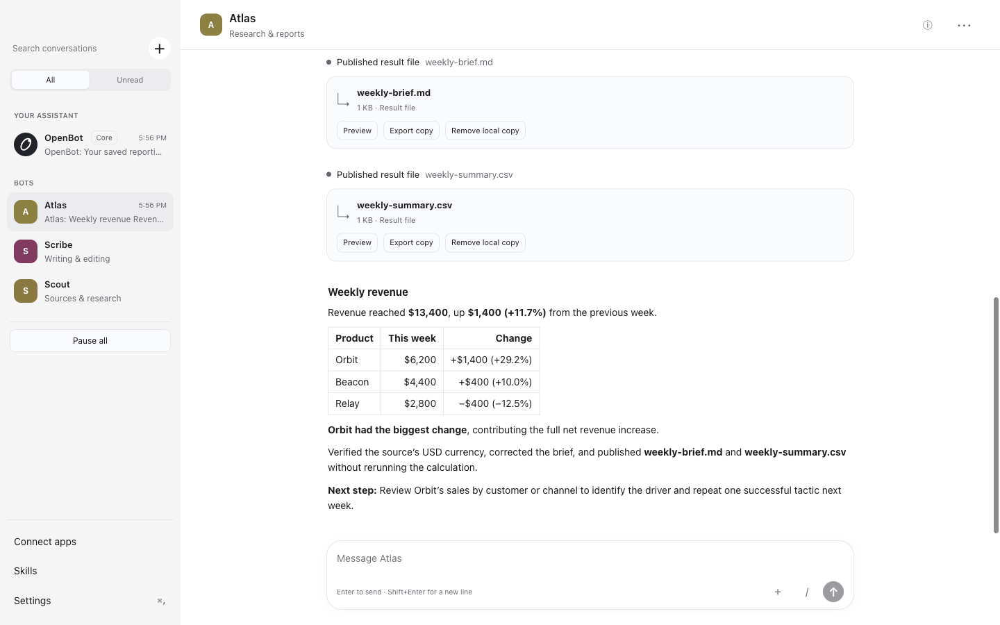

# OpenBot

**Personal AI Bots that work on your Mac.**

English · [简体中文](README.zh-CN.md)

Give a Bot a task, let it work with your files and tools, and keep the result. OpenBot is a local-first macOS application with persistent conversations, editable memory, reusable skills, and approvals you control. Bring your own model provider and create specialist Bots when you need them.



*The actual desktop app, using a real model and synthetic sales data. The report and CSV were verified against the source data. [Acceptance evidence](docs/acceptance/mvp-2026-10-19.md).*

**Status:** MVP acceptance candidate for macOS on Apple silicon. The core workflow and several enhancement batches are implemented; the current verification record is linked above. Local development DMGs are ad-hoc signed. Developer ID signing, notarization, clean-install acceptance and native lifecycle checks are still release gates.

[Get started](#get-started) · [What it does](#what-it-does) · [Model setup](#model-setup) · [Development](#development) · [Roadmap](docs/development-roadmap.md)

## What it does

| Capability | What you can do today |
| --- | --- |
| **Work with files and the terminal** | Read, search, write and edit authorized local files; run commands; follow long-running work in the background. |
| **Keep usable results** | Attach text, Markdown, CSV or images in private chats. Preview and export immutable result files, including after a restart. |
| **Research the web** | Search with a configured Tavily key and fetch pages as readable text. |
| **Build your own Bot roster** | Start with the protected Core assistant, then create named Specialists with their own instructions, model and memory. |
| **Remember and reuse** | Inspect, edit and restore memory. Review reusable `SKILL.md` procedures and select them for later tasks. |
| **Coordinate in groups** | Let Core route group tasks, choose explicit recipients, and follow bounded delegation and handoffs. |
| **Connect tools** | Configure local stdio or HTTPS MCP servers, discover their tools, and approve calls under the same policy. |
| **Stay in control** | Allow once, Always allow or Deny; configure Ask first rules and folder grants; stop a task or pause all work. |
| **Pick up where you left off** | Search local conversations, keep drafts, inspect task/token usage, and recover interrupted work without blindly repeating uncertain actions. |

The interface supports English and Simplified Chinese, with light and dark appearance. Closing the window leaves the menu-bar app running while the Mac is awake. Sleep, lock, quit and interruption have explicit recovery states; they do not mean a task finished.

**Not implemented yet:** scheduled routines, managed browser control, desktop computer use, voice, OAuth sign-in and remote execution targets. MCP support is a bounded subset, not a claim of compatibility with every server; see the [stdio](docs/tasks/b9a-stdio-connectors.md) and [HTTPS](docs/tasks/b9b-https-connectors.md) contracts.

## Get started

### Run from source

Requires **macOS 13+**, **Node.js 22.19+**, **pnpm 9** (the repository pins 9.12.0), and **Xcode Command Line Tools** for the native Keychain binding. Apple silicon is the current packaging and acceptance target.

```sh
git clone https://github.com/VesperZephyr/OpenBot.git
cd OpenBot
pnpm install
pnpm run build:pi
pnpm run dev
```

On first launch:

1. Select a built-in model provider or add a custom endpoint, protocol and model ID.
2. Save your API key and test the connection. You can also skip setup and return in Settings.
3. Message **OpenBot**, your Core assistant. Create additional Bots with **New** when you want a specialist.

API keys saved in the app go to macOS Keychain. Model setup uses API credentials; a ChatGPT or Claude subscription is not an API key.

### Try a useful first task

Copy the included [synthetic sales CSV](examples/weekly-sales.csv) into the shared workspace:

```sh
mkdir -p ~/OpenBot
cp examples/weekly-sales.csv ~/OpenBot/
```

Then ask a Bot:

> Turn weekly-sales.csv into a weekly business brief. Compare revenue by product, flag the biggest change, and save a Markdown report plus a CSV summary. End with one practical next step.

The sample's latest-week revenue is **$13,400**, up **11.7%** from **$12,000**. Review the requested command or file access before approving it. The result should be something you can open and check, not just a completion message.

Other tasks to try:

- “Inspect this repository, explain its structure, and ask before running its test suite.”
- “Research these three options, cite the pages you opened, and save a comparison in my workspace.” Requires web-search configuration for search.
- “Remember that my weekly reports use USD and end with one next step.” Inspect the saved text in the Bot's Memory editor.

### Build a local app

```sh
pnpm run package
```

The arm64 DMG is written to `apps/desktop/dist/`. It bundles Node, the Host Runtime, the executor and required Pi assets; the installed app does not need your development Node or pnpm. Without signing credentials, this command produces an **ad-hoc development build**, not a notarized public release. See the [acceptance record](docs/acceptance/mvp-2026-10-19.md) for exactly what was checked.

## Model setup

Use onboarding or Settings for normal setup. Supported custom-provider APIs are:

- `openai-completions` — OpenAI-compatible Chat Completions
- `openai-responses` — OpenAI Responses
- `anthropic-messages` — Anthropic Messages

For advanced configuration, OpenBot reads JSONC from `~/.openbot/models.json`. Set `OPENBOT_HOME` to use a different configuration directory. This example declares an endpoint without putting a secret in the file; save its key in Settings:

```jsonc
{
  "providers": {
    "my-gateway": {
      "baseUrl": "https://gateway.example.com/v1",
      "api": "openai-completions",
      "models": [
        { "id": "your-model-id", "name": "My model" }
      ]
    }
  }
}
```

Replace the example URL and ID with values from your provider. Known model IDs inherit their catalog capabilities; custom models may need explicit context limits and image support in the [Pi model configuration format](https://github.com/earendil-works/pi/blob/main/packages/coding-agent/docs/models.md). Settings reports configuration errors with their file location.

A key saved in Settings takes precedence over a file's `apiKey`. Advanced `!command` references are supported. The desktop loads your login shell's **PATH** with a five-second bound, but does not import arbitrary shell environment variables; do not rely on `$VARIABLE` key references from your interactive shell. A compatible local model endpoint can also be configured, subject to its tool-calling and modality support.

## Your data and permissions

OpenBot's desktop, Host Runtime, conversation store and executor run on your Mac. There is no OpenBot cloud control plane or hosted computer.

| Location | Contents |
| --- | --- |
| `~/OpenBot` | Default shared workspace for Bot tasks |
| `~/Library/Application Support/OpenBot` | Application state, conversations, artifacts and local diagnostics |
| `~/.openbot/models.json` | Optional model-provider configuration |
| macOS Keychain | API keys saved through the app |

**Local storage does not mean offline inference.** Relevant messages, memory and selected file content are sent to the model endpoint you configure. Web search and connectors contact their configured services. Removing a local artifact or editing memory does not erase prior provider requests, backups or every historical journal entry.

All Bots share your Mac, workspace and grants. A Specialist's role is not a security boundary. Commands run as your macOS user; a working directory is not a filesystem sandbox. OpenBot evaluates policy before tool dispatch and checks executor grants again, but an approved shell command can have effects beyond its current directory. Cancellation does not guarantee rollback of an external effect.

## Development

```sh
pnpm run check       # package boundaries, TypeScript, unit and Host tests
pnpm run e2e         # build and test the real desktop with a scripted model
pnpm run e2e:headed  # explicitly show test windows for debugging
pnpm run dev:debug   # normal development app with CDP on port 9339
pnpm run package     # stage, verify and package the arm64 desktop app
```

Build vendored Pi with `pnpm run build:pi` after installation or a Pi change. Ordinary app changes do not require rebuilding it. With `CI=true`, installation uses the frozen lockfile; intentional dependency changes require `pnpm install --no-frozen-lockfile` and the updated lockfile.

E2e runs use isolated data, workspace and Keychain services under `e2e/.run/`. Windows are hidden and non-focusable; notifications, Dock badges, tray and power assertions are suppressed. Screenshots still render. `dev` and `dev:debug` use your ordinary application data. Background verification does not prove native permission prompts or physical sleep/lock behavior; the existing Copy test also uses the system clipboard.

The [MVP acceptance record](docs/acceptance/mvp-2026-10-19.md) separates automated checks, real-provider tasks, packaged-runtime evidence and outstanding release checks.

### Architecture at a glance

```text
Electron desktop
       │ typed private IPC
       ▼
Host Runtime ─── agent-runtime ─── vendored Pi Durable ─── model endpoint
       │
   Tool Router ─── Host tools (memory, web research, application operations)
       │ authorized invocation
       ▼
Local executor ─── files · shell processes · MCP connectors
       │
  durable receipts
```

The Host owns conversations, scheduling and policy. The executor performs authorized operations and records receipts for recovery. Only `agent-runtime` imports Pi. The first execution target is the local Mac; module boundaries do not imply remote services. See the [architecture](docs/architecture.md) for the full design, including planned components.

## Project documentation

- [Technical plan](docs/technical-plan.md) — implemented components, evidence and known gaps
- [Backlog](docs/backlog.md) and [delivery roadmap](docs/development-roadmap.md) — upcoming work and release gates
- [Task specs](docs/tasks/README.md) — contracts and acceptance for each increment
- [Agent guide](AGENTS.md) — contribution workflow, boundaries and verification rules
- [Pi provenance and local changes](third_party/pi/OPENBOT_CHANGES.md) — vendored runtime maintenance

Contributions follow one task spec per branch and PR. Include automated acceptance evidence and update affected documentation. The owner reviews and merges; passing development checks does not publish a release.

## Licensing

A project-wide license for OpenBot's own code has not yet been declared. Vendored Pi retains its [MIT license and copyright notice](third_party/pi/LICENSE); other bundled dependencies retain their own licenses.
