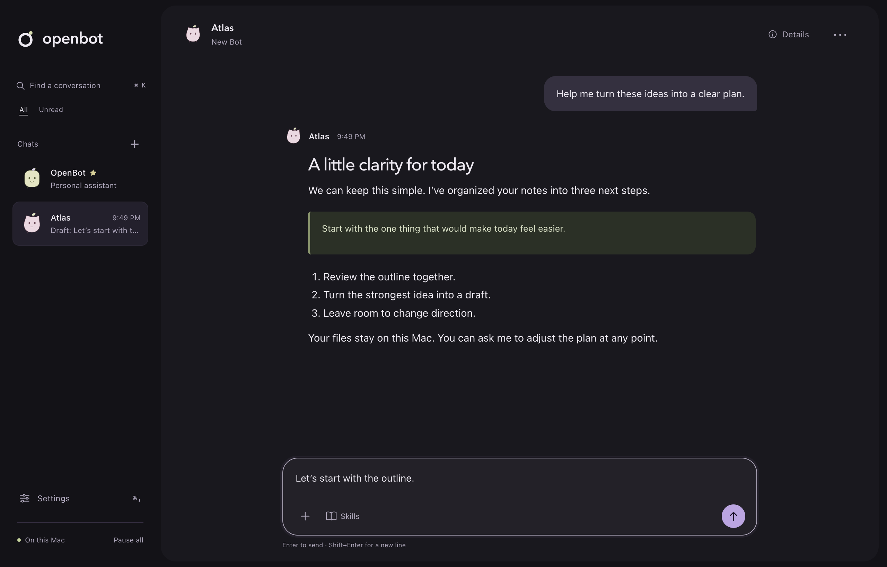
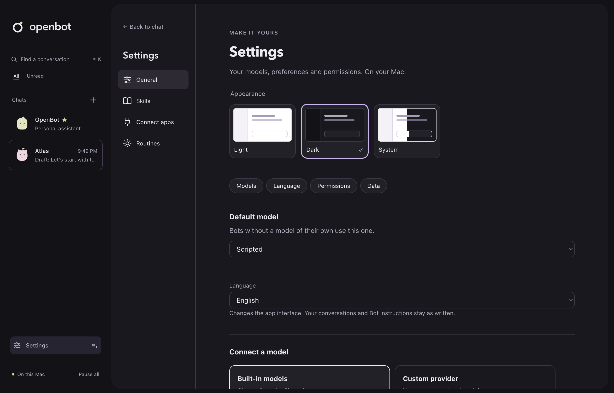

# OpenBot

**A personal assistant with the tools to get things done on your Mac.**

English · [简体中文](README.zh-CN.md)

Think **Grok Bot + Codex, in a personal desktop app**. OpenBot pairs approachable, ongoing conversations with an agent that can inspect a codebase, edit files, run commands, research the web and work through connected tools.

OpenBot is currently built for **one person on one Mac**. Give your Bots names, appearances and roles, keep their conversations and memories, and use them for everyday work as well as software projects. The application and its execution tools run on your Mac; you choose the model provider.


*The production desktop interface with sample conversation data from isolated automated tests. [Design and verification](docs/tasks/d6-desktop-design.md).*

<details>
<summary>See the welcome screen and Bot profile editor</summary>


</details>

**Status:** MVP acceptance candidate for macOS on Apple silicon. The core workflow and several enhancement batches are implemented; the desktop design verification is linked above, alongside separate [MVP release evidence](docs/acceptance/mvp-2026-10-19.md). Local development DMGs are ad-hoc signed. Developer ID signing, notarization, clean-install acceptance and native lifecycle checks are still release gates.

[Get started](#get-started) · [What it does](#what-it-does) · [Model setup](#model-setup) · [Development](#development) · [Roadmap](docs/development-roadmap.md)

## What it does

| Capability | What you can do today |
| --- | --- |
| **Work with files and the terminal** | Read, search, write and edit authorized local files; run commands; follow long-running work in the background. |
| **Keep usable results** | Attach text, Markdown, CSV or images in private chats. Click result filenames in the chat to read formatted Markdown, HTML pages, PDF, images or CSV in resizable right-hand tabs alongside web pages while continuing the conversation; export saved copies after a restart. |
| **Research the web** | Search with a configured Tavily key; read pages and official Atom/RSS feeds, retaining full-page date/version context when needed. |
| **Personalize every Bot** | Choose names, roles, instructions and generated or uploaded avatars. A small star identifies your permanent personal assistant; Specialists can use their own model and memory. |
| **Reuse Bot templates** | Export a profile as a local `.openbot.json` file and import it as a new Specialist. Review model and exact skill choices; memory, chats, credentials and permissions stay out of the file. |
| **Remember and reuse** | Inspect where notes came from, correct or forget them, explicitly share useful context, and pin reviewed `SKILL.md` procedures to a Bot. |
| **Schedule repeatable work** | Review interval, daily or weekly routines, pin skill versions, test them and receive reports in private chat or a confirmed group. Compose selected reports into an automatic daily summary, with bounded waiting and clear missing inputs. |
| **Coordinate in groups** | Let your personal assistant route group tasks, choose explicit recipients, and follow bounded delegation and handoffs. |
| **Connect tools** | Configure local stdio or HTTPS MCP servers, discover their tools, and approve calls under the same policy. |
| **Stay in control** | Allow once, Always allow or Deny; configure Ask first rules and folder grants; stop a task or pause all work. |
| **Pick up where you left off** | Search local conversations, keep drafts, inspect task/token usage, and recover interrupted work without blindly repeating uncertain actions. |

The interface supports English and Simplified Chinese, with light and dark appearance. Closing the window leaves the menu-bar app running while the Mac is awake. Sleep, lock, quit and interruption have explicit recovery states; they do not mean a task finished.

**Not implemented yet:** managed browser control, desktop computer use, voice, OAuth sign-in and remote execution targets. MCP support is a bounded subset, not a claim of compatibility with every server; see the [stdio](docs/tasks/b9a-stdio-connectors.md) and [HTTPS](docs/tasks/b9b-https-connectors.md) contracts.

## Get started

### Run from source

Requires **macOS 13+**, **Node.js 22.19+**, **pnpm 9** (the repository pins 9.12.0), and **Xcode Command Line Tools** for the native Keychain binding. Apple silicon is the current packaging and acceptance target.

```sh
git clone https://github.com/VesperZephyr/OpenBot.git
cd OpenBot
pnpm install
pnpm run build:pi
pnpm run dev
```

Run from the checkout you intend to use. When switching between checkouts or an installed build, fully quit the running OpenBot first: its single-instance behavior can otherwise reopen the existing app.

After pulling updates, run `pnpm install --frozen-lockfile` to synchronize dependencies before starting. Run `pnpm run build:pi` if the vendored runtime changed.

On first launch:

1. Select a built-in model provider or add a custom endpoint, protocol and model ID.
2. Save your API key and test the connection. You can also skip setup and return in Settings.
3. Message **OpenBot**, your personal assistant marked with a star. Create additional Bots with **New** when you want a specialist.

API keys saved in the app go to macOS Keychain. Model setup uses API credentials; a ChatGPT or Claude subscription is not an API key.

### Make your assistant your own

Open a Bot's **Details → Profile** to change its name, short description, instructions and avatar. **Generate options** creates original character choices locally; **Upload image** accepts PNG, JPEG or WebP and previews a centered crop. Changes take effect only when you save the profile. Renaming a Bot keeps its chosen avatar, conversation and memory.

Your starred personal assistant can be customized like every other Bot and cannot be deleted. Use the **Memory** tab to inspect and edit remembered information, or expand **Model and skills** to choose how a Bot works.

To reuse a profile, choose **Export template** from the Bot menu, review the included instructions and save to a new filename. Choose **New → Import template** to review a file, resolve missing models or skills and create a fresh Specialist. Templates include avatar artwork and skill references; they do not install skills or copy private history or permissions. Instructions are exported as written, so review any personal information you entered there.

The chat canvas defaults to white, independently of macOS appearance. Choose **Settings → General → Appearance** for Light, Dark or System, with visual previews. Dark uses a charcoal canvas, raised surfaces and lavender actions; Light uses pale navigation, a white canvas, dark text and plum accents throughout. **Skills**, **Connect apps** and **Routines** live inside Settings; **Back to chat** returns to your conversation with its draft intact.

While a Bot works, the composer shows a stop button. Type a follow-up to guide the current task, or use **Shift+Enter** for a new line. **Pause all** stops active work across Bots and retains queued messages. **Resume work** releases that queue; a settled interrupted private task also offers **Resume and continue**, which reopens work and asks the Bot to inspect saved results before continuing. Already completed actions are not undone.

<details>
<summary>See dark appearance and theme preferences</summary>





</details>

### Try a useful first task

Copy the included [synthetic sales CSV](examples/weekly-sales.csv) into the shared workspace:

```sh
mkdir -p ~/OpenBot
cp examples/weekly-sales.csv ~/OpenBot/
```

Then ask a Bot:

> Turn weekly-sales.csv into a weekly business brief. Compare revenue by product, flag the biggest change, and save a Markdown report plus a CSV summary. End with one practical next step.

The sample's latest-week revenue is **$13,400**, up **11.7%** from **$12,000**. Review the requested command or file access before approving it. The result should be something you can open and check, not just a completion message.

Other tasks to try:

- “Inspect this repository, explain its structure, and ask before running its test suite.”
- “Research these three options, cite the pages you opened, and save a comparison in my workspace.” Requires web-search configuration for search.
- “Remember that my weekly reports use USD and end with one next step.” Inspect the saved text in the Bot's Memory editor.

### Schedule a trusted workflow

Ask a Bot in chat to schedule recurring work. The AI prepares a routine card; review and confirm it before the schedule starts. Open **Conversation details → Routines** to view tasks, switch them on or off, and open their history. The existing **Settings → Routines** editor also supports manual configuration: choose a Bot and describe the source files, steps and expected output. Review the schedule and pinned skill versions before confirming. **Test run** performs real work with the same permissions and ten-minute unattended approval expiry. Choose the Bot's private chat or a group containing that Bot as the report destination; execution details and the latest 20 finished runs stay in the panel.

**Conversation details → Library** collects files published by that Bot, including routine results. Search, preview, export a copy or remove the saved local copy. Uploaded attachments and older files without Bot provenance remain in **Files → Shared files**.

OpenBot must be running and the Mac awake. After sleep or restart, at most one eligible missed run is caught up; overlapping work is skipped. Seven days without interaction pauses scheduling until you explicitly resume. Both the catch-up window and inactivity limit are configurable. [Routine contract and verification](docs/tasks/b11a-local-routines.md).

For a competitor radar, create Domestic Hunter and International Hunter and put them in a group with your existing main assistant. Use **Conversation details → New group routine** for each researcher, then create a daily main-assistant routine with both tasks selected in **Report inputs**. After one-time confirmation, reports and their summary arrive automatically without a daily message. The application waits for late inputs, identifies missing sources and preserves the exact reports used. Source or group changes require reconfirmation. Bots, monitored products and comparison criteria are your configuration; scheduling and report composition are reusable application capabilities. The [competitor radar workflow](docs/workflows/competitor-radar.md) includes sources, schedules and setup instructions.

The [integrated workflow acceptance](docs/acceptance/workflow-2026-10-20.md) exercises CRM records, reports, exact approvals, reviewed skills and routine reuse, including restart, rate limits and uncertain writes. Its evidence separates automated checks, a real-model trial and the live-retrieval limitation.

### Build a local app

```sh
pnpm run package
```

The arm64 DMG is written to `apps/desktop/dist/`. It bundles Node, the Host Runtime, the executor and required Pi assets; the installed app does not need your development Node or pnpm. Without signing credentials, this command produces an **ad-hoc development build**, not a notarized public release. See the [acceptance record](docs/acceptance/mvp-2026-10-19.md) for exactly what was checked.

## Model setup

Use onboarding or Settings for normal setup. Supported custom-provider APIs are:

- `openai-completions` — OpenAI-compatible Chat Completions
- `openai-responses` — OpenAI Responses
- `anthropic-messages` — Anthropic Messages

For advanced configuration, OpenBot reads JSONC from `~/.openbot/models.json`. Set `OPENBOT_HOME` to use a different configuration directory. This example declares an endpoint without putting a secret in the file; save its key in Settings:

```jsonc
{
  "providers": {
    "my-gateway": {
      "baseUrl": "https://gateway.example.com/v1",
      "api": "openai-completions",
      "models": [
        { "id": "your-model-id", "name": "My model" }
      ]
    }
  }
}
```

Replace the example URL and ID with values from your provider. Known model IDs inherit their catalog capabilities; custom models may need explicit context limits and image support in the [Pi model configuration format](https://github.com/earendil-works/pi/blob/main/packages/coding-agent/docs/models.md). Settings reports configuration errors with their file location.

A key saved in Settings takes precedence over a file's `apiKey`. Advanced `!command` references are supported. The desktop loads your login shell's **PATH** with a five-second bound, but does not import arbitrary shell environment variables; do not rely on `$VARIABLE` key references from your interactive shell. A compatible local model endpoint can also be configured, subject to its tool-calling and modality support.

## Your data and permissions

OpenBot's desktop, Host Runtime, conversation store and executor run on your Mac. There is no OpenBot cloud control plane or hosted computer.

| Location | Contents |
| --- | --- |
| `~/OpenBot` | Default shared workspace for Bot tasks |
| `~/Library/Application Support/OpenBot` | Application state, conversations, artifacts and local diagnostics |
| `~/.openbot/models.json` | Optional model-provider configuration |
| macOS Keychain | API keys saved through the app |

**Backup and restore:** Settings → General can save a local snapshot of conversations, memory, schedules, saved attachments, skills and execution records. Backups are unencrypted and restore only on the same Mac/account. The app pauses work, validates the selected snapshot and saves a recovery copy before replacing data; work stays paused afterward. Model credentials/configuration, browser profiles, logs and original workspace files are excluded. See the [backup contract](docs/tasks/b14d-backup-restore.md) for limits.

**Local storage does not mean offline inference.** Relevant messages, memory and selected file content are sent to the model endpoint you configure. Web search and connectors contact their configured services. Removing a local artifact or editing memory does not erase prior provider requests, backups or every historical journal entry.

All Bots share your Mac, workspace and grants. A Specialist's role is not a security boundary. Commands run as your macOS user; a working directory is not a filesystem sandbox. OpenBot evaluates policy before tool dispatch and checks executor grants again, but an approved shell command can have effects beyond its current directory. Cancellation does not guarantee rollback of an external effect.

## Development

```sh
pnpm run check       # package boundaries, TypeScript, unit and Host tests
pnpm run e2e         # build and test the real desktop with a scripted model
pnpm run e2e:headed  # explicitly show test windows for debugging
pnpm run dev:debug   # normal development app with CDP on port 9339
pnpm run package     # stage, verify and package the arm64 desktop app
```

Build vendored Pi with `pnpm run build:pi` after installation or a Pi change. Ordinary app changes do not require rebuilding it. With `CI=true`, installation uses the frozen lockfile; intentional dependency changes require `pnpm install --no-frozen-lockfile` and the updated lockfile.

E2e runs use isolated data, workspace and Keychain services under `e2e/.run/`. Windows are hidden and non-focusable; notifications, Dock badges, tray and power assertions are suppressed. Screenshots still render. Up to two suites run concurrently in background mode; cases within a suite and headed runs stay sequential. File/case timings are saved to `e2e/.run/results.json` and uploaded with CI screenshots. `dev` and `dev:debug` use your ordinary application data. Background verification does not prove native permission prompts or physical sleep/lock behavior; the existing Copy test also uses the system clipboard.

The [MVP acceptance record](docs/acceptance/mvp-2026-10-19.md) separates automated checks, real-provider tasks, packaged-runtime evidence and outstanding release checks.

### Architecture at a glance

```text
Electron desktop
       │ typed private IPC
       ▼
Host Runtime ─── agent-runtime ─── vendored Pi Durable ─── model endpoint
       │
   Tool Router ─── Host tools (memory, web research, application operations)
       │ authorized invocation
       ▼
Local executor ─── files · shell processes · MCP connectors
       │
  durable receipts
```

The Host owns conversations, scheduling and policy. The executor performs authorized operations and records receipts for recovery. Only `agent-runtime` imports Pi. The first execution target is the local Mac; module boundaries do not imply remote services. See the [architecture](docs/architecture.md) for the full design, including planned components.

## Project documentation

- [Technical constraints](docs/technical-plan.md) — known gaps, pitfalls, compatibility and open decisions
- [Backlog](docs/backlog.md) and [delivery roadmap](docs/development-roadmap.md) — active queue, planning rationale and release gates
- [Task specs](docs/tasks/README.md) — task status, contracts and acceptance evidence
- [Agent guide](AGENTS.md) — contribution workflow, boundaries and verification rules
- [Pi provenance and local changes](third_party/pi/OPENBOT_CHANGES.md) — vendored runtime maintenance

Contributions follow one task spec per branch and PR. Include automated acceptance evidence and update affected documentation. The owner reviews and merges; passing development checks does not publish a release.

## Licensing

A project-wide license for OpenBot's own code has not yet been declared. Vendored Pi retains its [MIT license and copyright notice](third_party/pi/LICENSE); other bundled dependencies retain their own licenses.
