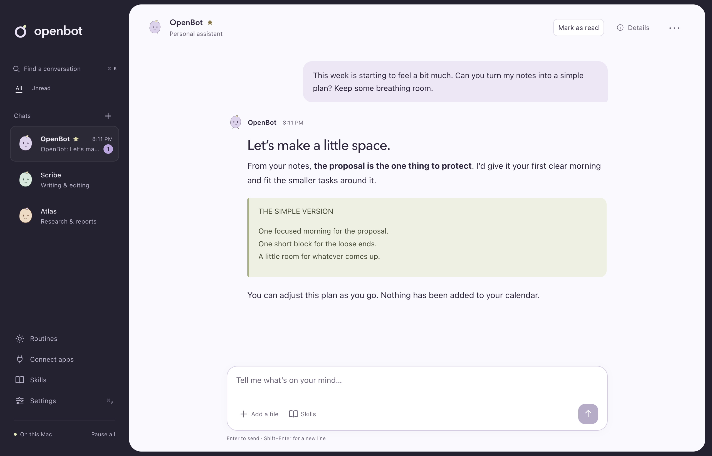
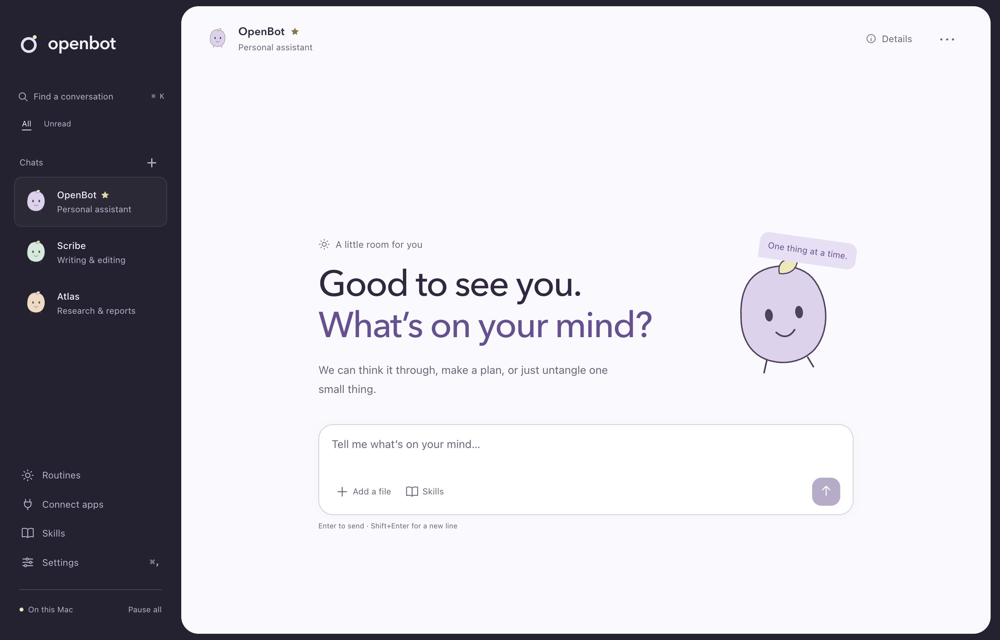
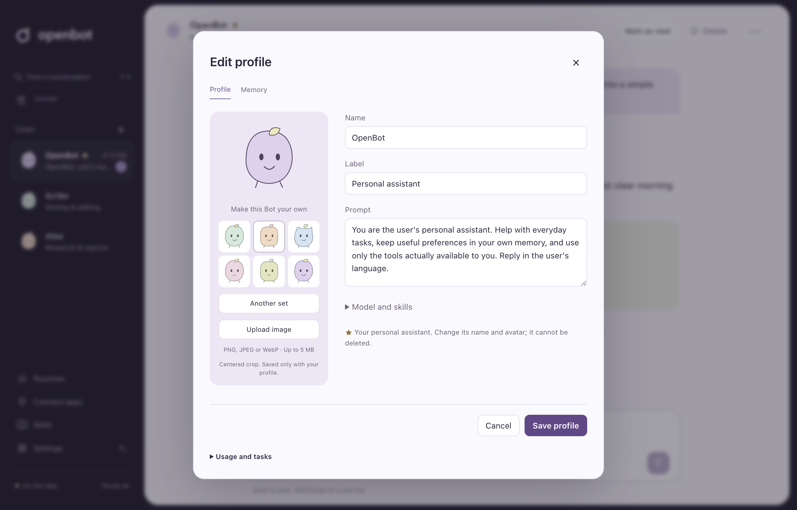

# OpenBot

**有私人助理的亲近感，也能在你的 Mac 上动手完成工作。**

[English](README.md) · 简体中文

可以把 OpenBot 理解为一个面向个人的 **Grok Bot + Codex**：既能持续聊天、陪你梳理想法，也能检查代码仓库、修改文件、执行命令、研究网页和调用连接的工具。

OpenBot 目前服务于**一个人、一台 Mac**。你可以为每个 Bot 设置名字、外观和职责，保留各自的对话与记忆，让它们帮助处理日常事务和软件项目。应用与执行工具运行在你的 Mac 上，模型服务由你选择。



*正式桌面应用截图，使用隔离自动化测试中的示例对话数据。[设计与验证记录](docs/tasks/d6-desktop-design.md)。*

<details>
<summary>查看欢迎界面与 Bot 资料编辑器</summary>





</details>

**当前状态：**面向 Apple 芯片 Mac 的 MVP 验收候选版本。核心工作流及部分增强功能已经实现，新版界面验证见上方记录，发布验证另见 [MVP 验收记录](docs/acceptance/mvp-2026-10-19.md)。本地开发 DMG 使用临时签名；Developer ID 签名、公证、全新环境安装验收和原生生命周期验证仍是正式发布前的关卡。

[快速开始](#快速开始) · [现在能做什么](#现在能做什么) · [模型配置](#模型配置) · [开发与测试](#开发与测试) · [路线图](docs/development-roadmap.md)

## 现在能做什么

| 能力 | 当前可用的工作方式 |
| --- | --- |
| **文件与终端** | 读取、搜索、写入和编辑已授权的本地文件，执行命令，跟踪后台长任务。 |
| **可保存的任务成果** | 在私聊中附加文本、Markdown、CSV 或图片；预览和导出保存的结果文件，重启后仍可使用。 |
| **网页研究** | 配置 Tavily 密钥后搜索网页，抓取页面并读取正文。 |
| **每个 Bot 都能自定义** | 设置名字、职责、指令，以及生成或上传的头像。小星标标识常驻的私人助理，其他专属 Bot 可以使用各自的模型和记忆。 |
| **记忆与技能复用** | 查看记忆来源、纠正或忘记内容，明确选择要共享的信息，并为 Bot 固定审核过的 `SKILL.md` 操作流程。 |
| **定时重复工作** | 确认固定间隔、每天或每周的任务，固定技能版本，测试运行并在聊天中收到报告；支持暂停、补跑和离线保护。 |
| **群聊协作** | 由私人助理分派群聊任务，也可明确指定接收者，跟踪有范围和次数限制的委派与交接。 |
| **连接外部工具** | 配置本地 stdio 或 HTTPS MCP 服务，发现工具，并通过统一策略审批调用。 |
| **操作控制** | 选择仅允许一次、始终允许或拒绝；设置“先询问”规则和文件夹授权；停止任务或暂停全部工作。 |
| **继续未完成的工作** | 搜索本地对话、保留草稿、查看任务与 Token 用量；对结果不确定的操作进行恢复处理，避免盲目重试。 |

界面支持英文、简体中文和浅色、深色外观。关闭窗口后，菜单栏应用会在 Mac 保持唤醒时继续运行。睡眠、锁屏、退出和中断有明确的恢复状态，并不代表任务已经完成。

**尚未实现：**托管浏览器控制、桌面电脑操作、语音、OAuth 登录和远程执行目标。MCP 实现支持有明确范围的协议子集，不保证兼容所有服务；详见 [stdio](docs/tasks/b9a-stdio-connectors.md) 和 [HTTPS](docs/tasks/b9b-https-connectors.md) 任务契约。

## 快速开始

### 从源码运行

需要 **macOS 13+**、**Node.js 22.19+**、**pnpm 9**（仓库固定为 9.12.0），以及用于编译原生钥匙串模块的 **Xcode Command Line Tools**。当前打包和验收目标为 Apple 芯片 Mac。

```sh
git clone https://github.com/VesperZephyr/OpenBot.git
cd OpenBot
pnpm install
pnpm run build:pi
pnpm run dev
```

请从你要使用的那份代码目录启动。切换工作目录或已安装版本前，先完全退出正在运行的 OpenBot；否则单实例机制可能重新打开原来的应用。

首次启动时：

1. 选择内置模型服务商，或添加自定义地址、协议和模型 ID。
2. 保存 API 密钥并测试连接。也可以跳过设置，稍后在“设置”中完成。
3. 向带有小星标的私人助理 **OpenBot** 发送消息。需要专属助手时，再通过“新建”创建 Bot。

在应用中保存的 API 密钥由 macOS 钥匙串保管。模型配置使用 API 凭据；ChatGPT 或 Claude 的订阅并不等于 API 密钥。

### 让助理更像你的伙伴

打开 Bot 的**详情 → 资料**，修改名字、简短说明、指令和头像。**生成头像**会在本地生成原创角色供你选择；**上传图片**支持 PNG、JPEG 和 WebP，并提供居中裁剪预览。点击保存后修改才会生效。改名会保留原来的头像、对话和记忆。

带星标的私人助理和其他 Bot 一样可以自定义，但不能删除。通过**记忆**标签查看和编辑已记住的信息，展开**模型与技能**设置 Bot 的工作方式。

### 试一个有用的任务

把仓库内的[虚构销售数据](examples/weekly-sales.csv)复制到共享工作目录：

```sh
mkdir -p ~/OpenBot
cp examples/weekly-sales.csv ~/OpenBot/
```

然后告诉 Bot：

> 把 weekly-sales.csv 整理成一份每周业务简报。按产品对比营收，指出最大的变化，保存一份 Markdown 报告和一份 CSV 汇总。最后给出一项具体的后续行动建议。

示例中最新一周的营收为 **13,400 美元**，比上一周的 **12,000 美元**增长 **11.7%**。批准前请查看具体命令或文件访问请求。任务结果应当是可以打开并核对的文件，而不只是“已完成”的回复。

也可以尝试：

- “检查这个仓库，解释它的结构，在运行测试前先征求我的同意。”
- “研究这三个选项，引用实际打开过的页面，并把比较报告保存在工作目录中。”使用搜索需要先配置网页搜索服务。
- “记住：我的周报使用美元，最后只给一项后续行动建议。”可以在 Bot 的记忆编辑器中查看保存的内容。

### 把验证过的流程设为定时任务

打开**定时任务**，选择 Bot，描述源文件、操作步骤和预期结果。确认执行时间和固定的技能版本后保存。**测试运行**会执行真实操作，沿用相同权限和十分钟无人值守审批有效期。报告回到 Bot 的聊天中；执行详情及最近 20 次完成记录保留在任务面板。

OpenBot 必须保持运行，Mac 需要处于唤醒状态。睡眠或重启后，最多补跑一次符合条件的任务；上次运行尚未完成时跳过新的执行。连续七天没有交互会暂停调度，直到你明确恢复。补跑窗口和离线保护期限均可配置。[任务契约与验证](docs/tasks/b11a-local-routines.md)。

[集成工作流验收](docs/acceptance/workflow-2026-10-20.md)覆盖 CRM 记录、报告、精确审批、审核过的技能和定时复用，并验证重启、限流及结果不确定的写入。记录区分了自动化检查、真实模型试验和公网资料抓取的限制。

### 构建本地应用

```sh
pnpm run package
```

arm64 DMG 会输出到 `apps/desktop/dist/`。安装包包含 Node、Host Runtime、执行器和必要的 Pi 资源，安装后不依赖开发环境的 Node 或 pnpm。未配置签名凭据时，这条命令生成的是**临时签名的开发构建**，并非经过公证的公开发布版。已验证的具体范围见[验收记录](docs/acceptance/mvp-2026-10-19.md)。

## 模型配置

通常使用首次启动向导或“设置”即可。自定义服务支持以下 API：

- `openai-completions`：兼容 OpenAI 的 Chat Completions
- `openai-responses`：OpenAI Responses
- `anthropic-messages`：Anthropic Messages

高级配置从 `~/.openbot/models.json` 读取，支持 JSONC。可通过 `OPENBOT_HOME` 指定其他配置目录。下面的示例只声明地址，不把密钥写入文件；请在“设置”中保存密钥：

```jsonc
{
  "providers": {
    "my-gateway": {
      "baseUrl": "https://gateway.example.com/v1",
      "api": "openai-completions",
      "models": [
        { "id": "your-model-id", "name": "My model" }
      ]
    }
  }
}
```

请将示例地址和 ID 替换为服务商提供的实际值。已知模型 ID 会继承模型目录中的能力信息；自定义模型可能需要按 [Pi 模型配置格式](https://github.com/earendil-works/pi/blob/main/packages/coding-agent/docs/models.md)声明上下文限制和图片支持。配置错误会在“设置”中显示，并标明文件位置。

在“设置”中保存的密钥优先于文件中的 `apiKey`。高级用法支持 `!command` 凭据引用。桌面端会在五秒限制内读取登录 shell 的 **PATH**，但不会导入任意 shell 环境变量，因此不要依赖交互式 shell 中的 `$VARIABLE` 密钥引用。也可以配置兼容的本地模型服务，实际可用能力取决于其工具调用和输入模态支持。

## 数据与权限

OpenBot 的桌面界面、Host Runtime、对话存储和执行器都运行在你的 Mac 上，没有 OpenBot 云端控制服务或托管电脑。

| 位置 | 内容 |
| --- | --- |
| `~/OpenBot` | Bot 任务默认使用的共享工作目录 |
| `~/Library/Application Support/OpenBot` | 应用状态、对话、结果文件和本地诊断信息 |
| `~/.openbot/models.json` | 可选的模型服务配置 |
| macOS 钥匙串 | 通过应用保存的 API 密钥 |

**本地存储不等于离线推理。**相关消息、记忆和选定的文件内容会发送到你配置的模型服务。网页搜索和连接器会访问各自配置的服务。删除本地结果副本或编辑记忆，不会抹除此前发送给服务商的请求、备份或所有历史日志记录。

所有 Bot 共享你的 Mac、工作目录和授权。Bot 的角色设定不是安全隔离边界。命令以你的 macOS 用户身份运行，工作目录也不是文件系统沙箱。OpenBot 会在工具分发前检查策略，并由执行器再次检查授权；但获批的 shell 命令仍可能影响当前目录之外的内容。取消操作不保证撤销已经发生的外部影响。

## 开发与测试

```sh
pnpm run check       # 包边界检查、TypeScript、单元及 Host 测试
pnpm run e2e         # 构建真实桌面应用，使用脚本模型进行端到端测试
pnpm run e2e:headed  # 明确显示测试窗口，便于调试
pnpm run dev:debug   # 使用日常开发数据启动应用，CDP 端口为 9339
pnpm run package     # 准备运行时、验证并打包 arm64 桌面应用
```

安装依赖或修改 Pi 后，执行 `pnpm run build:pi`。普通应用修改不需要重新构建 Pi。设置 `CI=true` 时，安装会使用冻结的锁文件；有意更新依赖后，应执行 `pnpm install --no-frozen-lockfile` 并提交更新后的锁文件。

端到端测试的数据、工作目录和钥匙串服务相互隔离，测试文件保存在 `e2e/.run/`。测试窗口默认隐藏且不会获得焦点，通知、Dock 标记、菜单栏图标和电源断言均被抑制，仍然可以渲染截图。`dev` 和 `dev:debug` 使用日常应用数据。后台测试不能证明原生权限提示或实际睡眠、锁屏行为；现有的复制测试也会使用系统剪贴板。

[MVP 验收记录](docs/acceptance/mvp-2026-10-19.md)分别列出了自动化检查、真实模型任务、打包运行时证据以及待完成的发布检查。

### 架构概览

```text
Electron desktop
       │ typed private IPC
       ▼
Host Runtime ─── agent-runtime ─── vendored Pi Durable ─── model endpoint
       │
   Tool Router ─── Host tools (memory, web research, application operations)
       │ authorized invocation
       ▼
Local executor ─── files · shell processes · MCP connectors
       │
  durable receipts
```

Host 管理对话、调度和策略；执行器执行已授权的操作，并记录用于恢复的执行凭据。只有 `agent-runtime` 可以导入 Pi。首个执行目标是本机 Mac，模块边界不代表远程网络服务。包含规划中组件的完整设计见[架构文档](docs/architecture.md)。

## 项目资料

- [技术计划](docs/technical-plan.md)：已实现的组件、验证依据和已知缺口
- [待办清单](docs/backlog.md)与[交付路线图](docs/development-roadmap.md)：后续工作与发布关卡
- [任务规格](docs/tasks/README.md)：每个增量的契约与验收标准
- [Agent 指南](AGENTS.md)：贡献流程、边界和验证要求
- [Pi 来源与本地修改](third_party/pi/OPENBOT_CHANGES.md)：内置运行时的维护记录

贡献遵循一个任务规格对应一个分支和 PR 的流程。请提供自动化验收证据，并同步相关文档。仓库所有者负责审阅和合并，通过开发测试并不代表已经发布正式版本。

## 许可

OpenBot 自有代码尚未声明项目级许可证。仓库内的 Pi 保留其 [MIT 许可证及版权声明](third_party/pi/LICENSE)，其他内置依赖遵循各自的许可证。
