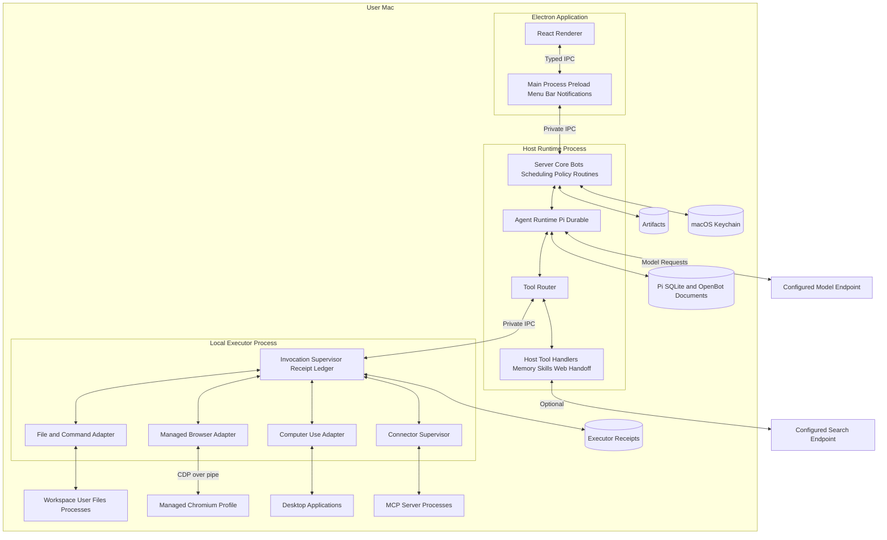
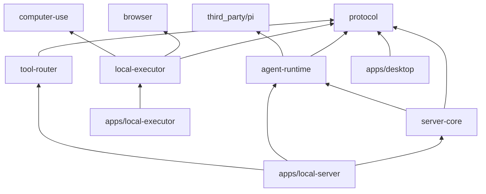
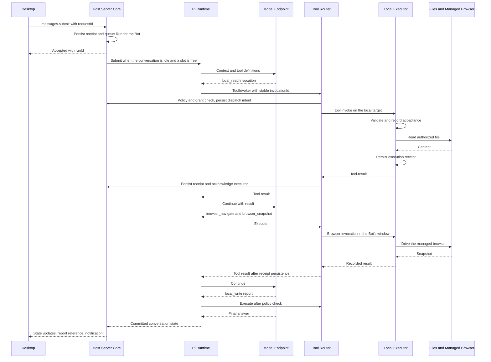

# OpenBot Architecture

Status: first-release design baseline. Last updated: 2026-10-15.

This document defines the target product shape, repository layout, module boundaries, interfaces, source dependencies, and development sequence. M0 is complete; the Host Runtime and a chat-only desktop shell exist ahead of their milestones. [The technical plan](technical-plan.md) tracks which parts are implemented and how each milestone is broken down; everything else below requires implementation and validation.

OpenBot is local-first. There is no cloud control plane and no cloud computer. The desktop UI, Host Runtime, Pi agent loop, storage, managed browser, and local executor all run on the user's Mac. Model inference and optional web search may call configurable API endpoints; that choice is separate from where OpenBot itself runs.

## 1. Product Goals and Runtime Scope

OpenBot gives one user a roster of persistent, named **Bots**: AI teammates with a role, instructions, memory, skills, and routines. The user messages a Bot with a task; the Bot works across files, the terminal, a browser, desktop applications, and connected services on the user's own Mac, keeps the user updated in the conversation, and stops for approval when an action needs it.

The product model follows Grok Bot's personal features, with every cloud component replaced by a local one. All Bots share the user's Mac as their computer.

| Grok Bot concept | OpenBot local equivalent |
| --- | --- |
| Persistent cloud computer per account | The user's Mac, shared by every Bot through the local executor |
| Shared browser sessions across Bots, one screen per Bot | One OpenBot-managed browser profile with shared logins; one browser window per Bot |
| `/workspace` shared files | A default shared workspace folder plus user-granted directories |
| Desktop and mobile clients with cloud sync | The macOS desktop application only |
| Work continues while the laptop is closed | Work continues while the window is closed and the Mac is awake; sleep suspends work and wake reconciles it |
| Connectors installed as plugins | MCP servers supervised by the local executor |
| Skills, teach-by-demonstration, routines | A local skill library, managed-browser recordings, and a local routine scheduler |
| Auto Review, Ask first / Allow automatically, takeover, secure secret requests | Local policy rules, an optional model reviewer, browser and desktop takeover, and Keychain-backed secret entry |
| Group chats and Bot-to-Bot handoff | Local group conversations and routed handoff messages between Bot conversations |

| Term | Meaning |
| --- | --- |
| Bot | A named profile (role, instructions, model, tool families, memory) with its own conversation; Bots are not a security boundary |
| Host | Owns Bots, conversations, the Pi Durable store, scheduling, approvals, policy, grants, routines, and tool routing |
| Executor | Performs authorized side effects on its bound target and keeps its own receipt ledger; never writes the Pi database |
| Target | The bound execution destination; the first release has exactly one: `{ kind: "local", targetId }`, this Mac |
| Grant | A user decision recorded as `(targetId, capability, scope, version)`; shared by all Bots |
| Policy rule | A persisted Ask first or Allow automatically rule evaluated before dispatch |
| Control lease | The exclusive, visible right for one Bot to send keyboard and mouse input to the real desktop, with an epoch |
| Skill | Reusable written instructions shared by all Bots |
| Routine | A Bot-owned schedule that runs a workflow without the user starting it |
| Connector | An MCP server that exposes structured tools for a service |

| Area | First-release decision |
| --- | --- |
| User and platform | One user on their own Mac; macOS first |
| Client | Electron + React, with a narrow preload API and a menu-bar presence |
| Host | A Host Runtime process managed by the desktop application (process composition lives in `apps/local-server`) |
| Agent | Pi Durable embedded in the Host through an OpenBot runtime adapter; one Pi conversation per Bot thread |
| Execution target | Only the local target: this Mac, its files, processes, managed browser, and interactive desktop session |
| Concurrency | Several Bots run in parallel up to a configurable cap; one active Run per conversation; sequential tools within a Run; one desktop control lease at a time |
| Model configuration | Configurable provider, model, base URL, and credentials per Bot; image input is required for visual browser and desktop observation |
| Persistence | Local SQLite, application artifacts, and files in user-authorized directories |
| Distribution | One desktop application bundling its required runtime and helpers |

Local execution and model inference are separate choices. Relevant conversation content, selected file content, browser snapshots, and screenshots can be sent to the configured provider as model input. A compatible local model endpoint can be configured; fully offline operation is not a first-release acceptance requirement.

### 1.1 Trust Model

All Bots share one computer, one browser profile, one workspace, and one set of grants, exactly as all of a user's Grok Bots share one computer. A Bot's description can state boundaries, but Bots do not isolate data or authority from each other. Policy rules can be narrowed to a Bot; grants cannot be relied on to keep a secret from another Bot.

The executor and every command it starts run as the user. Process boundaries between programs running as the same user are not an OS sandbox. A shell command's working directory does not confine its filesystem access, and a desktop application can open files outside a file grant. OpenBot therefore authorizes file tools, commands, browser control, desktop control, and connectors as separate capabilities, and keeps every grant and approval scoped to the target.

The first release has no isolated execution environment. An isolated environment, such as a local virtual machine, would attach later as a separate target behind the same Tool Router and executor protocol.

### 1.2 Multi-Target Seam (not first-release work)

The protocol carries `targetId` everywhere so that another execution destination can attach later without rewriting the agent loop. A future target runs only an executor; it never hosts Pi or conversation storage.

First-release rule: only `kind: "local"` is implemented. There is no pairing UI, LAN or remote transport, second-machine UX, or remote authentication. Tool Router rejects any other `targetId`. Do not expand this document into a pairing or remote-transport specification until the local path is accepted.

Out of scope for the first release: cloud control plane, cloud computer, mobile clients, multi-device sync, multi-user hosting, and peer-to-peer OpenBot instances on several machines.

## 2. Relationship with Pi

### 2.1 Source Vendoring

OpenBot vendors the required Pi sources under `third_party/pi/`, builds them within the local workspace, and accesses them only through `packages/agent-runtime`. This allows direct maintenance of task recovery, tool execution boundaries, and scheduling while retaining traceable upstream provenance and supporting deliberate manual updates.

Source distribution and runtime integration are separate concerns. Vendored code still exposes explicit package interfaces. OpenBot product code and Pi internals remain separate so upstream changes can be compared without losing local modifications.

### 2.2 Source Baseline and Import Scope

The reviewed upstream is [earendil-works/pi](https://github.com/earendil-works/pi) at [`b45e0ebcc5ae2fc42a6f2f23104d10e656e6bedb`](https://github.com/earendil-works/pi/tree/b45e0ebcc5ae2fc42a6f2f23104d10e656e6bedb) (2026-10-14). Its package version is 1.2.0, and the revision is 44 commits ahead of the `v1.2.0` release tag. This exact SHA is the proposed initial import baseline. Record the actual imported contents and avoid following a floating `main` during builds.

| Upstream directory | Package | Role in OpenBot |
| --- | --- | --- |
| `packages/durable` | `@earendil-works/pi-durable` | Persistent conversations, model generation, tool tasks, compaction, documents, state observation, and recovery |
| `packages/ai` | `@earendil-works/pi-ai` | Providers, credential resolution, model requests, streaming responses, and message/tool formats |
| `packages/chord` | `@earendil-works/chord` | Context, cancellation, state, and document infrastructure used by Durable |
| `packages/codemode` | `@earendil-works/pi-codemode` | A declared Durable dependency; retained without registering Code Mode for the model in the first release |
| `packages/telemetry` | `@earendil-works/pi-telemetry` | Telemetry contracts required by `pi-ai` |

The dependency graph is `durable -> ai / chord / codemode`, with `ai -> telemetry`. The initial import excludes `pi-agent-core`, `pi-coding-agent`, and the TUI. All five packages declare `engines.node >= 22.19.0`. See the [Durable manifest](https://github.com/earendil-works/pi/blob/b45e0ebcc5ae2fc42a6f2f23104d10e656e6bedb/packages/durable/package.json) and [AI manifest](https://github.com/earendil-works/pi/blob/b45e0ebcc5ae2fc42a6f2f23104d10e656e6bedb/packages/ai/package.json).

Import the selected packages' sources, relevant existing tests, manifests, required shared build configuration, and runtime assets. Copying only `src` does not complete an import. In particular:

- Upstream does not commit `pi-ai` model data: `packages/ai/src/providers/data/` is ignored by Git and produced by the networked `generate-models` script from public catalogs. Generate it with the baseline revision's `hydrate-model-data` script at import time, vendor the generated files with their own hashes in `BASELINE.json`, and build with `build:offline`, which validates the data before compiling. Local and packaged builds then need no network access. Do not hydrate from upstream's Nix catalog pin unless `pi-ai`'s tests pass against it; a pin older than the revision's generator fails metadata tests.
- Durable's Node image processor loads Photon's `photon_rs_bg.wasm` from `@silvia-odwyer/photon`, and Code Mode depends on `quickjs-wasi`. Package both WebAssembly assets.
- External dependencies remain managed and locked by the package manager.

### 2.3 Maintenance Boundaries

Keep the upstream `packages/<name>` layout and internal package names under `third_party/pi/`. Resolve Pi packages to the vendored sources through the pnpm workspace (Section 4.3). Installation, type checking, and runtime builds must resolve consistent entry points and must not mix in another registry copy of Pi.

Create these provenance records during the actual import:

| Path | Responsibility |
| --- | --- |
| `third_party/pi/.openbot-vendor.json` | Upstream URL, ref, exact SHA, package version, import date, package scope, and asset provenance; the machine-readable baseline entry point |
| `third_party/pi/BASELINE.json` | Imported file inventory, upstream paths, and original content hashes; also record adapted hashes when mechanical transformations are required |
| `third_party/pi/OPENBOT_CHANGES.md` | Local patch IDs, reasons, affected files, related upstream commits, and validation; reconcile this ledger with the actual baseline diff |
| `third_party/pi/LICENSE` | Pi's license and copyright notice; retain separate notices for third-party assets |

The baseline inventory describes the imported source. Update the patch ledger when changing vendor files, and advance the baseline only after a complete synchronization has passed validation. See [Pi's license](https://github.com/earendil-works/pi/blob/b45e0ebcc5ae2fc42a6f2f23104d10e656e6bedb/LICENSE).

Apply changes according to these boundaries:

- Keep generic agent-loop, durable-task, and storage changes in the Pi source copy as independently traceable patches.
- Keep Bots, grants, policy, approvals, execution supervision, browser and desktop control, routines, connectors, UI, and product protocols in OpenBot modules.
- Encapsulate Pi types in `agent-runtime`. Host IPC, executor protocols, and clients do not depend on Pi's internal document structure.
- Review updates against exact SHAs, reconcile patches, validate affected existing tests and OpenBot integration scenarios, then advance the baseline. Storage changes require backup, migration, and rollback compatibility checks.

Pi Durable declares its API experimental. Source vendoring lets OpenBot control its compatibility schedule; product protocols still require independent versioning. See the [upstream notice](https://github.com/earendil-works/pi/blob/b45e0ebcc5ae2fc42a6f2f23104d10e656e6bedb/packages/durable/README.md).

### 2.4 Manual Synchronization

Each synchronization is a three-way comparison of A, the old upstream baseline; B, the new upstream revision; and C, OpenBot's current copy. Review and application remain manual in the first release; a later helper may generate candidates and reports.

1. Ensure current vendor changes are organized and traceable. Read the old SHA and import scope from `.openbot-vendor.json`, fetch the target revision in a separate Pi checkout, and resolve it to an exact SHA.
2. Review relevant commits, changed files, package dependencies, exports, storage formats, and runtime assets between the old and new revisions. Review new dependencies recursively; updating only `durable/src` is insufficient.
3. Extract A and B from Git objects rather than a possibly modified Pi working directory. Apply the same path mappings and mechanical transformations used for C.
4. Generate merge candidates outside the repository. Review overlapping changes, additions, deletions, renames, binary files, and file-mode changes individually. Candidate generation neither overwrites current sources nor advances the baseline.
5. Apply selected changes and reconcile `OPENBOT_CHANGES.md`: retain necessary patches, mark patches superseded by upstream, and record new adaptations. Update dependency locks, build configuration, and asset inventories as needed.
6. Verify local package resolution, types, and builds. Run affected existing upstream tests and OpenBot integration checks. Storage changes require checks for opening old data, migration, recovery, and rollback constraints.
7. Update the baseline SHA, file inventory, and patch status only after the entire selected scope has been reviewed and validated. Keep the old baseline and record outstanding work if synchronization is incomplete.

When importing a single upstream fix, record its source commit as a local patch and retain the complete baseline. Every synchronized state must be explainable as one exact baseline plus a traceable set of local changes.

## 3. Local Deployment and Process Boundaries



There are three OpenBot processes, plus a computer-use helper: Desktop (Electron), Host Runtime, and the local executor. Desktop main starts the Host and connects through the child's IPC file descriptor. The Host starts the executor the same way and owns that connection. The executor is a separate process so that a command, browser, native helper, or connector failure can be contained and reconciled independently of the UI and conversation store. No OpenBot process opens a listening socket in the first release.

The Host and executor run on a **bundled, pinned, signed Node 24 binary** started with `child_process.spawn`, not on Electron's embedded Node:

- Electron's `runAsNode` fuse is disabled (Section 6.4), and with it disabled `child_process.fork` from Electron throws. `utilityProcess` can only be created from Electron main, so the Host could not start the executor from inside one.
- The same Node runs development, the M1 harness, Pi's tests, and the packaged app, and Pi's Node version is independent of Electron's release cycle.
- Process exit codes, signals, and process-group termination keep ordinary POSIX semantics.
- Cost: one more Mach-O per architecture, signed with the hardened runtime and the `com.apple.security.cs.allow-jit` entitlement; without it, the hardened runtime kills V8 at startup.

Streams between processes need application-level backpressure: neither Node IPC nor `MessagePort` applies flow control. Producers pause after a window of unacknowledged events, as VS Code's terminal does.

The renderer uses an allowlisted preload API; it cannot launch processes, open the database, read credentials, or connect directly to the Host or executor.

Only one Host owns the Pi store. Enforce a single application instance and exclusive store ownership before opening the database, including during crash recovery. Pi itself provides no cross-process store lock. The executor owns a separate receipt ledger and never writes the Pi database. See [Pi storage constraints](https://github.com/earendil-works/pi/blob/b45e0ebcc5ae2fc42a6f2f23104d10e656e6bedb/packages/durable/README.md#storage).

Pi's Node SQLite adapter uses `node:sqlite`; verify it in the packaged application as well as the development checkout. Desktop packaging must include the selected Pi packages, their runtime assets, the Node binary, and native helpers. The Host's and executor's JavaScript lives outside `app.asar` because the standalone Node cannot read ASAR archives; it is still covered by the application's code signature.

## 4. Repository Layout and Module Boundaries

### 4.1 Layout

OpenBot is a pnpm workspace TypeScript monorepo. Package boundaries follow Host / Executor / Target responsibilities and do not imply separate network services.

```text
OpenBot/
  apps/
    desktop/          # Electron main, preload, and React renderer
    local-server/     # Host Runtime entry: composition, Keychain, IPC transport, startup recovery
    local-executor/   # Executor process entry: adapters, browser, native helper, connector processes
  packages/
    protocol/         # Versioned IPC and execution envelopes including targetId; data contracts only
    server-core/      # Bots, conversations, scheduling, policy and approvals, grants, routines, skills, settings
    agent-runtime/    # The only product package that imports Pi
    tool-router/      # Target validation, dispatch gates, policy checkpoint, dispatch intent, correlation
    local-executor/   # Invocation supervision, receipt ledger, file and command adapters, connector supervisor
    browser/          # Managed Chromium profile, per-Bot windows, snapshots, input, takeover
    computer-use/     # macOS permissions, capture, input, display coordinates; native helper under native/
  third_party/
    pi/               # Vendored Pi with upstream packages/* names and layout
  docs/
  AGENTS.md
  pnpm-workspace.yaml
  package.json
  tsconfig.base.json
```

Product packages are published within the workspace as `@openbot/*`. Pi packages keep their `@earendil-works/*` names. Create a package only when a milestone implements it; do not add placeholder packages.

| Module | Responsibility | Boundary |
| --- | --- | --- |
| `apps/desktop` | Bot roster, conversations, group chats, streamed output, approval and takeover cards, settings, notifications, menu bar, and application lifecycle | Depends only on `protocol` |
| `apps/local-server` | Compose the Host: own the store, wire ports, implement the Keychain secret store, bind IPC, supervise the executor, and run startup recovery | Process entry point; little product logic |
| `apps/local-executor` | Compose executor adapters, bind the parent IPC channel, and own child processes and the browser instance | Process entry point |
| `packages/protocol` | Requests, responses, events, errors, and execution envelopes | No Pi, Electron, or Node-specific implementation dependencies |
| `packages/server-core` | Transport-independent application methods, scheduling, policy evaluation, approvals, grants, routines, skill library, Bot memory, and host tool handlers | Defines `SecretStore` and other infrastructure ports |
| `packages/agent-runtime` | Wrap Pi, map Bots to Pi conversations, register product tools, project state, coordinate cancellation and recovery | Defines the `ToolInvoker` port that every tool call enters |
| `packages/tool-router` | Validate target and capability, consult policy, gate scheduling, persist dispatch intent, dispatch to the executor or a host handler, and correlate results | Defines `PolicyPort`, `DispatchLedger`, `ExecutorTransport`, and `HostToolHandler` ports |
| `packages/local-executor` | Execute file, command, browser, desktop, and connector invocations; enforce grants again; keep receipts | Executor protocol |
| `packages/browser` | Launch and drive the managed browser profile, map Bots to windows, capture snapshots, and handle takeover | Called only by `local-executor` |
| `packages/computer-use` | macOS permission checks, screenshot capture, application activation, keyboard and mouse input, and display coordinates | Called only by `local-executor` |
| `third_party/pi` | Vendored Pi sources, assets, provenance, and local patch records | Consumed only by `agent-runtime` |

### 4.2 Dependency Rules



- Dependencies point downward only. `desktop` never depends on `server-core`, `agent-runtime`, or Pi. `local-executor` never depends on `server-core`, `tool-router`, or Pi.
- Only `agent-runtime` imports `third_party/pi`.
- `tool-router` depends only on `protocol`. It reaches grants, policy, approvals, and the dispatch ledger through ports that `apps/local-server` wires to `server-core`. `agent-runtime` reaches the router only through its own `ToolInvoker` port. This keeps the router from importing application logic and avoids a cycle between the runtime, the router, and the application layer.
- `browser` and `computer-use` are imported only by `local-executor`.
- Concrete Keychain, IPC, and process-spawning implementations live in `apps/*`; packages define the ports.
- Both Host↔Desktop and Host↔Executor traffic uses `protocol` envelopes, so a future executor transport changes no business package.

Enforce these rules with an import-boundary check in CI rather than convention.

### 4.3 Workspace Configuration

List the vendored Pi packages explicitly so that an unreviewed upstream package never joins the build:

```yaml
packages:
  - "apps/*"
  - "packages/*"
  - "third_party/pi/packages/durable"
  - "third_party/pi/packages/ai"
  - "third_party/pi/packages/chord"
  - "third_party/pi/packages/codemode"
  - "third_party/pi/packages/telemetry"
```

- Product packages depend on Pi with `workspace:*`.
- Upstream Pi manifests pin each other with exact versions such as `"1.2.0"`, not `workspace:*`. `.npmrc` enables `link-workspace-packages` and `prefer-workspace-packages` so those specifiers link to the vendored packages. Verify that `pnpm-lock.yaml` resolves every `@earendil-works/*` package as a workspace link, never from a registry.
- Pi packages resolve to their built `dist` for both type checking and runtime: `pnpm run build:pi` builds them in dependency order, and product packages then type-check and run against the same output. Durable, Chord, and Code Mode also expose a `source` condition, but AI and Telemetry do not, so OpenBot does not use it.
- pnpm's strict layout exposes undeclared imports that upstream npm hoisting hides. Record each workaround as a workspace adaptation in `OPENBOT_CHANGES.md` (currently `@smithy/types` for `pi-ai`).
- `pnpm run check:boundaries` enforces Section 4.2 for every manifest and source import under `apps/` and `packages/`; a new package must add its rule to `scripts/check-boundaries.mjs`.

## 5. Runtime Integration

### 5.1 Agent Runtime and Pi Mapping

Pi runs inside the Host. One Pi `Harness` opens the store and runs every Bot's conversations concurrently. Before scheduling, the Host assembles the model collection, storage, extension registry, OpenBot tool definitions, and settings.

| OpenBot concept | Pi integration point | Contract |
| --- | --- | --- |
| Bot thread | `harness.createConversation({ ownership: { kind: "ownerless" } })` | One main conversation per Bot; record `botId`, workspace, and local-target binding in OpenBot documents |
| Bot profile | `conversation.configure({ model, thinkingLevel, instructions, extensions, tools, modelTools, cwd })` | Applied when the profile changes; takes effect from the next model request |
| Start work | `conversation.submit({ type: "input", content, requestId, entry })` | Stable Pi request ID derived from the OpenBot request ID; OpenBot entry kinds use the `openbot.` prefix |
| Steer a running Bot | `submit({ ..., whenBusy: "steer" })` | A user message to a Bot with an active Run joins that Run at the next tool boundary; routine and handoff input waits in the OpenBot queue instead |
| Non-model transcript records | `submit({ type: "write", entry })` | Routine reports, handoff notices, and group messages that should not start a model request |
| New topic or handoff | `conversation.reset(handoff)` | Older entries remain in storage |
| Observe | `conversation.watch()`, `viewState()`, or `watchEvents()` | Project Pi state into OpenBot snapshots and sequenced events |
| Register tools | `defineExtension()`, `defineTool()` | Every product tool calls the `ToolInvoker` port with a bound `targetId` |
| Connector tools | `deferred: true` plus `createToolSearchExtension()` | Large tool sets are searched and loaded on demand |
| Product state | `defineDoc()` with `session` or `conversation` scope | Bots, queues, policy, grants, routines, invocation records, and memory |
| Cancel | `conversation.abort()` | Also cancel executor work and reconcile the outcome |
| Usage | `docs["pi.usage"]`, `harness.usage()` | Per-Bot and total token and cost display |
| Recover | Reopen storage and gate scheduling before `harness.resume()` | Reconcile unfinished invocations and invalidate stale browser and desktop control first |

Required Harness settings:

- `toolExecution: "sequential"`, so Pi itself runs one tool at a time within a round. Tool Router enforces the same rule as a second gate.
- `env` is not configured, and `CodingTools` is not installed. Pi's built-in `read`, `write`, `edit`, and `bash` would otherwise act through an unrestricted environment and bypass OpenBot authorization. Reusing them later requires a routed `ExecutionEnv` that preserves authorization and supervision. See the [environment API](https://github.com/earendil-works/pi/blob/b45e0ebcc5ae2fc42a6f2f23104d10e656e6bedb/packages/durable/README.md#environment).
- The model collection is created with `createModels({ credentials })`, where `credentials` is a Keychain-backed `CredentialStore` (Section 5.9).

A Pi tool receives `execute(args, api, context)`, including conversation, task, and call identities. The adapter derives a stable OpenBot `invocationId` from the Pi tool task, propagates cancellation, and converts results into model text or image content. See the [Pi tool interface](https://github.com/earendil-works/pi/blob/b45e0ebcc5ae2fc42a6f2f23104d10e656e6bedb/packages/durable/src/harness/types.ts).

**Replay policy.** Every routed tool is declared `replay: "safe"` at the Pi layer. This is correct only because the routed adapter, not the tool body, owns idempotency:

- The `invocationId` is the same on every rerun of the same Pi tool task.
- If the invocation record shows it still waiting for approval, the rerun resumes waiting; the approval survives a Host restart.
- If dispatch intent exists, the rerun re-sends the same `tool.invoke`. The executor deduplicates by `invocationId` and argument digest: it either accepts a never-received invocation once or returns the recorded state.
- If the executor recorded acceptance but has no terminal receipt, the outcome is `unknown`; the adapter returns an `unknown` error result and the Run enters `needs_attention`. It never dispatches a new invocation in its place.

A tool that cannot satisfy these rules must stay `replay: "unsafe"`, which makes Pi return an interrupted result after a crash. See [Pi tool recovery](https://github.com/earendil-works/pi/blob/b45e0ebcc5ae2fc42a6f2f23104d10e656e6bedb/packages/durable/README.md#tools).

### 5.2 Tool Set and Dispatch

Tool Router dispatches every model-selected tool to one of two destinations. **Executor tools** cause side effects on the target and always run in the local executor. **Host tools** read or change OpenBot product state, or call configured network services with Host-held credentials, and run as `server-core` handlers. Both destinations pass the same target, policy, and scheduling checks.

| Tool | Destination | Behavior | Authorization |
| --- | --- | --- | --- |
| `local_read`, `local_list` | Executor | Read files and list directories | Read grant for the canonical path; the shared workspace is granted at onboarding with consent |
| `local_write`, `local_edit` | Executor | Create, write, or apply targeted edits; edit includes an expected-content check | Write grant |
| `local_exec` | Executor | Run a command in a working directory, stream bounded output, record exit status | Command setting: ask every time (default), always allow, or never; plus policy rules |
| `browser_open`, `browser_navigate`, `browser_tabs` | Executor | Open or reuse the Bot's managed-browser window and manage its tabs | Browser capability |
| `browser_snapshot`, `browser_screenshot` | Executor | Return an accessibility/DOM snapshot with element references, or a page image with frame metadata | Browser capability |
| `browser_click`, `browser_type`, `browser_key`, `browser_scroll`, `browser_select` | Executor | Apply bounded input to the Bot's window using snapshot references or frame coordinates | Browser capability and policy review |
| `browser_request_takeover` | Executor | Hand the Bot's window to the user for a login, CAPTCHA, payment, or other human-only step | Always allowed; the Run waits for the user |
| `browser_fill_secret` | Executor | Fill a field from a stored secret reference; the value never enters the transcript or model input | Secret request flow (Section 5.9) |
| `computer_screenshot` | Executor | Capture the selected display and return image metadata | Desktop capability and macOS Screen Recording permission |
| `computer_activate`, `computer_click`, `computer_type`, `computer_key`, `computer_scroll` | Executor | Activate an application or apply bounded input to the real desktop | Desktop capability, the control lease, and macOS Accessibility permission |
| `mcp__<server>__<tool>` | Executor | Call a connector tool | Connector installation plus policy rules |
| `web_search`, `web_fetch` | Host | Query the configured search endpoint; fetch a public URL as text | Network setting; private and loopback addresses blocked by default |
| `memory_update` | Host | Record or revise the Bot's stable preferences and role notes | Allowed; visible in the Bot's memory panel |
| `skill_load`, `skill_save` | Host | Load a saved skill; save or revise a draft skill | Loading allowed; saving requires confirmation |
| `bot_message`, `bot_handoff` | Host | Message another Bot or a group, or transfer a task with context | Allowed; recorded in both transcripts |
| `routine_propose` | Host | Propose a new or changed routine for the user to confirm | Confirmation in the conversation |
| `request_user_input` | Host | Ask the user a structured question or present a form step | Always allowed; the Run waits for the user |

Tool Router validates arguments, the target, grants, policy, deadlines, and Run and control state. It persists dispatch intent before sending an invocation to the executor. Any `targetId` other than the bound local target is a hard error.

The executor independently checks the capability, `targetId`, grant version, and, for desktop input, the current control epoch before acting. It records acceptance before starting a side effect, supervises command lifetimes, drains stdout and stderr, limits output, and records exit status separately from transport status. Cancellation targets the supervised command and its process group. A closed pipe, a lost parent connection, or a killed wrapper does not establish that all descendants stopped; uncertain outcomes require reconciliation.

File grants cover canonical paths, symbolic links, and changes between validation and use. Record grants as `(targetId, capability, scope, version)`.

### 5.3 Policy, Approvals, and Auto Review

`server-core` evaluates every invocation before dispatch, in this order:

1. **Hard rules.** A non-local target, a missing OS permission, or a path outside every grant for a file tool is rejected or converted into a grant request. Model output cannot create grants.
2. **Ask first rules.** A matching rule always stops for the user.
3. **Allow automatically rules.** A matching rule proceeds unless the reviewer below escalates it.
4. **Capability defaults.** Defaults per tool family from settings, such as command execution set to ask every time.
5. **Optional model reviewer.** When Auto Review is enabled, a configured model inspects the proposed action and recent context and may escalate to ask, for example for sending, publishing, purchasing, deleting, changing permissions, or accepting terms. It can only make a decision stricter.

When rules conflict, Ask first wins. Rules match on tool, target, Bot (optional), and an argument predicate such as a working directory, command prefix, URL origin, or connector tool name. Rules are narrow by design; there is no rule that allows an entire tool family everywhere.

An approval card shows the Bot, tool, target, and exact arguments, and offers **Allow once**, **Always allow** (creates a matching Allow automatically rule after the user confirms its scope), and **Deny**. An approval binds `invocationId`, tool, target, argument digest, grant version, and validity period. Approvals in a conversation the user started wait for an answer. Approvals raised by unattended work, such as a routine or a handoff from another Bot, expire after 10 minutes; the tool then returns an `approval_expired` result and does not run.

Grant or rule revocation invalidates pending approvals and requests cancellation of affected active work. Policy is checked again immediately before dispatch. An approval controls a proposed action; it does not reverse work already completed.

### 5.4 Managed Browser

Browser tasks use an OpenBot-managed browser profile, separate from the user's everyday browser profile. All Bots share this profile, so signing in once makes a session available to every Bot.

- The executor launches a Chrome-family browser installed on the Mac with a dedicated `--user-data-dir` under the application data directory and `--remote-debugging-pipe`, so only the executor holds the DevTools channel; no local TCP debugging port is opened. A missing or unsupported browser is reported as a capability state.
- Each Bot owns one browser window and the tabs it opens. Browser tools address only the calling Bot's window. Windows are a coordination boundary, not a security boundary.
- Browser input goes through DevTools, not the OS input system, so Bots can work in their own windows in parallel without the desktop control lease and without Screen Recording or Accessibility permission. Background and occluded windows can be throttled by the browser; validate the launch configuration that keeps background Bots responsive.
- Every snapshot and screenshot carries `frameId`, `tabId`, page URL, viewport, and capture time. Element references and coordinates are valid only for the snapshot that produced them; navigation or takeover invalidates them.
- The Bot's conversation shows its window's latest frame and current action. The user can bring the window forward at any time to watch it.

**Takeover.** For a password, passkey, two-factor code, CAPTCHA, payment confirmation, or a site that requires a human, the Bot calls `browser_request_takeover`. The conversation shows a **Take over** card; the window comes forward; the Bot's browser tools are gated. The user completes only the blocked step and chooses **I'm done**. The Bot continues from a fresh snapshot. The Bot does not try to bypass automation checks.

Teach-a-task records DevTools navigation and input events from the Bot's window for up to ten minutes and turns them into a draft skill for review. It records no audio and excludes typed values from fields marked as passwords.

### 5.5 macOS Computer Use

Desktop tools operate the user's real interactive desktop for applications that the managed browser and connectors cannot reach. Screen Recording, Accessibility, and synthetic-input (PostEvent) permissions are separate macOS grants. Missing or revoked permission produces a visible per-grant state and an actionable error; the application cannot grant itself those permissions.

**Permission ownership.** macOS attributes a child process's privacy (TCC) access to its *responsible* process, normally the application at the top of the launch chain. Without care, every process OpenBot starts, including agent shell commands, Chromium, and MCP servers, would share any Screen Recording or Accessibility grant given to OpenBot.app. OpenBot therefore puts those grants on a dedicated helper instead:

- The helper is a separate Swift application at `OpenBot.app/Contents/Helpers/OpenBot Computer Use.app`, with its own bundle identifier, icon, usage strings, and `LSUIElement`.
- The executor launches it with responsibility disclaimed (`responsibility_spawnattrs_setdisclaim`, the mechanism behind Electron's `utilityProcess` `disclaim` option), so the helper is its own responsible process and is the only OpenBot process that holds Screen Recording, Accessibility, and PostEvent. OpenBot.app holds none of them. If disclaiming stops working, launch the helper through launchd (`SMAppService.agent`) or LaunchServices instead, which also break the chain.
- The helper talks to the executor over stdio with length-prefixed JSON frames. Screenshots are written to `0600` files in a private directory and passed by path. End of input means the parent is gone, and the helper exits.
- Grants are tied to the code signature: Developer ID signing keeps them across updates; ad-hoc signing invalidates them on every rebuild. Development builds use an Apple Development certificate and a separate `.debug` bundle identifier. Grants take effect after the helper restarts, not the whole application.

**Capture and input.** Capture uses ScreenCaptureKit (`SCScreenshotManager`); `CGWindowListCreateImage` is obsoleted in the macOS 15 SDK. Capture filters exclude OpenBot's own windows with `SCContentFilter`, because Electron's content protection no longer hides windows from ScreenCaptureKit on macOS 15 and later. macOS periodically re-confirms screen-recording access for apps that capture without the system picker; OpenBot treats that prompt as expected and pauses unattended desktop work while it is pending. Input prefers Accessibility actions (`AXPress`, setting `AXValue`) and falls back to CGEvent synthesis. Permission preflight APIs can report false negatives, so status checks confirm with a real capture.

One display is selected for control. Every capture includes `frameId`, `displayId`, `desktopEpoch`, image dimensions, capture bounds, scale, and capture time. Input coordinates are mapped from the captured image to desktop coordinates, including display origin and scaling.

Only one Bot holds the control lease at a time. Other Bots' desktop input waits at the Tool Router gate; their file, browser, and connector work continues. The lease is visible in the application and menu bar and can be paused through an action or a dedicated shortcut handled outside the executing tool.

The executor rejects input tied to an obsolete display, session, or control epoch. A lock, user-session switch, display change, pause, or handoff invalidates previous captures. Page content and application focus can change between observation and action; screenshots do not freeze the desktop. The user's physical keyboard and mouse remain usable throughout; the lease coordinates OpenBot's own actions and cannot exclude human input.

### 5.6 Connectors

Connectors are MCP servers. Installing one records its definition, required credentials, and tool namespace. The executor's connector supervisor launches stdio servers as supervised child processes and holds the client sessions for both stdio and HTTP servers.

- Connector tools are registered with Pi as deferred tools named `mcp__<server>__<tool>` and loaded through tool search, so a large connector does not fill the model's context.
- Every connector tool call passes through Tool Router and the executor like any other executor tool, with its own receipts.
- A connector's credentials come from the Keychain and are injected only into that server's process environment or request headers. No other command receives them.
- OAuth flows open in the user's default browser and return to the Host.
- Connectors are installed for all Bots. The composer's `@` menu attaches a connector to a task; policy rules can narrow which Bots may call it.

Prefer a connector over browser automation when one exists.

### 5.7 Bots, Memory, Group Chats, and Handoff

A Bot profile is an OpenBot session document containing `botId`, name, avatar, role description, instructions, model selection, enabled tool families, default working directory, and status (active, hidden, deleted). Creating a Bot creates its main Pi conversation and applies the profile through `configure()`.

**Memory.** Each Bot has a memory document with stable preferences, role context, and summaries of prior work. A `memory` prompt section renders it; `memory_update` changes it; the user can view and edit it. Memory is guidance, not a source of truth: for consequential decisions the Bot checks the current source.

**Parallel work.** Bots run in parallel up to the active-Run cap (Section 7.2). Each conversation has at most one active Run. Bots share files, the browser profile, and connectors; concurrent writes to the same file are serialized by the executor and checked by the edit tool's expected-content check.

**Group chats.** A group is an OpenBot document listing member Bots and backed by an ownerless Pi conversation used as a write-only transcript. A user message in a group is written to the group transcript. Each mentioned Bot, or a designated lead Bot when none is mentioned, receives it as an input to its own conversation with an `openbot.group-message` entry. A Bot's reply is written back to the group transcript as a write entry. Bots in a group can mention each other through `bot_message`.

**Handoff.** `bot_handoff` submits a task to another Bot's conversation with the request ID `handoff:<invocationId>`, which deduplicates retransmission after a crash. Both transcripts record the handoff. Work started by a handoff is unattended for approval-expiry purposes unless the user is in that conversation.

**Templates.** A Bot can be exported as a template containing its profile, instructions, and referenced skill names, excluding memory, conversation history, credentials, and grants. Importing a template creates a new Bot.

### 5.8 Skills and Routines

**Skills.** The skill library is shared by all Bots and stored as `skills/<name>/SKILL.md` in the application data directory, with metadata for when to use the skill, required inputs, connectors and logins, the sequence of work, validation, output, and actions that require approval. A `skills` prompt section lists names and descriptions; `skill_load` returns the content; the composer's `/` menu attaches a skill to a message. A Bot can draft a skill from a completed task with `skill_save`; the user reviews and confirms it.

**Routines.** A routine belongs to one Bot and contains a schedule with time zone, the workflow (instructions and referenced skills), input sources, expected result, approval boundary, and missing-data behavior. Routines are created or changed only after user confirmation, either through `routine_propose` or the routines panel.

- `server-core` owns the scheduler; Pi has no cron facility. Each occurrence submits with the request ID `routine:<routineId>:<scheduledAt>`, which makes duplicate firing and crash retries idempotent.
- Each occurrence runs in a fresh ownerless conversation configured from the Bot's profile, so routine work does not grow the Bot's main context. The result is written to the Bot's main conversation as an `openbot.routine-report` entry and raises a notification.
- Limits: at most 50 routines per Bot, at least five minutes between scheduled occurrences, and the 20 most recent run records per routine.
- **Test run** performs real work immediately with the same policy.
- Occurrences missed while the Mac slept or OpenBot was not running are coalesced: at most one catch-up occurrence runs after wake if it is within the routine's catch-up window; the others are recorded as skipped.
- If the user has not interacted with OpenBot for a configurable period, routines pause and ask whether to continue.
- Triggers are time-based in the first release. Event triggers require a local event source, such as a connector that supports polling or a file-system watch; there is no inbound webhook endpoint.

### 5.9 Credentials and Secrets

Model, search, and connector credentials are stored in the macOS Keychain and loaded by the Host as needed. Renderers receive redacted settings.

**Bring your own key.** The user configures endpoints in `~/.openbot/models.json` (or `$OPENBOT_HOME/models.json`), which has the shape and meaning of Pi's `models.json`, restricted to the `openai-completions`, `openai-responses`, and `anthropic-messages` APIs. Only this user-level file exists; no project or workspace file can add providers or commands. The file may use `//` comments and trailing commas; unknown properties are errors.

- An entry with a built-in provider ID overlays that provider: `baseUrl`, `headers`, `compat`, and `apiKey` apply to its models, `models` adds or replaces models, and `modelOverrides` patches individual ones, while streaming and the provider's own key sources stay. Any other ID declares a new provider; each model needs `api` and `baseUrl` at model or provider level, so one gateway can serve OpenAI- and Anthropic-protocol models together.
- A configured model whose ID is in the built-in catalog inherits its name, capabilities, limits, and cost; thinking levels and cache metadata only when the API matches. Transport `compat` is not inherited by a new provider, because a gateway relaying a model often rejects vendor-only request features; set it explicitly.
- `apiKey` and header values follow Pi's grammar: `$NAME` or `${NAME}` read the environment the Host was launched with, `!command` runs through `/bin/sh` with a 10-second timeout and a 5-minute cache of successful output, anything else is literal. Values resolve only when a request needs them; errors name the field, never the value. `authHeader: true` also sends the key as `Authorization: Bearer`.
- Key precedence, as in Pi: a key saved in Settings (Keychain), then the configured `apiKey`, then the built-in provider's own sources.
- The Host re-reads the file when settings or the model list are fetched; removing an overlay restores the built-in provider. A file that does not parse or validate contributes nothing; a single invalid provider is skipped. Problems are shown in Settings with their path in the file.

Credential handling:

- The Host implements pi-ai's `CredentialStore` over the Keychain. pi-ai consults environment variables only when no stored credential exists, so the Host removes provider key variables such as `OPENAI_API_KEY` from its own environment at startup. A developer shell variable is therefore never used silently or inherited by child processes; only a `$NAME` reference the user wrote in `models.json` reads the launch environment.
- Keychain access control follows the code signature of the process that reads an item. Because the Host runs on a general-purpose Node binary, any script started with that binary would share its Keychain identity. Keychain reads and writes therefore happen in a dedicated signed helper or in Electron main, which passes values to the Host over the private IPC channel; the final placement is decided in M2 and verified on a signed build.
- Executor and command environments exclude credentials by default. Connector credentials are injected only into their own server.
- **Secret requests.** When a Bot needs a value it must not see, such as a password for a site field or an API key for a connector, it raises a secret request. The user enters the value in a masked field. The value is stored in the Keychain or used once, never added to the transcript, and never sent to the model. `browser_fill_secret` uses a secret reference.
- For form steps that are not secrets, `request_user_input` presents one form per step and the Bot fills the answers into the page.
- Users should not paste passwords or one-time codes into chat; the UI warns when a message looks like one.

## 6. Local Interfaces

### 6.1 Desktop Application Protocol

The transport is private IPC with versioned request, response, and event envelopes. Electron main validates renderer calls and forwards allowlisted methods to the Host. A native file selection supplies a scoped selection reference; a renderer-supplied arbitrary path is not evidence of a user grant.

| Method | Semantics |
| --- | --- |
| `bots.create`, `bots.update`, `bots.list`, `bots.hide`, `bots.delete`, `bots.export`, `bots.import` | Manage Bot profiles and templates |
| `bots.memory.get`, `bots.memory.update` | View and edit a Bot's memory |
| `conversations.list`, `conversations.snapshot`, `conversations.subscribe` | List Bot, group, and routine-run conversations; deliver the current view followed by ordered updates |
| `groups.create`, `groups.update`, `groups.delete` | Manage group chats and membership |
| `messages.submit` | Accept `requestId`, conversation, content, mentions, skill and connector attachments, and artifact references; return `runId`, state, and whether the message steered an active Run, after durable receipt |
| `runs.cancel`, `runs.pause`, `runs.resume` | Persist an idempotent cancellation or pause request and report its outcome separately |
| `approvals.decide` | `allow_once`, `always_allow` with a confirmed rule scope, or `deny` for the exact pending invocation |
| `policy.rules.list`, `policy.rules.upsert`, `policy.rules.delete`, `policy.settings.update` | Manage Ask first and Allow automatically rules, capability defaults, and Auto Review |
| `grants.create`, `grants.revoke` | Record or revoke user-selected file access or capability grants for a `targetId` |
| `skills.list`, `skills.get`, `skills.save`, `skills.delete` | Manage the skill library |
| `routines.list`, `routines.confirm`, `routines.update`, `routines.setEnabled`, `routines.testRun`, `routines.delete`, `routines.runs` | Manage routines and inspect their run history |
| `connectors.list`, `connectors.install`, `connectors.authorize`, `connectors.remove` | Manage MCP connectors |
| `browser.status`, `browser.takeover`, `browser.release` | Report managed-browser state; take over or release a Bot's window |
| `computer.status`, `computer.control` | Report OS permission, session, and lease state; pause or hand back control |
| `secrets.provide`, `secrets.cancel` | Answer a secret request; the value travels only from main to Host |
| `inputs.provide` | Answer a structured question or form step |
| `artifacts.import`, `artifacts.export` | Copy selected inputs or generated outputs through authorized local paths |
| `settings.get`, `settings.update`, `usage.get` | Read redacted settings, update configuration, and read per-Bot usage |

A request carries `protocolVersion`, `messageId`, `method`, and `params`. Mutating operations include a stable application request identity where retries could otherwise create duplicate work. `messages.submit` returns the same Run for the same request ID and content; different content under that ID is a conflict. Durable receipt does not mean model generation has started.

Observation events include `streamId`, `seq`, `conversationId`, `type`, and `payload`. A subscription starts from a consistent snapshot and continues with updates after that snapshot. Reconnection, a sequence gap, or a new Host instance requires a new snapshot; Pi's watch does not replay arbitrary historical events. See [Pi observation semantics](https://github.com/earendil-works/pi/blob/b45e0ebcc5ae2fc42a6f2f23104d10e656e6bedb/packages/durable/README.md#watching-a-conversation).

Electron main raises macOS notifications for approvals, takeover and secret requests, completed or failed Runs, and routine reports. Dictation in the composer uses macOS on-device speech recognition or a configured transcription endpoint.

### 6.2 Executor Protocol

The Host and the executor exchange a startup handshake containing protocol version, process-instance identity, supported capabilities (files, commands, browser, desktop, connectors), and the executor's bound `targetId`. The connection is owned by the Host and accepts requests only from its parent.

| Message | Contract |
| --- | --- |
| `tool.invoke` | Invocation ID, Bot, Run, and conversation IDs, tool name, arguments and digest, target, deadline, and authorization |
| `tool.ack` | Durable acceptance or the recorded state of an existing invocation |
| `tool.progress` | Sequenced, bounded output or progress; never a substitute for terminal status |
| `tool.result` | Terminal status, result content or references, exit details, and structured errors |
| `tool.status` | Reconcile a previously accepted invocation after interruption |
| `tool.cancel` | Request termination; report confirmed termination or an uncertain outcome |
| `result.ack` | Confirm that the Host persisted the terminal receipt |
| `control.revoke` | Invalidate the current desktop control epoch and block subsequent desktop input |
| `browser.gate` | Gate or release one Bot's browser window for takeover, pause, or cancellation |
| `connector.ensure`, `connector.stop` | Start, verify, or stop a connector server with its injected credentials |

Desktop actions additionally carry the current desktop and control epochs; browser actions carry the snapshot's `frameId`. Model output cannot choose another target or forge a grant.

The executor retains terminal receipts until the Host acknowledges persistence. Repeated invocations return existing state; a repeated ID with different arguments is rejected. After receipt compaction, retained completion identities or a retired executor epoch must still prevent an old invocation from executing again. An execution whose side effect may have happened but whose result is missing becomes `unknown`.

### 6.3 Later Multi-Target Seam

When another target is added, it receives its own `targetId`, capability advertisement, and Host-owned connection; the same `tool.invoke` envelope applies over a different transport; approvals and control UI show which target is affected; and failure domains stay per executor. This section is a seam only.

### 6.4 Desktop Application

`apps/desktop` is an Electron application built with electron-vite and packaged with electron-builder. Its interaction model follows Grok Bot's desktop app (Section 6.5).

```text
apps/desktop/
  electron.vite.config.ts
  src/
    main/
      index.ts            # Lifecycle: single-instance lock, window, tray, login item, power events
      host.ts             # Spawn and supervise the Host Runtime; request/response and event routing
      ipc.ts              # Allowlisted renderer methods: sender check, argument validation, forwarding
    preload/
      index.ts            # contextBridge: one named function per allowed method; no generic invoke
    shared/
      api.ts              # The renderer-facing method map, typed from @openbot/protocol
    renderer/
      index.html
      src/                # React: sidebar roster, conversation, composer, work panel, settings
```

Rules:

- **Main owns processes; the renderer owns nothing privileged.** Main starts the Host, holds the only Host connection, and is the only code that shows native dialogs, notifications, tray menus, and global shortcuts.
- **Named methods only.** The preload exposes one function per Section 6.1 method. A generic `invoke(channel, args)` is not allowed. Main checks that every call comes from the application's own frame and validates arguments before forwarding.
- **Typed end to end.** `shared/api.ts` is derived from `@openbot/protocol`, so a renamed or removed method fails type checking in main, preload, and renderer. Runtime validation uses a schema per method; the schema library (zod, or TypeBox, which Pi already uses) is chosen in M2.
- **Snapshot then events.** The renderer store for a conversation is a `conversations.snapshot` followed by `seq`-ordered events. A sequence gap or Host restart discards the store and requests a new snapshot. Token deltas are coalesced before they cross IPC.
- **Secrets never reach the renderer.** A secret request renders a masked field, but the value goes renderer → preload → main → Host in one call and is never kept in renderer state. Settings arrive redacted.
- **Closing the window is not quitting.** The tray menu, the dock, and the global shortcut reopen the window. Quit runs the Section 8.1 shutdown sequence before the process exits. Main relays `powerMonitor` suspend, resume, lock, and unlock events to the Host, and holds `powerSaveBlocker` only while Runs are active.

Security baseline:

| Area | Setting |
| --- | --- |
| Fuses | `RunAsNode`, `EnableNodeOptionsEnvironmentVariable`, and `EnableNodeCliInspectArguments` off; `EnableEmbeddedAsarIntegrityValidation`, `OnlyLoadAppFromAsar`, and `EnableCookieEncryption` on; `GrantFileProtocolExtraPrivileges` off |
| Windows | `contextIsolation`, `sandbox`, and `webSecurity` on; `nodeIntegration` off |
| Loading | Packaged builds serve the renderer from a custom `app://` protocol with a strict Content Security Policy; never `file://` |
| Navigation | `will-navigate` is blocked; `setWindowOpenHandler` denies new windows and sends allowlisted `https:` links to `shell.openExternal` |
| Permissions | Session permission request and check handlers deny by default |
| Child processes | User commands and MCP servers start with responsibility disclaimed so they do not inherit any OpenBot grant |

Toolchain and libraries, as of 2026-10-15:

| Concern | Choice | Notes |
| --- | --- | --- |
| Shell | Electron 44 | Bundles Chromium 152 and Node 24.18; requires macOS 13 or later. Tauri, Electrobun, and a native Swift shell were rejected: each leaves Node supervision, login items, or power assertions to the application, and WebKit rendering differs from the Chromium that the executor drives |
| Build | electron-vite 5 | 6.0.0 was released on 2026-10-15; adopt it after it settles. Electron Forge 8 is the first-party alternative |
| Package, sign, update | electron-builder 26 with electron-updater 6 | Built-in fuses, universal builds, nested-binary signing, and update manifests with staged rollouts |
| Renderer | React 19, Zustand for conversation stores, TanStack Query for settings and rosters | |
| Transcript | TanStack Virtual (`anchorTo: "end"`), Streamdown for streaming Markdown, AI Elements components adapted as source | All MIT or Apache-2.0. The Virtuoso message list is commercial; assistant-ui is pre-1.0 and has cloud dependencies |

References: [goose `ui/desktop`](https://github.com/aaif-goose/goose/tree/main/ui/desktop) (Apache-2.0) for backend supervision, tray, and approval components; [UI-TARS-desktop](https://github.com/bytedance/UI-TARS-desktop/tree/main/apps/ui-tars) (Apache-2.0) for the typed router shape and macOS permission flow; [Eigent](https://github.com/eigent-ai/eigent) and [AionUi](https://github.com/iOfficeAI/AionUi) (Apache-2.0) for process health checks and multi-agent UI. Cherry Studio (AGPL-3.0), Chatbox (GPL-3.0), and LobeHub (custom license) are for reading only. Copying Apache-2.0 code requires keeping its license header and adding a NOTICE entry.

### 6.5 Interface Model

The desktop interface follows Grok Bot's layout and vocabulary so that users and contributors can rely on a known product.

| Area | Content |
| --- | --- |
| Sidebar | **New** (`Cmd+N`), search (`Cmd+K`), pinned Bots, Bots, groups, **Hidden Bots**, and entries for Routines, Skills, Connect apps, and Settings. Each Bot row shows its avatar, name, and state: Needs attention, Working, or Unread, in that priority |
| Conversation | Header with the Bot's name, label, and menu (Edit profile, Pin, Hide, Duplicate, Delete). The transcript shows messages, grouped tool activity with status, computer and browser steps with thumbnails, created files, questions, forms, approval cards, takeover cards, secret requests, and drafts. A Normal or Verbose toggle controls tool detail |
| Composer | Attachments, `/` for skills, `@` for Bots, groups, routines, and connectors, dictation (`Cmd+D`), Send (`Enter`), new line (`Shift+Enter`), and Stop while a Run is active. Sending while a Bot works redirects the current Run |
| Work panel | Opens beside the conversation (`Cmd+Shift+I`): Browser (live screencast of the Bot's window, Take over), Screen (desktop control state and lease), Files, and Activity |
| Approval card | The Bot, the action, target and values, and where the Run came from; **Allow once**, **Always allow** (previews the rule it saves), **Deny** (Esc). Cards from unattended work show **Expired** after 10 minutes |
| Takeover card | **Take over** brings the managed browser window forward and gates the Bot; **I'm done** releases it and the Bot continues from a fresh snapshot |
| Group chat | Two to six Bots; `@mention`, `@everyone`, and reply-to-Bot; handoffs are visible. Approvals, secret requests, and drafts appear only in the owning Bot's conversation, with a link from the group |
| Menu bar | Running Bots, pending approvals count, **Pause all**, Open OpenBot, Quit |
| Desktop control | While a Bot holds the control lease, the computer-use helper draws a screen border and a small HUD with the Bot, its action, and Pause or Stop. Esc during control and a global pause shortcut stop input. Physical keyboard or mouse input pauses the Run |

## 7. Durable State and Scheduling

### 7.1 State Ownership

| State | Owner |
| --- | --- |
| Conversations, model context, generation tasks, tool tasks, and compaction | Pi Durable in the Host |
| Bots, memory, groups, message queues, Runs, policy rules, grants, approvals, invocation records, routines, connector definitions, and settings | Versioned OpenBot documents in the Pi store, accessed through the runtime adapter |
| Command lifetimes, invocation acceptance, final execution receipts, and retransmission | The executor's separate persistent ledger |
| Skill library | Files in the application data directory |
| Artifact contents | The application-owned artifact directory; metadata in OpenBot documents |
| Managed-browser profile, cookies, and logins | The browser's user-data directory owned by OpenBot |
| User files | The shared workspace and user-selected directories |
| Credentials and stored secrets | The macOS Keychain; transient use by the Host |
| Capture and input readiness | Live macOS observations and an expiring control epoch |

### 7.2 Scheduling

OpenBot keeps a durable Run queue. A Run starts when its conversation is idle and the number of active Runs is below the configurable cap (default 3); queued Runs are admitted oldest first across Bots. Routine occurrences wait for a slot like user work but run in their own conversations. A user message to a Bot with an active Run steers that Run (`whenBusy: "steer"`) instead of starting a new one; a message to a Bot whose Run is still queued joins that queued Run. Pi's submission ID is associated with the OpenBot Run; the stable request ID reconciles a crash between Pi admission and recording that association.

Within a Run, tools are sequential. Across Runs, the executor accepts concurrent invocations; it serializes writes to the same file, and desktop input waits for the single control lease.

Run states are `queued`, `running`, `waiting_approval`, `waiting_user`, `paused`, `cancelling`, `needs_attention`, `completed`, `failed`, and `cancelled`. `waiting_user` covers takeover, secret requests, and structured questions. Closing an observation stream changes connection state only. Cancelling one Run leaves queued messages and other Bots' work intact.

Product-state transactions persist approvals, policy decisions, and dispatch intent before external execution. Execution receipts and Pi results are correlated because database transactions cannot include filesystem, command, browser, or desktop side effects.

### 7.3 End-to-End Message Flow

Consider: "Read my project notes, research the topic on the web, and save a report in the project."



Policy can stop dispatch for approval before any file, command, browser, desktop, or connector action. Tool results, including durable references to snapshots and screenshots, are committed before later model steps use them.

## 8. Lifecycle, Recovery, and Storage

### 8.1 Human Control and Application Lifecycle

Closing the conversation window leaves the menu-bar application, Host Runtime, and admitted work running. OpenBot can register as a login item so routines run after login. While Runs are active or a routine is due soon, the Host holds a macOS power assertion that prevents idle sleep; it cannot prevent sleep when the lid closes or the user chooses Sleep.

| Event | First-release behavior |
| --- | --- |
| Conversation window closes | The application, Host, admitted Runs, and routines continue while the Mac is awake and required permissions remain available |
| User pauses a Bot or takes control | Block new tools for that Run, gate its browser window or revoke the desktop lease, and reconcile the active invocation before continuation |
| User quits the application | Stop admission, preserve queued messages, cancel supervised active work, flush state, stop the browser and helpers; unresolved effects remain visible on next launch |
| Mac sleeps or the session locks | Gate execution and invalidate desktop control; a sleep transition may interrupt work before it can be reconciled |
| Mac wakes or the session unlocks | Reconcile active executions, refresh permissions and display state, coalesce missed routine occurrences, and require explicit continuation before new desktop input |
| Display, focus, or session changes | Revalidate the target and capture a fresh frame before dependent desktop input; observed unsafe changes pause control |
| Browser exits or crashes | Gate browser tools, reconcile in-flight browser invocations as `unknown` when their effect is uncertain, and relaunch with the same profile |
| Executor, native helper, or connector exits | Block dependent tools, reconcile receipts and command state, then restart the process if appropriate |
| Host Runtime exits | The executor loses its parent lease, stops accepting work, revokes input, and attempts to terminate supervised commands and connector servers |

Pausing gates tool dispatch; it does not assume Pi can serialize an in-memory waiting function. If cancellation or interruption terminates a Pi submission, continuation uses committed history and an explicit follow-up rather than reviving the old command.

### 8.2 Recovery and Cancellation

On launch, the Host acquires exclusive ownership, opens storage, validates the executor handshake for the local target, reconciles unfinished invocations, and checks the desktop and browser state before enabling scheduling. Gate every Pi scheduling entry point, including `resume`, `submit`, and `wait`, until that check completes. The routine scheduler starts only after recovery.

A known terminal execution receipt is reconciled without executing again. Routed tools resume under the replay rules in Section 5.1. If an executor may have performed a side effect before losing its result, mark the invocation `unknown` and the Run `needs_attention`. Do not infer completion or safe retry from a missing process ID, transport disconnection, or an empty result.

Cancellation is a persisted request followed by an observed outcome. Enter `cancelled` only when active tool termination is confirmed or no tool was dispatched; an uncertain termination enters `needs_attention`. PID reuse, detached descendants, and external effects mean killing the command wrapper alone is insufficient evidence.

### 8.3 Data and Backups

The application data directory, normally `~/Library/Application Support/OpenBot/`, holds the conversation database, artifact directory, executor receipts, skill library, managed-browser profile, and bounded operational logs. The shared workspace defaults to `~/OpenBot` so the user can see and edit Bot files. Other user files stay in explicitly selected directories.

The Pi SQLite adapter uses WAL with `synchronous = NORMAL` at the reviewed baseline. Commits survive process crashes; the newest commits may be lost on power or host failure. Validate the storage behavior before making stronger durability guarantees.

A backup includes consistent snapshots of application and executor state, artifact contents, the skill library, and version records. Pause writes or use verified backup APIs; copying a live SQLite file alone is insufficient. The browser profile and user project files require their own chosen backup scope. Credentials remain in the Keychain.

Record application, Pi, protocol, and data-format versions for diagnosis and upgrades. Use `botId`, `runId`, and `invocationId` to correlate logs. Operational logs exclude credentials and secret values and avoid collecting full file content, page content, or screenshots by default. Verify migrations against a backup before advancing the data format.

Removing access follows the same steps as in a hosted product: pause or delete routines, sign out of sites in the managed browser, remove connectors and revoke their authorization at the service, delete sensitive workspace files, and hide or delete Bots. Deleting a Bot removes its profile, conversation, memory, and routines; shared files, browser sessions, and connectors remain.

## 9. First-Release Scope

| Area | First release |
| --- | --- |
| Product | One macOS desktop application; Host, executor, and managed browser on the user's Mac |
| Targets | The local target only; the protocol carries `targetId`; other targets are rejected |
| Bots | Named Bots with profiles, memory, parallel Runs up to a cap, group chats, handoff, and templates |
| Agent | Configurable model per Bot, streaming conversations, history, compaction, queueing, steering, and cancellation |
| Files and commands | Shared workspace, selected directory grants, read/list/write/edit, and policy-controlled commands |
| Browser | Managed shared profile, one window per Bot, snapshots, input, takeover, secret filling, and teach-a-task |
| Web | Configurable web search and public-page fetch |
| Desktop control | Selected-display screenshots, application activation, keyboard and mouse input, permission status, visible lease, pause, and handback |
| Connectors | MCP servers supervised by the executor, Keychain credentials, deferred tool loading |
| Skills and routines | Shared skill library, time-based routines with test runs, history, coalesced catch-up, and pause after long absence |
| Policy | Grants, Ask first and Allow automatically rules, optional model reviewer, approval expiry for unattended work |
| Notifications and voice | macOS notifications and composer dictation |
| Persistence | Local conversation state, execution receipts, artifact references, and explicit interrupted-work recovery |
| Packaging | Bundled runtime and helpers, stable macOS application identity, startup diagnostics, and backup guidance |

Not in the first release: cloud computer, mobile clients, multi-device sync, live voice conversation, inbound event webhooks, additional targets, and isolated execution environments.

The first release is delivered in phases ([backlog](backlog.md)). **Phase 1 (MVP)** ships a standard agent Bot: Bots with profiles and memory, parallel Runs up to the cap with steering and cancellation, files and commands with grants, Always allow for commands and folders, `web_search` and `web_fetch`, durable approvals and receipts, compaction, and a signed installable build. Phase 2 adds connectors, skills, routines, the rest of Auto Review, group chats, handoff, and templates. Phase 3 adds the managed browser, desktop computer use, voice, and teach-a-task. The contracts in this document cover all phases so that later ones attach without reworking Phase 1.

## 10. Development Sequence and Milestone Acceptance

Each milestone requires a verifiable result before the next builds on it. These are planned implementation steps; [the technical plan](technical-plan.md) breaks each one into ordered work and records progress.

| Milestone | Development work | Completion criteria |
| --- | --- | --- |
| M0: Workspace and Pi baseline | Workspace and import-boundary check; `protocol` with `targetId`; Pi import with Section 2 provenance and assets; pinned Node runtime | Pi packages resolve only from the workspace; required builds and checks pass; a minimal conversation persists and reopens using temporary SQLite |
| M1: Host and local execution | `apps/local-server`, `server-core`, `agent-runtime`, `tool-router`, `local-executor`; file and command tools; grants and basic policy; per-conversation queue; receipts; cancellation; replay rules | Through a local harness, a real-model task creates and reads a file in an authorized temporary directory; unauthorized paths fail; a non-local `targetId` is rejected; command output, exit status, and receipts are stored; a Host restart during an approval resumes the same approval without duplicate execution |
| M2: Desktop | Electron UI, preload, main, private IPC, Bot roster, conversations, approvals, settings with Keychain credentials, notifications, menu-bar lifecycle, reconnect | The UI completes M1; closing and reopening the window preserves the Run view; the renderer cannot invoke the executor or read stored secrets |
| M3: Managed browser and web | `packages/browser`, browser tools, takeover, secret requests and filling, `web_search`, `web_fetch` | A Bot researches a topic in its own window and saves a report; a manual login through takeover is reused by a later task; secret values never appear in the transcript or model input |
| M4: Multiple Bots | Bot memory, parallel Runs with a cap, group chats, handoff, templates, usage | Two Bots work in parallel in separate browser windows; a handoff runs exactly once after a Host restart; cancelling one Bot leaves the other running |
| M5: Skills, routines, and Auto Review | Skill library and `/` attachment, `skill_save`, routine scheduler, test runs, catch-up, policy rules, model reviewer, approval expiry | A routine fires on schedule, posts a report, and deduplicates a duplicate firing; an unattended approval expires without running; Ask first overrides Allow automatically |
| M6: Desktop computer use | `packages/computer-use` with native helper, permission status, desktop tools, control lease, pause shortcut, handback | A Bot operates a desktop application; pause blocks further input; permission denial and display changes are handled; resume starts from a fresh capture; a second Bot's desktop input waits for the lease |
| M7: Connectors | MCP connector supervisor, OAuth and Keychain credentials, deferred tools and tool search, `@` attachment | A Bot uses a connector tool through Tool Router with receipts; the connector's credential is absent from other command environments |
| M8: Voice and teach-a-task | Composer dictation; browser recording to a draft skill | A recorded browser workflow produces a reviewable draft skill without password field values |
| M9: Recovery and packaging | Termination of each process, lock, sleep, and wake, duplicate delivery, consistent backup, upgrades, bundled runtime, packaged permissions | Section 11 passes on a real Mac using the packaged application, with unsupported or unverified boundaries recorded |

Permissions, policy, and execution records are part of M1 from the start. Use Pi's existing affected tests where appropriate and add focused protection for high-risk lifecycle or authorization gaps. Static skills are explicitly loaded by OpenBot; `pi-coding-agent` extension loading is not provided by Durable.

## 11. First-Release Acceptance Scenarios

1. **All OpenBot processes are local:** A Bot reads a selected file, researches in the managed browser, and saves a report locally. Execution records identify this installation, user session, Bot, and local `targetId`. Model inference may still use a configured remote API.
2. **Permission scope is visible and enforced:** Unauthorized file paths, stale approvals, and revoked grants fail. Commands, browser control, desktop control, and connectors are authorized separately. Other targets are rejected. Denied macOS permission produces a useful status.
3. **Policy precedence holds:** Ask first wins over Allow automatically; the model reviewer can only escalate; Always allow creates exactly the confirmed rule; unattended approvals expire without running.
4. **Bots work in parallel without interfering:** Two Bots run concurrently in separate browser windows; desktop input from one waits for the lease held by the other; shared logins work for both.
5. **Human control takes priority:** Takeover gates the Bot's window; pausing during a sequence of desktop actions blocks further input; continuation starts from a fresh snapshot or capture.
6. **Secrets stay out of model input:** Secret requests, secret filling, and connector credentials never appear in transcripts, model requests, logs, or unrelated command environments.
7. **Routines are predictable:** A routine runs on schedule, deduplicates repeated firing, coalesces occurrences missed during sleep, records each run, and reports failures instead of using stale data.
8. **Application lifecycle is predictable:** A closed window leaves work running; quitting stops supervised work or records an uncertain outcome; sleep, wake, lock, and unlock never silently reuse stale desktop control.
9. **Submission and execution deduplicate:** Resubmitting a message, retransmitting an invocation or result, replaying a handoff, or re-firing a routine does not create duplicate work or repeat a confirmed side effect.
10. **Cancellation preserves unrelated work:** Cancelling one Run propagates to its executor operations while other Bots and queued messages continue. Unconfirmed termination is visibly distinct from cancellation.
11. **Interrupted effects remain explicit:** After a crash between an action and its result recording, OpenBot reconciles the receipt or requires user attention. It never automatically repeats an unsafe action.
12. **The packaged application uses the intended runtime:** The bundled Node, Pi sources and assets, native helper identity, OS permissions, browser launch, store ownership, and clean relaunch are verified on macOS.
13. **State restores from backup:** Conversation state, Bot profiles and memory, routines, artifact references, skills, and execution records recover consistently, with application, Pi, and data-format versions recorded.

The Pi source baseline and interfaces above were checked against upstream revision `b45e0ebcc` in a local checkout on 2026-10-14. Tool permissions, browser and macOS integration, crash recovery, real-model behavior, and packaged distribution remain implementation and acceptance work.
