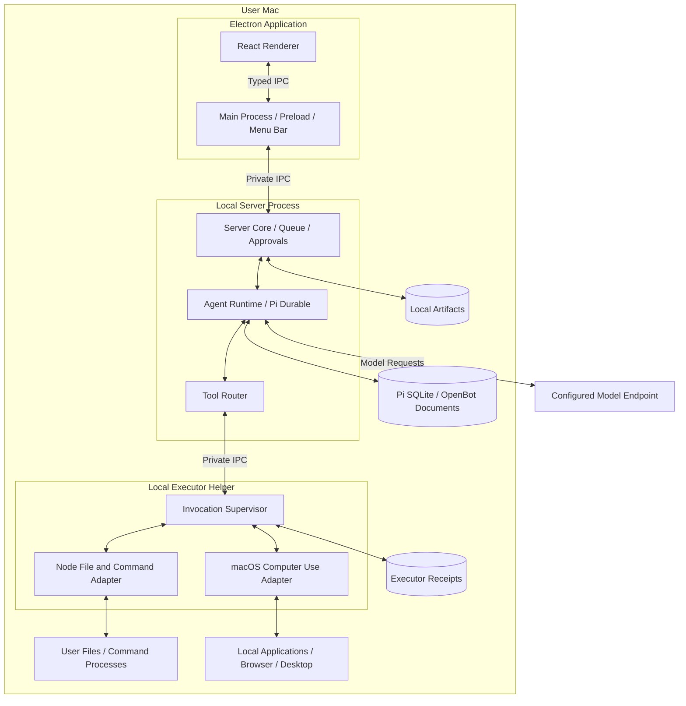
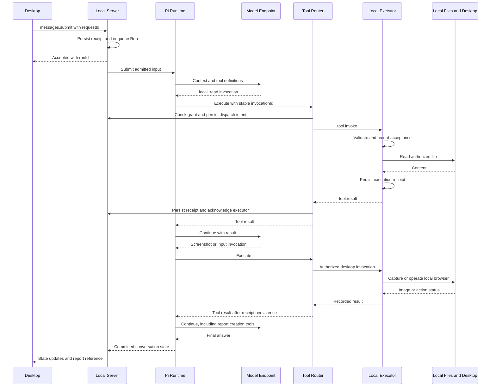

# OpenBot Architecture

Status: first-release design baseline. Last updated: 2026-10-14.

This document defines the target module boundaries, interfaces, source dependencies, and development sequence. The repository is in the design phase; the packages, processes, and behaviors below require implementation and validation.

## 1. Product Goals and Runtime Scope

OpenBot is an open-source desktop agent for personal use. The desktop client, application service, Pi agent loop, storage, and tool execution all run on the user's computer. Users submit tasks through the client, and the agent works with authorized local files, commands, applications, and the visible desktop.

| Area | First-release decision |
| --- | --- |
| User and platform | One user on their own Mac; macOS first |
| Client | Electron + React, with a narrow preload API |
| Application service | A Local Server process managed by the desktop application |
| Agent | Pi Durable embedded in Local Server through an OpenBot runtime adapter |
| Execution target | The current user's local machine and interactive desktop session |
| Concurrency | Multiple conversations, one active Run, sequential tools |
| Model configuration | Configurable provider, model, base URL, and credentials; desktop observation requires image input support |
| Persistence | Local SQLite, application artifacts, and files in user-authorized directories |
| Distribution | One desktop application bundling its required runtime and helpers |

Local execution and model inference are separate choices. Local Server can call a configured online model API. Relevant conversation content, selected file content, and screenshots can be sent to that provider as model input. A compatible local model endpoint can be configured separately; fully offline operation is not a first-release acceptance requirement.

Closing the conversation window leaves the application and Local Server running in the menu bar. Quitting the application stops its runtime and supervised work. Sleep suspends execution; lock and wake transitions gate computer control and require reconciliation. These lifecycle rules are specified in Section 8.

## 2. Relationship with Pi

### 2.1 Source Vendoring

OpenBot vendors the required Pi sources under `third_party/pi/`, builds them within the local workspace, and accesses them through `packages/agent-runtime`. This allows direct maintenance of task recovery, tool execution boundaries, and scheduling while retaining traceable upstream provenance and supporting deliberate manual updates.

Source distribution and runtime integration are separate concerns. Vendored code still exposes explicit package interfaces. OpenBot product code and Pi internals remain separate so upstream changes can be compared without losing local modifications.

OpenBot owns the maintenance of local patches, build assets, storage migrations, and upstream updates. Version pinning, clear boundaries, and verification provide API stability and recovery guarantees.

### 2.2 Source Baseline and Import Scope

The reviewed upstream is [earendil-works/pi](https://github.com/earendil-works/pi) at [`3daa20280f6a7c7cbe0935680c9a38fdc3863005`](https://github.com/earendil-works/pi/tree/3daa20280f6a7c7cbe0935680c9a38fdc3863005). Its package version is 1.2.0, and the revision is 22 commits ahead of the `v1.2.0` release tag. This exact SHA is the proposed initial import baseline. Record the actual imported contents and avoid following a floating `main` during builds.

Retaining the current package entry points requires considering these Pi dependencies together:

| Upstream directory | Package | Role in OpenBot |
| --- | --- | --- |
| `packages/durable` | `@earendil-works/pi-durable` | Persistent conversations, model generation, tool tasks, compaction, state observation, and recovery |
| `packages/ai` | `@earendil-works/pi-ai` | Providers, model requests, streaming responses, and message/tool formats |
| `packages/chord` | `@earendil-works/chord` | Context, state, and document infrastructure used by Durable |
| `packages/codemode` | `@earendil-works/pi-codemode` | A declared Durable dependency; retain the source dependency without registering Code Mode for the model in the first release |
| `packages/telemetry` | `@earendil-works/pi-telemetry` | Telemetry contracts required by `pi-ai` |

The dependency graph is `durable -> ai / chord / codemode`, with `ai -> telemetry`. Durable provides the conversation runtime. The initial import excludes `pi-agent-core`, `pi-coding-agent`, and the TUI. See the [Durable manifest](https://github.com/earendil-works/pi/blob/3daa20280f6a7c7cbe0935680c9a38fdc3863005/packages/durable/package.json) and [AI manifest](https://github.com/earendil-works/pi/blob/3daa20280f6a7c7cbe0935680c9a38fdc3863005/packages/ai/package.json).

Import the selected packages' sources, relevant existing tests, manifests, required shared build configuration, and runtime assets. Check model data generation and packaging in `pi-ai`, as well as required WASM assets. Copying only `src` does not complete an import. External dependencies remain managed and locked by the package manager.

### 2.3 Maintenance Boundaries

Keep the upstream `packages/<name>` layout and internal package names under `third_party/pi/`. Use a pnpm workspace to resolve Pi packages to repository sources. Product packages use `workspace:*`; the same workspace must constrain dependencies between Pi packages. Installation, type checking, and runtime builds must resolve consistent entry points and must not mix in another registry copy of Pi.

Create these provenance records during the actual import:

| Path | Responsibility |
| --- | --- |
| `third_party/pi/.openbot-vendor.json` | Upstream URL, ref, exact SHA, package version, import date, package scope, and asset provenance; the machine-readable baseline entry point |
| `third_party/pi/BASELINE.json` | Imported file inventory, upstream paths, and original content hashes; also record adapted baseline hashes when mechanical transformations are required |
| `third_party/pi/OPENBOT_CHANGES.md` | Local patch IDs, reasons, affected files, related upstream commits, and validation; reconcile this ledger with the actual baseline diff |
| `third_party/pi/LICENSE` | Pi's license and copyright notice; retain separate notices for third-party assets |

The baseline inventory describes the imported source. Update the patch ledger when changing vendor files, and advance the baseline only after a complete synchronization has passed validation. See [Pi's license](https://github.com/earendil-works/pi/blob/3daa20280f6a7c7cbe0935680c9a38fdc3863005/LICENSE).

Apply changes according to these boundaries:

- Keep generic agent-loop, durable-task, and storage changes in the Pi source copy as independently traceable patches.
- Keep local capability grants, approvals, execution supervision, desktop control, UI, and product protocols in OpenBot modules.
- Encapsulate Pi types in `agent-runtime`. Local IPC, executor protocols, and clients do not depend directly on Pi's internal document structure.
- Review updates against exact SHAs, reconcile patches, validate affected existing tests and OpenBot integration scenarios, then advance the baseline. Storage changes require backup, migration, and rollback compatibility checks.

Pi Durable currently declares its API experimental. Source vendoring lets OpenBot control its compatibility schedule; product protocols still require independent versioning. See the [upstream notice](https://github.com/earendil-works/pi/blob/3daa20280f6a7c7cbe0935680c9a38fdc3863005/packages/durable/README.md).

### 2.4 Reference Structure and Manual Synchronization

The design follows several MiniMax Code conventions: `third_party/pi-mono/.minimax-vendor.json` records provenance, `MINIMAX_CHANGES.md` records local modifications, and `pnpm-workspace.yaml` includes vendored packages in the build. Its TUI Engine's `UPSTREAM.md` and `BASELINE.json` demonstrate how to record a fixed baseline separately from selective upstream patches.

MiniMax Code's `docs/source-sync.md` and `scripts/prepare-source-sync.mjs` synchronize its internal source with its public repository. OpenBot adopts their three-way comparison approach for the selected Pi package scope: old upstream, current local copy, and new upstream. Review and application remain manual in the first release; a future helper may generate candidates and reports.

A manual synchronization follows this sequence:

1. Ensure current vendor changes are organized and traceable. Read the old SHA and import scope from `.openbot-vendor.json`, fetch the target in a separate Pi checkout, and resolve it to an exact SHA.
2. Review relevant commits, changed files, package dependencies, exports, storage formats, and runtime assets between the old and target revisions. Review new dependencies recursively; updating only `durable/src` is insufficient.
3. Extract old and new upstream snapshots from Git objects rather than a possibly modified Pi working directory. Compare A, the old upstream baseline; B, the new upstream target; and C, OpenBot's current copy. Apply consistent path mappings and mechanical transformations.
4. Generate merge candidates outside the repository. Review overlapping changes, additions, deletions, renames, binary files, and file-mode changes individually. Candidate generation must neither overwrite current sources nor advance the baseline.
5. Apply selected changes and reconcile `OPENBOT_CHANGES.md`: retain necessary patches, mark patches superseded by upstream, and record new adaptations. Update dependency locks, build configuration, and asset inventories as needed.
6. Verify local package resolution, types, and builds. Run affected existing upstream tests and OpenBot integration checks. Storage changes require checks for opening old data, migration, recovery, and rollback constraints.
7. Update the baseline SHA, file inventory, and patch status only after the entire selected scope has been reviewed and validated. Keep the old baseline and record outstanding work if synchronization is incomplete.

When importing a single upstream fix, record its source commit as a local patch and retain the complete baseline. Every synchronized state must be explainable as one exact baseline plus a traceable set of local changes.

## 3. Local Deployment and Process Boundaries

There are two application components: Desktop and Local Server. Local Server hosts the server logic and Pi in one process. The executor runs as a supervised helper so a command or native integration failure can be handled independently of the UI and conversation store. macOS capture and input may require a packaged native helper behind the computer-use adapter.

Package boundaries do not require separate network services. Desktop main starts Local Server and connects through private child-process IPC. Local Server owns the executor connection. The renderer uses an allowlisted preload API; it cannot launch processes or connect directly to the executor.

Only one Local Server owns a Pi store. Enforce a single application instance and exclusive store ownership before opening the database, including during crash recovery. Pi itself provides no cross-process store lock. The executor owns a separate receipt ledger and never writes the Pi database. See [Pi storage constraints](https://github.com/earendil-works/pi/blob/3daa20280f6a7c7cbe0935680c9a38fdc3863005/packages/durable/README.md#storage).

Bundle and pin the Node runtime used by Local Server rather than depending on a globally installed Node. Pi's Node SQLite adapter uses `node:sqlite`; verify it in the packaged application as well as the development checkout. Desktop packaging must include the selected Pi packages, their runtime assets, and native helpers.

## 4. Modules and Code Boundaries

These directories describe the intended implementation layout.

| Module | Responsibility | Boundary |
| --- | --- | --- |
| `apps/desktop` | Conversations, streamed output, approvals, file selection, model settings, control indicator, and application lifecycle | Renderer-to-main preload API and Local Server IPC |
| `apps/local-server` | Start and compose the application service, own the store, supervise the executor, and perform startup recovery | Local process entry point and transport binding |
| `packages/server-core` | Conversation operations, durable Run admission, approvals, grants, settings, and artifact metadata | Transport-independent application methods |
| `packages/agent-runtime` | Wrap Pi, register tools, map state, expose product-state transactions, and coordinate cancellation/recovery | `createConversation`, `submit`, `observe`, `abort`, `recover` |
| `packages/tool-router` | Validate the execution target and capability, bind invocations, enforce scheduling gates, and correlate results | `invoke`, `cancel`, `reconcile` |
| `packages/local-executor` | Execute local file/command operations, supervise child processes, enforce grants, and retain receipts | Executor protocol and local execution adapters |
| `packages/computer-use` | macOS permission checks, screenshot capture, application activation, keyboard/mouse input, and display coordinates | Native adapter called by the executor |
| `packages/protocol` | Versioned requests, responses, events, errors, and execution envelopes | Data contracts without Pi or Electron implementation dependencies |
| `third_party/pi` | Vendored Pi sources, assets, provenance, and local patch records | Preserved upstream entry points consumed by `agent-runtime` |

`server-core` consumes Pi-backed state through `agent-runtime`; it does not maintain another model transcript. Runtime registers product tools that always enter Tool Router. Only the executor invokes local file, command, or desktop adapters on behalf of the agent.

Application configuration and artifact storage remain Local Server infrastructure. Model-request networking belongs to the runtime. These infrastructure operations are distinct from granting the model arbitrary filesystem or process access.

## 5. Connecting Pi, Local Server, and Local Execution

### 5.1 Agent Runtime

Pi runs inside Local Server. The process assembles model configuration, storage, the extension registry, and the OpenBot tool definitions before accepting work.

| OpenBot operation | Pi integration point | Contract |
| --- | --- | --- |
| Create a conversation | `harness.createConversation()` | Persist the workspace and local-target binding |
| Submit an admitted message | `conversation.submit()` | Derive a stable Pi request ID from the OpenBot request ID |
| Observe execution | `conversation.watch()` or `watchEvents()` | Project Pi state into OpenBot snapshots and events |
| Register product tools | `defineExtension()`, `defineTool()` | Route every invocation through Tool Router |
| Cancel a Run | `conversation.abort()` | Also cancel its executor work and reconcile the outcome |
| Recover | Reopen storage and gate scheduling before `harness.resume()` | Reconcile unfinished invocations and invalidate stale computer control first |

A Pi tool receives `execute(args, api, context)`, including conversation, task, and call identities. The adapter maps these to a stable OpenBot `invocationId`, propagates cancellation, and converts executor results into model text or image content. See the [Pi tool interface](https://github.com/earendil-works/pi/blob/3daa20280f6a7c7cbe0935680c9a38fdc3863005/packages/durable/src/harness/types.ts).

Pi already provides `NodeExecutionEnv` for local files and commands; its runtime does not require a remote execution host. The first release registers explicit OpenBot tools backed by the local executor's file and process adapters. Reusing Pi's built-in tools later requires a routed `ExecutionEnv` adapter that preserves authorization and supervision. An unrestricted environment must not bypass those checks. See the [environment API](https://github.com/earendil-works/pi/blob/3daa20280f6a7c7cbe0935680c9a38fdc3863005/packages/durable/README.md#environment).

The model provider and credentials are selected by application settings. Stored secrets live in the macOS credential store; Local Server loads them as needed. Renderers receive redacted settings. Executor and command environments exclude model credentials by default. A process boundary between programs running as the same user is not an OS sandbox.

### 5.2 Tool Set and Executor

| Tool | Local behavior | Authorization |
| --- | --- | --- |
| `local_read`, `local_list` | Read files and list directories | Read grant for the selected roots |
| `local_write`, `local_edit` | Create, write, or apply targeted edits | Write grant; edit includes an expected-content check |
| `local_exec` | Execute a command in a specified working directory, stream bounded output, and record exit status | Separate command approval |
| `computer_screenshot` | Capture the selected display and return image metadata | Capture grant and macOS Screen Recording permission |
| `computer_activate` | Bring an approved local application to the foreground | Computer-control grant |
| `computer_click`, `computer_type`, `computer_key`, `computer_scroll` | Apply bounded input actions to the visible desktop | Computer-control grant and required macOS Accessibility permission |

Tool Router validates arguments, the current local target, grants, deadlines, and Run/control state. It persists dispatch intent before sending an invocation to the executor. The executor independently checks the bound capability and current control epoch before performing the operation.

The executor records acceptance before starting a side effect. It supervises command lifetimes, drains stdout and stderr, limits output, and records exit status separately from transport status. Cancellation targets the supervised command and its process group. A closed pipe, a lost parent connection, or a killed wrapper does not establish that all descendants stopped; uncertain outcomes require reconciliation.

File grants cover canonical paths, symbolic links, and changes between validation and use. Shell commands and desktop control have broader authority than file tools. A command's working directory does not confine its filesystem access, and an application can open files outside a file-tool grant. Present and authorize these capabilities separately.

### 5.3 macOS Computer Use

The computer-use adapter operates the user's actual interactive desktop. Screen Recording and Accessibility permissions must be granted through macOS. Missing or revoked permission produces a visible capability state and an actionable error; the application cannot grant itself those OS permissions.

The first release controls one selected display. Every capture includes `frameId`, `displayId`, `desktopEpoch`, image dimensions, capture bounds, scale, and capture time. Input coordinates are mapped from that captured image to the corresponding desktop coordinates, including display origin and scaling.

The executor rejects input tied to an obsolete display/session epoch. A lock, user-session switch, display change, or control handoff invalidates previous captures and control grants. Page content and application focus can also change between observation and action; screenshots do not freeze the desktop.

Browser tasks use the ordinary local browser through desktop tools. The user can log in manually and then resume the agent. Browser cookies and profiles remain owned by that browser.

## 6. Local Interfaces and Authorization

### 6.1 Desktop Application Protocol

The first-release transport is private IPC with versioned request, response, and event envelopes. Electron main validates renderer calls and forwards allowlisted methods to Local Server. A native file selection supplies a scoped selection reference; a renderer-supplied arbitrary path is not evidence of a user grant.

| Method | Semantics |
| --- | --- |
| `conversations.create`, `conversations.list` | Create or list local conversations and their workspace bindings |
| `messages.submit` | Accept `requestId`, content, and artifact references; return `runId` and state after durable receipt |
| `conversations.snapshot`, `conversations.subscribe` | Deliver the current view followed by ordered updates |
| `runs.cancel` | Persist an idempotent cancellation request and report its execution outcome separately |
| `runs.pause`, `runs.resume` | Gate tool execution and coordinate explicit user continuation |
| `grants.create`, `grants.revoke` | Record user-selected file access or capability grants and their versions |
| `approvals.decide` | Allow or reject the exact pending invocation and arguments |
| `computer.status`, `computer.control` | Report OS permission/session state and request pause or handback |
| `artifacts.import`, `artifacts.export` | Copy selected inputs or generated outputs through authorized local paths |
| `settings.get`, `settings.update` | Read redacted settings and update model/provider configuration |

A request carries `protocolVersion`, `messageId`, `method`, and `params`. Mutating operations include a stable application request identity where retries could otherwise create duplicate work. `messages.submit` returns the same Run for the same request ID and content; different content under that ID is a conflict. Durable receipt does not mean model generation has started.

Observation events include `streamId`, `seq`, `conversationId`, `type`, and `payload`. A subscription starts from a consistent snapshot and continues with updates after that snapshot. Reconnection, a sequence gap, or a new service instance requires a new snapshot. Pi's watch does not replay arbitrary historical events. See [Pi observation semantics](https://github.com/earendil-works/pi/blob/3daa20280f6a7c7cbe0935680c9a38fdc3863005/packages/durable/README.md#watching-a-conversation).

### 6.2 Executor Protocol

Local Server and the executor exchange a startup handshake containing protocol version, process-instance identity, and supported capabilities. The connection is owned by the application and accepts requests only from its parent service.

| Message | Contract |
| --- | --- |
| `tool.invoke` | Invocation ID, Run/conversation IDs, tool name, arguments and digest, target, deadline, and authorization |
| `tool.ack` | Durable acceptance or the recorded state of an existing invocation |
| `tool.progress` | Sequenced, bounded output or progress; never a substitute for terminal status |
| `tool.result` | Terminal status, result content/references, exit details, and structured errors |
| `tool.status` | Reconcile a previously accepted invocation after interruption |
| `tool.cancel` | Request termination; report confirmed termination or an uncertain outcome |
| `result.ack` | Confirm that Local Server persisted the terminal receipt |
| `control.revoke` | Invalidate the current input-control epoch and block subsequent input actions |

The only supported target is `{ kind: "local", targetId }`, bound to this installation and user session. Desktop actions additionally carry the current desktop and control epochs. Model output cannot choose another machine or forge a grant.

Approvals bind `invocationId`, tool, target, argument digest, grant version, and validity period. Grant revocation invalidates pending work and requests cancellation of affected active work. Validate again immediately before execution.

The executor retains terminal receipts until Local Server acknowledges persistence. Repeated invocations return existing state; a repeated ID with different arguments is rejected. After receipt compaction, retained completion identities or a retired service epoch must still prevent an old invocation from executing again. An execution whose side effect may have happened but whose result is missing becomes `unknown`.

## 7. Durable State and Message Flow

### 7.1 State Ownership and Scheduling

| State | Owner |
| --- | --- |
| Conversations, model context, generation tasks, tool tasks, and compaction | Pi Durable in Local Server |
| Run queue, workspace binding, approvals, capability grants, and product status | Versioned OpenBot documents in the Pi store, accessed through the runtime adapter |
| Command lifetimes, invocation acceptance, final execution receipts, and retransmission | Local executor and its separate persistent ledger |
| Artifact contents | Application-owned local artifact directory; metadata in OpenBot documents |
| Browser login/profile and user files | Existing local applications and user-selected directories |
| Model credentials | OS credential store; transient use by Local Server |
| Capture/input readiness | Live macOS observations and an expiring control epoch |

OpenBot maintains one global durable Run queue and admits one input to Pi at a time. Later messages stay queued, including messages in other conversations. Tool Router serializes dispatch even when a model response produces multiple Pi tool tasks. Pi's submission ID is associated with the OpenBot Run; a stable request ID reconciles a crash between Pi admission and recording that association.

Run states are `queued`, `running`, `waiting_approval`, `paused`, `cancelling`, `needs_attention`, `completed`, `failed`, and `cancelled`. Closing an observation stream changes connection state only. Cancelling one Run leaves unrelated queued work intact.

Product-state transactions persist approvals, target bindings, and dispatch intent before external execution. Execution receipts and Pi results must be correlated because database transactions cannot include filesystem, command, or desktop side effects.

### 7.2 End-to-End Message Flow

Consider: "Read my project notes, research the topic in my browser, and save a report in the project."

The permission flow can pause dispatch and ask the user before either file or computer access. Tool results, including durable references to screenshots, are committed before subsequent model steps use them. Desktop receives status updates throughout the Run.

## 8. Local Computer Control, Recovery, and Storage

### 8.1 Human Control and Application Lifecycle

Computer control is an explicit, visible mode. The user grants control, sees its active state in the application/menu bar, and can pause it through an action or a dedicated shortcut handled outside the executing tool.

A pause closes the tool-dispatch gate, revokes the input-control epoch, and requests cancellation of active tool work. Input actions must be bounded so the helper can honor revocation between actions. Already delivered input and completed side effects cannot be undone by cancellation.

The user's physical keyboard and mouse remain usable throughout. OpenBot's control lease coordinates its own tools; it cannot exclude human input or other applications. After manual interaction, resuming requires a fresh desktop observation and a new control epoch.

| Event | First-release behavior |
| --- | --- |
| Conversation window closes | The menu-bar application, Local Server, and admitted Run continue while the Mac is awake and required permissions remain available |
| User pauses or takes control | Block new tools, revoke input control, and reconcile the active invocation before continuation |
| User quits the application | Stop admission, preserve queued messages, cancel supervised active work, flush state, and stop helpers; unresolved effects remain visible on next launch |
| Mac sleeps or the interactive session locks | Gate execution and invalidate desktop control; a sleep transition may interrupt work before it can be fully reconciled |
| Mac wakes or session unlocks | Reconcile active executions and refresh permissions/display state; require explicit continuation before new desktop input |
| Display, focus, or user session changes | Revalidate the target and capture a fresh frame before dependent input; observed unsafe session changes pause control |
| Executor or native helper exits | Block dependent tools, reconcile receipts and command state, then restart the helper if appropriate |
| Local Server exits | The executor loses its parent lease, stops accepting work, revokes input, and attempts to terminate supervised commands |

Pausing gates tool dispatch; it does not assume Pi can serialize an in-memory waiting function. If cancellation or interruption terminates a Pi submission, continuation uses committed history and an explicit follow-up rather than reviving the old command. A waiting approval survives as product state only while its bound invocation remains valid; invalidate it when recovery abandons that invocation.

### 8.2 Recovery and Cancellation

On launch, Local Server acquires exclusive ownership, opens storage, validates the executor handshake, reconciles unfinished invocations, and checks the local desktop before enabling scheduling. Gate every Pi scheduling entry point, including `resume`, `submit`, and `wait`, until that recovery check completes.

A known terminal execution receipt can be reconciled without executing again. If Pi already recorded an interruption, preserve its immutable entries, attach the confirmed receipt to OpenBot recovery information, and use an explicit follow-up for continuation. If an executor may have performed a side effect before losing its result, mark the invocation `unknown` and the Run `needs_attention`. Do not infer completion or safe retry from a missing process ID, transport disconnection, or an empty result.

Pi records tool intent before execution. Interrupted calls rerun only when declared `replay: "safe"`; the default `unsafe` produces an interrupted result. Select `safe` only for verified retryable read-only or idempotent operations that still pass current authorization. Commands, file mutations, and desktop actions default to `unsafe`. Reconcile uncertain effects before allowing another model step to act on an interrupted result. See [Pi tool recovery](https://github.com/earendil-works/pi/blob/3daa20280f6a7c7cbe0935680c9a38fdc3863005/packages/durable/README.md#tools).

Cancellation is a persisted request followed by an observed outcome. Enter `cancelled` only when active tool termination is confirmed or no tool was dispatched; an uncertain termination enters `needs_attention`. PID reuse, detached descendants, and external effects mean killing the command wrapper alone is insufficient evidence.

### 8.3 Data and Backups

Use the application data directory, normally `~/Library/Application Support/OpenBot/` on macOS, for the conversation database, artifact directory, executor receipts, and bounded operational logs. Store user working files in explicitly selected directories. Browser profile persistence remains the browser's responsibility.

The Pi SQLite adapter uses WAL with `synchronous = NORMAL` at the reviewed baseline. Process-crash recovery and sudden power-loss durability differ: recent commits may be lost after a host failure. Validate the selected storage behavior before making stronger durability guarantees.

A backup includes consistent snapshots of both application and executor state, artifact contents, and version records. Pause writes or use verified backup APIs; copying a live main SQLite file alone is insufficient. User project files and browser data require their own chosen backup scope. Credentials remain in the OS credential store.

Record application, Pi, protocol, and data-format versions for diagnosis and upgrades. Use `runId` and `invocationId` to correlate logs. Operational logs exclude stored credentials and avoid collecting full file content or screenshots by default. Verify migrations against a backup before advancing the data format.

## 9. First-Release Scope

| Area | First release |
| --- | --- |
| Product | One macOS desktop application operating the user's own computer |
| Agent | Configurable model endpoint, streaming conversations, history, compaction, one active Run, queueing, and cancellation |
| Files and commands | Selected directory grants, local read/list/write/edit, and separately approved commands |
| Computer use | Selected-display screenshots, application activation, keyboard/mouse actions, permission status, visible control, pause, and handback |
| Browser tasks | Operate the user's local browser; support manual login followed by agent continuation |
| Artifacts | Import selected local inputs, show outputs, and export generated files |
| Persistence | Local conversation state, execution receipts, artifact references, and explicit interrupted-work recovery |
| Extensions | Product-maintained tools/instructions and deliberately loaded static skill content |
| Packaging | Bundled runtime and helpers, stable macOS application identity, startup diagnostics, and backup guidance |

The first release depends on the local OS and configured model endpoint. Future hosting or sandbox targets can be added behind transport and executor adapters when required. OpenSandbox belongs to such a future isolated-execution adapter; it is not part of the local desktop tool path.

## 10. Development Sequence and Milestone Acceptance

Each milestone requires a verifiable result before the next builds on it. These are planned implementation steps.

| Milestone | Development work | Completion criteria |
| --- | --- | --- |
| M0: Workspace and Pi baseline | Establish packages and protocol schemas; import Pi with the Section 2 provenance and asset records; select a compatible Node runtime | Selected Pi packages resolve locally, required builds/checks pass, and a minimal conversation persists and reopens using temporary local SQLite |
| M1: Local service and execution | Local Server, server-core, Pi adapter, Tool Router, executor, file grants, command approval, durable queue, and cancellation | Through a local harness, a real-model task creates and reads a file in an authorized temporary directory; unauthorized paths fail; command output, exit status, and receipts are stored |
| M2: Desktop interaction | Electron UI/preload/main, private IPC, conversations, streaming, approvals, model settings, artifacts, menu-bar lifecycle, and reconnect | The UI completes M1, closing/reopening the window preserves the Run view, and the renderer cannot directly invoke an executor or retrieve stored secrets |
| M3: Local computer use | macOS helper, permission status, screenshot/input tools, selected-display coordinates, control indicator, pause shortcut, and manual handback | The agent observes and operates the actual local browser; user pause blocks subsequent input; permission denial and display changes are handled; resume starts from a fresh screenshot |
| M4: Failure recovery and packaging | Application/helper termination, lock/sleep/wake, duplicate delivery, consistent backup, upgrades, bundled runtime, and packaged permission checks | Complete Section 11 on a real Mac using the packaged application and record unsupported or unverified boundaries |

M1 includes permissions and execution records from the start. M3 extends that boundary to desktop control. Use Pi's existing affected tests where appropriate and add focused protection for high-risk lifecycle or authorization gaps. Static skills are explicitly loaded by OpenBot; `pi-coding-agent` CLI extension loading is not automatically provided by Durable.

## 11. First-Release Acceptance Scenarios

1. **All execution is local:** A task reads a selected local file, uses the local browser, and saves a report locally. Execution records identify this installation and user session.
2. **Permission scope is visible and enforced:** Unauthorized file paths, stale approvals, and revoked grants fail. Commands and desktop control have separate grants. Denied macOS permission produces a useful status.
3. **Actual desktop control works:** Screenshots correspond to the selected display; clicks use the correct origin and scale. Display/session changes invalidate stale input.
4. **Human control takes priority:** Pause during a sequence of actions blocks subsequent input. Manual login works, and continuation captures a fresh frame before acting.
5. **Application lifecycle is predictable:** A closed conversation window leaves the running application active; quitting stops supervised work or records an uncertain outcome. Sleep/wake and lock/unlock never silently reuse stale desktop control.
6. **Submission and execution deduplicate:** Resubmitting a request or retransmitting an invocation/result does not create a duplicate Run or repeat a confirmed side effect.
7. **Cancellation preserves unrelated work:** Cancelling the active Run propagates to its executor operations while keeping other queued messages. Unconfirmed termination is visibly distinct from cancellation.
8. **Interrupted effects remain explicit:** Crash between an action and result recording; reconcile its receipt or require user attention. Do not automatically repeat an unsafe action.
9. **The packaged application uses the intended runtime:** Verify the actual bundled Node/Pi sources and assets, native helper identity, OS permissions, store ownership, and clean relaunch on macOS.
10. **State restores from backup:** Recover conversation state, artifact references, and execution records consistently, with application/Pi/data-format versions recorded.

The Pi source baseline and interfaces above were checked locally on 2026-10-14. Tool permissions, macOS integration, crash recovery, real-model behavior, and packaged distribution remain implementation and acceptance work.
