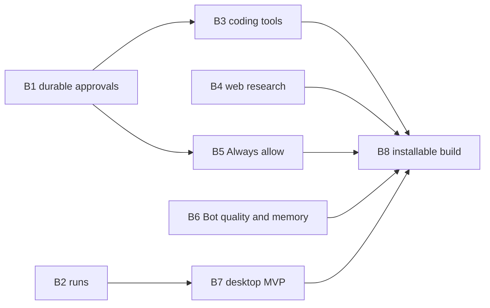

# OpenBot Backlog

Work after the tools demo, cut into batches that can each be finished and verified on their own. Each batch states its approach, key decisions, and the acceptance that closes it. A batch gets a full task spec in [`tasks/`](tasks/README.md) before execution starts; batches here without a spec link are approach only.

The [architecture](architecture.md) defines the target design; the [technical plan](technical-plan.md) records current state. When a batch lands, move it to the plan's current-state table and delete it here.

References:

- **MCode**: `~/minimax-ai/minimax-code` (MiniMax Code). Study, do not copy.
- **Grok Bot**: [docs.x.ai/grok-bot](https://docs.x.ai/grok-bot/overview) and the leaked prompt at `~/github/system_prompts_leaks/xAI/grok-bot.md`.
- **Pi**: `~/github/pi/packages/coding-agent` for the reference coding-agent tools.

## Phases

| Phase | Goal | Batches |
| --- | --- | --- |
| **1. MVP** | A standard agent Bot you can install and use every day: chat with any configured model, work in files and the terminal, research the web, ask before risky actions, remember the user, survive restarts | B1–B8 |
| 2. Enhancements | Connectors, skills, routines, full Auto Review, Bots working together, desktop completion | B9–B15 |
| 3. Computer control | Managed browser with takeover and secrets, desktop computer use, voice and teach-a-task | Architecture M3 (browser part), M6, M8 |

The MVP deliberately leaves out the managed browser, computer use, connectors, skills, routines, and group chats. The architecture keeps their seams (`targetId`, Tool Router, executor capabilities), so they attach later without reworking Phase 1.

## Demo baseline (done)

A Bot chats through any configured model and uses `local_read`, `local_list`, `local_write`, `local_edit`, `local_exec`, and `web_fetch`. File tools run without asking inside the shared workspace (`~/OpenBot`, or `OPENBOT_WORKSPACE`); outside it they ask, and an approval grants that one path for that one call. Every command asks. Calls go Pi tool → `ToolInvoker` → Tool Router (policy, approval) → executor process (grant re-check, process groups, scrubbed environment) or a Host handler. The transcript shows Markdown, one row per tool call, and an inline **Allow once / Deny** card. The e2e suite drives the built app against a scripted model; CI runs it on macOS.

## Phase 1: MVP

B1, B2, B4, and B6 can start in parallel. B8 is last because it packages everything.

### MVP acceptance

The MVP is done when all of these pass on a packaged build installed on a Mac that never ran the development setup:

1. First launch walks through choosing a model and creating a first Bot; the API key lands in the Keychain.
2. A Bot searches a repository in the workspace with `rg` or `grep` (no approval card), edits code, runs its tests in the background after **Allow once**, and reports the result.
3. A Bot researches a question with `web_search` and `web_fetch`, cites the pages it opened, and saves a report in the workspace.
4. **Always allow** on a command card stops later identical commands from asking; the rule is visible and deletable in Settings.
5. Telling a Bot a preference ("always answer in Chinese") persists in its memory and applies in a new topic after restart.
6. Three Bots work at once; a fourth waits; Stop and redirect work while a Bot is busy.
7. Quitting during a pending approval and relaunching shows the same approval; an interrupted command is reported, never repeated.
8. A long conversation keeps working past the model's context window (compaction).

### B1. Durable approvals and receipts

**Spec: [tasks/b1-durable-approvals.md](tasks/b1-durable-approvals.md) (ready).** Approvals persist as a Pi session document and executor receipts in the executor's own SQLite ledger, both keyed by IDs derived from Pi's stable call ID, so a restart neither re-asks nor re-runs. Interrupted commands become **Interrupted** and the Bot shows **Needs attention**. Orphaned process groups are killed on executor start.

### B2. Runs, cap, Stop, and redirect

**Spec: [tasks/b2-runs.md](tasks/b2-runs.md) (ready).** Durable Run records with `runId`, a global active-Run cap (default 3) with FIFO admission across Bots, `runs.cancel` by `runId`, and messages sent while a Bot works steering its current Run (`whenBusy: "steer"`).

### B3. Coding-agent tools (after B1)

Bring the tool set to what users expect from a coding agent. References: Pi `coding-agent/src/core/tools/` (truncation), MCode `output-limit.ts`, `read-guards.ts`.

No dedicated search tools: Bots search with `rg`, `grep`, and `find` through `local_exec`, which models already use well. B5 lets read-only search commands inside grants run without asking, and B6's prompt tells the Bot to prefer `rg` when installed. Revisit `local_grep` only if real use shows models struggling or approvals piling up.

- **One output limiter** in `local-executor` for every tool: head and tail by lines and bytes, a truncation marker, and the full output spilled to `<data>/artifacts/<invocationId>.txt`. The marker names that path and the `offset` to continue; the artifacts directory is an implicit read grant.
- **`local_edit`** gains an optional `expected_sha256` of the current file (architecture 5.2 requires an expected-content check) and lists line numbers when `old_text` matches more than once.
- **Background commands.** `local_exec` accepts `background: true`, and a foreground command still running after 60 seconds yields to the background. Either way the call ends with a `taskId` and the output so far. `task_output(taskId, wait_seconds ≤ 60)` returns new output and status; `task_stop(taskId)` signals the group. Tasks live in the executor with a `background_tasks` table in the B1 ledger; on executor restart they are killed by the orphan guard and reported `unknown`. The approval covers the command once, including its background phase. Waking the Bot when a background task finishes is Phase 2 (B15); in the MVP the model polls with `task_output`.
- Acceptance: unit tests for truncation spill and continuation, hash mismatch refusal, background yield and stop; e2e: a scripted model runs a 70-second command, gets a `taskId`, and reads the final output with `task_output`.

### B4. Web research

- **`web_search`** Host tool behind a `SearchProvider` interface (`search(query, count) → { title, url, snippet, published? }[]`). First adapter: Tavily (built for agents, returns clean snippets, free tier), chosen in the B4 spec; a second adapter (Brave) only when someone needs it. Key stored in the Keychain under `search:<provider>`; Settings gets a Web search section. Without a key the tool is not offered to the model, rather than failing at call time.
- **`web_fetch`** extracts the main content with Mozilla Readability and converts it to Markdown (Turndown) instead of flat text, keeps links, and pages long documents with `offset`. Results carry a `retrieval_outcome` (`usable_content`, `not_found`, `access_challenge`, `auth_required`, `dynamic_page`), following MCode `local-webfetch.ts`. The private and loopback address block stays.
- Prompt guidance (in B6's tool section): a search miss does not prove absence; cite pages that were opened, not snippets; prefer primary sources.
- Acceptance: unit tests with a local fake search endpoint (provider base URL override for tests) and fixture pages for each outcome; e2e: a scripted research turn shows a search row and a fetch row and the report cites the fetched URL.

### B5. Always allow and folder grants (after B1)

The MVP subset of architecture 5.3: enough that a daily user is not asked the same thing twice. Ask-first rules, the model reviewer, and unattended expiry are Phase 2 (B12). Reference: MCode `bash-rule-match.ts`, `permission-picker.ts`; Grok Bot Auto-review settings.

- **Command setting** in Settings: Ask every time (default), Always allow, Never.
- **Read-only commands inside grants run without asking** (on by default, a toggle in Settings). The allowlist is `rg`, `grep`, `find`, `ls`, `cat`, `head`, `tail`, `wc`, `file`, `stat`, `pwd`, `which`, and `git status|diff|log|show|branch`. They are allowed only when the working directory is inside a grant and every path-like argument (absolute, `~`, or containing `..`) resolves inside a grant; output redirection, `-exec`, `--pre`, and command substitution disqualify a command. Otherwise the normal setting applies. Commands cannot be confined to a directory (architecture 1.1), so this is a heuristic for convenience, kept narrow on purpose.
- **Command rules.** **Always allow** on a command card offers scopes narrow-first: this exact command, then the program and subcommand with any arguments (`git status *`). It shows the exact rule before saving. A command is tokenized conservatively. Pipes, `&&`, `||`, and `;` split it into parts, and every part must match a rule. Subshells, redirections to files outside grants, `eval`, and unparseable input never auto-allow.
- **Folder grants.** **Always allow** on a file card outside the workspace grants the containing folder (read, or read and write for write tools), defaulting to the narrowest folder and editable to a parent. Settings → **Folders** lists grants with revoke and **Add folder** (native picker; main passes a selection reference, never a renderer path).
- Rules and grants are versioned documents (`openbot.policy`, `openbot.grants`). Precedence: hard rules, Never, allow rule or grant, then the capability default. Revoking a grant invalidates pending approvals that relied on it, and the executor receives the current grant list with every invocation (already the case).
- Acceptance: unit tests for rule matching (compound commands with one unapproved part still ask; quoting cannot smuggle a second command), the read-only default (`rg foo src` in the workspace runs; `cat ~/.ssh/id_rsa`, `find . -exec rm {} \;`, and `grep x > out.txt` ask), precedence, and grant revocation; e2e: Always allow on `git status`, a second `git status` runs without a card, and deleting the rule brings the card back.

### B6. Bot quality and memory

What makes a Bot feel like a teammate rather than a raw model.

- **System prompt sections** registered in the OpenBot Pi extension (they stay cache-friendly and change only when their inputs change): identity (Bot name, role, today's date only), working style adapted from Grok Bot (reply first with a short acknowledgment before tool work, steady progress updates, plain prose, ask only when blocked, report what was done and what was not verified), the tool surface (workspace first; search with `rg` when installed, else `grep` and `find`, through `local_exec`; web for lookups; which commands need approval; how truncation and background tasks work), and memory. Write it once, review it against real models in the spec.
- **Memory.** One `openbot.memory` document per Bot holding Markdown of at most 8 KB. A `memory_update` Host tool takes `replace` or `append` with a section heading, is always allowed, and appears in the transcript as "Updated memory". A `memory` prompt section renders the content. The Edit profile dialog gets a Memory tab to view and edit it. A document (not files, as Grok Bot does) keeps it atomic with the rest of Host state and out of the shared workspace.
- **Thinking level** per Bot (Off, Low, Medium, High) through Pi `configure({ thinkingLevel })`, shown only for reasoning models. The transcript renders thinking as a collapsed block.
- **Long conversations.** Pi auto-compaction is on by default (`reserveTokens` 16384). Show a divider "Earlier messages summarized" at each `pi.compaction` entry. Add **New topic** in the Bot menu: `conversation.reset()` with a divider; memory carries over, context does not.
- **Model errors.** An error row with the provider's message and **Retry** (resubmits the last user message under a new request ID) after Pi's own retries are exhausted.
- Acceptance: e2e with a scripted model: a `memory_update` call shows in the memory tab and in the next request's system prompt; a scripted model with a small `contextWindow` triggers compaction and the divider; **New topic** clears the context but the next request still carries memory. Real-model spot check of the prompt with two providers.

### B7. Desktop MVP (after B2)

The parts of architecture M2 a daily user notices. Production IPC hardening beyond validation stays in Phase 2 (B14).

- **Onboarding.** With no usable model, the app opens a setup screen: provider presets (Anthropic, OpenAI, OpenRouter, any OpenAI-compatible base URL), key to the Keychain, a test request, then "Meet your first Bot" with suggested roles. It writes to `~/.openbot/models.json` only for custom endpoints.
- **Streaming cost.** Only the selected Bot's conversation receives snapshots (`conversations.subscribe` for one Bot at a time; others receive activity changes). Coalesce token updates to about 50 ms in the Host before IPC. Sequence-gap recovery and backpressure stay in B14.
- **Transcript.** Consecutive successful tool rows collapse into "Ran 4 steps" (expandable). Code blocks get a copy button. Files the Bot created link to Reveal in Finder (main checks the path is inside a grant). Message timestamps on hover.
- **Notifications.** A macOS notification when an approval is waiting or a Run finishes or fails while the window is unfocused; clicking opens that Bot. The dock badge shows pending approvals.
- **Bot menu:** Duplicate (profile and memory, not history) and Delete (confirmation; status `deleted`, conversation kept on disk per architecture 8.3).
- **IPC validation.** TypeBox schemas per Host method in `protocol`, checked in main and in the Host. This settles the open decision in favor of TypeBox, which Pi already uses.
- **Power.** `powerSaveBlocker` (`prevent-app-suspension`) while any Run is active.
- Acceptance: e2e for onboarding with the scripted model's endpoint as a custom provider, collapsed tool rows, Duplicate and Delete, and a schema-invalid call from DevTools rejected by main.

### B8. Installable build (last)

A signed DMG a user can download and run. References: architecture 3, 6.4; electron-builder docs.

- electron-builder, arm64 DMG first (universal later). Host and executor JavaScript and Pi's runtime assets outside `app.asar`; a pinned, checksum-verified Node 24 binary in `Contents/Resources` with the `allow-jit` entitlement.
- The `app://` protocol replaces `file://` for the renderer. Fuses from architecture 6.4 are set.
- Signing and notarization with a Developer ID from CI secrets. Without a certificate, a local ad-hoc build for testing, never published.
- Keychain stays in the Host through `/usr/bin/security` for the MVP. Recorded risk: items it creates trust the `security` tool, so another process of the same user can read them through it. Moving to a signed helper or Electron `safeStorage` is B14.
- A GitHub Release workflow builds, signs, notarizes, and attaches the DMG on a tag. Auto-update is Phase 2.
- Acceptance: the MVP acceptance list above, run by hand on a clean macOS user account with the packaged app and recorded in the release notes. This is the one place manual verification is unavoidable (Gatekeeper, notarization, Keychain prompts).

## Phase 2: Enhancements

Approach only; each becomes a spec when Phase 1 lands.

- **B9. MCP connectors** (architecture M7). Executor-supervised stdio servers and HTTP sessions, credentials from the Keychain injected only into their own server, tools named `mcp__<server>__<tool>` through Tool Router with receipts, a Connect apps page. OAuth through the default browser comes after the first token-based connectors work.
- **B10. Skills.** Library at `<data>/skills/<name>/SKILL.md`, a `skills` prompt section listing names and descriptions, `skill_load`, `skill_save` with user confirmation, `/` in the composer to attach one.
- **B11. Routines** (after B2). Scheduler in `server-core` with occurrence request IDs `routine:<id>:<scheduledAt>`, a fresh conversation per occurrence admitted through B2's queue, test run, coalesced catch-up after sleep, Grok Bot limits (50 per Bot, 5-minute spacing, 20 runs of history), `routine_propose` with a confirmation card.
- **B12. Full Auto Review.** Ask-first rules (always win), argument predicates for URL origins and connector tools, an optional model reviewer that can only escalate, 10-minute expiry for approvals raised by unattended work.
- **B13. Bots together** (architecture M4). Group chats with mentions and a lead Bot, `bot_message`, `bot_handoff` with request ID `handoff:<invocationId>`, templates (export and import without memory, history, credentials, or grants), usage per Bot from `pi.usage`.
- **B14. Desktop completion** (architecture M2 rest). Subscriptions with `seq`, gap detection and backpressure, `Cmd+K` search, menu-bar app with running Bots and **Pause all**, Normal and Verbose tool detail, transcript virtualization, login item, Keychain moved out of the `security` CLI, auto-update with electron-updater.
- **B15. Agent extras.** Image results from `local_read` for vision models, waking the Bot when a background task finishes, attachments in the composer, background subagents for parallel research within one Bot.

## Phase 3: Computer control

Architecture M3 (managed browser, takeover, secret requests), M6 (desktop computer use with the signed Swift helper and control lease), and M8 (dictation, teach-a-task). These need packaging and signing from B8 for TCC attribution; start with spikes before specs: two Bots' browser windows not throttled in the background, and the disclaimed helper receiving Screen Recording and Accessibility grants.
