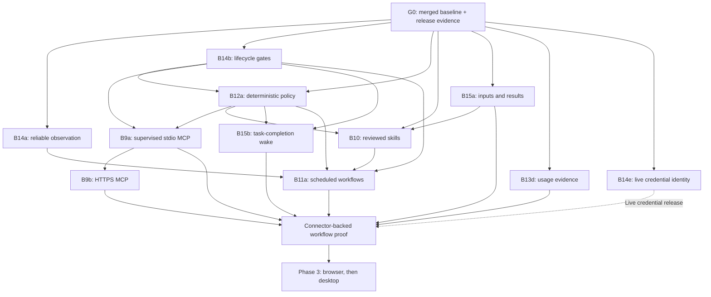

# OpenBot Development Roadmap

This document preserves the D4 planning rationale and dependency model, plus briefs for work that still needs a ready spec. It is not a live delivery board. Use the [backlog](backlog.md) for the active queue, individual [task specs](tasks/README.md) for status/contracts/evidence, and the [technical constraints](technical-plan.md) for known gaps. Later ready specs supersede their earlier planning briefs.

Design record: [D4](tasks/d4-delivery-plan.md), reviewed October 18, 2026, against `54c2a1c` on `main` (B26 / PR #27). Competitor research remains dated evidence, not a current benchmark. Do not refresh baseline tables or add merge announcements here. Only revise this document when planning rationale or future prerequisites change.

## 1. Product outcome and constraints

Deliver a personal Bot that completes a useful task, retains the approved method, and repeats it with visible results and bounded intervention. Optimize successful delivery, recovery, and user effort before increasing the number of tools or Bots.

- One user, one Mac, one local execution target. No hosted computer, cloud control plane, remote pairing, mobile client, or shared Team Bot service.
- All Bots share the Mac, grants, workspace, and future browser logins. Roles and separate contexts are not security boundaries.
- Keep Desktop -> Host Runtime -> Tool Router -> Executor boundaries. Only `agent-runtime` imports Pi. Host tools also pass through Tool Router; executor tools receive a second authorization check.
- Keep model endpoints configurable. Local storage does not imply offline inference.
- Work may continue after the window closes while the Mac stays awake. Sleep, lock, quit, and process loss require reconciliation; do not promise cloud-style availability.
- Preserve stable request/invocation identities, persisted approvals and dispatch intent, and executor receipts. An uncertain external effect is not safe to retry automatically.
- Retain Core-default group routing, explicit recipients, and existing collaboration bounds. Core-only management is an OpenBot decision, not a verified Grok requirement.

## 2. Dated D4 implementation baseline (October 18)

| Area | Evidence at the baseline | Remaining work |
| --- | --- | --- |
| Agent and execution | Pi adapter, configurable models, queue/cap, steering, cancellation, file/command tools, background tasks, web research | Completion wakeups, richer inputs/results, later subagents |
| Policy and durability | Persistent approval, Always allow, folder grants, dispatch records, executor receipts and unknown outcomes | Ask-first rules, active-work revocation, unattended expiry |
| Bot and memory | Protected Core, Specialist management, revisioned Prompt/memory, history/restore, fresh duplication | Templates, usage presentation, separately designed data purge |
| Collaboration | B13a/b/c channel contexts, group lifecycle, bounded delegation, ownership transfer and tree stop | Do not reimplement groups; direct-chat/cross-group peer dispatch stays deferred |
| Conversation UI | B21 shared shell/drafts/mentions; B22 previews/read cursors; B23 history search and unread filtering, all merged | Artifacts, large-history performance and organization |
| Desktop lifecycle | Window/Host supervision and basic native attention logic exist | Sequence-gap recovery/backpressure, Host power-event handling, packaged native validation |
| Application APIs and Code Mode | B24 shared authorized reads, B25 local bounded Pi Code Mode and B26 exact-approved Bot/group mutations are merged | Add future capabilities through explicit descriptors and shared domain services; never expose every Host method |
| Extensions | Architecture seams only for MCP, skills and routines | B9/B10/B11 below |
| Computer control | Browser and computer-use packages not implemented | Phase 3 spikes and implementation |

Baseline evidence: [B22](tasks/b22-conversation-list.md), [B23](tasks/b23-conversation-search.md), [B24](tasks/b24-app-capability-api.md), [B25](tasks/b25-local-app-code-mode.md), [B26](tasks/b26-code-mode-management.md). B26 recorded 278 unit/Host tests, 73 background e2e tests, a four-scenario final UI rerun and isolated real-model six-approval/restart acceptance. These counts are prior implementation evidence; this documentation task does not repeat desktop or real-model acceptance. Repository checks run for the document change are recorded separately in D4 and its PR.

Do not rebuild model entry, protected Core, Prompt/memory controls, groups, collaboration, conversation previews/search, the API gateway or local Code Mode. Keep private Bot chats; only ordinary group messages default to Core. Explicit recipient selection remains available. No Specialists are created on first launch.

## 3. Milestone priority and dependency order

| Priority | Outcome | Batches |
| --- | --- | --- |
| P0 | Verify the merged baseline and make observation, stopping and permissions dependable | G0 automated gate; B14a, B14b, B12a |
| P1 | Deliver useful files first, then a measurable repeatable workflow | B15a, B13d, B10, B15b, B9a/b, B11a; B14e gates live connector credentials |
| P2 | Broaden access and complete production maintenance | B13e, B14c/d/f; signed release evidence |
| P3 | Reach applications without a connector | M3-S/A/B, M6-S/A, M8-A/B |

G0 has an automated development gate and a separate native release evidence ledger. Missing signing certificates or permission evidence blocks the affected release claim, not unrelated isolated development. New Phase 2 work still needs its own ready spec; this roadmap does not add it to MVP acceptance. Phase 3 remains gated on workflow evidence and its packaged spikes. The active queue is in the backlog; dependency edges do not imply multiple agents or concurrent implementation.

The scheduler does not technically require a connector: B11a must also work with local files and web research. Connector integration is a delivery-gate requirement for the business-workflow proof, not a runtime dependency.

## 4. P0: closeout and dependable execution

### G0 — Current increment and packaged MVP acceptance

**Depends on:** merged B1–B8 and authorized product increments through B26. This is an integration/release gate over existing specs, not a new feature batch.

**In:** verify `main` ancestry and the existing suite; reconcile task status, background verification and runtime packaging evidence. Keep native clean-install/signing/permission evidence in a separate release checklist. **Out:** new UI features, connectors, expanded MVP scope and opening the owner’s real-data app.

**Acceptance:**
1. Existing `pnpm run check` and background `pnpm run e2e` pass on the candidate revision, including B22–B26; inspect light/dark, English/Chinese and minimum-width screenshots.
2. In an isolated hidden development shell, verify default Core/model setup, file edit/command, approval persistence, memory reopen, queue/Stop, search and Code Mode recovery without duplicate effects. Separately run bundled Node/Host/executor startup without a GUI. Record candidate SHA and sanitized results; no owner data is used.
3. Record bundled Node/Pi assets and signing mode. Native clean-install, notification, Keychain and power-event checks need a separately authorized visible packaged session or a proven isolated native harness. Current background flags do not make installed production bundles quiet. Do not launch them during background-only acceptance. Missing certificates/consent stay outstanding and block only the associated release claim.

The execution contracts are [B14a observation](tasks/b14a-reliable-observation.md), [B14b lifecycle](tasks/b14b-lifecycle-gates.md), and [B12a policy](tasks/b12a-deterministic-policy.md). Their specs own state transitions, acceptance, and status; do not maintain parallel packet descriptions here.

## 5. P1: the first repeatable workflow

The delivery rationale is to produce a useful report, retain its reviewed method, then repeat it with bounded intervention. Local routines do not depend on a connector; the connected workflow gate validates their composition.

| Capability | Execution contract |
| --- | --- |
| File inputs and result artifacts | [B15a](tasks/b15a-bounded-artifacts.md) |
| Usage evidence | [B13d](tasks/b13d-usage-evidence.md) |
| Reviewed reusable methods | [B10](tasks/b10-reviewed-skills.md) |
| Background command completion | [B15b](tasks/b15b-background-completion.md) |
| Supervised stdio / HTTPS connectors | [B9a](tasks/b9a-stdio-connectors.md), [B9b](tasks/b9b-https-connectors.md) |
| Credential ownership | [B14e](tasks/b14e-main-credentials.md) |
| Local scheduling | [B11a](tasks/b11a-local-routines.md) |
| Integrated workflow gate | [I3](tasks/i3-workflow-acceptance.md) |

## 6. P2: broader access and maintainability

Templates, history scaling, backup/restore and credential ownership have their own contracts: [B13e](tasks/b13e-bot-templates.md), [B14c](tasks/b14c-history-scaling.md), [B14d](tasks/b14d-backup-restore.md), [B14e](tasks/b14e-main-credentials.md). Read their status there.

**B14f signed updates — planning brief, not ready for implementation.** Prerequisites are B14d backup/restore, B14e credential ownership and available signing certificates. The spec must define artifact verification, migration failure recovery and rollback-compatible data strategy. Acceptance must reject invalid update artifacts, preserve state and credentials across a packaged upgrade/relaunch, and retain a restorable snapshot after failed migration. Developer ID/notarization evidence is separate from ad-hoc builds. This does not authorize release publication.

## 7. P3: browser, desktop and demonstration (deferred)

| Batch / prerequisites | In / out | Acceptance |
| --- | --- | --- |
| **M3-S browser feasibility spike** — P1 delivery gate | Isolated managed profile, DevTools pipe, two Bot windows. No product tool exposure | Reproducible harness verifies shared login reuse, background-window responsiveness, process restart and private control channel; record browser/version evidence and unresolved constraints |
| **M3-A managed browser** — M3-S, B12a, B14b, B15a | `packages/browser` through executor only; per-Bot windows, snapshots, bounded input and visible activity. No real desktop input | Two Bots operate local fixture sites without cross-window input; stale frame/element references fail; browser crash leaves uncertain effects explicit; background e2e covers result capture and cancellation |
| **M3-B takeover and secrets** — M3-A, B14e | User takeover, window gating, masked secret request and reference-based fill. No CAPTCHA bypass or password in model context | While taken over no Bot input occurs; release requires a fresh snapshot; sentinel secret never appears in transcript/model/log/ordinary tool result; isolated packaged login persists in the managed profile |
| **M6-S native permission spike** — M3-B, packaged helper identity | Dedicated signed Swift helper with disclaimed responsibility, capture/input/permission probing. No general desktop automation | Real-Mac packaged harness verifies helper TCC attribution, revoked permissions and that shell/MCP children do not inherit its grants; tests cannot be replaced by renderer mocks |
| **M6-A desktop control** — M6-S, B12a, B14b | One selected display, exclusive lease/epochs, visible control and pause, fresh observation. No multi-display or multi-machine control | Packaged tests reject obsolete frames after lock/display/session change, block input after pause, serialize two Bots, and preserve human takeover; unrelated file/connector work remains possible |
| **M8-A dictation** — packaged permission baseline | Editable speech-to-text input and explicit transcription setting. No live voice agent | Denial/cancel leaves the draft intact; recording does not send a message; IME/draft/send behavior remains correct; test fixtures and packaged microphone evidence are separate |
| **M8-B teach a task** — M3-B, B10 | Browser demonstration up to ten minutes into a reviewable skill. No automatic deployment or desktop-wide recording | Recording omits protected secret values/audio, stops on takeover/permission loss as specified, produces a draft with explicit gaps, and saves only after review; e2e reruns the approved skill on a changed fixture rather than replaying raw coordinates |

## 8. Deferred scope

Do not add these incidentally: hosted VMs, remote execution/pairing, mobile sync, Team Bots/multi-user access, payments, Bot-owned email, X distribution, public marketplace, inbound webhooks, live voice calls, or local VM isolation. Local event triggers need a later polling/file-watch design; the first-release routine contract remains time-based. Direct-chat/cross-group peer dispatch, parallel model subagents, vector memory, full data erasure and group organization need separate evidence and specs.

## 9. Verification and measurement

[AGENTS.md](../AGENTS.md#verification) owns the verification workflow. A ready spec names its acceptance fixtures; its evidence records candidate revision, outcomes and limitations. Native permissions, signing, credential continuity and physical lifecycle behavior require separate packaged evidence.

For workflow acceptance, measure completed/partial/failed/unknown outcomes, manual interventions, elapsed time, tool retries, usage/cost when known, and recovery. Require zero unapproved writes, no repeated confirmed effects in failure fixtures, and explicit unknown outcomes. Establish a measured baseline before setting production targets or comparing competitors.

## 10. Decisions required before execution specs become ready

Existing capability decisions are in their linked specs. New work must settle authority, protocol and persistence changes, compatibility, recovery, bounded inputs/results, and observable acceptance before readiness. Outstanding cross-cutting questions live in the [technical plan](technical-plan.md#5-open-decisions); Phase 3 feasibility requirements are in Section 7.

## 11. Delivery queue and execution packets

The [backlog](backlog.md) is the only maintained active queue. Specs own execution packets and status. Dependency rationale remains in Section 3; queue position is not implementation authorization. Credential ownership and destructive storage changes must bring their compatibility evidence forward rather than deferring it to a later packaging task.

## 12. Application capabilities and Pi reuse across the plan

B24–B26 are the common foundation. Each new application capability must declare audience, trusted origin/channel, target, input/output schema, result bound, effect class, approval, revision/idempotency and recovery behavior before model exposure. Desktop and model adapters call the same Host domain operation. A desktop menu or method is not automatically a Code Mode API.

Use the [application capability architecture](architecture.md#510-application-capabilities-and-local-code-mode) and the owning task spec for concrete contracts. New surfaces must not acquire authority merely because a desktop method exists; routine, group and direct-user origins remain distinct. Connector tools do not automatically become Code Mode APIs.

Reuse vendored Pi conversation/context management, compaction, execution tasks, deferred tools, cancellation, usage and Code Mode through `agent-runtime`. Implement product library/scheduler/policy/UI services in OpenBot. Check the current vendor source before choosing an integration; reuse does not mean installing unrestricted Pi CodingTools, adding `pi-coding-agent`, changing the vendor baseline, or assuming Durable provides a scheduler or ready-made product skills UI.

## 13. Verification, handoff and planning control

Follow [AGENTS.md](../AGENTS.md) and the [spec lifecycle](tasks/README.md#lifecycle). Preserve evidence once in the spec or a linked dated acceptance record; update the active queue on merge. Keep transcripts, credentials and raw diagnostic bundles outside Git. If a real provider or native environment is unavailable, leave that acceptance claim unverified.

Review scope, defects, manual interventions, time-to-result, available token/cost evidence and recovery outcomes before planning the next packet. Reorder unstarted work in the backlog; update this roadmap only when the dependency rationale changes. A workflow gate accepts the integrated result, not merely its individual unit tests.

## 14. Delivery checkpoint

Dated integration evidence lives in [I1](tasks/i1-product-foundation.md), [I2](tasks/i2-mvp-acceptance.md), and [I3](tasks/i3-workflow-acceptance.md). Later delivery records are reachable through the [task index](tasks/README.md). This section does not track current main SHAs or repeat release claims.
