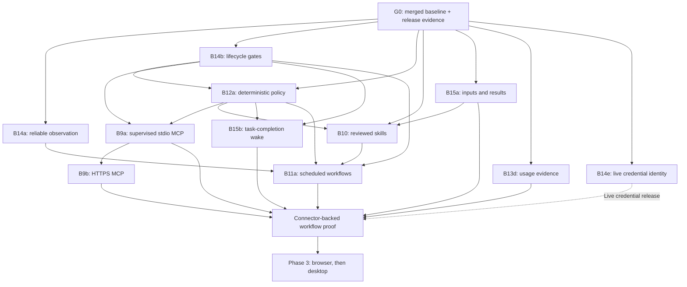

# OpenBot Development Roadmap

Active delivery scope (2026-10-29): role memory/skills (B27a/B27b), routines and summaries (B11a–d), file readers (D9/D10), backup/restore (B14d), reliable web pagination (B4a), official-pagination workflow acceptance (I7) and [bounded history/search (B14c)](tasks/b14c-history-scaling.md) are merged. Verified main is `9898c0a` after documentation closeout #65, including [#64](https://github.com/VesperZephyr/OpenBot/pull/64) with [final integrated acceptance](acceptance/history-scaling-2026-10-28.md#main-integration-and-ci-readiness). [B13e templates](tasks/b13e-bot-templates.md) has a ready implementation spec; product implementation has not started. B14f signed updates follows and still needs a ready spec. OAuth, optional model review and Phase 3 remain deferred.

Status: current queue above; the dated D4 baseline and packet contracts below are retained for dependency context. Implementation status is recorded in the task index and technical plan.
Design record: [D4: Post-B26 Delivery Plan](tasks/d4-delivery-plan.md).
Original D4 review: 2026-10-18. Current delivery status verified: 2026-10-29.
Baseline: `54c2a1c` on `main`, including B26 merged in [PR #27](https://github.com/VesperZephyr/OpenBot/pull/27). The research was imported unchanged from documentation commit `4568df0`; its competitor claims remain a dated research snapshot, not a fresh benchmark.

This plan translates the [Grok Bot research](research/grok-bot.md) into bounded OpenBot work. The [architecture](architecture.md) owns module and authorization contracts; the [technical plan](technical-plan.md) records implementation; the [backlog](backlog.md) indexes capability batches. Existing task specs remain authoritative. Priorities below order the remaining work without expanding the current MVP acceptance scope.

Unlinked future sub-batches remain planning briefs; B14c is merged and its linked spec records completion. Before implementation, each needs one spec in `docs/tasks/` with exact protocol/schema changes, migration and recovery rules, steps, and resolved open questions. Use one task branch and pull request per spec, always targeting `main`. The owner has authorized sequential execution of the queue. Each increment still requires its ready spec before product changes.

## 1. Product outcome and constraints

Deliver a personal Bot that completes a useful task, retains the approved method, and repeats it with visible results and bounded intervention. Optimize successful delivery, recovery, and user effort before increasing the number of tools or Bots.

- One user, one Mac, one local execution target. No hosted computer, cloud control plane, remote pairing, mobile client, or shared Team Bot service.
- All Bots share the Mac, grants, workspace, and future browser logins. Roles and separate contexts are not security boundaries.
- Keep Desktop -> Host Runtime -> Tool Router -> Executor boundaries. Only `agent-runtime` imports Pi. Host tools also pass through Tool Router; executor tools receive a second authorization check.
- Keep model endpoints configurable. Local storage does not imply offline inference.
- Work may continue after the window closes while the Mac stays awake. Sleep, lock, quit, and process loss require reconciliation; do not promise cloud-style availability.
- Preserve stable request/invocation identities, persisted approvals and dispatch intent, and executor receipts. An uncertain external effect is not safe to retry automatically.
- Retain Core-default group routing, explicit recipients, and existing collaboration bounds. Core-only management is an OpenBot decision, not a verified Grok requirement.

## 2. Dated D4 implementation baseline (October 18)

| Area | Evidence at the baseline | Remaining work |
| --- | --- | --- |
| Agent and execution | Pi adapter, configurable models, queue/cap, steering, cancellation, file/command tools, background tasks, web research | Completion wakeups, richer inputs/results, later subagents |
| Policy and durability | Persistent approval, Always allow, folder grants, dispatch records, executor receipts and unknown outcomes | Ask-first rules, active-work revocation, unattended expiry |
| Bot and memory | Protected Core, Specialist management, revisioned Prompt/memory, history/restore, fresh duplication | Templates, usage presentation, separately designed data purge |
| Collaboration | B13a/b/c channel contexts, group lifecycle, bounded delegation, ownership transfer and tree stop | Do not reimplement groups; direct-chat/cross-group peer dispatch stays deferred |
| Conversation UI | B21 shared shell/drafts/mentions; B22 previews/read cursors; B23 history search and unread filtering, all merged | Artifacts, large-history performance and organization |
| Desktop lifecycle | Window/Host supervision and basic native attention logic exist | Sequence-gap recovery/backpressure, Host power-event handling, packaged native validation |
| Application APIs and Code Mode | B24 shared authorized reads, B25 local bounded Pi Code Mode and B26 exact-approved Bot/group mutations are merged | Add future capabilities through explicit descriptors and shared domain services; never expose every Host method |
| Extensions | Architecture seams only for MCP, skills and routines | B9/B10/B11 below |
| Computer control | Browser and computer-use packages not implemented | Phase 3 spikes and implementation |

Evidence: [current-state table](technical-plan.md#11-components), [B22](tasks/b22-conversation-list.md), [B23](tasks/b23-conversation-search.md), [B24](tasks/b24-app-capability-api.md), [B25](tasks/b25-local-app-code-mode.md), [B26](tasks/b26-code-mode-management.md). B26 recorded 278 unit/Host tests, 73 background e2e tests, a four-scenario final UI rerun and isolated real-model six-approval/restart acceptance. These counts are prior implementation evidence; this documentation task does not repeat desktop or real-model acceptance. Repository checks run for the document change are recorded separately in D4 and its PR.

Do not rebuild model entry, protected Core, Prompt/memory controls, groups, collaboration, conversation previews/search, the API gateway or local Code Mode. Keep private Bot chats; only ordinary group messages default to Core. Explicit recipient selection remains available. No Specialists are created on first launch.

## 3. Milestone priority and dependency order

| Priority | Outcome | Batches |
| --- | --- | --- |
| P0 | Verify the merged baseline and make observation, stopping and permissions dependable | G0 automated gate; B14a, B14b, B12a |
| P1 | Deliver useful files first, then a measurable repeatable workflow | B15a, B13d, B10, B15b, B9a/b, B11a; B14e gates live connector credentials |
| P2 | Broaden access and complete production maintenance | B13e, B14c/d/f; signed release evidence |
| P3 | Reach applications without a connector | M3-S/A/B, M6-S/A, M8-A/B |

G0 has an automated development gate and a separate native release evidence ledger. Missing signing certificates or permission evidence blocks the affected release claim, not unrelated isolated development. New Phase 2 work still needs its own ready spec; this roadmap does not add it to MVP acceptance. Phase 3 remains gated on workflow evidence and its packaged spikes. The serial delivery order and exit criteria are in Section 11; dependency edges do not imply multiple agents or concurrent implementation.

The scheduler does not technically require a connector: B11a must also work with local files and web research. Connector integration is a delivery-gate requirement for the business-workflow proof, not a runtime dependency.

## 4. P0: closeout and dependable execution

### G0 — Current increment and packaged MVP acceptance

**Depends on:** merged B1–B8 and authorized product increments through B26. This is an integration/release gate over existing specs, not a new feature batch.

**In:** verify `main` ancestry and the existing suite; reconcile task status, background verification and runtime packaging evidence. Keep native clean-install/signing/permission evidence in a separate release checklist. **Out:** new UI features, connectors, expanded MVP scope and opening the owner’s real-data app.

**Acceptance:**
1. Existing `pnpm run check` and background `pnpm run e2e` pass on the candidate revision, including B22–B26; inspect light/dark, English/Chinese and minimum-width screenshots.
2. In an isolated hidden development shell, verify default Core/model setup, file edit/command, approval persistence, memory reopen, queue/Stop, search and Code Mode recovery without duplicate effects. Separately run bundled Node/Host/executor startup without a GUI. Record candidate SHA and sanitized results; no owner data is used.
3. Record bundled Node/Pi assets and signing mode. Native clean-install, notification, Keychain and power-event checks need a separately authorized visible packaged session or a proven isolated native harness. Current background flags do not make installed production bundles quiet. Do not launch them during background-only acceptance. Missing certificates/consent stay outstanding and block only the associated release claim.

### B14a — Ordered observation and bounded event delivery

**Depends on:** G0; integrate B22/B23 summary/search invalidation and B26 nested activity. **Modules:** protocol, Host composition, server-core, desktop.

**In:** `streamId`/`seq` validation, snapshot recovery after gaps/restart, coalescing, acknowledged backpressure. **Out:** full-text search, virtualization and new task states.

**Acceptance:**
1. Host/renderer tests inject dropped, duplicate, stale and reordered events; the view converges to a fresh snapshot without rolling back newer state.
2. A paused renderer cannot cause unbounded buffering; the spec fixes queue/window limits and tests overflow/resnapshot behavior.
3. Background e2e loses/reconnects a stream while approval, text and unread state change; results appear once and drafts survive.

### B14b — Sleep, lock, quit and pause lifecycle

**Depends on:** G0. **Modules:** desktop main, server-core, agent-runtime, tool-router, executor.

**In:** forward native lifecycle events, gate admission and dispatch, reconcile on wake/restart, define Pause all and explicit continuation. **Out:** keeping the Mac awake after lid-close, desktop control, routine catch-up implementation.

**Acceptance:**
1. Host tests inject lock/suspend/quit before dispatch and during work; no newly gated tool starts, queued work survives, and unresolved effects stay `needs_attention`.
2. Repeated pause/resume/recovery is idempotent; it neither creates a new invocation for an uncertain action nor resumes work the user explicitly paused.
3. Background e2e verifies visible paused/interrupted states and unrelated-Bot behavior; a packaged real-Mac smoke separately checks native event delivery and closing the window versus quitting.

### B12a — Deterministic rules, revocation and unattended approvals

**Depends on:** G0 and B14b cancellation gates. **Modules:** protocol, server-core, tool-router, executor, desktop.

**In:** persisted Ask-first predicates, precedence, exact approval binding, dispatch-time recheck, active-work cancellation on revocation, ten-minute unattended expiry. **Out:** model reviewer, blanket allow rules, cancellation-as-rollback claims.

**Acceptance:**
1. Unit tests prove hard rules > Ask first > Allow automatically > capability defaults; wrong target, changed arguments/revision and stale grants cannot reuse approval.
2. With a fake clock, an unattended approval expires after ten minutes without dispatch; reopening the store preserves its deadline. Ordinary user-started approvals keep their existing behavior. B26 Code Mode has a separate absolute parent deadline even in direct user chat; effective expiry is the earliest applicable deadline. B12a must not lengthen or reset it.
3. Revocation cancels affected supervised work, preserves unrelated work, and reports unconfirmed termination as attention needed; background e2e covers approval, expiry and revocation.

## 5. P1: the first repeatable workflow

### B9a — Supervised stdio MCP connectors

**Depends on:** B12a, B14b. **Modules:** protocol, server-core, agent-runtime, local-executor, Host/executor composition, desktop.

**In:** explicit connector install/remove, namespaced schemas, deferred discovery, supervised stdio process, token credentials from Keychain, routed invocation and receipts. **Out:** OAuth, remote HTTPS transport, marketplace publishing and arbitrary automatic installation.

**Acceptance:**
1. A deterministic local MCP fixture exposes read/write tools; every invocation is bound to the local target and passes policy. Tool annotations do not grant write authority.
2. A sentinel credential reaches only its connector, never another connector/shell, renderer settings, model request or diagnostic record. Remove/revoke blocks new calls and stops the supervised process.
3. Restart/crash tests distinguish known receipts from uncertain effects without blind replay. Background e2e installs, discovers, approves, uses and removes the fixture.

### B9b — HTTPS MCP sessions and failure handling

**Depends on:** B9a. **In:** explicitly configured HTTPS endpoints and token auth; bounded timeouts/output, reconnect, rate-limit handling and session cancellation. **Out:** OAuth and inbound webhooks.

**Acceptance:**
1. A local HTTPS fixture verifies success, invalid schema, expired token, 429 retry delay and broken session; all waits/retries are bounded and visible.
2. Credentials never cross an unapproved origin through redirects; changed tools require fresh schema validation and retain policy checks.
3. A write that loses its response becomes uncertain unless a verified provider idempotency/reconciliation contract proves safe retry; e2e shows actionable reconnect/failure states.

### B10 — Reviewed reusable skills

**Depends on:** G0, B12a; B15a supplies the chosen task-to-skill acceptance fixture. **In:** shared local `SKILL.md` library, validated names/metadata, list/load, explicit attachment, draft/save/update/delete with user review and revisions. **Out:** executing arbitrary bundled scripts, marketplace, demonstration capture.

**Acceptance:**
1. A scripted successful task produces a reviewable skill covering input, steps, validation, output and approval boundaries; deny leaves the library unchanged and approve saves once.
2. A second Bot can load the skill after restart without receiving new grants; stale edits and path traversal are rejected. Accepted messages record the skill revision actually used.
3. E2e attaches/reuses the skill and confirms that loading untrusted instructions cannot bypass Tool Router. Versioned content used by a run remains identifiable.

### B15a — Bounded inputs and result artifacts

**Depends on:** G0. **In:** native-selected text/Markdown/CSV and supported image inputs, authorized import/export, bounded artifact metadata and storage, safe result cards/previews. **Out:** Office editing, live web embeds, multimedia pipelines and new document-generation services.

**Acceptance:**
1. Arbitrary renderer paths, traversal/symlink escapes, unsupported formats and over-limit payloads are rejected; the spec fixes per-file, total-storage and retention limits before execution.
2. Text and image fixtures reach compatible model input; incompatible models get an explicit error. Previewed HTML/script payloads cannot execute or read other local files.
3. Background e2e imports a selected file, removes the original, retries an uncertain send with the same request ID, then reopens the result after restart and exports via authorized selection. Input/result retention is distinct from seven-day spill cleanup; missing/expired content is visible rather than an empty success. Spill-file limits are covered too.

### B13d — Usage and execution evidence

**Depends on:** existing Runs/receipts; delivered in P1 before repeated or scheduled workflow trials. **In:** per-Bot/Run token usage, estimated cost when rates are known, model/source attribution and links to results. **Out:** remote telemetry, billing services and guessed prices.

**Acceptance:** retries and restart do not double count; provider generation usage is not counted again as Code Mode child usage; unknown rates display unavailable rather than zero; background e2e links a Run, approval, result and available usage; operational diagnostics exclude task content and secrets.

### B15b — Background-command completion wakeups

**Depends on:** B14b and B12a. **In:** durable completion subscriptions, a deduplicated continuation in the originating context, stop/delete handling and visible result delivery. **Out:** parallel model subagents and cross-chat dispatch.

**Acceptance:**
1. A command finishing after its original model turn wakes the owning Bot once; duplicate completion and a restart between receipt and admission do not duplicate the logical continuation.
2. Completion cannot resurrect a cancelled task, deleted Bot or dissolved/invalid group; the new work uses the existing queue and unattended policy.
3. E2e receives a final result without repeated polling prompts, while another conversation continues normally.

### B11a — Time-based routines and run history

**Depends on:** B10, B12a, B14a/b. **In:** explicit create/update confirmation, local timezone schedule, isolated occurrence context, stable occurrence identity, test run, report delivery, pause/delete, bounded history and coalesced catch-up. **Out:** event triggers, inbound servers, cloud scheduling and autonomous creation of routines.

**Acceptance:**
1. Fake-clock/store tests cover timezone and daylight-saving transitions, duplicate firing, restart between admission and recording, disabled/deleted routines and per-Bot admission. Each scheduled occurrence has one logical Run and report.
2. Sleep/relaunch coalesces missed work to at most one eligible catch-up, records skips, honors the chosen window and does not restart explicitly paused work. Enforce the architecture's initial product limits: 50 routines/Bot, five-minute spacing and 20 retained run records; these are product choices, not scheduler constraints.
3. Background e2e creates a routine, performs an end-to-end test run through ScriptedModel, survives restart, shows its report/history, and expires an unattended write approval without execution.
4. An occurrence cannot contaminate private/group context or gain Core management authority. A missing/stale source produces an explicit failure or partial result; no fabricated successful report.

The [B11a spec](tasks/b11a-local-routines.md) fixes occurrence mapping, publication receipts, unread projection, exact skill versions, catch-up, absence and overlap. Initial management is through the confirmed panel; model proposals remain a separately scoped follow-up. Host expiry uses deterministic clock tests; desktop tests verify unattended deadline presentation and disabled controls.

### P1 delivery gate — demonstrate the whole workflow

Use a deterministic CRM-style MCP fixture plus local source files: read current records, research a referenced public fixture page, create a report and proposed updates, obtain exact approval for a write, save the corrected method as a skill, then run it as a routine. Inject 429, revoked auth, a Host restart and a lost write result. Verify no unapproved write, no duplicate confirmed effect, and explicit partial/unknown results. This is an integration acceptance of the batches above, not a new orchestration framework. [I3](tasks/i3-workflow-acceptance.md) defines the reproducible capture-based CI path and a separate live-fetch spot check; [current evidence](acceptance/workflow-2026-10-20.md) records their distinct outcomes.

## 6. P2: broader access and maintainability

B14c, B14d and B14e are merged; their rows retain the delivery contracts. B13e has a ready spec; B14f still needs one. Planned acceptance is not an existing test pass.

| Batch / prerequisites | In / out | Acceptance |
| --- | --- | --- |
| **[B13e templates](tasks/b13e-bot-templates.md), ready** — B10, B27b, D6, B14d | Versioned bounded JSON export/import of profile, instructions, avatar and exact skill references. No skill bundles, public marketplace or Team Bots | Import creates a new identity and preserves Core restrictions; exported fixtures contain no memory, history, credentials or grants; missing skills/models require explicit resolution; duplicate import behavior is defined and tested |
| **[B14c search scaling and long history](tasks/b14c-history-scaling.md), merged #64** — B23/B24, B14a, B14d | Persistent/rebuildable indexing and bounded transcript rendering over existing literal search semantics. No new search syntax, group pin/hide or changed read semantics | A fixed 10,000-entry fixture renders a bounded viewport; search locates retained messages with navigation; e2e preserves scroll/read cursor during streaming and compaction; index rebuild cannot expose deleted identities |
| **B14d consistent backup/restore, merged (#61)** — G0, repeat for new persisted features | Versioned consistent snapshots of Host/executor state, artifact contents and metadata, and the skill library. Browser profiles and user-project files have a separately declared scope. No automatic cloud upload | Delete the original fixture data, restore, open artifacts and load skills with identical content/versions; Bot/approval/receipt relationships survive; incompatible/corrupt backups fail before replacing active data; uncertain work never reruns automatically; credentials are not exported as plaintext |
| **B14e credential identity, merged (#38; signed-release evidence remains open)** — G0 | Replace Host `/usr/bin/security` access with decided main-process or signed-helper ownership. No wider credential inheritance | Packaged real-Mac tests cover read/write/relaunch and signature identity; renderer APIs return only redacted metadata; connector/shell fixtures receive only authorized secrets; migration preserves existing settings without logging values |
| **B14f signed updates** — B14d/e, certificates available | Verified update, migration failure handling and rollback-compatible data strategy. No release publication by an agent | Local update fixtures reject invalid artifacts; packaged upgrade/relaunch preserves state and credentials; failed migration retains a restorable snapshot; Developer ID/notarization evidence is recorded separately from ad-hoc builds |

## 7. P3: browser, desktop and demonstration (deferred)

| Batch / prerequisites | In / out | Acceptance |
| --- | --- | --- |
| **M3-S browser feasibility spike** — P1 delivery gate | Isolated managed profile, DevTools pipe, two Bot windows. No product tool exposure | Reproducible harness verifies shared login reuse, background-window responsiveness, process restart and private control channel; record browser/version evidence and unresolved constraints |
| **M3-A managed browser** — M3-S, B12a, B14b, B15a | `packages/browser` through executor only; per-Bot windows, snapshots, bounded input and visible activity. No real desktop input | Two Bots operate local fixture sites without cross-window input; stale frame/element references fail; browser crash leaves uncertain effects explicit; background e2e covers result capture and cancellation |
| **M3-B takeover and secrets** — M3-A, B14e | User takeover, window gating, masked secret request and reference-based fill. No CAPTCHA bypass or password in model context | While taken over no Bot input occurs; release requires a fresh snapshot; sentinel secret never appears in transcript/model/log/ordinary tool result; isolated packaged login persists in the managed profile |
| **M6-S native permission spike** — M3-B, packaged helper identity | Dedicated signed Swift helper with disclaimed responsibility, capture/input/permission probing. No general desktop automation | Real-Mac packaged harness verifies helper TCC attribution, revoked permissions and that shell/MCP children do not inherit its grants; tests cannot be replaced by renderer mocks |
| **M6-A desktop control** — M6-S, B12a, B14b | One selected display, exclusive lease/epochs, visible control and pause, fresh observation. No multi-display or multi-machine control | Packaged tests reject obsolete frames after lock/display/session change, block input after pause, serialize two Bots, and preserve human takeover; unrelated file/connector work remains possible |
| **M8-A dictation** — packaged permission baseline | Editable speech-to-text input and explicit transcription setting. No live voice agent | Denial/cancel leaves the draft intact; recording does not send a message; IME/draft/send behavior remains correct; test fixtures and packaged microphone evidence are separate |
| **M8-B teach a task** — M3-B, B10 | Browser demonstration up to ten minutes into a reviewable skill. No automatic deployment or desktop-wide recording | Recording omits protected secret values/audio, stops on takeover/permission loss as specified, produces a draft with explicit gaps, and saves only after review; e2e reruns the approved skill on a changed fixture rather than replaying raw coordinates |

## 8. Deferred scope

Do not add these incidentally: hosted VMs, remote execution/pairing, mobile sync, Team Bots/multi-user access, payments, Bot-owned email, X distribution, public marketplace, inbound webhooks, live voice calls, or local VM isolation. Local event triggers need a later polling/file-watch design; the first-release routine contract remains time-based. Direct-chat/cross-group peer dispatch, parallel model subagents, vector memory, full data erasure and group organization need separate evidence and specs.

## 9. Verification and measurement

For each implementation batch: run `pnpm run check`; extend ScriptedModel background e2e for every visible or Host/executor behavior; run `pnpm run e2e` and inspect `e2e/.run/` screenshots. Use deterministic fixtures and isolated data/Keychain services. Test names and fixture limits must be fixed in the ready spec. English is the default; all added application text must also support Simplified Chinese. Verification remains hidden, non-focusable and silent, with a separate explicit opt-in for visible native work. Real-model observations supplement these checks and must state the task, sanitized configuration class, capabilities and limitations. Public model names may be included when appropriate; private endpoint/provider/model identities, credentials and transcripts stay outside Git.

Record for the P1 workflow set: completed/partial/failed/unknown result; manual interventions; elapsed time; tool retries; tokens and estimated cost when known; recovery behavior. Initial invariants are zero unapproved writes, zero repeated confirmed effects in the failure fixtures, and explicit presentation of every unknown outcome. Establish a task-quality baseline before setting production success-rate or cost targets; do not invent a competitor benchmark.

A documentation update does not establish product acceptance. Native permissions, signing, notifications and power behavior require packaged evidence on a real Mac; current background-only authorization does not permit a visible production app launch. Each landed batch updates the current-state table and backlog with actual checks and outstanding limits.

## 10. Decisions required before execution specs become ready

| Decision | Owner batch | Required output |
| --- | --- | --- |
| Credential-reference behavior at desktop startup | G0 / focused follow-up if needed | Documented supported path for `$NAME`, Keychain and `!command`; no broad environment import |
| Event windows, lifecycle pause semantics and cancellation outcome mapping | B14a/b | Explicit protocol/state transitions and deterministic failure tests |
| Rule predicates, revocation scope and unattended origin classification | B12a | Versioned schema and migration; group/peer provenance preserved |
| MCP transport/version, schema changes, credential binding and retry classification | B9a/b | Narrow supported matrix and provider-independent failure fixtures |
| Skill revisions/attachments and artifact formats/quotas/retention | B10 / B15a | Exact reference formats and data migration/cleanup rules |
| Routine occurrence context, scheduling, overlap and report delivery | B11a | B13a-compatible identities, persisted deadlines, catch-up and absence policies |
| Credential helper ownership, backup consistency and update compatibility | B14d/e/f | Packaged evidence, data-format migration and rollback constraints |
| Browser launch support, helper TCC identity and protected-field capture | Phase 3 spikes | Reproducible feasibility reports before implementation specs |

## 11. Delivery queue and execution packets

Current queue: B13e ([ready spec](tasks/b13e-bot-templates.md)) → B14f (planning brief). Rows 0–11, B14d and B14c below have landed; their contracts remain reference material. B4a is merged in #62.

B13e reuses the reviewed skill library, exact per-role skill references and existing Bot creation guards. Its ready spec fixes the versioned export allowlist, bounded avatar portability, missing model/skill resolution, import preview, durable request identity and duplicate/restart behavior. Export excludes memory, history, credentials and grants; importing creates a new Specialist identity without Core authority. Do not silently install referenced skills, grant capabilities or import group/routine bindings. These are design requirements, not implemented template behavior. B14f follows with update verification, migration/rollback and separate Developer ID/notarization evidence. Signing prerequisites must be checked before claiming a release-ready update path.

This is a dependency-driven queue for one implementation stream, not a calendar commitment. Each row is one reviewable spec/PR unless explicitly a gate. Prerequisites normally merge to `main` before dependent implementation. For the owner-authorized uninterrupted queue, [I1](tasks/i1-product-foundation.md) assembles reviewed prerequisite heads on an integration branch and validates their combined contracts before B10 starts. Dependent task branches may start from that verified candidate; each PR still targets `main` and records its dependency. Only the owner merges. A design packet may be prepared earlier. Re-estimate after each accepted increment using actual effort and defects; no dates or staffing commitments are assumed.

Effort bands indicate scope only: **small** is a focused existing-surface change; **medium** crosses protocol/Host/UI; **large** adds a persisted lifecycle or process boundary and should be split at design review if it cannot fit one verifiable PR. All include failure tests, bilingual UI, background verification and documentation.

| Order | Packet | Deliverable the user can observe | Entry / exit gate | Effort |
| --- | --- | --- | --- | --- |
| 0 | G0 | The current Core, chats, groups, search and approved Code Mode work together on the merged baseline | Record automated results and unresolved native release evidence; no new feature code | Small |
| 1 | B14a | Reconnecting never loses a result, pending approval or unread update | G0; bounded queue/gap tests and reconnect e2e pass | Medium |
| 2 | B15a | Drop/select supported material, receive a persistent result card, reopen and export it | G0; exact import/storage/preview limits and permissions fixed first | Large |
| 3 | B14b | Pause all and interrupted-work states match what Host/executor actually do | G0; no post-gate dispatch, repeated wake/restart/Stop tests pass | Large |
| 4 | B12a | Users can inspect Ask-first rules, revoke access and understand approval expiry | B14b cancellation contract; precedence, active revocation and earliest-deadline tests pass | Large |
| 5 | B13d | A task exposes its model, token usage and estimated cost when available | Existing receipts; nested/replayed usage cannot double count | Medium |
| 5a | I1 | Observation, artifacts, lifecycle, permissions and usage work as one desktop | Exact reviewed PR #28–#33 heads; combined interrupted usage, attachment continuation, Ask first publication and receipt recovery evidence | Integration gate |
| 6 | B10 | Turn an accepted report workflow into a reviewed skill and reuse it | B12a + B15a fixture; revisioned skill and attachment survive restart | Large |
| 7 | B15b | A background command returns its final result without repeated user polling | B14b + B12a; durable wake deduplication and cancellation tombstones pass | Medium |
| 8 | B9a | Connect apps can install, inspect, use and remove a supervised stdio fixture | B12a + B14b; credential isolation, tool changes and unknown writes tested | Large |
| 9 | B14e, then B9b | A supported token connector can use the decided credential owner and bounded HTTPS transport | B14e packaged identity evidence gates live secrets; HTTPS may develop against synthetic credentials first | Separate medium / large PRs |
| 10 | B11a | Create, test, pause and inspect one reliable local scheduled workflow | B10 + B12a + B14a/b; occurrence/report identities, absence and overlap rules fixed | Large |
| 11 | P1 workflow gate | Reuse and schedule a report, propose a connector update, recover failures honestly | B9a/b + B10 + B15a/b + B13d + B11a; evidence pack below | Integration gate |
| 12 | B14d, B14c, B13e | Restore state, keep long histories responsive, then reuse Bot templates | Independent ready specs; backup/migration evidence required before destructive format changes | Separate large / large / medium PRs |
| 13 | B14f | Signed updates | Relevant security and packaged prerequisites; no automatic release publication | Separate specs |
| Deferred | Phase 3 | Managed browser first; takeover/secrets; native desktop; optional dictation/teaching | P1 workflow evidence and each feasibility spike; see Section 7 | Separate spikes/specs |

B14e and B14d are safety dependencies, not permission to postpone credential or migration checks: a batch that changes credential ownership or irreversibly changes storage must bring the relevant design/evidence forward. B9b is not needed to develop local routines, and no connector is needed for the first local report workflow.

### Packet 1: B14a — observation foundation

**User story:** Core is waiting for approval; the renderer disconnects while a child finishes; reopening the conversation shows the current approval, completed object and unread status exactly once.

**Design outputs before readiness:**
- Inventory the current Host event envelope and all consumers: conversation projection, group/publication feed, list/search invalidation and nested application executions. Define stream lifetime, sequence monotonicity and snapshot watermark semantics.
- Specify snapshot/delta reconciliation with old-stream rejection. Preserve B22 rendered-timeline read acknowledgements and B23 search-mode suppression; reconnect must never mark a chat read merely by fetching it.
- Choose bounded outstanding-event count/bytes and acknowledgement behavior. Coalesce replaceable state updates; recover from overflow by a snapshot, never silently drop a required approval/result.
- Define disconnect/unsubscribe/Host restart cleanup and whether the snapshot carries a consistent stream watermark. Version the protocol only as required by the repository's compatibility policy.

**Implementation cuts within the PR:** protocol contract and Host fixture; bounded publisher; renderer recovery; group/search/Code Mode integration; background e2e and documentation.

**Required fixtures:** duplicate delta, gap before approval, old stream after restart, snapshot arriving after a newer delta, paused renderer flooding, unsubscribe cleanup, and repeated recovery with an unsent bilingual draft. Assert bounded memory/event counts, not just eventual UI text.

**Out:** new unread mutations, permanent indexing, transcript virtualization, scheduler work and a general event-bus rewrite. Pi remains the source of agent state; this packet fixes application delivery.

### Packet 2: B15a — file inputs and results

**User story:** select a CSV or text file, ask a Bot to analyze it, receive a durable report card, quit/reopen, and export the same result.

**Design outputs before readiness:** define `artifactId`, input/result roles, original display name, media type, size/hash, local object reference, owner Run/message association and missing/expired states. The Host owns metadata and validates renderer requests; authorized file acquisition/export happens through the established desktop selection and executor boundary. File picker selection is narrow authority, not access to an arbitrary renderer path.

Fix supported formats, file/count/total quotas, image decoding limits, retention and deletion behavior. Separate durable inputs/results from existing temporary tool spills. Persist a selected input before accepting a send; bind artifact IDs to the immutable send request so a retry does not re-import or duplicate the message. Decide model compatibility before sending images. No Office/PDF generation engine or arbitrary active HTML preview in this packet.

**Implementation cuts:** data contract and migration/reconciliation; validated import; typed model input; authorized result registration; safe preview/download/export; missing-content and restart flows. Existing command/file tools can generate content; a result card requires a validated artifact reference, not a model-supplied filesystem path.

**Acceptance product states:** selecting, uploading/importing locally, attached draft, sending, processing, result ready, unsupported, quota exceeded, missing and export failure. English/Chinese, keyboard removal, draft preservation and minimum-width layouts all need screenshots. Background verification injects file selection through a test seam; it never opens native Finder dialogs on the owner's desktop.

### Packets 3–4: B14b and B12a — reliability before unattended work

B14b owns the lifecycle state machine and admission/dispatch gates. B12a consumes those gates for revocation; it must not implement a competing cancellation path. Fix the boundary between stopping model generation, cancelling a queued child, terminating executor work and reconciling an external effect. A paused conversation and a disconnected renderer are different states.

Prepare a table for user Pause all, resume, Stop one Run, lock, unlock, sleep, wake, quit and restart. For each, specify treatment of queued Runs, approval waits, admitted Code Mode parents, pending children, active commands, group roots and future wakeups. Only explicit resume clears an explicit user pause. Clearing a UI flag must not admit work before Host reconciliation.

B12a must share B26 exact approvals and immutable proposal bindings. A waiting script cannot gain a new ten-minute window when policy is reloaded or the Host restarts. Revoking a grant cancels only affected supervised work; already committed effects remain in the local history. Its spec must distinguish the runtime authority deadline from policy approval expiry and document which one terminated a step.

### Packets 5–11: assemble the workflow incrementally

| Checkpoint | Demonstration | Persisted evidence | Failure to inject |
| --- | --- | --- | --- |
| Useful report (B15a + B13d) | Selected synthetic CSV plus public/local research fixture becomes an inspectable report | Accepted inputs, report artifact, Run/result linkage, available usage | Missing source, unsupported model input, result deleted before reopen |
| Reusable procedure (B10) | Correct the report method, review/save a skill and use it on a changed dataset | Exact saved revision and accepted skill reference | Denied save, stale edit, missing skill revision |
| Completion delivery (B15b) | A long command finishes after the initial answer and delivers one result | Task receipt, subscription, continuation/publication receipt | Duplicate completion, Host loss before wake, Stop before finish |
| Connected work (B9a/b) | Read synthetic CRM records; propose one exact update | Connector identity/schema, invocation/approval/receipt, proposed diff | Credential revoked, schema changed, 429, lost response after write |
| Scheduled local report (B11a) | Test one routine, simulate sleep and show one eligible catch-up report | Routine revision, occurrence identity, skill revision, report identity | DST boundary, overlap, pending approval timeout, missing source |
| End-to-end gate | Combine report, connector, skill and routine after all independent gates pass | Sanitized evidence manifest with candidate SHA and outcome metrics | Restart after commit before publication; no duplicate confirmed write/report |

No automatic onboarding demo Bots or preinstalled routines are introduced. Use synthetic resources only in tests. The user creates Specialists and explicitly saves skills/routines.

## 12. Application capabilities and Pi reuse across the plan

B24–B26 are the common foundation. Each new application capability must declare audience, trusted origin/channel, target, input/output schema, result bound, effect class, approval, revision/idempotency and recovery behavior before model exposure. Desktop and model adapters call the same Host domain operation. A desktop menu or method is not automatically a Code Mode API.

| Surface | Planned exposure | Required boundary / owner |
| --- | --- | --- |
| Existing chat search/read and Bot/group management | Keep B24–B26 unchanged | Direct user-origin Core can manage; group Core has scoped reads; Specialist and automatic continuations cannot become a direct Core user Run |
| Artifacts | Register/read only accepted local references needed by the current work; exact API names remain B15a decisions | Host validation and executor file checks; no arbitrary paths, credential files or hidden exports |
| Skills | List/load and explicit message attachment; reviewed draft/save uses the B10 contract | Shared library does not grant tools; stable revision; a stored skill never creates approval or changes its audience |
| Routines | Explicit proposal and user confirmation; execution uses separate occurrence authority | B11a fixes who may propose/manage which routine; a scheduled Core occurrence cannot use B26 direct-user management |
| Connectors | Executor tools through Tool Router and Pi deferred discovery | Do not automatically add connector tools to the application Code Mode namespace; any composition support needs explicit scope, budgets and recovery design in B9 |
| Policy, credentials, approval decisions, UI navigation and memory outside the calling Bot | No incidental new model API | Separate spec and authority decision; never expose a generic `host.call(method, params)` bridge |
| Usage/history | B13d read projections if needed | Aggregate without leaking secrets or double-counting Code Mode child/provider usage |

Reuse vendored Pi conversation/context management, compaction, execution tasks, deferred tools, cancellation, usage and Code Mode through `agent-runtime`. Implement product library/scheduler/policy/UI services in OpenBot. Check the current vendor source before choosing an integration; reuse does not mean installing unrestricted Pi CodingTools, adding `pi-coding-agent`, changing the vendor baseline, or assuming Durable provides a scheduler or ready-made product skills UI.

## 13. Verification, handoff and planning control

Every ready spec must name its fixtures and acceptance before implementation. Apply this matrix to each affected surface:

| Layer | Required evidence |
| --- | --- |
| Contract and state | Strict input/output bounds; invalid authority; stable IDs; atomic receipts; stale revision; migrations and compatible restart |
| Executor/transport | Cancel/timeout, repeated delivery, response lost after effect, process loss and unrelated-work isolation |
| Desktop | English default and Simplified Chinese; keyboard/IME/drafts; loading/empty/error/attention/partial states; search/read semantics preserved |
| Background e2e | ScriptedModel, isolated data/workspace/Keychain, hidden non-focusable windows, no notifications/badges/tray/power side effects; screenshots inspected |
| Real model | One bounded synthetic workflow after scripted checks; verify actual objects/files/receipts, not the model's success text; record selected endpoint class and clean test resources |
| Native release | Separate evidence for signing, permission identity, notifications and power events; never substitute an unsanctioned foreground production launch |

A real provider may be unavailable or lack a required modality. Record that limitation and leave the affected acceptance item unverified; do not claim a scripted response is a real-model pass. Documentation-only work checks links, baseline and consistency and does not launch the application or rerun costly model calls.

**Evidence pack per implementation PR:** spec acceptance checklist; exact commit; commands and test counts; fixture IDs; sanitized screenshot references; real-model actions and resulting receipts; remaining risks. Keep transcripts, credentials, personal files and raw diagnostic bundles outside Git. Logs carry correlation IDs and outcomes by default, with bounded local retention; content capture requires an explicit design and user control. No automatic uploads or analytics are added.

**Merge and release:** one ready task spec per branch/PR, target `main`; the owner merges. A merged task becomes `done`; an open PR is `in review`, even when tests pass. Update backlog and technical current state with actual evidence. Keep the next unstarted packets `draft` until their contracts and open questions are resolved. A milestone gate accepts the integrated user outcome, not only its individual unit tests.

**Review after each packet:** compare scope and actual effort, new defects, interventions, time-to-result, token/cost availability and recovery outcomes. Reorder only unstarted packets, recording changed dependencies here. Do not pursue generic parity, a new agent runtime or another UI rewrite when a concrete workflow is still missing its result, approval or recovery behavior.

## 14. Delivery checkpoint

October 29: main `4d1c5c3` contains B14c/#64, B4a/#62, I7/#63 and B14d/#61. B14c is done; see the active queue and dated acceptance above. The following checkpoint records the earlier P1 integration evidence.

D4 (#28), I1 (#34), B10 (#35), B15b (#36), B9a (#37) and B14e (#38) are merged into main through `b95ade7`. I1 includes the reviewed B14a/B15a/B14b/B12a/B13d implementation heads. Their earlier evidence remains in the individual task specs.

[B9b](tasks/b9b-https-connectors.md) is implemented in PR #39: bounded HTTPS MCP sessions, explicit reconnect, persistent retry cooldown, private token handling and honest unknown outcomes. It is merged. [I2](tasks/i2-mvp-acceptance.md) verifies this integrated MVP candidate and supplies a bilingual introduction and authentic product screenshot; see the [acceptance record](acceptance/mvp-2026-10-19.md). I2 does not add routines or computer control to MVP acceptance.

B11a local routines is merged in PR #41. [I3](tasks/i3-workflow-acceptance.md) implements the P1 integration gate in PR #42; [evidence](acceptance/workflow-2026-10-20.md) records automated/real-model results and the unavailable live public fetch. Developer ID identity, notarization, update continuity, clean-install acceptance and physical native lifecycle evidence remain release gates.
