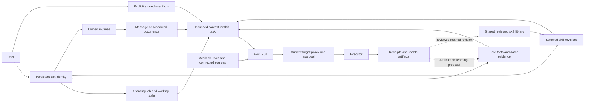

# Persistent Bots: Roles, Memory, Skills and Continuing Work

Research date: **2026-10-22**. Baseline: OpenBot `main` at `b04aa77`, including merged B6a (#43) and D5 (#44). [D6](../tasks/d6-bot-role-design.md) owns this documentation task. This report proposes product direction; it does not introduce a runtime contract or authorize implementation. [Architecture](../architecture.md) and the individual implemented specs remain authoritative.

Integration note (2026-10-23): the implementation comparison below remains tied to the research baseline. Subsequent B27a (#46), B27b (#47), I4 (#48) and desktop D6 (#49) implemented and checked portions of the proposed direction; see the [current technical plan](../technical-plan.md) for delivered behavior and remaining gaps.

## Recommendation

Make the Bot the durable owner of a useful responsibility. Its identity should connect an understandable job, attributable knowledge, selected procedures, usable tools and inspectable results. A recognizable name helps users return to it; dependable corrections and repeatable outcomes give them a reason to return.

For OpenBot, prioritize a coherent role experience over adding more tool families: users should be able to answer **what this Bot owns, what it knows, how it works, what access is missing, and what it has actually completed**. Keep these as separate objects behind one approachable interface. Learning a fact, revising a procedure and granting access are different operations.

## What Grok documents, and what remains unknown

Official sources below were rechecked on the research date. Product documentation describes supported behavior, not backend code or measured reliability. The installed-client observations and archived prompt are separate evidence categories.

| Question | Official evidence | Boundary or unresolved point |
| --- | --- | --- |
| What is the main product object? | The design article organizes the interface around persistent Bots. Its five objects are Bots, chats, prompts, tools and artifacts. Tools/skills are account resources; memory/routines follow a role. Groups supply shared project context. [Product design](https://x.ai/news/designing-grok-bot) | This is a conceptual model, not evidence of separate compute or database instances for every Bot. |
| What defines a role? | A Bot has a name, label, description and avatar. Standing responsibilities belong in its description; a task message describes the immediate job. Duplication carries configuration, enabled skills and routines but excludes learned memory, conversation history and attachments. [Bots](https://docs.x.ai/grok-bot/bots) | The duplication reference to enabled skills does not establish the exact selection, inheritance or update rules for personal Bots. |
| What is a personal skill? | Private skills form one library available across a user's Bots. A skill describes a method, including inputs, validation and approval points; a routine activates work for one Bot. Demonstrations produce drafts for review and testing. [Skills and routines](https://docs.x.ai/grok-bot/skills-routines-and-automations) | Private means user-library scope here, not exclusive ownership by one personal Bot. Skill availability alone supplies neither a login nor permission. |
| Where does capability live? | Personal Bots share their account's computer, filesystem, browser sessions and installed connectors; separate screens are work surfaces. Connector access is preferred where available. [Computer and apps](https://docs.x.ai/grok-bot/computer-and-apps) | A role label is not a security boundary. Cloud availability does not transfer to a sleeping local Mac. |
| What makes a role improve? | Setup begins with a focused job and an initial task. The use-case guide recommends correcting a real result, saving the successful method, testing another input, then automating with defined failure handling. [Setup](https://docs.x.ai/grok-bot/get-started), [Use cases](https://docs.x.ai/grok-bot/use-cases) | This supports an operational learning loop, not a claim of automatic model training or reliable generalization from one example. |
| Is a Team Bot just another personal Bot? | Team Bots have centrally maintained setup, explicitly shared team facts and private per-person notes. Owners/managers maintain team skills; ordinary members' lessons stay in their personal notes until promoted. Routines remain personal to their creator. Public templates instead produce separately maintained copies. [Team Bots](https://docs.x.ai/grok-bot/team-bots) | Multi-user identity and privacy are separate product contracts; OpenBot remains single-user. Public-template memory content must be inspected, not assumed empty. |

The strongest transferable principle is **shared methods and tools, focused role context, and explicit work ownership**. This does not require separate model weights, private computers, a vector database or a worker hierarchy for each role.

### What the archived prompt adds

The [2026-10-20 prompt](https://phistory.cc/captures/grokbot/2026-10-20/variants/default/prompt.md) and [metadata](https://phistory.cc/captures/grokbot/2026-10-20/variants/default/meta.json) identify an unverified, redacted model self-report. It suggests own/shared profiles, own/shared journals, a small persistent context, recent events and recall with dates and originating-Bot attribution. Its recall description mentions word overlap and literal fallback. This does not establish production storage, embeddings, ranking or retention.

The official [personal-Bot overview](https://docs.x.ai/grok-bot/overview) emphasizes separate learned context, whereas the self-report describes shared user facts. Shared personal memory remains a hypothesis for OpenBot, not an independently verified Grok contract. Its newest-record-wins rule also risks reviving stale information imported later. D5 recommends distinct source, event and recording times, with explicit correction precedence. Finally, “profile memory” describes retained facts; editable Bot identity and standing instructions are separate objects.

### What the installed client adds

Read-only inspection used `/Applications/Grok Bot.app/Contents/Resources/app.asar`, version **0.71.2**, without opening the application or reading account data. This is the same package version recorded by [D2](../tasks/d2-grok-ui-research.md#reproducible-client-evidence), not a claim about the newest available release. Existing `@electron/asar` 3.4.1 extracted named assets in memory; SHA-256 identifies the inspected bytes. No application code or artwork is copied into the repository.

| Archive entry | SHA-256 prefix | Narrow observation |
| --- | --- | --- |
| `package.json` | `4a990be80cf0aee5` | Identifies version 0.71.2. |
| `dist/renderer/assets/index.eager-app-DSuGVQNC.js` | `cb1f20a05ee14c4e` | Client handlers list user/Bot memories by `agentId` and promote selected `factIds` to team memory. Nearby team-context handlers add/update/remove agent skills. |
| `dist/renderer/assets/chunk-bot-template-details-dialog-DDulAFr1.js` | `0b8b77286d23efeb` | Template-detail rendering checks separate description, memory, skills, routines and plugin fields; memory entries have content. |

Reproduce the inspection by listing that archive and extracting those entries with `@electron/asar`; hash the raw buffers. Search the eager asset for `listGrokBotUserBotMemories`, `promoteGrokBotMemoriesToTeam` and `updateGrokBotAgentSkill`; inspect their request arguments and surrounding team context. Inspect the template asset's field-selection and memory-entry rendering. Do not execute bundled application code or call the discovered APIs.

These observations support explicit selection/promotion and inspectable configuration in the client. They do **not** prove that every account exposes those controls, that personal Bots have private skill stores, or that backend writes enforce any particular consistency model. A template representation capable of carrying memory is also different from duplicating a Bot without its learned history. OpenBot should keep its own planned memory-free export contract explicit.

### Questions public evidence does not settle

- Exact personal-Bot skill activation/defaults, catalog filtering, revision pinning and conflict resolution.
- Personal-memory extraction triggers, record schema, retrieval algorithm, compaction and prompt budgets.
- Ordering of concurrent corrections, cross-Bot shared-fact reconciliation, deletion and restoration behavior.
- Whether routine executions bind old or current role/memory/skill configuration, and how uncertain external effects recover.
- Learning accuracy, latency, cost and improvement over time on comparable workflows. No live Grok trial or comparative benchmark was performed here.

## OpenBot's actual foundation

Inspecting code matters because the architecture describes some future fields as well as shipped behavior.

| Object | Verified current behavior | Missing role experience |
| --- | --- | --- |
| Identity | `BotProfile` has a stable ID, kind, revision, name, role, instructions, optional model/thinking level and lifecycle state. Core authority comes from persisted identity and invocation context. [Protocol](../../packages/protocol/src/index.ts), [runtime](../../packages/agent-runtime/src/index.ts) | No persisted avatar, per-Bot skill defaults, source bindings or tool-family profile fields in the current type. Naming these in architecture does not make them implemented. |
| Memory | Per-Bot 8 KiB Markdown, revisions, CAS, replay protection and bounded snapshot restore. Direct/group/routine contexts share it. [Memory](../../packages/agent-runtime/src/memory.ts), [D5](memory-design.md) | No individual fact provenance, shared user profile, structured episodes or selective fact recall. Current Bot memory is not private to its direct chat. |
| Skills | Shared reviewed library; names/descriptions in the prompt; exact content loaded on demand or attached. At most two exact references per direct message; routine references are also pinned. [Prompt](../../packages/agent-runtime/src/prompt.ts), [skill service](../../packages/server-core/src/skills.ts), [B10](../tasks/b10-reviewed-skills.md) | No default skill association on a Bot profile. No claim of skill-specific expertise from merely listing a procedure. |
| Tools and access | Runtime offers registered tools with management/collaboration differences by context. Host policy and target-bound executor checks control execution. Connectors have separate lifecycle and discovery. [Runtime](../../packages/agent-runtime/src/index.ts), [router](../../packages/tool-router/src/index.ts), [connectors](../../packages/server-core/src/connectors.ts) | No coherent role-level view connecting a job to required sources, available procedures and missing access. |
| Continuing work | Durable Runs/receipts, artifacts, bounded group handoff and local routines already supply work identity and outcomes. [B11a](../tasks/b11a-local-routines.md), [I3](../acceptance/workflow-2026-10-20.md) | Results are evidence to reuse; a learned summary must not replace their status. Routine proposal through chat remains a separate follow-up. |
| Copying | Duplicate copies role/instructions/model settings into a fresh Specialist; it does not copy memory, history or routines. [Host method](../../packages/server-core/src/index.ts) | Template import/export remains B13e; Grok's different duplication rules are not the OpenBot contract. |

## Proposed OpenBot object model

The following diagram describes a **proposal**, not Grok internals or a new persistence schema. The shared-user-fact and role-configuration edges are additions requiring specs; memory, skills, routines and execution already have established owners.

### A role has an outcome, not only a personality

Offer a small editable role card: name, primary responsibility, expected output, working style and default sources/methods. Begin with a concrete useful task rather than requiring users to complete a large configuration form. Existing Prompt remains the place for standing instructions; a later structured editor must have one authoritative representation, not a second conflicting description generated silently in the background.

For example, an Invoice Analyst owns accurate outstanding-invoice reports with source links. “Careful, concise and friendly” is a style preference; “reconcile every total and separate overdue items” describes the job. Neither grants CRM write access. A model change preserves identity and knowledge, but should trigger revalidation of methods whose results depend on the model.

### Make the destination of learning visible

| User teaches or requests | Proposed destination | What should not happen |
| --- | --- | --- |
| “I now work in Singapore; let my Bots know.” | Explicit shared user fact with source and correction link | An old imported message must not silently restore the previous city. |
| “For your invoice reports, show overdue items first.” | Role-scoped preference | Other roles' formats should not change. |
| “This quarter ends on October 31 for this project.” | Dated, scoped project evidence with an authoritative reference | It must not become the user's permanent calendar default. |
| “Keep using the reconciliation procedure we just checked.” | Reviewable skill revision and explicit role association | A successful tool call alone must not publish a procedure or grant recurring authority. |
| “Run it every Friday.” | Confirmed routine with timezone, inputs, output and failure behavior | A memory sentence must not masquerade as a scheduled job. |
| “You may update this account once.” | Exact action approval | Approval must not become a remembered reusable permission. |

Start with D5's attributable facts and correction/forgetting semantics. Keep a small current profile in context and retrieve dated evidence only when useful. A project/history question should use its scoped evidence, not flood every Bot with the entire account's history. Shared facts require explicit promotion; group-origin text cannot silently become universally available knowledge.

The memory surface should explain what was saved, its scope, source, time and replacement history. Let users correct or stop using a fact without editing a large Markdown document. “Forget” must state its actual scope: suppressing future memory use is not erasing retained transcripts, journals, backups or prior provider requests. Do not add background extraction before stale-job fencing and restore behavior are specified.

### Shared skill content, personal role configuration

Recommend **one shared versioned library plus each Bot's chosen methods**, rather than copying skill text into every Bot's Prompt. A role-specific variant can be a separately named reviewed procedure when its behavior differs materially; a display preference belongs in role settings or memory. Merely selecting the same skill must not couple the Bots' learned facts.

Defaults should be inspectable exact revision references, with explicit adoption of newer revisions. Start with direct user conversations; existing routine pins remain authoritative, and group propagation needs its own context contract. Defaults and message attachments must share the existing two-reference budget unless a later spec changes it. Selection collisions, unavailable revisions and excess references should require a visible resolution instead of silently dropping a method or loading the latest version. Accepted/queued work retains its recorded inputs across edits and restart.

This gives the user a meaningful sense that a Bot has its own skills without inventing a private library or security boundary. Keep source requirements and validation in the procedure; never embed credentials. Skill learning means creating or revising an inspectable method and testing it on new inputs. It does not imply model-weight training.

### Show capability readiness separately from authorization

A role detail view can show its needed sources and tools as configured, unavailable, needing sign-in, or not yet verified. An action's approval requirement remains contextual and must be evaluated at dispatch; a ready connector is not a preapproved write. Capability requirements should use registered IDs and fresh status, not a model's claim that it has access.

Initially, role defaults can guide discovery and presentation. If a future product promises a Bot is restricted to particular operations, every relevant route must enforce that contract, including alternative tools; hiding a tool card or writing “read-only” into Prompt is insufficient. The current shared Mac and grants remain unchanged. Core's role-management privileges do not turn it into the owner of every Specialist's memories or approvals.

## A concrete learning journey to validate

Use synthetic local invoices and the existing I3 fixture before any real service. This is a proposed acceptance journey, not a completed test in D6.

1. Create an Invoice Analyst with an outcome and a report format. Show missing required inputs/access while allowing a first local-file task.
2. Complete a one-time report with reconciled totals and an immutable artifact. Retain receipt/source references, not a remembered claim that all future invoices are paid.
3. Correct its format once. On a new topic after restart, apply that role preference; an unrelated Research Bot retains its own format.
4. Explicitly share a user timezone correction. Both Bots use the corrected fact. A delayed extraction from an older message cannot undo it; an existing routine's schedule changes only through its schedule-edit contract.
5. Review a reusable reconciliation method and associate its exact revision with the Analyst. Try different input, including a missing column, before calling it reliable.
6. Create a confirmed routine with pinned skills. Update the shared skill afterward; existing occurrences retain their original method until the routine is deliberately revised.
7. Deny a write, then simulate a lost response on a separately approved write. The Bot respects denial and records unknown outcomes honestly, without learning “success” from its own final sentence or repeating the mutation.
8. Inspect why a fact was used, correct/forget it, restart and restore test data. Confirm suppression and retained-history limits against the eventual spec; do not infer erasure from an empty memory panel.

## Lifecycle decisions for later specs

| Trigger | Proposed behavior to specify and verify |
| --- | --- |
| New topic or role/model edit | Preserve durable identity; separate task context from standing settings and memory. Profile revisions identify changes. Model edits do not silently rewrite facts or procedures. |
| Concurrent memory correction | Host-bound provenance, stable record identity and revision checks; a stale proposal cannot overwrite a correction. Conflicting evidence remains inspectable. |
| Shared fact versus role preference | A role's format may override a general format default. A role-local stale user identity fact must not defeat an explicit newer user correction. |
| Skill edit, deletion or missing dependency | Show affected associations/routines. Preserve accepted input snapshots and exact pins; fail visibly when a required revision cannot be resolved. No automatic upgrade. |
| Copy or template import | Keep OpenBot's fresh-memory default. B13e should export reviewed role configuration and references, excluding learned history, credentials and grants. Any routine templates should begin disabled and require access/schedule review. |
| Group or routine invocation | Identify context audience before assembling memory and methods. Current per-Bot memory already reaches both; new filtering requires migration rather than a retroactive privacy claim. |
| Hide, delete or forget | Treat visibility, stopping future work, soft deletion, memory suppression and full erasure as separate operations. Explain affected routines and shared files with the existing lifecycle controls. |
| Restart or backup restore | Keep receipt identities, provenance, fact revisions, skill pins and suppression markers consistent. Never reconstruct confirmed external effects from a conversational summary. |

## Proposed next design packets

These are planning briefs, not ready implementation specs or an automatic change to the delivery queue.

| Packet | Outcome | Decisions and dependencies before execution |
| --- | --- | --- |
| Role detail and method selection | One place to inspect the job, current memory, selected procedures, source readiness and recent results | Exact default-skill storage, two-reference composition, queued-input snapshots, user/Core edit authority, direct/group/routine application and conflict UI. Reuse B10/B19; do not bundle a new memory schema into this packet. |
| Attributable memory and correction | Inspect/edit individual facts with source evidence and replacement/suppression semantics | D5 record/migration design; explicit versus proposed automatic writes; source binding; retention; B14d backup/restore compatibility. Preserve CAS and replay guarantees. |
| Explicit shared user facts and bounded recall | Share selected stable facts without merging every Bot's working history | Audience rules, shared-write authority, conflict precedence, Chinese/English evaluation and context budgets. Coordinate B14c indexing; start with disposable local indexes before considering embeddings. |
| Learning and reuse journey | A reviewed procedure works on a second input, then runs under an explicit routine | Reuse existing skill approval and schedule controls; chat-based routine proposals need their own spec. Coordinate B13e templates. No automatic skill publishing or schedule creation. |

The memory investigation should remain a dedicated track. Its first useful milestone is **a correction the Bot can explain and reliably retain**, not a larger context window. A role detail prototype can progress alongside that design without changing storage. B14d remains the safeguard for any memory migration; B9c, B12b and Phase 3 remain excluded/deferred.

## Evaluation and evidence limits

Deterministic tests should protect profile/memory revisions, scope admission, exact skill snapshots, correction races, forgotten-record suppression, template exclusions and unknown-effect replay. Extend ScriptedModel e2e for every resulting user-visible control. Scripted replies cannot measure whether a real model learns better.

Use a separate real-model evaluation with synthetic multi-session trajectories: stable user facts, role-specific exceptions, changing facts, stale imports, ambiguous references, Chinese/English paraphrases, skill revision changes and missing sources. Compare the merged baseline with one changed mechanism at a time using the same model configuration and fixtures. Measure correct supported answers, incorrect cross-role use, stale-fact use, appropriate abstention, interventions, task completion, latency and input tokens. Include unseen inputs and repeated runs; do not treat fewer tokens or successful recall as successful work.

D6 performed source review, static client inspection and repository comparison only. It did not run Grok tasks, train models, benchmark retrieval or change OpenBot behavior. D5's bilingual lexical probe and B6a/I3's execution trials remain separate evidence with their original limits.
