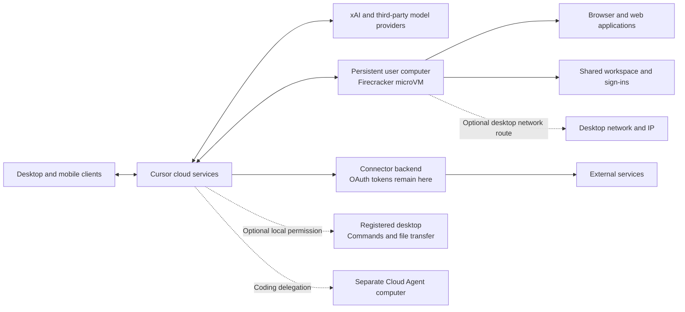

# Grok Bot: Product and Architecture Research

Research date: **2026-10-18**. Scope: the persistent-agent product, not ordinary Grok chat or the `@grok` account on X.

This is a source-backed research snapshot, not an implementation specification. The [development roadmap](../development-roadmap.md) turns the findings into priorities. [D2](../tasks/d2-grok-ui-research.md) contains the detailed desktop interaction evidence. OpenBot's [architecture](../architecture.md) remains authoritative for its boundaries; the [task index](../tasks/README.md) links delivery contracts and evidence, and [technical constraints](../technical-plan.md) record known gaps.

## Evidence and conclusion

**Official facts** below come from product documentation, architecture disclosures, and published event schemas. **Client observations** come from static inspection of the installed desktop package. **Implications** are OpenBot design judgments. No live end-to-end benchmark was performed, and no private conversations, credentials, or proprietary source are included here.

Grok Bot combines persistent named roles, retained context, real application access, background execution, reusable procedures, and human intervention. Its main product advantage is continuity: users delegate an outcome to a familiar Bot and return to a result or decision. The five organizing objects are Bots, chats, prompts, tools, and artifacts; skills reuse prompts, while routines activate work. This is a useful product model independently of its cloud implementation. [Product design](https://x.ai/news/designing-grok-bot)

## Capability map

| Area | Documented capability | Boundary relevant to OpenBot |
| --- | --- | --- |
| Persistent roles | Named Bots with profiles, conversations, retained preferences and facts; duplicate, share, hide, and delete. | Memory supports a role but is not an authoritative source. Deleting a Bot does not clear shared computer files or sign-ins. [Bots](https://docs.x.ai/grok-bot/bots) |
| Conversation | Text, attachments, dictation, live voice, voice memos, replies, reactions, structured mentions, and editable message drafts. New instructions can redirect ongoing work. | Stop does not undo completed actions. An understandable transcript must distinguish results, questions, approvals, and activity. [Messaging](https://docs.x.ai/grok-bot/chat-and-collaboration) |
| Research and execution | Browser, terminal, files, connected services, and computer use; public X search/read access without an X login. | Prefer a connector for supported operations; browser control covers missing interfaces and visual workflows. [Computer and apps](https://docs.x.ai/grok-bot/computer-and-apps) |
| Deliverables | Office documents, spreadsheets, decks, images, media, and other files appear in conversation cards with supported previews. | The result needs a usable artifact and evidence, not only a textual claim of completion. Desktop accepts six attachments at once; ordinary files are limited to 25 MB and video to 200 MB. [Files](https://docs.x.ai/grok-bot/files-and-results) |
| Collaboration | Groups of two to six Bots, directed mentions, asynchronous messages, wakeups, and visible handoffs. | Group approval, secret/login, and outbound draft cards have documented limitations. This does not justify hiding OpenBot approvals. [Messaging](https://docs.x.ai/grok-bot/chat-and-collaboration) |
| Repeatable work | Account-wide skills, Bot-owned scheduled/event routines, and optional teaching by demonstration. | Each is a different object: method, activation, and procedure capture. Details below. [Skills and routines](https://docs.x.ai/grok-bot/skills-routines-and-automations) |
| Background presence | Desktop/mobile access, working/unread/attention states, completion and input notifications. | Background execution and notification delivery must remain distinct from whether a conversation is open. [Settings](https://docs.x.ai/grok-bot/settings-and-notifications) |
| Delegated coding | A Bot can dispatch coding work to Cloud Agents and return their artifacts. | This is a separate execution environment, not another screen on the personal computer. [Architecture](https://docs.x.ai/grok-bot/teams-and-enterprises#architecture), [Files](https://docs.x.ai/grok-bot/files-and-results) |

Skills store instructions, validation, outputs, and approval boundaries in a shared library. Routines belong to one Bot and invoke work on a schedule or supported event; Slack/GitHub event integrations are separate from their plugins. The documented limits are 50 routines per Bot, schedules at least five minutes apart, and 20 retained run records. Test runs perform real actions.

Teaching captures a browser demonstration for up to ten minutes without microphone audio. It produces a draft skill for review and testing, not a guaranteed deterministic replay. Availability is gradual. One demonstration cannot establish every branch, error condition, or authorization boundary; OpenBot should require those explicitly before scheduling the procedure. [Skills and teaching](https://docs.x.ai/grok-bot/skills-routines-and-automations)

Public templates give recipients their own copy of a configuration; they do not share the author's computer, login sessions or conversation history. Team Bots instead share centrally maintained setup, team memory and private per-member notes. OAuth uses the requesting member's identity; a configured key/token may provide shared Bot access. [Bot sharing](https://docs.x.ai/grok-bot/bots), [Team Bots](https://docs.x.ai/grok-bot/team-bots)

The retrieved October 11 changelog adds Bot-owned email, public X search, interactive connector cards and payment integrations; earlier entries add proactive suggestions and slide-deck delivery. It also records fixes for rate limits, incorrect arguments, stopping, browser recovery and missing result delivery. These reveal engineering work areas, not a measured failure rate. The changelog snapshot is not a global latest-version claim. [Changelog](https://x.ai/changelog/bot)

X can also dispatch a post to the user's main Bot through `@bot`, subject to account linking and regional availability. That entry point is separate from public X search and ordinary `@grok`. [X entry point](https://docs.x.ai/grok-bot/tag-on-x)

## Execution architecture

The official architecture describes desktop/mobile clients connecting to Cursor services, which coordinate model requests, a hosted computer, and connected applications. The diagram below summarizes disclosed boundaries; it does not claim an exact process layout or locate every agent-loop component. [Official architecture](https://docs.x.ai/grok-bot/teams-and-enterprises#architecture)

**Personal computer.** Each user receives a Firecracker microVM with its own kernel, memory, and virtual devices. Users are isolated from one another; that isolation does not apply between their personal Bots. [Isolation](https://docs.x.ai/grok-bot/security-faq)

Personal Bots share files, browser sessions, and command-line credentials. Each has its own screen, allowing parallel work, but only one computer-use task can operate that Bot's screen at a time. `/workspace` is the durable shared work area. Separate screens prevent some input contention; they do not isolate authority or prevent conflicting file/account operations. [Computer boundaries](https://docs.x.ai/grok-bot/computer-and-apps)

**Team Bot exception.** In a member's private chat, a Team Bot generally uses that member's computer, connected accounts, and usage. In Slack and group conversations it uses its own computer. Owner-provided secrets, plugins, and files can serve every teammate's chat. Consequently, the personal-Bot sharing rule must not be generalized to every team scenario. [Team execution](https://cursor.com/docs/grok-bot/teams)

**Local execution and networking.** Desktop commands and file movement use a separate local-computer permission. Cloud web traffic can optionally route through the desktop's network/IP; this is not local execution. Enterprise setup can install Linux networking clients on Debian-based hosted computers. A desktop-dependent network path necessarily loses that path when the desktop is unavailable; ordinary cloud work can continue independently. [Local execution](https://docs.x.ai/grok-bot/security#local-execution), [Private networks](https://docs.x.ai/grok-bot/private-networks)

**Model routing.** The dedicated model help page states that tasks may use first-party xAI or third-party models. Users cannot select or exclude a specific model; the Cursor model allowlist does not govern Grok Bot. Usage is presented as Grok Bot activity rather than a model breakdown. Routing policy, model proportions, and computer-use model selection are undisclosed. [Models](https://cursor.com/help/grok-bot/models)

## Authorization and secrets

Auto Review is an independent model-based review layer for consequential shell, plugin, computer-use, automation, and delegation actions. It can allow, escalate, or deny. Memory writes and most settings changes are examples outside its coverage. Network restrictions and user isolation provide boundaries that do not depend on the review model. [Security](https://docs.x.ai/grok-bot/security)

Ask first takes precedence over Allow automatically. Automatic permission can still be stopped for another risk; personal rules cannot relax applicable team rules. Allow once, Always allow, and Deny are distinct decisions. An unattended approval, including routine-triggered work, expires after roughly ten minutes without running the action; a foreground conversation approval waits for the user. Local execution separately defaults to per-command approval and can be disabled. [Approvals](https://docs.x.ai/grok-bot/approvals-security-and-privacy)

Credential handling has separate paths:

- Browser login, two-factor authentication, CAPTCHA, and payment steps use human takeover. A browser session is subsequently usable by the other personal Bots.
- Connector OAuth tokens remain on the connector backend; the Bot invokes tools without receiving those tokens. [Identity and sign-ins](https://docs.x.ai/grok-bot/security#identity-and-sign-ins)
- Secure secret cards keep values out of chat and model input. Saved values are write-only; a supported request can fill the value into a page. Team Bot secret descriptions are visible while values are not. This is not evidence that arbitrary shell processes receive all stored secrets. [Secrets](https://cursor.com/help/grok-bot/secrets)

## Durable execution and observable outcomes

The published event schema identifies turns, root turns, subagents, computers, tool calls, and approval decisions separately. Per-turn sequence numbers continue across approval waits. Decisions distinguish policy, human, hook, and automatic sources; local-tool permission is a distinct approval mode. HTTP MCP calls are observed server-side, while stdio MCP servers run on the computer. Computer-use sessions are described as subagent sessions.

These records are not proof of exactly-once effects. The schema permits two results for one tool-call ID after a transient model-stream failure. Some tools return a refusal as a successful tool response; decision records determine whether permission was granted. The protocol therefore supports correlation, not a claim that every reported success completed an external action. [Event schema](https://cursor.com/docs/enterprise/opentelemetry-export/wire)

Recreate prepares a replacement computer and pauses active work at a safe point before switching; inability to pause can fail the operation. Durable disk survives, while manually installed packages are replaceable. Terminate stops current work and retains disk; the next message creates a computer again. It does not revoke account access. [Computer lifecycle](https://docs.x.ai/grok-bot/computers)

Recover/update preserve durable data; reset can lose recent unsynced work. A disconnected app does not imply a stopped cloud task. Backend task persistence, filesystem persistence, and external side effects must therefore be considered separately. [Recovery](https://docs.x.ai/grok-bot/troubleshooting)

## What the installed client establishes

The inspected desktop package is **0.71.2**; `package.json` SHA-256 prefix is `4a990be80cf0aee5`. [D2's reproducible evidence](../tasks/d2-grok-ui-research.md#reproducible-client-evidence) records archive/module identities and observations.

The manifest declares Electron/React and agent/runtime, storage-sync, local-execution, MCP-execution, ConnectRPC/Protobuf, OpenTelemetry, and Sentry dependency families. Compiled modules separately establish draft persistence, send-journal recovery, stable send nonces, structured mention handling, and persisted layout. These observations support a client with substantial interaction and integration responsibilities despite the cloud execution model.

Dependency names do not establish server language, database, transport usage for every route, or enabled product features. No application code or artwork is copied into OpenBot. The installed version is not asserted to be the latest release available globally.

## Availability and pricing snapshot

The product is available across macOS, Windows, Linux, iOS, and Android. Hosted operation does not offer on-premises or bring-your-own-image deployment. [Overview](https://docs.x.ai/grok-bot/overview), [Hosting](https://docs.x.ai/grok-bot/security#hosting)

On the research date, the product page advertises Premium at **$30/month**, Super at **$100/month**, and Ultra at **$200/month**, with larger usage allowances. These are advertised subscription prices, not costs per completed task. [Pricing](https://x.ai/bot)

The current X Subscription shares a weekly pool across Grok Bot, Cursor, and Grok. Legacy Cursor plans and linked SuperGrok grants follow different rules; multiple eligible legacy grants do not stack. Do not use launch-era claims of universally separate usage for current unit economics. Recheck the applicable account plan before comparisons. [Billing rules](https://cursor.com/help/grok-bot/plans)

## Implications for local OpenBot

These are product recommendations, not claims about Grok's implementation. The [roadmap](../development-roadmap.md) owns sequencing and acceptance gates.

| Preserve or build | Local adaptation and acceptance concern |
| --- | --- |
| Durable Bot identity | Keep role, memory, conversation context, and active work distinct. Users should correct retained knowledge without recreating a Bot. |
| Outcome-oriented conversation | Preserve draft/send recovery, visible ownership, clear attention states, reviewable artifacts, and actionable approvals. Validate with scripted end-to-end flows. |
| Trusted execution | Keep every tool behind the Tool Router, bind `targetId`, and persist acceptance, policy decision, dispatch intent, and executor receipt. Reconcile unknown effects before retrying. |
| Useful tools before autonomy | Prioritize reliable file/terminal/research outcomes and artifact access, then repeatable skills/routines and structured connectors. Each new capability needs its own executable task specification. |
| Browser and desktop separation | A shared managed-browser profile with Bot windows can support parallel browsing. Real macOS desktop input still requires one visible, pausable control lease and fresh observation after takeover. |
| Honest background behavior | Window closure can leave the local Host running. Sleep, lock, quit, and restart require explicit suspension/recovery semantics; a sleeping Mac cannot promise cloud-style continuous work. |
| Inspectable cost and authority | Configurable models, local data, visible memory, and explicit grants can differentiate OpenBot. Local execution does not prevent selected content from reaching a configured inference endpoint. |
| Bounded collaboration | Measure completed outcomes and correct ownership transfer, not number of Bots. Budgets, cancellation, durable delivery, and scoped approval remain necessary when specialists cooperate. |

The [D6 role, memory and skill study](bot-role-design.md) rechecks the role-related sources on 2026-10-22, examines personal versus shared methods and template memory representation, and proposes a local learning journey. Its source categories and remaining unknowns are explicit; this older snapshot is not an implementation contract.

The existing architecture deliberately excludes cloud hosting, mobile synchronization, and remote pairing. Grok's enterprise identity, network administration, and Team Bot hosting are useful comparison points, not near-term OpenBot parity requirements. No research finding authorizes product-code changes or bypasses phase acceptance.

## Unresolved evidence

- No official complete Grok Bot runtime source or self-hostable distribution was found. The public [Grok prompts repository](https://github.com/xai-org/grok-prompts) covers other Grok surfaces and is not Grok Bot's runtime or system prompt.
- Database, queue, scheduler, memory retrieval/compaction, screen virtualization, remote-display transport, and side-effect compensation internals remain undisclosed. There is no evidence that Grok Bot uses Pi.
- Official pages disagree on model visibility/allowlist behavior and on where personal Auto Review rules are stored. This report uses the dedicated [model help page](https://cursor.com/help/grok-bot/models) for routing and leaves rule synchronization unresolved; compare [Cursor settings](https://cursor.com/docs/grok-bot/settings) with [x.ai settings](https://docs.x.ai/grok-bot/settings-and-notifications).
- Documentation describes supported behavior, not measured task success, latency, cost, or reliability. A future comparison should run the same bounded workflows, record external results and human interventions, and separate scripted verification from real-model trials.
