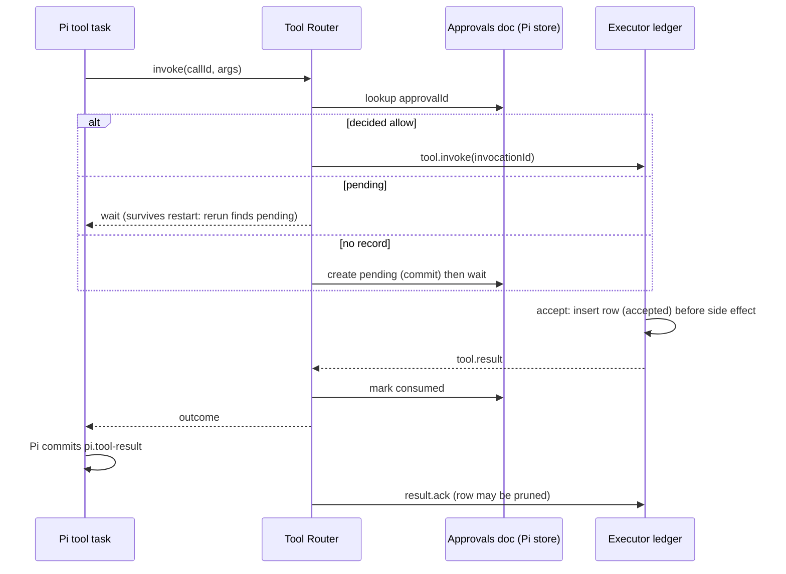
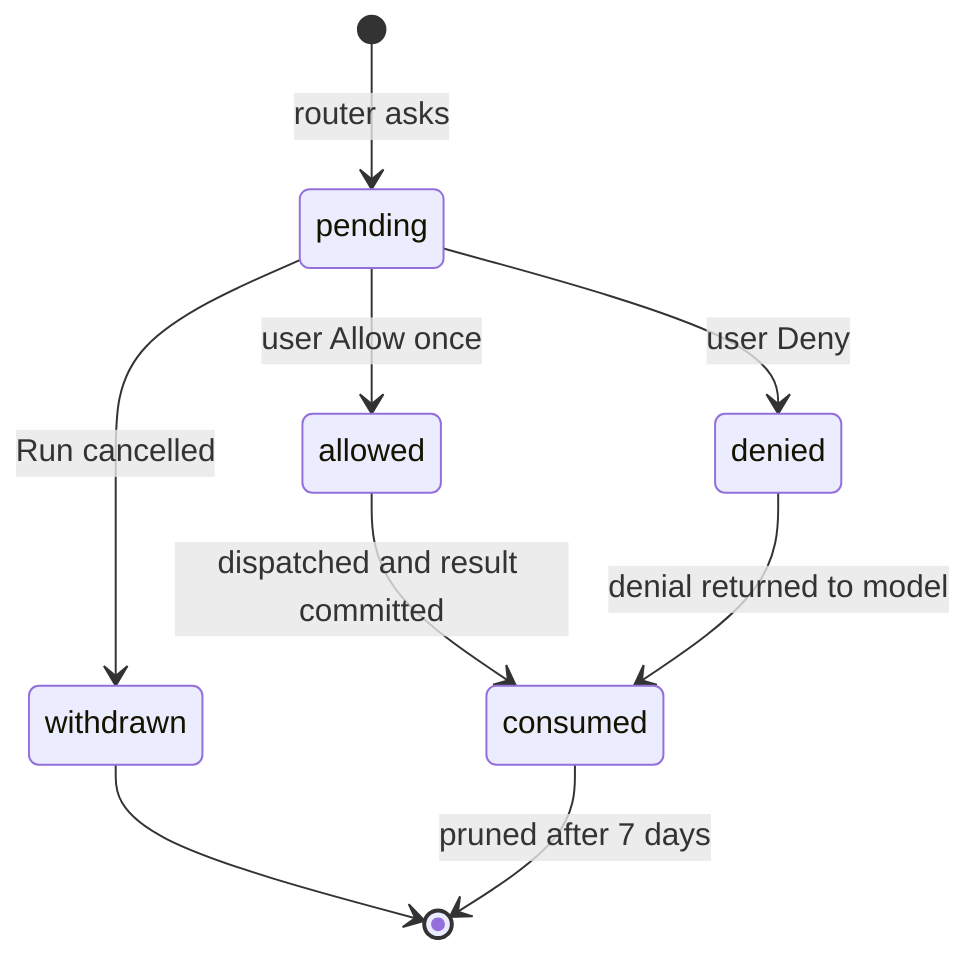

# B1: Durable Approvals and Executor Receipts

Status: done (Phase 1 MVP merged; see task index)
Branch: task/b1-durable-approvals
Depends on: none
Architecture: Sections 5.1 (replay policy), 5.3 (approvals), 6.2 (executor protocol), 7.1, 8.2

## Goal

A Host or executor restart must never run an approved action twice, never run an action the user has not approved, and never silently drop a request the user was answering. Today approvals and receipts live in memory: a Host restart forgets a pending approval (the call asks again) and the executor cannot tell whether it already ran an invocation. This task makes both durable and adds a recovery step before scheduling resumes.

## Scope

In:
- Pending approvals and decisions persisted in the Pi store as an OpenBot document.
- Executor receipt ledger in its own SQLite file; `tool.status` and `result.ack` messages.
- Host recovery gate: reconcile unfinished invocations before `runtime.resume()`.
- `unknown` outcomes surfaced as **Needs attention** with a transcript note.
- Orphaned command guard: no command process group outlives the executor that started it.

Out:
- Run records, queue, cap: B2.
- Always allow rules and folder grants: B5. Approval expiry for unattended work: B12 (Phase 2).
- Process-tree tracking beyond the process group (descendants that call `setsid` leave the group and are not killed): recorded as a known limit.

## Design

### Why this works with Pi

`routedTool` is registered with `replay: "safe"`. Pi records the call's intent before `execute()` and, after a restart, calls `execute()` again with the **same** `api.callId` and arguments (`third_party/pi/packages/durable/src/harness/tool.ts`, phase `execute`). Every identity in this design derives from `conversationId:callId`, so the rerun lands on the same approval and the same invocation:

- `approvalId = approval:<conversationId>:<callId>` (already used by Tool Router).
- `invocationId = <conversationId>:<callId>` (already used by Tool Router).

The safety argument is therefore: **the approval decides whether dispatch may happen; the receipt ledger decides whether it already happened.** Both are durable, both are keyed by the same stable ID, and neither is recomputed on rerun.

Evidence, checked in the vendored Pi: `ToolTask`'s `call` phase commits the checkpoint `{ phase: "execute", arguments, replay }` before it runs the tool; on recovery the `execute` phase calls `run()` again with the stored arguments only when both the stored and the current registration say `replay: "safe"`, and `run()` passes the same `call.id` as `api.callId`. Otherwise it settles the call with an `interrupted` diagnostic. `Harness.close()` signals and joins running tasks but writes no task outcome, so a clean quit leaves the call in `execute` for the next start. No difference from the description above.



### Alternatives considered

- **Persist approvals in the executor ledger.** Rejected: approvals are Host policy state (architecture 7.1) and the executor must not decide authorization.
- **A separate Host SQLite file for approvals.** Rejected: two Host stores that must commit together. Pi documents commit atomically with the rest of Host state and are already backed up together.
- **Make tools `replay: "unsafe"` and let Pi write `interrupted`.** Rejected: the model would see an error for an action the user approved, and approvals would be asked twice; also loses exactly-once for executor actions that did finish.

### Approvals document

A session-scoped document `openbot.approvals` holds every approval not yet consumed, keyed by `approvalId`. Approvals are written by Host code (Tool Router's `ApprovalPort` implementation in `server-core`), never by tools, through a new `BotRuntime` method that commits the document.

States:



A rerun of the same call reads the record: `pending` waits again, `allowed` proceeds straight to dispatch (the executor ledger prevents a second run), `denied` returns the denial again, `consumed` behaves like the decision it consumed.

### Executor receipt ledger

`<data>/executor/receipts.sqlite`, opened by `apps/local-executor` with `node:sqlite` in WAL mode. The executor owns it; the Host never opens it.

```sql
create table receipts (
  invocation_id text primary key,
  args_digest   text not null,
  tool          text not null,
  status        text not null check (status in ('accepted','succeeded','failed','cancelled','unknown')),
  outcome       text,            -- JSON ToolOutcome once terminal
  accepted_at   integer not null,
  finished_at   integer,
  acked_at      integer
);
```

Rules:
- `tool.invoke` with an unknown ID: insert `accepted` **in a committed transaction before** starting the side effect, then run, then update to the terminal status with `outcome`.
- Known ID, same digest, terminal: return the recorded outcome without running.
- Known ID, same digest, `accepted` (a previous executor died mid-run): mark `unknown`, return `unknown`. Never rerun.
- Known ID, different digest: refuse.
- `result.ack`: set `acked_at`. Rows acked more than 7 days ago are deleted at startup.

### Recovery gate in the Host

Before `runtime.resume()`:
1. Start the executor and wait for `executor.hello`.
2. The executor, on startup, has already converted every `accepted` row to `unknown` (it is a new process; nothing of the old one is running).
3. Pi then resumes. Each interrupted routed tool reruns, re-reads its approval, re-sends `tool.invoke`, and gets either the recorded terminal outcome or `unknown` from the ledger.

No explicit `tool.status` sweep is needed for the local executor because the rerun itself queries by ID. `tool.status` is still added to the protocol (read-only lookup) for diagnostics and future remote executors.

### Unknown outcomes

An `unknown` outcome returns to the model as an error result with a fixed text: "This action was interrupted and may have partly run. Check its effect before doing anything else." The Bot's activity becomes `needs_attention` until the user sends a new message. The transcript tool row shows status **Interrupted**.

### As built

Additions to the contracts below, all additive:
- `ToolCallStatus` gains `"interrupted"`. Agent-runtime derives it from the result's `details.status === "unknown"` (set by the routed tool) or a Pi `interrupted` diagnostic.
- `ApprovalRecord` also stores `decision`, so a `consumed` record still answers a rerun with the decision it consumed.
- `ApprovalStore` gains `prune(before)`: it deletes non-pending records older than 7 days when the Host starts.
- `ApprovalBook` gains `start(store)` (prune, load pending), `close()`, and `settled(botId, callId)` (marks `consumed`). `decide` now returns `Promise<boolean>` because it commits before it wakes the waiter. `request` and `forBot` are unchanged.
- `HostService` takes an optional `toolSettled(botId, callId)`, called once per tool item the first time the conversation view shows it settled (also for results already present at start). The Host wires it to `result.ack` and `ApprovalBook.settled`. `BotRuntime.conversationKey(botId)` gives the conversation ID that the invocation IDs use.
- The recovery gate is `executor.start()` (the ledger opens, `accepted` becomes `unknown`, orphans are killed), then `service.start()`, then `runtime.resume()`.
- `LocalExecutor` takes a `ledger`, and `forget` is replaced by `ack`. `cancelAll()` stops every running command on disconnect or SIGTERM and records its outcome before exit.
- Orphan guard: when the recorded leader no longer exists but its group still does, the group is killed too. A PID is not reused while a process group with that ID exists, so the group is still ours.
- The architecture's `tool.ack` (durable acceptance) is not a separate message: the local executor answers a repeated `tool.invoke` with `tool.result` carrying the recorded outcome.

## Contracts

```ts
// packages/protocol
export type ApprovalState = "pending" | "allowed" | "denied" | "withdrawn" | "consumed";

export type ApprovalRecord = PendingApproval & {
	readonly state: ApprovalState;
	readonly decidedAt?: number;
};

export type ExecutorRequest =
	| { readonly kind: "tool.invoke"; readonly invocation: ToolInvocation }
	| { readonly kind: "tool.cancel"; readonly invocationId: string }
	| { readonly kind: "tool.status"; readonly invocationId: string }
	| { readonly kind: "result.ack"; readonly invocationId: string };

export type ExecutorMessage =
	| { readonly kind: "executor.hello"; readonly protocolVersion: 1; readonly targetId: string; readonly instanceId: string; readonly tools: readonly ExecutorToolName[] }
	| { readonly kind: "tool.progress"; readonly invocationId: string; readonly output: string }
	| { readonly kind: "tool.result"; readonly invocationId: string; readonly outcome: ToolOutcome }
	| { readonly kind: "tool.status"; readonly invocationId: string; readonly status: InvocationStatus | "accepted" | "absent"; readonly outcome?: ToolOutcome };

// packages/agent-runtime: Host-side document access, no Pi types leak
export interface ApprovalStore {
	get(approvalId: string): Promise<ApprovalRecord | undefined>;
	put(record: ApprovalRecord): Promise<void>; // one Pi commit
	pending(): Promise<readonly ApprovalRecord[]>;
}
// BotRuntime gains: approvals(): ApprovalStore
```

`ApprovalBook` (server-core) keeps its public shape (`request`, `decide`, `forBot`) but reads and writes through `ApprovalStore`; in-memory waiters are only a cache of who to wake.

Invariants:
- An approval record is written before the router waits on it.
- A decision is written before the waiter is woken.
- The executor inserts `accepted` before any side effect.
- The Host sends `result.ack` only after Pi committed the tool result (that is, after `execute()` returned and the result is visible in the conversation view).

## Steps

1. **Protocol** (`packages/protocol/src/index.ts`): add `ApprovalState`, `ApprovalRecord`, the new executor messages, `instanceId` on hello. Update architecture 6.2 if wording changes. Check: `pnpm run typecheck`.
2. **Approvals document** (`packages/agent-runtime/src/approvals.ts`, new): `defineDoc` `openbot.approvals` (session scope, `history: "latest"`), `ApprovalStore` over `harness.commit` and `harness.snapshot`. Export from `index.ts`. Unit test: put, get after reopen of the same SQLite file.
3. **ApprovalBook over the store** (`packages/server-core/src/approvals.ts`): persist on `request` and `decide`; rerun semantics per the state table; `forBot` reads pending records. An aborted wait writes `withdrawn` only when the Run was cancelled. A Host shutdown also aborts every wait, but it must leave records `pending`, so `HostService.stop()` calls a new `ApprovalBook.close()` before closing the runtime; after `close()` an abort writes nothing. Startup: `start()` loads pending records so the UI shows them before Pi reruns the calls. Unit tests: decision survives a new `ApprovalBook` on the same store; second `request` for a decided ID returns the decision without waiting; an abort after `close()` leaves the record pending.
4. **Receipt ledger** (`packages/local-executor/src/ledger.ts`, new): the table and rules above; `LocalExecutor` takes a ledger instead of its in-memory map; startup converts `accepted` to `unknown`; pruning. Unit tests: accepted-before-effect (kill between insert and effect simulated by throwing), duplicate returns recorded outcome, accepted on open becomes unknown, digest mismatch refused.
5. **Executor process** (`apps/local-executor/src/main.ts`): open the ledger under `<data>/executor/receipts.sqlite`, handle `tool.status` and `result.ack`, send `instanceId`. The Host resolves its data directory with a default (`apps/local-server/src/main.ts`), so pass the resolved path explicitly as `OPENBOT_DATA_DIR` in `ExecutorProcess`'s env instead of relying on inheritance.
6. **Host transport** (`apps/local-server/src/executor.ts`): `ack(invocationId)`, `status(invocationId)`; Tool Router calls `ack` after the outcome is returned and Pi committed it. Simplest correct hook: send `result.ack` from `HostService` when the conversation view first shows the tool item as `succeeded` or `failed`.
7. **Unknown surfacing** (`agent-runtime` routed tool text, `server-core` activity, desktop tool row label **Interrupted**).
8. **Orphan guard** (`packages/local-executor/src/command.ts`, `ledger.ts`): add `pgid integer` and `leader_started text` columns, written right after spawn (`leader_started` from `ps -o lstart= -p <pid>`). On executor shutdown (Host disconnect, SIGTERM) signal every running group as cancellation already does. On startup, for each row converted `accepted` → `unknown`, if `ps -o lstart= -p <pgid>` still matches `leader_started`, SIGKILL the group (`process.kill(-pgid)`); a mismatch means the PID was reused, so leave it. Unit test: spawn `sleep 30` in a group, drop the executor without cleanup, open a new ledger, the group is gone.
9. **E2E** (`e2e/recovery.e2e.ts`, new): see acceptance 1 and 2. To restart the Host inside a test, quit the Electron app and relaunch it on the same `e2e/.run` data.
10. **Docs**: technical plan current state; backlog moves B1 to Done; architecture 6.2 if the message table changed.

## Acceptance

1. **Approval survives restart, runs once.** E2E `recovery.e2e.ts › pending approval survives a restart`: script `local_exec` `echo run >> count.txt`; wait for the approval card; quit and relaunch the app; the card is shown again (same command); Allow once; `count.txt` contains exactly one line.
2. **Decided-but-unfinished runs once.** E2E `› approved command interrupted by a crash is not repeated`: script `local_exec` `echo start >> count.txt; sleep 30`; Allow once; once `count.txt` exists, SIGKILL the Host and executor processes (a clean quit cancels the command and records `cancelled`, which never reaches the `unknown` path), then close Electron and relaunch; the tool row shows **Interrupted**, `count.txt` has one `start`, and the Bot shows **Needs attention**.
3. **Duplicate invocation returns the recorded outcome.** Unit `ledger.test.ts › repeated invocation returns recorded outcome`.
4. **Accepted without receipt becomes unknown.** Unit `ledger.test.ts › accepted row on open becomes unknown`.
5. **Denial survives restart.** Unit `approvals.test.ts › denied approval answers a rerun without waiting`.
6. **No orphans.** After acceptance 2, `pgrep -f "sleep 30"` finds nothing once the relaunched app is ready.
7. `pnpm run check` and `pnpm run e2e` pass; CI green.

## Risks

- **`result.ack` timing.** Acking before Pi commits the tool result and then crashing would let the ledger prune a receipt that a rerun needs. Pruning waits 7 days after ack, so a rerun within that window still finds it; keep the delay.
- **Session document size.** Consumed approvals are pruned after 7 days at Host start; a heavy user could still accumulate thousands. Acceptable; revisit if the document grows past a few hundred KB.
- **Executor ledger on a different disk state than the Pi store** (for example after restoring only one from backup). Out of scope; backups (architecture 8.3) must snapshot both.

## Open questions

None.
