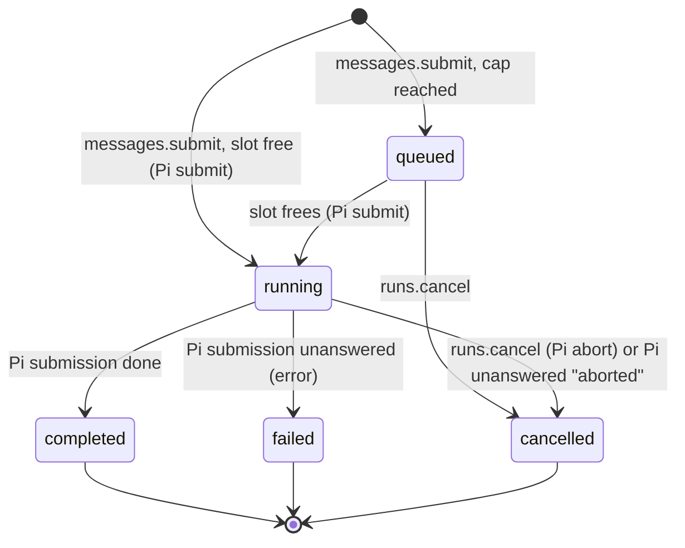

# B2: Runs, Queue, Cancellation, and Steering

Status: in review
Branch: task/b2-runs
Depends on: none (B1 recommended first; they touch different files except `server-core/src/index.ts`)
Architecture: Sections 6.1 (`messages.submit`, `runs.cancel`), 7.2 (scheduling)

## Goal

Give every message a durable Run the UI can follow, cap how many Bots work at once, and let the user stop or redirect a Bot while it works. Today `messages.submit` hands text straight to Pi and returns `{ accepted: true }`; there is no run identity, no global cap, and Stop aborts everything in the conversation.

## Scope

In:
- `runId` returned by `messages.submit`, deduplicated by `requestId`.
- Global active-Run cap (default 3) across Bots; messages beyond the cap wait in an OpenBot queue.
- `runs.cancel` by `runId`, for queued and running Runs.
- Steering: a message sent while the Bot works redirects the current turn.
- Composer and transcript states: queued, working, cancelled.

Out:
- Pause and resume (`runs.pause`, `runs.resume`): need desktop control and browser gating, later.
- Routine-originated Runs: B11 (Phase 2) reuses this queue.
- `needs_attention` from unknown outcomes: B1.

## Design

### What Pi already does, and what OpenBot adds

Pi Durable, per conversation (`third_party/pi/packages/durable/src/harness/submissions.ts`, README "Busy Conversations"):
- `submit({ type: "input", requestId })` is idempotent per conversation and request ID, and persisted.
- A busy conversation queues input in `pi.inbox`: `followUp` (default) starts the next run when the current one answers; `steer` joins the running work after the current tool round.
- A settled submission is `done` (with `answer`) or `unanswered` (with `reason`); `conversation.submission(id)` reacquires one after restart.
- `conversation.abort()` withdraws queued inputs and aborts the current work; `submission.abort()` withdraws one queued submission.

Pi has **no cross-conversation limit**: every conversation with input runs at once. OpenBot's job is therefore narrow:

1. A Run record that maps OpenBot identity to Pi's submission.
2. A global admission gate: hold a message in OpenBot's queue until a slot is free, then submit it to Pi.
3. Product semantics on top: what Stop and sending-while-busy mean.

### Run model



`waiting_approval` is not a stored state: the conversation snapshot already derives it from pending approvals, and the cap counts it as running (the Run holds its Pi work).

A Run counts against the cap from `running` until terminal. One active Run per conversation, as Pi already enforces.

### Sending while a Bot works

Grok Bot redirects the current turn when you send while it works; we match that. If the Bot has a running Run, `messages.submit` submits to Pi with `whenBusy: "steer"` and returns the **same** `runId` (the steer joins that Run; it does not take a new slot). The message is recorded on the Run as an extra input. If the Bot only has a queued Run (cap reached), the new text is appended to that queued Run's inputs and submitted together when it starts.

Alternatives considered:
- **Follow-up (Pi default).** Rejected for the user path: the Bot would finish the whole old task before reading the correction, which feels unresponsive and matches neither Grok Bot nor the architecture's "Sending while a Bot works redirects the current Run".
- **New Run per message.** Rejected: two Runs for one conversation would violate one active Run per conversation and double-count the cap.

### Admission and the cap

`RunScheduler` in `server-core`:
- Holds the Runs document and the cap (setting `maxActiveRuns`, default 3).
- On `submit`: steer path above, else if active < cap, Pi submit and `running`, else `queued`.
- On a Run reaching terminal: admit the oldest queued Run across all Bots (FIFO by `createdAt`).
- Observes Pi submissions with `submission.wait()` (in memory) plus a startup sweep: for every `running` Run, `conversation.submission(piSubmissionId)` → if settled, finalize; else re-attach `wait()`.

### Runs document

Session-scoped `openbot.runs`, via `agent-runtime` (Pi stays private to it), keyed by `runId`. Terminal Runs older than the 50 most recent per Bot are pruned.

## Contracts

```ts
// packages/protocol
export type RunId = string;
export type RunRecord = {
	readonly runId: RunId;
	readonly botId: BotId;
	readonly state: "queued" | "running" | "completed" | "failed" | "cancelled";
	/** OpenBot request IDs of every message in this Run, first one starts it. */
	readonly requestIds: readonly string[];
	readonly createdAt: number;
	readonly startedAt?: number;
	readonly endedAt?: number;
	readonly error?: string;
};

// HostMethods changes
"messages.submit": {
	params: { botId: BotId; requestId: string; text: string };
	result: { runId: RunId; state: RunRecord["state"]; steered: boolean };
};
"runs.cancel": { params: { runId: RunId }; result: { state: RunRecord["state"] } };

// ConversationSnapshot gains
readonly run?: RunRecord; // the Bot's latest non-terminal Run, if any

// packages/agent-runtime: BotRuntime gains (no Pi types leak)
submit(botId, requestId, text, mode: "start" | "steer"): Promise<{ submissionId: string }>;
submissionState(botId, submissionId): Promise<"queued" | "placed" | "done" | "unanswered" | "absent">;
waitSubmission(botId, submissionId): Promise<{ status: "done" | "unanswered"; reason?: string }>;
runsStore(): RunStore; // get, put, list, same pattern as B1's ApprovalStore
```

Invariants:
- Same `requestId` for the same Bot returns the same `runId`, before or after restart. Same `requestId` with different text: `request_conflict` error.
- A Run is written `running` and its Pi submission is created in that order; on restart a `running` Run without a Pi submission (crash in between) is resubmitted with the same Pi `requestId` (Pi dedups).
- Active Runs never exceed the cap after any admission step.
- `runs.cancel` on a terminal Run returns its state and changes nothing.

## Steps

1. **Protocol**: types and method changes above; update desktop `shared/api.ts` allowlist if names change. Update architecture 6.1 rows for `messages.submit` and `runs.cancel`.
2. **Run store** (`packages/agent-runtime/src/runs.ts`, new): document and store, same shape as B1's `ApprovalStore` (if B1 landed, reuse its helper). Unit test: reopen keeps Runs.
3. **Runtime submit modes**: `submit(..., mode)` maps `steer` to `whenBusy: "steer"`; add `submissionState` and `waitSubmission`. Unit tests with the scripted model: steer while a tool waits lands in the same run; `waitSubmission` after reopen.
4. **RunScheduler** (`packages/server-core/src/runs.ts`, new): admission, cap, steer path, terminal handling, startup sweep. Unit tests with scripted models and a cap of 1: second Bot's message queues; finishes; queued one starts; cancel queued; cancel running.
5. **HostService wiring**: `messages.submit` and `runs.cancel` through the scheduler; snapshot includes `run`; activity `working` for running, a new sidebar label **Queued** for queued.
6. **Desktop**: composer shows Stop for running or queued; a queued Run shows "Waiting for a free slot" in place of "Working"; cancelled Runs leave a small "Stopped" note in the transcript.
7. **E2E** (`e2e/runs.e2e.ts`, new): acceptance 1 to 3 with the scripted model (set the cap with a new `OPENBOT_MAX_ACTIVE_RUNS` env var read by the Host, default 3).
8. **Docs**: plan, backlog, architecture 6.1 and 7.2.

## Acceptance

1. **Cap and queue.** E2E `runs.e2e.ts › second Bot waits for a free slot` with cap 1: Bot A runs a tool that waits for approval; Bot B's message shows **Queued**; approve A; A completes; B starts and completes.
2. **Steer.** E2E `› a message sent while working redirects the turn`: Bot waits on an approval; send "Use a different file"; approve; the model's next request contains the steer text (assert via `ScriptedModel.requests`), and only one Run exists.
3. **Stop.** E2E `› Stop cancels the running Run`: a running `sleep 30` command after approval; click Stop; the tool row ends cancelled, the Run is cancelled, and the next message starts a new Run.
4. **Idempotent submit.** Unit `runs.test.ts › same requestId returns the same run across reopen`.
5. **Crash between Run write and Pi submit.** Unit `› running Run without Pi submission is resubmitted once`.
6. `pnpm run check` and `pnpm run e2e` pass; CI green.

## Risks

- **Steer timing.** Pi places a steer after the current tool round; if a tool is waiting for approval, the steer is placed only after the user decides. Acceptance 2 covers this; the UI should show the steer message immediately (it does: user messages are written as entries when placed, so show a pending bubble from the store until then).
- **Cap starvation by approvals.** A Run waiting for approval holds a slot. With cap 3 and three pending approvals, other Bots queue. Accepted for now; B5 (Always allow) reduces approvals. Revisit if users report it.
- **Cancel of a steered Run** cancels the whole Run including the steer; that matches Stop meaning "stop this Bot".

## Open questions

2026-10-15 (execution notes, decided locally; no contract change beyond these):
- Messages that joined a queued Run start the Pi run as **one** input (texts joined by a blank line, Pi request ID = the first request ID), so the model reads them in one turn instead of a start plus steers.
- `ConversationSnapshot` also gains optional `pending?: PendingMessage[]` (queued-Run messages, and steers Pi holds in `pi.inbox` until the tool round ends) so the UI shows a sent message at once; `TranscriptItem` gains `{ kind: "stopped", id }` (display-only Pi entry `openbot.stopped`, written when a Run ends cancelled); `ToolCallStatus` gains `cancelled` (Pi's `aborted` tool diagnostic); `BotActivity` gains `queued`.
- A queued Run of a Bot whose previous Run is still being stopped waits until that Run ended: Pi withdraws inputs admitted while its abort is in progress.
- When a Run fails (unanswered, not aborted), its steers still in Pi's inbox are withdrawn, because Pi would otherwise place them with the next input.
- `BotRuntime.cancel(botId)` stays (abort); new `markStopped(botId)` and `withdraw(botId, submissionId)` support the scheduler.
- The e2e suite was not run locally in this batch (no Electron launches); it passed in CI on the integrated branch.
