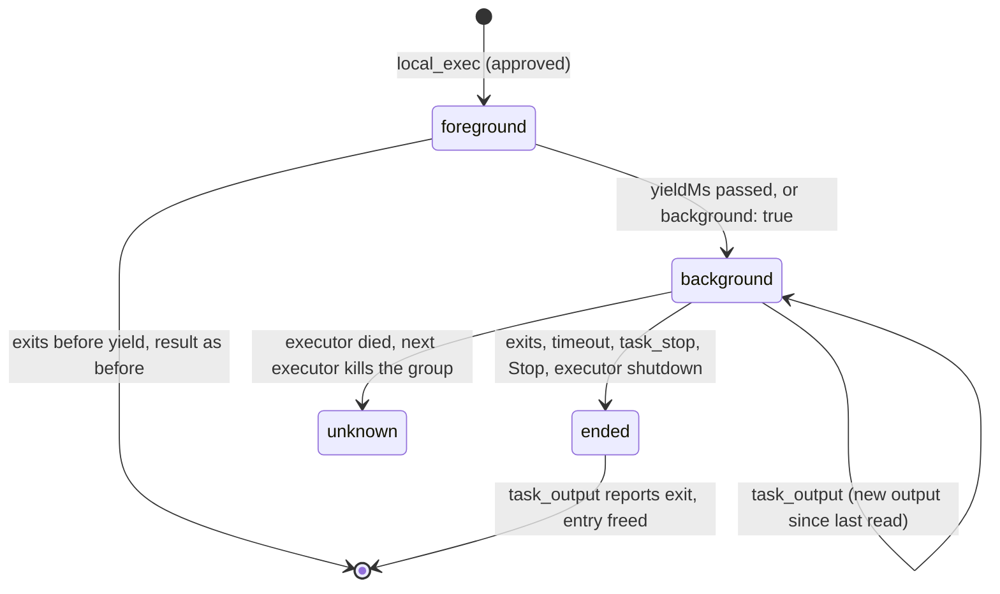

# B3: Coding-Agent Tools

Status: done (Phase 1 MVP merged; see task index)
Branch: task/b3-coding-tools
Depends on: B1 (receipt ledger, orphan guard)
Architecture: Sections 5.1 (executor tools), 5.2 (tool set; expected-content check for edits), 6.2 (executor protocol)

## Goal

Bring the executor tools to what users expect from a coding agent: long output never floods the model's context or gets lost, edits refuse to overwrite a file that changed under the Bot, and a build, test suite, or server that runs for minutes does not block the Run. Before this batch a command was killed after 120 seconds, output was cut without a way to read the rest, and `local_edit` could only say "appears 3 times".

## Scope

In:
- One output limiter in `packages/local-executor/src/output.ts` used by every executor tool, with the full output spilled to `<data>/artifacts/<invocationId>.txt` and a marker naming the file and the `local_read offset` to continue.
- The artifacts directory as an implicit read grant for `local_read` only, in the executor and in the Host grant port.
- `local_edit`: optional `expected_sha256`; ambiguous matches list their line numbers. `local_read`, `local_write`, and `local_edit` report the file's `sha256`.
- Background commands: `local_exec { background? }`, foreground yield after 60 s (`OPENBOT_EXEC_YIELD_MS`), new tools `task_output` and `task_stop` with capability `"tasks"`, a `background_tasks` ledger table, the orphan guard for tasks, and Stop ending a conversation's tasks.
- Prompt lines for `local_exec` (truncation, background tasks); desktop verbs for the new tools and the task ID on a backgrounded command row.

Out:
- Dedicated `local_grep` / `local_glob` tools: dropped (backlog B3); Bots search with `rg` through `local_exec`.
- Policy for commands (Always allow, read-only commands): B5.
- Waking the Bot when a background task ends: Phase 2 (B15). In the MVP the model polls with `task_output`.
- A desktop task panel or per-task Stop button: B7 may add one on top of `taskId` in the transcript.

## Design

**One limiter, two uses.** `OutputLog` is both the capture buffer of a running command and the formatter of any finished result (`limitText`). A result fits when it is at most 500 lines and 24 KB; otherwise the model gets the first 40 % (cut at a line end) and the last 60 % (errors come last), joined by a marker:

```text
[... 1520 lines (9873 bytes) omitted. Full output: /…/artifacts/12:call_3.txt. Read the omitted part with local_read path="/…/artifacts/12:call_3.txt" offset=201.]
```

`offset` is the first omitted line, numbered as `local_read` numbers lines, so continuing is one call. The log counts newlines as chunks arrive, so line numbers stay exact when memory no longer holds the start. The file is written with mode 0600 in a 0700 directory. Artifact names are the invocation ID with characters outside `[A-Za-z0-9._-]` replaced, because call IDs come from model providers. Artifacts older than seven days are pruned when the executor starts (same retention as acknowledged receipts). `local_read` is already a pager under the same limits, so its own output is not spilled again.

Alternatives: Pi's coding-agent truncation keeps only the tail and has no spill file; MCode spills but writes a separate file per tool. One log type keeps the marker format, the limits, and the continuation identical for commands, tasks, and file tools.

**Artifacts as a read grant.** Spilled output is the executor's own data, so reading it back must not ask. The executor adds the canonical artifacts directory to `local_read`'s grants only; `local_list` and the write tools do not get it (no browsing, no tampering). The Host grant port mirrors it: `decide()`'s `isGranted` also accepts paths inside the artifacts directory when the tool is `local_read`, and `grants()` appends it for `local_read`, so the call neither asks nor is refused by the executor's independent check. The Host edit in `apps/local-server/src/tools.ts` is three lines, so B5's rewrite of that file merges cleanly; with B5's read-only grant list the artifacts root belongs in the read grants of `local_read`.

**Expected content.** Reads, writes, and edits end with `[sha256: <hex>]` of the file bytes. `local_edit { expected_sha256 }` compares before matching and refuses with "changed since you read it (expected …, now …); read it again and redo the edit". The check and the rename are not atomic against other processes; it protects against the common case (another Bot, the user's editor, a command) between the model's read and its edit, which is what architecture 5.2 asks for. Ambiguous matches report the start line of each non-overlapping occurrence.

**Background commands.** `CommandTasks` (`tasks.ts`) runs every `local_exec`:



- The `local_exec` invocation ends when the command yields: its receipt becomes terminal with `{ status: "succeeded", taskId, output so far }`, Pi's tool call ends, and the Run continues. The process belongs to the executor from then on. The approval of the `local_exec` call covers the whole command; `task_output` and `task_stop` never ask (`decide()` case `"tasks"`).
- Before yielding, the log is spilled: every later chunk is appended to the artifact file and memory keeps roughly the last 1 MB (older ranges are read back from the file when a read needs them). Progress events stop at the yield; the transcript row is final.
- `task_output { taskId, wait_seconds 0–60 }` waits for the end or the timeout (or the call's abort), then renders the log from the last read position under the same limits and advances it. When the task ended it reports `exited with code N`, `timed out after Ns`, or `stopped`, with `exit`, and frees the in-memory entry; later reads answer from the ledger row.
- `task_stop { taskId }` uses the same group cancellation as Stop on a foreground command (SIGTERM, SIGKILL after 3 s) and returns the final output.
- Tasks belong to the conversation that started them (the invocation's `conversationId`); another conversation's task ID is "Unknown task".
- `timeout_seconds` no longer defaults to 120: without it a command runs until it ends or is stopped, in the foreground or background. Its maximum rises to one day.
- The yield threshold is `DEFAULT_YIELD_MS` (60 s); the executor reads `OPENBOT_EXEC_YIELD_MS`, which the desktop passes through to the Host and the Host's environment passes on to the executor.

**Durability.** `recordTask` inserts a `background_tasks` row, copying `pgid` and `leader_started` from the invocation's receipt, before the `local_exec` result is returned. Opening the ledger turns every `running` row into `unknown` and kills its group with B1's guard (start time must still match). `task_output` for such a task says it is unknown and may have partly run. Clean executor shutdown (`cancelAll`) stops foreground commands and background tasks alike.

**Stop.** A background task is no longer part of any Pi tool call, so aborting the Run cannot reach it through the call's `AbortSignal`. The narrowest hook is the Host's Stop path: `HostService` takes an optional `conversationStopped(botId)` callback, called in the `runs.cancel` handler before `runtime.cancel`. The Host resolves the conversation key and sends a new executor request `{ kind: "tasks.stop", conversationId }`; the executor cancels every task of that conversation. With B2, the call moves to where `RunScheduler.cancel(runId)` cancels a running Run (right before `runtime.cancel(botId)`); queued Runs never reached the executor and need no call. A Run that ends normally leaves its tasks running on purpose: the Bot started a server or a watcher and the next message may use it. "New topic" (`conversations.reset`) keeps the same Pi conversation, so its tasks also keep running.

## Contracts

```ts
// protocol
export type ToolCapability = "files.read" | "files.write" | "commands" | "tasks" | "web" | "memory";
export type ToolOutcome = { …; readonly taskId?: string }; // set by local_exec when it yields, and by task_*
// TranscriptItem kind "tool" gains
readonly taskId?: string; // from the tool result's details
export type ExecutorRequest = … | { readonly kind: "tasks.stop"; readonly conversationId: string };

// catalog
local_edit  { path, old_text, new_text, replace_all?, expected_sha256? }
local_exec  { command, description, cwd?, timeout_seconds? (1–86400, no default), background? }
task_output { taskId, wait_seconds? (0–60) }   capability "tasks", destination executor
task_stop   { taskId }                          capability "tasks", destination executor

// agent-runtime: ToolInvoker results may carry taskId; routed tools put it in details { status, taskId }.

// server-core
HostServiceOptions.conversationStopped?: (botId: BotId) => void;
decide(): case "tasks" → allow

// local-executor
ExecutorOptions.artifactsDirectory: string;  // canonical <data>/artifacts
ExecutorOptions.yieldMs?: number;             // default DEFAULT_YIELD_MS = 60_000
LocalExecutor.stopTasks(conversationId): void;
```

Ledger table (same SQLite file as receipts):

```sql
create table if not exists background_tasks (
	task_id         text primary key,      -- task_<8 hex>
	invocation_id   text not null,         -- the local_exec invocation
	conversation_id text not null,
	pgid            integer,
	leader_started  text,
	status          text not null check (status in ('running','succeeded','failed','cancelled','unknown')),
	exit            text,                  -- JSON { code, signal }
	started_at      integer not null,
	finished_at     integer                -- rows are pruned 7 days after this
);
```

Invariants:
- A background task's row exists before the model learns its `taskId`.
- No command outlives its executor: shutdown stops tasks, and a crashed executor's tasks are killed by the next one.
- The model never receives more than `OUTPUT_LIMITS` from one executor result; anything cut is in the artifact file unless writing it failed, and the marker says which.
- Only `local_read` gets the artifacts directory.

## Steps

1. Output limiter (`output.ts`), command runner on `OutputLog` (`command.ts`), file tools with sha256 and match lines (`files.ts`).
2. Tasks (`tasks.ts`), ledger table and recovery (`ledger.ts`), executor wiring (`index.ts`, `apps/local-executor/src/main.ts`).
3. Protocol catalog and types; `decide()` case; Host grant port, `ExecutorProcess.stopTasks`, `conversationStopped` in `HostService` and the Host composition; desktop env pass-through.
4. Prompt `local_exec` lines; desktop verbs and task chip.
5. Unit tests (`packages/local-executor/test/coding-tools.test.ts`), e2e suite (`e2e/coding-tools.e2e.ts`), `ScriptedModel` turns with computed arguments.

## Acceptance

1. Truncation spill and continuation: `coding-tools.test.ts › cuts long output to head and tail, spills it, and continues with local_read offset` (head and tail shown, file 0600 with the full output, offset is the first omitted line, `local_read` reads it without a grant, `local_list` is refused).
2. Hash mismatch refusal: `› refuses an edit when the file changed since it was read`.
3. Ambiguous edit line numbers: `› lists the line numbers of an ambiguous edit`.
4. Background yield and incremental reads: `› moves a long foreground command to the background and reads its output incrementally` (yield 300 ms).
5. `background: true` and conversation ownership: `› starts with background: true and refuses another conversation's task`.
6. `task_stop` kills the group: `› task_stop kills the whole process group`.
7. Stop ends the conversation's tasks: `› stopping a conversation stops its background tasks`.
8. Orphan guard: `› an executor restart kills a background task and reports it unknown`.
9. E2E `coding-tools.e2e.ts › a long command moves to the background and task_output reads its result` (`OPENBOT_EXEC_YIELD_MS=1500`, `sleep 3; echo done`, the row shows its task, `task_output` with wait returns `done`).
10. `pnpm run check` passes.

## Risks

- **Tasks left running after a normal Run.** Intentional (servers, watchers), but a forgotten task holds resources until Stop, quit, or `task_stop`. The prompt tells the Bot to stop tasks it no longer needs; B7 can surface running tasks.
- **No default timeout.** A foreground command that hangs now yields after 60 s instead of being killed at 120 s; the Run continues and the model decides. Watch for Bots that never stop hung tasks.
- **Artifact disk use.** A chatty background task appends everything to its file. Retention prunes after 7 days; a size cap per file can follow if real use needs it.
- **sha256 is advisory.** Another writer between the check and the rename still wins the race; the window is milliseconds.

## Open questions

- 2026-10-15: Integration with B2 — `runs.cancel` becomes `{ runId }`; call `conversationStopped(botId)` (or the scheduler equivalent) right before `runtime.cancel(botId)` for running Runs in `RunScheduler.cancel`.
- 2026-10-15: Integration with B5 — `PolicyPort.grants` returns `{ readwrite, read }`; put the artifacts directory into `read` for `local_read` only, and keep the `|| local_read in artifacts` check next to B5's `isGranted`.
