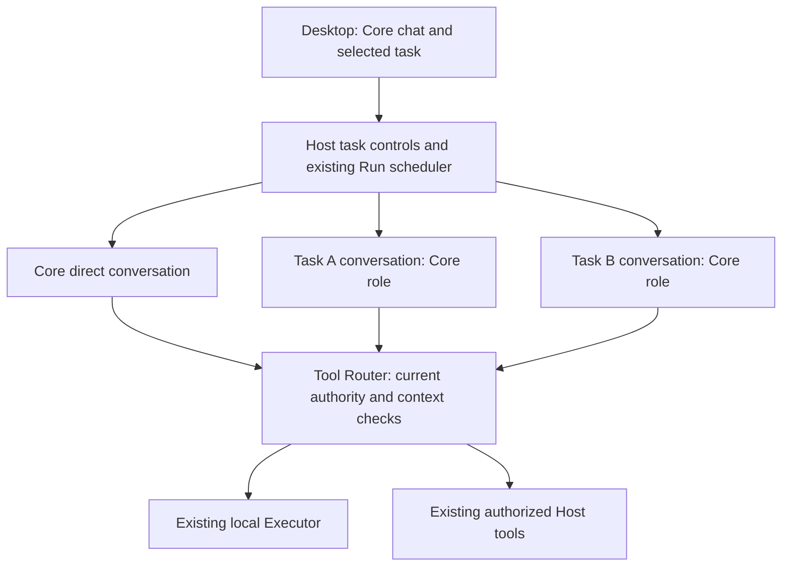

# D11: Local Task Continuity and a Responsive Core

Status: draft — design only; no implementation is authorized by this document
Branch: `docs/d11-local-task-continuity`
Date: 2026-11-02
Baseline: product `1b550b934c0adfd267bc7559d0ff80d91263b396`; [research](../research/superagent-local-design-2026-11-02.md) at `c7949d3`
Related contracts: B2, B13a/B13c, B12a, B14a–B14d, B15a/B15b, B24/B25, B27a–B27c, B28a
Architecture: Sections 5.1–5.3, 5.7, 6.1, 6.5, 7.1–7.2 and 8

## Goal and first increment

Let the owner start two independent research or document tasks from Core, keep talking to Core while those tasks run, correct the intended task, stop only that task, and find each result after restart. The owner should not need to create permanent Bots or groups for temporary work.

The first increment is **explicit, owner-created tasks using Core's role in separate local conversations**. It adds a small task identity and task-specific controls around the existing Run scheduler and Pi adapter. Ordinary Core chat, Specialist private chats, groups and Routines retain their current routing. A model does not silently decide whether an ordinary message starts, updates or stops a task.

The initial task capability set covers web research, reading authorized files, and writing/publishing new local reports in a task-owned output folder. It excludes shell commands, connectors and edits to original/shared work products. This restriction makes parallel work useful without first designing arbitrary workspace conflict resolution or generic asynchronous tools. Existing unrestricted-by-task ordinary tool flows remain subject to their current policy; this design does not remove them from ordinary chat.

Inputs and report formats retain B15a/D9 limits; this increment does not add Office/PDF extraction or a new document-generation engine. Plain-text and supported HTML reports are sufficient for the first two-task acceptance.

**Self-use, one Mac, no separately operated service.** All new scheduling, persistence and projections belong to existing application processes. No remote Target, server endpoint, daemon, worker service, new package or Pi synchronization is proposed. Model inference may use the configured endpoint. Window closure follows the existing menu-bar lifecycle; sleep and Quit do not become always-online execution.

The conversations share the existing in-process Pi Harness. The diagram describes responsibilities, not new processes or services.

## Why these are the minimum changes

The review inspected the linked code and tests; proposed behavior below is not implemented.

| Current fact | Consequence for this design |
| --- | --- |
| [RunScheduler](../../packages/server-core/src/runs.ts) admits at most one Run per Bot, even across channels; same-channel user inputs can steer the current Run. [Tests](../../packages/server-core/test/runs.test.ts) cover queueing, priority, cancellation and recovery. | Another channel alone cannot make Core responsive. Introduce an explicit task execution lane while preserving legacy Bot exclusion for ordinary channels. |
| [ChannelsDoc](../../packages/agent-runtime/src/channels.ts) maps Bot/channel to Pi conversation. [Runtime configuration](../../packages/agent-runtime/src/index.ts) treats non-routine channels as groups. | A task must have a trusted context kind. A `task_` prefix passed to `ensureChannel` is insufficient and risks group tools, wrong memory projection and rejected publication. |
| [B13c](b13c-collaboration.md) roots bind group membership, deliveries, transfer and bounded continuation. | Reusing a group root would require a hidden group and its authority semantics. Keep group collaboration unchanged; a personal task needs a smaller identity with one executor conversation and no delegation tree. |
| [Run storage](../../packages/agent-runtime/src/runs.ts) prunes some terminal Runs; [B28a markers](../../packages/agent-runtime/src/message-records.ts) preserve outcomes independently. | A Run cannot be the durable user-facing identity. Retain task ownership and input/result references without copying the canonical final answer. |
| [B15b](b15b-background-completion.md) already handles durable command completion, but its origins, group bookkeeping and eligibility are specific. | Do not build another polling loop. Task command execution and B15b task-context support are deferred together; existing command flows remain regression requirements. |
| [File tools](../../packages/local-executor/src/files.ts) enforce canonical invocation grants; [ToolInvocation](../../packages/protocol/src/index.ts) already separates read and write grants. | Restrict task writes by narrowing existing per-invocation grants. No new executor transport or OS sandbox is required for this increment. |
| [Conversation keys](../../packages/protocol/src/index.ts), [history](../../packages/agent-runtime/src/history-store.ts), [composer drafts](../../apps/desktop/src/renderer/src/composers.ts) and [observation](../../packages/server-core/src/observation.ts) distinguish existing views. | Add task identity to these explicit projections; do not overload the Core direct key or poll full transcripts. |

Alternatives rejected for this increment:

- **Only add a delegation prompt:** does not remove the scheduler's Bot exclusion, guarantee context separation or bind a correction to a task.
- **Create a Specialist or hidden group per task:** adds roster/membership lifecycle and changes authority for temporary execution.
- **Make Core a mandatory tool-free router:** changes ordinary private chat and management behavior beyond the first workflow. Core can still block on its own ordinary work; the promise here is that these task executions do not occupy Core's conversation or reserved capacity.
- **Automatically classify every message or fan out workers:** adds ambiguous intent, model cost and error recovery before the explicit workflow is proven.
- **Start with arbitrary concurrent coding or connector work:** separate contexts cannot prevent conflicting shell or remote effects. Broader capabilities require their own design.

## Interaction

### Creating and navigating work

Core's existing details area gains a **Tasks** view and **New task** action. Opening it is a local UI action with no model request. It shows task title, truthful state, result/unread indication and the next available action. It is not a separate project-management application or a new top-level Bot roster.

**New task** opens an empty composer with an explicit `New task · Core` destination. Submission creates the task directly through the Host; it does not first ask Core to rewrite the request. The initial title is a plain-text truncation of the owner's first line, with no title-generation inference. Attachments and exact skill pins are selected as in current chat. The task starts with only that submitted input, Core's current role/memory projection and its selected methods; it does not inherit the entire Core chat. The owner may explicitly quote a message into the draft when context is needed.

After acceptance, open the task in the shared conversation shell with a `Core / <task title>` breadcrumb and **Back to Core**. Task selection persists across restart. Keep drafts and immutable send attempts keyed separately for Core chat, each task and each new-task draft. A late acceptance must not clear a newer draft or change a newly selected destination. The accepted task ID remains discoverable after an IPC response is lost.

Ordinary sends in Core continue to use current direct-chat semantics. A free-text reference such as "change yesterday's report" is not lifecycle authority over a task. Core may read task summaries and help the owner identify it; the owner selects the task before submitting a change. There is no model `task_start`, `task_update`, `task_stop` or cross-task messaging tool in this increment.

### Updating, stopping and continuing

| Owner action | Visible behavior | Host meaning |
| --- | --- | --- |
| Submit in **New task** | One task appears with a queued/running state | Create one stable task, isolated conversation and accepted initial Run. Duplicate submission returns the same task. |
| Send while a task is selected | Composer identifies the task. If active, show **Update task** with the short explanation "Stops current work before applying this change." | Persist the correction, fence further dispatch from the old execution and cancel/settle it before starting one replacement Run in the same task conversation. No mid-tool steering or cross-task inference. |
| **Stop task** | Show **Stopping** until settled; keep partial results visible | Fence this task before cancellation. Stop never means rollback and never cancels ordinary Core chat or another task. |
| **Continue task** after stopped/interrupted/failed work | Review the reason and any uncertain effects; explicit action starts another execution | New Run, same task conversation and accepted inputs/methods; never revive an old invocation or reuse an approval. Unreconciled effects keep the action unavailable. |
| Send after a result is available | Same task, new owner revision; old result remains readable | Start a new Run with the follow-up in the retained task context. This is a refinement, not evidence the earlier result was accepted. |
| **Archive** | Move settled work out of the active list; no model call | Visibility only. Reject while work or cancellation is pending. Unarchive restores visibility, subject to the active-list bound; it never starts execution. |
| **Ask Core about this result** | Open a Core draft with an explicit result reference; owner sends it | A normal user request with selected context, not an automatic completion wakeup or a copy of all task history. |

While an update is settling, another update is refused with a specific busy result and its draft preserved; Stop remains available and discards the pending automatic replacement. This avoids an unbounded correction queue. If cancellation cannot establish the outcome, retain the pending correction and show **Needs attention**. Continue can later consume it once, after reconciliation and explicit owner action.

Create/update/stop responses acknowledge the durable operation, not completed execution or termination. Return after the short commit and let observation report subsequent settlement. An idempotent replay returns its original accepted IDs/revision alongside a freshly read projection; the renderer must not replace newer task state with the old operation's initial state.

The task view contains its own deliberate messages, outcomes, approvals, activity and exact final answer using B28a semantics. Core's direct timeline does not receive a second assistant answer. Task completion updates the task card; it makes no extra model call. **Result available** means an answer was committed, not that its claims were independently verified or that the owner accepted it. No new acceptance/review state is introduced.

Task results are separate searchable/readable conversations. Opening Core does not mark task results read. The Core row may show a task attention/unread count, but aggregates count each underlying item once. Reuse the result reader and generated-file Library for published artifacts. Quiet task completion does not add native notifications; existing direct-chat notification behavior remains unchanged. Approval counts and keep-awake decisions must still include task work without using task completion as Core's direct `lastRun`.

### State projection

Do not persist a second execution state machine. Derive the following task presentation from its current revision, pending operation, Run outcomes and approval facts, with uncertainty and pending cancellation taking precedence over an older result:

| Presentation | Evidence | Action |
| --- | --- | --- |
| Needs attention | Unsettled interruption/unknown effect or failed recovery | Inspect evidence; Continue only when permitted |
| Stopping / Applying update | Durable stop/update fence, old execution not yet settled | Wait; Stop may withdraw an update |
| Awaiting approval | Current, unexpired approval for the current task execution | Existing Allow/Deny controls |
| Paused / Queued | Global lifecycle gate or accepted Run awaiting capacity | Explain reason; existing Resume work where applicable |
| Working | Current Run admitted and not above | Stop or Update |
| Could not finish | Current execution failed without an unresolved effect | Inspect; explicit Continue |
| Stopped | Stop settled and no replacement authorized | Continue |
| Result available | Current revision's committed final answer | Read/refine/archive |

Archive is a filter over these facts, not successful completion. A late answer from an earlier revision can be viewed in history but cannot change the current task's state or unread result indication.

## Minimal application and persistence contracts

The names below define the proposed surface for a future implementation spec. They are not implemented APIs.

### Identity and durable records

- A Host-generated `taskId` owns one Core Bot identity, one local Target binding, one typed task channel, one Pi conversation and one fixed output root. IDs and paths are not model-selected. No additional Bot is created.
- Add a task manifest in Host-owned Pi documents, read through `agent-runtime`. It holds identity, owner, creation/title/visibility, an owner-command revision, an execution epoch, current/pending Run references and canonical input/result references. It contains no copied final-answer body, credentials or second executor receipt.
- Keep owner-command revision separate from activity updates. Create/update/stop/continue/archive changes use compare-and-swap; ordinary streaming cannot continually invalidate a button. Increment execution epoch when invalidating a current execution. Bind task ID and epoch to its stored Run and trusted routed invocation context; never accept them as model tool arguments.
- Task Runs use an explicit trusted `task` origin, including owner-requested corrections and continuations. They never masquerade as direct `user` Runs or group `peer` deliveries. Task approvals use the existing unattended ten-minute expiry; opening a task does not change that classification. Approval expiry, deny and revocation retain existing execution semantics.
- Store exact task operation receipts keyed by stable owner request ID and operation digest. Check an existing receipt before current-revision validation: identical replay returns the original result without starting work or clearing a newer stop; conflicting arguments fail. The digest includes operation, task/destination, expected revision, input, attachments and skill pins.
- Atomically create the manifest, typed conversation mapping, accepted initial Run with frozen inputs, and receipt in one Host/Pi transaction. Only then admit inference. If the existing scheduler's `submit` cannot share that transaction, extract a narrow atomic admission-store operation; do not call a nested scheduler mutation and hope both commits succeed.
- A correction atomically stores its immutable pending input and fence/receipt. A separate settled transition atomically links the deterministic replacement Run and consumes that pending operation. Recovery between transitions must discover the same records. The source Run remains available until reconciliation and replacement acceptance finish.
- Retain the latest accepted input snapshot and exact attachment/method references independently of terminal Run pruning, plus stable links to canonical earlier input/outcome entries. Pin only live/reconciling Runs; do not pin every historical Run. A pruned execution can still be read through B28a history; history alone never reconstitutes permission to retry an unknown effect.
- Store per-task records/receipts separately, with a bounded active-ID registry. Initial bounds: 32 unarchived tasks, one pending update per task, 24 KiB UTF-8 per owner input, at most four attachments and two composed exact skill references. Archive frees an active-list slot; archived metadata/history use paginated reads. Do not load every retained task transcript at startup.

No new task is reconstructed automatically from old Runs, groups or Routines. Those records retain their meanings and IDs.

### Desktop methods and model reads

| Surface | Proposed contract |
| --- | --- |
| `tasks.create` | Owner IPC only: `requestId`, text, optional existing attachment IDs and exact skill refs. Host resolves Core/Target/context/output path; returns task ID, revision, Run ID and current presentation. |
| `tasks.update` | Owner IPC only: task ID, request ID, expected revision and new immutable input. Applies the stop-before-update semantics above. |
| `tasks.stop` / `tasks.continue` | Owner IPC only: task ID, request ID and expected revision. Stop fences before dispatch; Continue validates current settlement and creates one new execution. |
| `tasks.archive` | Owner IPC only: task ID, request ID, expected revision and archived boolean. No model or tool execution. |
| `tasks.list` / `tasks.snapshot` | Bounded metadata/current facts; list returns at most 32 items with an opaque keyset cursor. Snapshot does not embed full transcript. Revalidate ownership on every read. |
| Task history/search/read cursors | Add `task:<taskId>` as an explicit conversation-key variant to the existing bounded window/detail/search/read machinery. Keep task rows separate from `bot:<coreId>` and group execution partitions. |
| Core task discovery | Add bounded task-list/read descriptors through the existing application capability gateway for **direct Core user Runs only**. Use 32 KiB result limits and canonical message/artifact anchors; reuse history reads internally. No task lifecycle mutations through Code Mode. |

Task workers get their own conversation, not general application-history reads or other tasks' model context. Direct Core can explicitly retrieve its tasks, but group Core and Specialists do not gain access. Model reads do not mark items read, mutate memory or grant execution authority. Existing `messages.submit` remains ordinary chat; generic `runs.cancel` and `runs.continue` must not bypass task fences or enable task/group continuation accidentally. Task Runs require the task operations above.

Use the existing pull-credit observation channel. Add one explicit task-change topic and refresh bounded task metadata plus the selected task's live snapshot. Extend changed-stream/full-refresh masks and abandoned-request limits consistently. Do not add a push transcript stream or infer task changes solely from the Core direct feed, which currently drops channel snapshots.

### Context classification and configuration

Introduce one trusted context resolver for direct, group, routine and task contexts. Persist a task discriminator and owner-task reference in new channel records. Preserve legacy direct mappings; legacy stored channel rows continue to classify as routine/group by existing rules. An unknown or orphan task reference fails closed, not back to group or direct authority. Reuse this resolver in tool registration, prompt/memory projection, invocation binding, message publication, history and admission.

The task uses Core's configured model, thinking level and standing instructions; configuration changes follow existing next-request behavior, with no per-task model picker. It reads current Core/shared memory under private-context rules but cannot write memory. Core role-default skills and owner-selected pins are composed and frozen at task acceptance; corrections/Continue retain that task's exact methods. A newly selected conflicting revision is rejected rather than silently replacing one. Missing retained attachments or methods fail visibly, without empty input or substituted content.

Core direct history, other task history and group content are not automatically injected. Task context is the accepted inputs, its own committed history, bounded current memory and selected file content. All Bots still share a Mac and grants; this is context separation, not a data-security boundary against arbitrary filesystem access elsewhere in the application.

## Scheduling and responsiveness

Retain the configured global maximum `C` of admitted model Runs, default 3. There is no extra hidden slot and no new scheduler process.

1. Ordinary direct/group/routine work keeps the existing per-Bot exclusion. New task work uses its task conversation as the exclusion key. The same Core role can therefore execute two distinct task conversations while Core direct chat uses its ordinary lane. Two Runs of the same task conversation never overlap, including while cancellation settles.
2. While task work is queued or running, reserve one of the `C` slots for a direct Core user Run when `C >= 2`. All other admitted Runs together may use at most `C - 1`; the reserved slot is not lent to another long task when Core is idle. Count approval-waiting executions and executions still stopping until they actually settle.
3. At `C = 3`, two independent tasks and Core chat may run; at `C = 2`, one task and Core chat; at `C = 1`, execution remains serial. Show the serial-mode limitation instead of silently raising the cap. Task list, Stop and input acceptance are Host operations and remain available even when inference cannot start.
4. If tasks are created while legacy work already fills the cap, do not kill or preempt it. Stop admitting more non-Core work until enough existing work settles to establish the reservation; show **Waiting for capacity**. The guarantee starts after this drain, not retroactively at task creation.
5. Preserve direct-work priority and the existing 30-second aging rule among eligible general-slot candidates; tasks participate with their accepted timestamps. Core's reserved slot does not defeat lifecycle gates or a still-active ordinary Core/group/routine Run under legacy Bot exclusion.
6. Never hold the scheduler's short state-transition queue while awaiting model completion, a file/network operation or cancellation settlement. Admission records and dispatch checks can be serialized; completion waits are outside that critical section.

The promise is **no waiting on these task workers merely to admit an otherwise eligible Core request**. It is not a wall-clock LLM response guarantee. Provider throttling, Core's own foreground tool or model call, an existing ordinary Core group Run, `C = 1`, and lifecycle pause remain visible limitations. No preemption or generic full-duplex Pi loop is introduced.

## Tools, output ownership and current authority

Task tools are an explicit allowlist: `local_read`, `local_list`, `local_write`, `local_edit`, `artifact_publish`, `web_search`, `web_fetch`, `skill_load`, eligible `memory_search`/`memory_read`, and `send_message`. Runtime registration and Host dispatch both enforce the list. Newly added product tools are not automatically task-enabled.

Disallow `local_exec`, background-command control, all connector tools, memory writes, skill saving, routine proposals, Bot/group management, collaboration and generic application Code Mode in task workers. A skill cannot override the allowlist. Report unsupported work honestly; the owner can choose ordinary chat for a workflow outside this increment. No external message sending, purchases, publishing or merge capability is granted by task creation.

Allocate `<workspace>/tasks/<taskId>/` as a distinct output root. The directory name is Host-bound; capture its canonical root under the granted workspace at acceptance and require the root to resolve to that same location on later calls. A redirect to another task's directory is rejected even if both are inside the workspace. Ordinary authorized executor file calls create files/directories as needed; no shell setup command is required. The output directory is not an OS sandbox.

- Reads use current grants and existing attachment rules. Tasks may still read shared granted files; do not claim confidentiality between tasks.
- Writes are limited to the task output root intersected with current write authority. The Host applies this hard boundary before approval and again when constructing invocation grants. Executor `grants` contain only that intersection; other ordinarily writable grants become read-only for the task. An Allow once or Always allow decision cannot widen the task boundary.
- Task `artifact_publish` is restricted to that task's output root. It still uses existing immutable artifact receipts, size/type limits and Library storage. Source documents and other task outputs cannot be overwritten or silently republished through an exception.
- Require `expected_sha256` for task `local_edit`; `local_write` retains its existing replacement semantics inside the task root. Original input files are never task write targets. Separate roots avoid task-to-task output contention but cannot prevent the owner or ordinary shell work from editing files. Do not claim race-free isolation against external writers.
- Every call remains local-target-bound and passes current policy/lifecycle checks. Revalidate task epoch and Run ownership before policy, after asynchronous checks/approval and at transport admission. The task-bound fence also applies to Host `send_message` publication inside its transaction.
- Stop/update does not roll back an already admitted file operation. Reconcile its receipt; an old revision's output remains historical evidence and cannot settle the new revision. Returning an existing receipt is permissible; redispatching it under a fresh identity is not.

No executor wire-format change is required for narrowed file grants and existing Run-scoped cancellation. If implementation finds a case that cannot be enforced with those fields and the Host fence, record it under Open questions rather than silently adding a protocol or assuming prompt compliance.

## Lifecycle, recovery and data compatibility

Task operations use the existing lifecycle gate. Lock continues to allow the currently supported non-interactive work; sleep, Quit, user pause, authority revocation and Host/executor loss follow existing quiescence and reconciliation. Owner Stop is durable task intent; it is never cleared by restart, model output or opening the view.

While the Host is available but work is paused, metadata reads, Stop and archive controls remain available. New inputs may be durably accepted as queued; they cannot admit inference or dispatch tools, and they do not clear pause. Continue requires the global gate to be open as well as task settlement. Task acceptance and global Resume work are distinct owner actions.

| Recovery point | Required behavior |
| --- | --- |
| Create committed; IPC response lost or Pi not yet admitted | Same owner request returns the same task and Run. Resume only through normal lifecycle/admission gates. |
| Pi admitted; stored submission association missing | Find the same stable request/submission, as current Runs do; no duplicate logical input/admission. This does not promise exactly-once provider inference when a request or response was interrupted. |
| Update fence persisted; old Run not settled | Keep the pending correction and block replacement. After interruption/uncertain recovery, require explicit Continue; do not auto-clear the gate merely because the process disappeared. |
| Old Run settled; replacement acceptance committed | Reconcile the same deterministic replacement Run; eligible queued work follows existing recovery gates. |
| Old execution completes after a newer epoch | Retain its canonical history/receipts but do not publish it as the current result or restart work. |
| Stop committed before a delayed approval/tool result | The stale approval cannot authorize another call. Settle the admitted operation honestly and keep the task stopped or needing attention. |
| Backup restored | Restore manifests, receipts, typed channels and canonical content; clear derived caches and stay paused. No automatic task creation, correction or continuation. |

Task manifests, operation receipts and retained input references live in the Host SQLite snapshot already covered by B14d; published artifact bytes use existing attachment storage. Working output folders are workspace files and remain outside backup scope. If they are missing after restore, published immutable results remain readable; Continue reports missing working files and must not imply the workspace was restored. Archive does not erase history, output files, journals, backups or prior provider input.

Version the existing `ChannelsDoc` to version 2 with a migration that preserves all legacy conversation IDs and records explicit kinds. Materialize that guarded document before task creation or Pi resume. Pi's [document version check](../../third_party/pi/packages/durable/src/documents.ts) rejects a stored version newer than the reader definition; the future acceptance must prove the baseline version-1 Host fails before inference or dispatch on a migrated database. An unknown optional marker alone would not protect an older binary. Migration opens existing data without creating tasks; downgrading live migrated data is unsupported, and rollback uses a pre-upgrade snapshot.

New backups use manifest version 2 with an explicit task-context compatibility requirement; the new reader accepts legacy version-1 backups and migrates only in the controlled restored store before resume. Existing version-1 [backup validation](../../packages/server-core/src/backup.ts) rejects a version-2 archive, avoiding silent restore into an app unaware of task authority. Keep managed roots and credential/workspace exclusions unchanged. The implementation spec must define the exact compatibility fields and test both old-reader refusal and old-data migration. Existing IPC consumers still upgrade together under the repository's protocol policy; no remote compatibility layer is needed.

Extend the rebuildable B14c index for task keys, exact message anchors and unread counts; canonical messages and task records remain authoritative. Task summary scans are bounded to the active registry, archived lists use keyset pagination, and selected transcripts use bounded windows. Acceptance must include many archived tasks and long history so separate contexts do not introduce one full-history observer per retained task.

## Change ownership and implementation cuts

| Owner | Minimum proposed change |
| --- | --- |
| `packages/protocol` | Task metadata/operations, task conversation-key variant, trusted Run task binding, task observation topic and direct-Core read descriptors. Keep public contracts independent of Pi. |
| `packages/agent-runtime` | Task manifest/receipt storage, atomic acceptance, typed context resolver, task tool/memory configuration, exact input references and task-aware message/history/usage projection. Pi remains the sole execution/history engine. |
| `packages/server-core` | Task application service, scope/epoch checks, stop-before-update transitions, reserved-capacity admission, bounded metadata/reads and state projection. Reuse current policy/approval/recovery services. |
| `packages/tool-router` | Carry trusted task invocation context and call the application admission port at existing checkpoints. No dependency on task storage or Pi. |
| `packages/local-executor` | Reuse canonical file grants, file operations, artifacts, receipts and scoped cancellation. Add regression evidence for narrowed task grants; no new adapter/service. |
| `apps/local-server` | Wire task services and grant narrowing into existing ports; no separate business rules or listener. |
| Desktop | Core Tasks view, destination-specific composer, task timeline/controls, bounded observation, search/unread and correct attention/power aggregation. Use existing UI primitives and bilingual copy. |

This is one coherent vertical feature, not a framework project. A future ready implementation spec should sequence internal work as: (1) atomic identity/context/authority with deterministic tests; (2) scheduler and control/recovery transitions; (3) task UI and history/artifact integration; (4) integrated acceptance. Do not expose partially functional task creation before its stop, recovery and authority checks exist. No placeholder package or standalone infrastructure batch is needed.

Deferred: model-created tasks, routing ordinary language to task mutations, Specialist assignment, group/task handoffs, automatic completion synthesis, generic task dependencies, shell/background-command support, connectors, shared-file editing, event-triggered tasks, semantic memory extraction and autonomous repair. Add one only after this workflow produces useful evidence and a separate spec settles its contracts.

## Acceptance for a future implementation

These checks define intended outcomes; none has run for this design. Add named cases to the indicated suites or narrowly scoped new suites using [ScriptedModel](../../e2e/scripted-model.ts), Host APIs, observed gates and `h.nextFrame()`. Avoid fixed sleeps and live-provider timing as correctness oracles.

| ID | Scenario and required evidence | Verification home |
| --- | --- | --- |
| A1 | Create twice with the same request after a lost response: one task/channel/Run/input. Changed input/destination conflicts; injected failures around atomic acceptance leave no executable orphan. | Proposed `task-store` adapter tests; Host task tests |
| A2 | Core starts a competitor report and an independent selected-file summary at `C = 3`. Hold both model/tool operations on deterministic gates; a normal Core request is admitted and answered before either gate releases. No new Bot/group and no task/context mixing. | Proposed `local-tasks.e2e.ts`; scheduler tests |
| A3 | Exercise `C = 1, 2, 3`, approvals, cancellation settlement and initially saturated legacy work. Counts never exceed the cap; reservation/drain explanations match actual admission; general-slot aging still progresses. | Extend [scheduler tests](../../packages/server-core/test/runs.test.ts) |
| A4 | Update task A while A and B run: old A cannot dispatch after its fence; replacement A waits for settlement and uses the new instruction. B and Core continue. A stale final result never becomes A's current result. | Task transition tests and background e2e |
| A5 | Stop during update, pending approval, file dispatch and delayed completion. No automatic replacement or approval escape; partial effects remain visible. Duplicate Stop/Continue and replay after a newer Stop cannot restart work. | Host/receipt fault injection; task e2e |
| A6 | Task context cannot invoke shell, connectors, management, collaboration, Code Mode or memory writes even with forged model calls/skills. Unknown task context cannot acquire group/direct privileges. | Router/Host tests; extend [channel tests](../../packages/agent-runtime/test/channels.test.ts) |
| A7 | Task A writes/publishes its report; attempts to write an input, task B output, a traversal/symlink escape or an approval-expanded path are denied. Executor receives narrowed grants and enforces them independently. | Executor file tests; Host authorization tests; task e2e |
| A8 | Task corrections/Continue preserve frozen skills and attachments across defaults changing, missing library entries and restart. Core history/private group canaries are absent from task input; task memory cannot mutate shared notes. | Adapter/prompt tests; reuse role-skill and memory fixtures |
| A9 | Crash at every create/update/replacement/result boundary; sleep, Quit, pause and restore. Stable identities survive, uncertain effects block, published artifact bytes remain readable and no interrupted write is blindly retried. | Lifecycle/store fault injection; recovery/backup e2e |
| A10 | Task messages/results appear once in their own timeline and search, never as duplicated Core answers. Exact anchors, unread/read state and index rebuild agree. Completion makes zero additional model requests. | History/message tests; task e2e |
| A11 | Rapidly switch Core/A/B/new-task drafts while submission is pending. Late responses preserve current text, attachments, method pins and destination. Stop from one view cannot target the currently selected different task. | Composer tests; bilingual task e2e |
| A12 | Archive/unarchive retains references, starts no work and enforces the 32-active-view bound. With 1,000 archived tasks and 10,000 messages in one task, opening Core/list/window sends bounded pages and creates no observer per archived transcript. | B14c-style performance fixture and cache tests |
| A13 | Closed-window work participates in existing power/approval aggregation; task completion does not masquerade as Core's direct completion or generate duplicate native notices. Background test-mode restrictions remain in force. | Main attention unit tests; isolated desktop integration |
| A14 | Existing Core/Specialist chats, group delegation/stop, Routines, B15b completion, exact management approvals and recovery keep their semantics. A task API cannot be reached through generic messages or a group-origin model. | Existing check/e2e suites plus task-negative cases |
| A15 | A version-1 database/backup opens in the new implementation with unchanged legacy identities and no tasks; the baseline Host refuses a version-2 channel store before inference, and its backup reader refuses a version-2 archive. Restore remains paused and references rebuild correctly. | Old/new adapter compatibility fixture; backup tests |
| A16 | Task approvals expire under the existing unattended deadline across restart, even while the task view is open. Ordinary direct-user approvals keep their attended semantics. Usage is attributed to Core once per Run, with task links rather than a second cost ledger. | Approval/usage unit tests; task e2e |

Measure local acceptance separately from model response: after successful Host acceptance, queued/task/stop state must render by the next bounded refresh, while test gates remain held. Capture Host admission latency and provider latency separately; do not invent a universal model SLA. After deterministic acceptance, a separately budgeted, isolated real-model trial should produce two useful reports, apply one correction and stop one task without affecting the other. Record routing mistakes, owner interventions, repeated explanations and model usage, not just elapsed time.

Implementation verification requires `pnpm run check`, full `pnpm run e2e`, inspection of English/Chinese task states at supported window sizes, and refreshed shard timings when the new suite is added. Native power delivery/signing claims still require their separate packaged evidence. This design neither clears those gates nor requires a new benchmark framework.

## Open questions and review gates

No runtime change is approved by this draft. The proposed first-increment choices are explicit: owner-selected tasks, Core role only, task-local report writes, one reserved slot within the cap and stop-before-update. Review these together before producing a ready implementation spec; do not silently expand them to recover the full article's feature set.

The implementation spec must finish the concrete schema/compatibility mapping, enumerate every existing channel-kind branch, and assign the acceptance cases above to executable tests. In particular, atomic task-plus-Run acceptance and task fence ordering must be demonstrated with deterministic failures before parallel UI acceptance. A mismatch in the inspected Pi transaction or executor grant contracts is a dated blocker for that affected slice, not permission to bypass the boundary.

## Design evidence

Read-only inspection covered the existing scheduler, channel/runtime configuration, group gates, task-independent background completion, application capabilities, message persistence, history/indexing, composer persistence, file grants and attention logic, plus their relevant tests. No application, model trial, prototype or product suite was run for this document. Documentation verification and review state belong to this branch/PR; the research remains the dated external evidence record.
