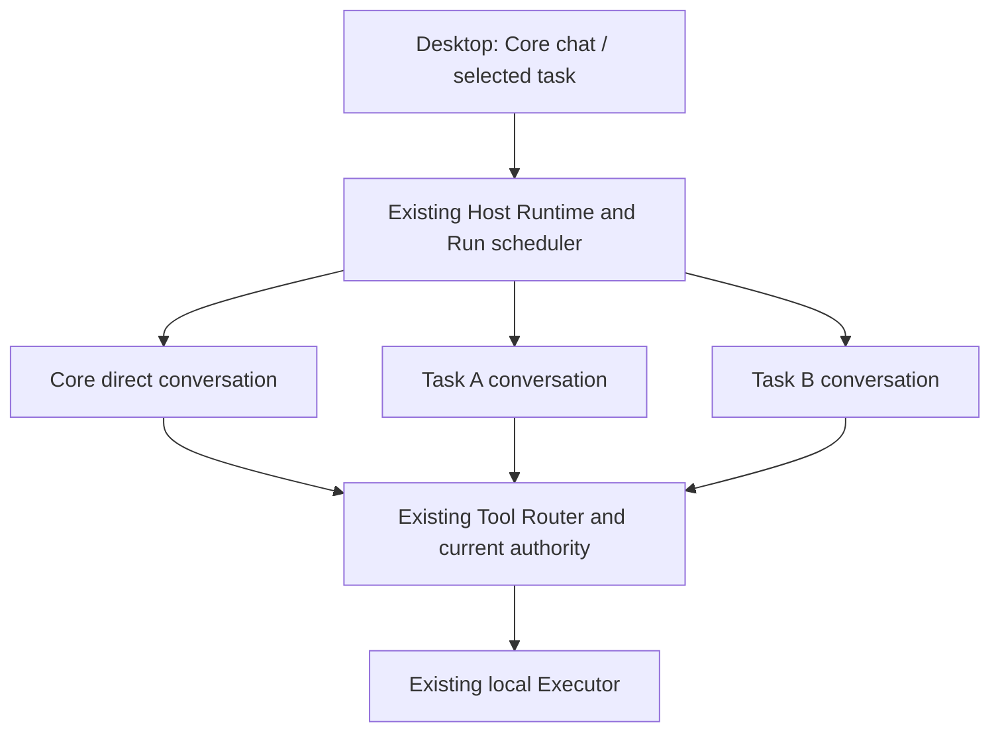

# D11: Local Task Continuity and a Responsive Core

Design record: reviewed on 2026-11-02; implementation contracts and status are owned by [B29](b29-local-task-continuity.md).
Baseline: product `1b550b934c0adfd267bc7559d0ff80d91263b396`; research at `c7949d3`. The subsequent `origin/main` changes through `f45a707` do not change the scheduler, cancellation or channel contracts examined here.
Evidence: [Super-agent research](../research/superagent-local-design-2026-11-02.md).

## Decision

Use explicit owner-created tasks, each with Core's role in a separate local Pi conversation. Keep ordinary Core chat available through a separate scheduling lane and capacity reserved within the configured global cap. Tasks initially do research and produce local reports. They do not run shell commands, connectors or arbitrary edits to shared work products.

All execution, persistence and control stay in the existing application on one Mac. The configured model endpoint remains the only inference dependency. There is no new service, daemon, remote Target, Bot-per-task, hidden group or orchestration framework. Closing a window retains the existing menu-bar lifecycle; sleep and Quit do not become always-online operation.

The owner creates and selects tasks explicitly. During active execution, **Stop to edit** stops the selected task and preserves its local draft. After confirmed settlement the owner sends the modification. There is no automatically queued replacement. This adds one deliberate send to the correction flow and removes a durable pending-command state machine.

These are execution contexts in existing processes, not separately operated workers.

## Review findings and resolutions — 2026-11-02

| Finding in the initial draft | Resolution and reason | Implementation contract |
| --- | --- | --- |
| Automatic stop-before-update needed pending input, an execution epoch, replacement IDs and crash recovery between two admissions. | Remove automatic replacement. Accept a follow-up only after settlement; the existing Run ID plus a durable stop intent fences old work. Owner-command revision is only for stale controls. | [B29 control transactions](b29-local-task-continuity.md#3-control-transactions-and-stop-ordering) |
| A new task conversation key, search/unread system, model task reads and observation topic widened the first delivery unnecessarily. | Reuse B14c's private execution partition under Core with a task selector, existing observation invalidation and bounded task cards. Defer global task search/unread and all model task APIs. | [B29 reading and interaction](b29-local-task-continuity.md#7-reading-and-desktop-interaction) |
| A terminal Run or aborted model input was treated too much like proof that work stopped. | Keep the conversation occupied, and an admitted Run counted, until both Pi and accepted executor operations are quiescent. An unresolved stop cannot release capacity or admit a replacement. | [B29 scheduling](b29-local-task-continuity.md#4-scheduling-and-core-responsiveness) |
| Blocking Continue on every unknown effect had no recovery exit. | Separate uncertain liveness from uncertain results. The former blocks; the latter allows explicit owner acknowledgement after confirmed quiescence. Preserve unknown receipts. Each new Run writes a fresh output subdirectory, so continuation never automatically replays an old write. | [B29 recovery](b29-local-task-continuity.md#6-lifecycle-and-recovery) |
| “One reserved slot” did not fully address draining existing work, approval waits or cancellation. | Count all admitted and settling executions, preserve the cap, establish the reservation by draining without preemption, and state the `C = 1` and legacy Core-lane limitations. | [B29 scheduling](b29-local-task-continuity.md#4-scheduling-and-core-responsiveness) |
| A correction after pre-admission cancellation could lose the original task request; retaining only the latest text was insufficient. | Retain a bounded immutable owner-input sequence and initial attachment/method pins independently of Run pruning. Supply that brief to each fresh Run; never silently truncate it or depend on a previous input having reached Pi. | [B29 durable data](b29-local-task-continuity.md#2-identity-and-durable-data) |
| A backup manifest v2 and new feature-negotiation fields duplicated an existing compatibility mechanism. | Keep manifest v1; increment the existing exact runtime compatibility token and explicitly allow the known legacy token in the new reader. Keep the channel document version guard for live databases. | [B29 compatibility](b29-local-task-continuity.md#8-compatibility-and-retention) |
| Unbounded archived-history promises implied another indexing project. | Page task metadata and selected history, reuse existing display bounds, and acknowledge the existing channel registry's metadata growth. Do not claim constant-time startup or unlimited history scaling. | [B29 reading and interaction](b29-local-task-continuity.md#7-reading-and-desktop-interaction) |

## Why the remaining changes are necessary

[RunScheduler](../../packages/server-core/src/runs.ts) excludes concurrent work by Bot, including different channels. A second conversation alone cannot make Core responsive. A task-specific lane and reserved capacity are the smallest scheduler changes that deliver the intended two-task-plus-Core workflow; they do not require making Core a mandatory tool-free router.

[Runtime channel configuration](../../packages/agent-runtime/src/index.ts) and [group admission](../../packages/server-core/src/groups.ts) currently distinguish routines from other channels; other channels inherit group assumptions. A trusted task kind and fail-closed resolution are therefore required. Reusing a group root would also bring membership, delivery and delegation authority that temporary personal work does not need.

[Run storage](../../packages/agent-runtime/src/runs.ts) is execution bookkeeping, and terminal direct Runs can be pruned. A task needs a stable identity and accepted-input references independent of that retention policy. Pi remains the canonical conversation engine and the executor remains the receipt owner; a task is not a second transcript or effect ledger.

[AuthorityCoordinator](../../packages/server-core/src/authority.ts) already serializes short dispatch decisions and durable invocation intent. [Executor revocation](../../packages/local-executor/src/index.ts) and [receipt recovery](../../packages/local-executor/src/ledger.ts) already support scoped stop checks. Reuse those mechanisms; neither a process-local cancelling flag nor a prompt instruction is a durable stop fence.

[B14c private partitions](b14c-history-scaling.md#contracts) already bound execution-history reads. Task search, unread counts and a model-facing task catalog are optional discovery features, not prerequisites for creating, finding and continuing work through task cards.

## Boundaries and reconsideration triggers

- Keep Core's ordinary tools and current chat semantics. Responsiveness means task workers do not occupy Core's lane or reserved capacity; it does not guarantee provider latency or preempt Core's own work.
- Use an explicit task tool allowlist and narrow existing file grants to a fresh Run output directory. Shared reads remain authorized under current policy. This is not an OS sandbox or a security boundary between Bots.
- Revisit automatic task dispatch or active steering only if explicit selection and Stop-to-edit prove materially disruptive in actual use; record routing mistakes and recovery evidence first.
- Revisit shell, connectors, original-file editing or worker handoffs only with a separate ready spec covering their effects, conflict resolution and B15b integration.
- Revisit global task search/unread, model task reads and larger retained-task indexes when task-card navigation or measured metadata costs justify them.

## Review evidence

Read-only review covered the scheduler and its cancellation/recovery tests; channel configuration and memory tests; authority admission and scoped revocation; executor receipts and canonical file grants; B28a publication; B14c execution windows; desktop drafts/attention; and backup validation. The review found design gaps, not newly demonstrated runtime regressions. [B29 acceptance](b29-local-task-continuity.md#acceptance) specifies the implementation evidence still required. No runtime code or tests were changed or executed for this design review.
