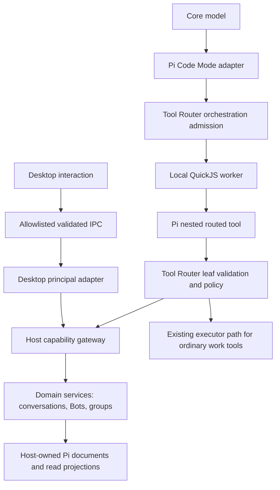

# D3: Application Capabilities and Local Code Mode

Status: accepted direction; B24 implemented in PR #23, B25/B26 draft behind implementation gates
Branch: task/d3-app-capabilities
Baseline: B23, commit d1635bc; vendored Pi b45e0ebcc5ae2fc42a6f2f23104d10e656e6bedb
Date: 2026-10-18

## Decision

Make OpenBot's application capabilities an explicit, typed, authorized Host service surface. Desktop IPC and model tools are separate adapters over the same domain operations. Core uses Pi's local durable Code Mode to discover and compose approved capabilities. Code Mode is an orchestration mechanism, not an authorization mechanism or a new application backend.

Do not expose `HostService.handlers`, Electron IPC, a database handle, arbitrary SQL, Node APIs, or a generic `invoke(method, params)` to generated code. Do not put an HTTP server, API key, cloud code executor or MCP server between components that already live inside one Host. A future external API can adapt the same capabilities with its own authenticated principal; it is not part of this increment.

Search is the first vertical slice. Then enable read-only application composition for Core. Only after cancellation, replay, resource bounds and packaging pass, make existing Bot/group management operations callable from scripts. Specialist Bots keep their current agent behavior and group task limits. They do not acquire management rights through discovery, code or delegation.

## Evidence and alternatives

| Source | Observed fact | OpenBot implication |
| --- | --- | --- |
| [Pi durable README](../../third_party/pi/packages/durable/README.md#code-mode), [implementation](../../third_party/pi/packages/durable/src/codemode/codemode.ts) at the pinned baseline | `createCodemodeExtension`, nested `executeTool`, deterministic VM replay, version/fingerprint checks, `searchTools`/`describeTool`/`describeNamespace`, typed declarations, separate `tools`/`modelTools` and `callers` already exist | Reuse the imported runtime. Do not implement a second agent loop, tool discovery engine or replay journal. No upstream sync is needed |
| [Pi sandbox README](../../third_party/pi/packages/codemode/README.md) and [options](../../third_party/pi/packages/codemode/src/types.ts) | QuickJS WASM in a Node worker; no script `process`, `require`, filesystem or network globals; configurable heap/deadline; capacity release can follow actual worker exit | Use local Node workers, explicit resource caps and a bridge containing only application tools. This is language-runtime confinement, not an OS sandbox for commands |
| [Anthropic PTC documentation](https://platform.claude.com/docs/en/agents-and-tools/tool-use/programmatic-tool-calling), reviewed 2026-10-18 | Provider-native PTC runs generated orchestration in a code-execution container and returns tool requests/results through the provider API | Adopt the programmatic composition pattern, not the provider-hosted execution path: local intermediates should not need another cloud runtime, and model configuration remains provider-independent |
| [Cloudflare Code Mode](https://blog.cloudflare.com/code-mode/) and [SDK documentation](https://github.com/cloudflare/agents/blob/main/docs/agents/codemode.md), reviewed 2026-10-18 | Typed tool declarations, generated scripts and sandbox-to-Host dispatch are separate pieces | Useful separation of discovery, execution and tool authority. Its deployed Workers backend is unnecessary for this Mac-only application |

Direct tools remain useful for simple work and compatibility; both transports must produce identical authorization and effects. Provider-native PTC is not inherently unsafe, but its placement and provider coupling do not fit this product. MCP is an interoperability transport, not a prerequisite for an internal capability layer. Code Mode need not save tokens on a single lookup: measure complete task success, latency and input/output usage rather than promise a fixed saving.

### Current code gaps

- `packages/server-core/src/index.ts` exposes desktop methods, including B23 search. Model tools are separately composed in `apps/local-server/src/tools.ts`. B24 shares descriptor-backed reads through `server-core/AppCapabilities`; desktop methods cannot all be exposed to a Bot.
- `packages/agent-runtime/src/index.ts:routedTool` derives identity from durable conversations/Runs, and B24 maps validated application results through `structuredOutputSchema` plus `structuredOutput`. Ordinary work tools retain text results.
- `packages/tool-router/src/index.ts` serializes by conversation. Holding that gate for a parent script while it awaits children entering the same gate deadlocks. B24 validates application leaves explicitly at the router/service boundary; parent orchestration admission remains a B25 task.
- Bot management already requires active Core, a direct user-origin Run, exact approval, current revision and durable mutation receipt. Reuse those constraints, including the prohibition on model-driven Core profile changes. Do not infer broader permissions from the new API name.
- Pi code mode is vendored but not installed in OpenBot's Harness. Its `models.*` default is enabled, output overflow may use `api.env`, and `store/load` persist per conversation. These defaults need deliberate integration.
- Pi's nested results are task-scoped and cleaned up when the parent settles. They do not replace OpenBot's durable application mutation receipts or human-visible operation history.

## Layers and ownership



The executor edge describes existing direct work tools; the first app Code Mode bridge does not expose them. File/terminal/browser/connector work retains its existing separately authorized routes.

| Module | Responsibility |
| --- | --- |
| `protocol` | Pure capability identifiers, strict input/output schemas, public result/error types, version metadata and safe catalog descriptions; no handlers or Pi imports |
| `server-core` | Capability gateway, authenticated-principal construction at transport boundaries, resource authorization, domain services, approval preparation/recheck and audit policy |
| `agent-runtime` | Pi registration, typed result conversion, Code Mode sandbox adapter, trusted Run ancestry binding, nested-call projection, replay/persistence implementation |
| `tool-router` | Validate each model operation against descriptors, local target binding, policy/admission, leaf sequencing and approval gate through ports; still depends only on `protocol` |
| `apps/local-server` | Composition and worker/WASM asset paths; lifecycle and readiness; no product-policy duplication |
| `desktop` | IPC interaction, bilingual operation/approval presentation; no Pi types or authority synthesis |

Create files within current packages. A package named `app-api` is unnecessary until a real independent dependency boundary warrants it. Capability handlers must call domain services rather than re-enter desktop handlers; the desktop adapter must not masquerade as a model invocation.

## Capability contract

Target contracts: B24 implements the five read descriptors; inspect/mutation descriptors and Code Mode remain planned:

```ts
type AppCapabilityId =
  | "conversations.list" | "conversations.search" | "conversations.read"
  | "bots.list" | "bots.inspect"
  | "bots.create" | "bots.update" | "bots.delete"
  | "groups.list" | "groups.inspect"
  | "groups.create" | "groups.update" | "groups.dissolve";

type CapabilityDescriptor = {
  id: AppCapabilityId;
  version: 1;
  effect: "read" | "write" | "destructive";
  inputSchema: JsonSchema;
  outputSchema: JsonSchema;
  audiences: readonly ("desktop" | "core-direct" | "core-group")[];
  scope: "user-application" | "current-group";
  approval: "none" | "exact-change";
  replay: "read-result" | "mutation-receipt";
  maxResultBytes: number;
  description: string;
};

type AppResult<T> =
  | { ok: true; value: T }
  | { ok: false; error: {
      code: "invalid_request" | "permission_denied" | "not_found"
        | "conflict" | "cancelled" | "outcome_unknown" | "resource_limit";
      message: string; // fixed safe text; no thrown stack or credentials
    } };
```

Use existing concrete protocol types where possible. Generate Pi declarations and IPC validators from the same schema definitions; verify results before crossing into a script. Reject collisions between registered tool names and their normalized JavaScript identifiers at startup. Version the capability catalog independently of provider/model selection. Pin the catalog/adapter version in admitted execution records; incompatible replay stops rather than silently changing semantics.

The gateway accepts `(capabilityId, input, trustedContext)`. Context is constructed in Host code and is never part of model input or client-provided principal JSON. It binds principal kind, Bot/conversation/Run, immutable root user request, parent and child invocation, target, channel scope, signal and limits. A script may supply resource IDs and expected revisions, never actor identity, `origin`, granted scopes, approval decisions or a replacement Run. Validate the provenance against current durable records on every leaf dispatch. Desktop identity comes from the private authenticated transport, not `params.source = "desktop"`; direct renderer mutation remains a deliberate user interaction, separate from model proposal approval.

Catalog discovery filters descriptions and schemas by the caller's maximum allowed surface. It is not a security gate: guessed names, aliases, stale cached schemas and forged JSON are checked by the same gateway. Unknown/unauthorized resource lookup must not expose hidden metadata through detailed errors.

## Authority matrix

| Capability | User desktop | Core direct user Run | Core in group task | Specialist |
| --- | --- | --- | --- | --- |
| Conversation list/search/read | User's retained, nondeleted data | Same global scope, including hidden only when requested | Current group's public posts only; no other group/private history | No new app API in this rollout; existing own task context remains |
| Bot/group list and inspect | Current existing UI semantics | Bounded redacted roster/profiles/groups | Current group and minimum participant identity, not private Prompt/memory | Existing supplied roster/task context only |
| Create/update/delete Specialist; create/update/dissolve group | Existing explicit UI action | Exact-change approval, user-origin direct Run, revisions and receipt | Denied, preserving current management boundary | Denied |
| Core identity deletion or model-driven Core Prompt/permissions | Core deletion prohibited; current explicit settings remain | Denied | Denied | Denied |
| Approval decisions, grants, permission rules, credentials, provider endpoint writes, arbitrary settings, app quit/install/update | Existing explicit user-only flows | Not exposed | Not exposed | Not exposed |
| Mark read, navigate UI, change language, other Bots' memory, new message dispatch | Existing UI flows | Future individually specified capabilities | Future individually specified capabilities | Not added |

The distinction between Core direct and group scope prevents accidental retrieval of private chat into a public group answer. It is a data-minimization/product-authority rule, not a claim that Bots are OS-isolated: all Bots still share the Mac and grants. Retrieval output is untrusted data. Instructions inside a search hit cannot authorize mutation, broaden scope, approve a proposal or turn a delegated task into a direct user request. A `run.origin = user` establishes provenance, not semantic consent to every action; exact approval remains necessary for management mutations.

## First read APIs

- `conversations.search` reuses B23 literal matching, snippets, IDs and 30-item cursor pages. Add an optional exact `conversationKey` constraint for model reads; the Host intersects it with the trusted scope. Omitted group scope is forced to the current group. Bind cursors to effective scope/principal plus query and filters so cursors cannot broaden access. Hidden is explicit, deleted is excluded, dissolved history is readable.
- `conversations.list` returns bounded summaries, excluding drafts and raw Prompt/memory. The capability result is paged (50 summaries, opaque cursor); desktop may retain its current aggregate IPC return while migrating behind the same authorization/domain projection.
- `conversations.read` accepts `{conversationKey, anchorMessageId, before?: number, after?: number}`: defaults 3/3, each at most 10, at most 21 public text messages and 32 KiB serialized result. Validate that the stable anchor belongs to the scoped conversation; return sender/time/ID/plain text, `truncated` and `hasBefore/hasAfter`. Truncate individual text on Unicode boundaries; never include tool arguments/results, thinking, live tokens, approvals, private channel inputs or errors as content. Reject missing/deleted anchors. Reading never acknowledges unread.
- Roster/inspect endpoints return stable IDs, names, kind/status and revisions; Core direct inspection may include the same editable profile fields as existing `bot_inspect`. Current-group metadata does not include Prompt, memory or unrelated membership. No settings/credential objects are reachable through an object graph.

This makes a search-to-answer chain possible without returning entire transcripts:

```js
const hits = await tools.app_conversations_search({query: "release plan", unreadOnly: true});
if (!hits.ok) throw new Error(hits.error.code);
const selected = hits.value.items.slice(0, 3);
const summaries = [];
for (const hit of selected) {
  const context = await tools.app_conversations_read({
    conversationKey: hit.conversationKey, anchorMessageId: hit.messageId, before: 2, after: 2
  });
  if (context.ok) summaries.push({conversationKey: hit.conversationKey, ...context.value});
}
text(summaries);
```

`app_conversations_search` is a concrete registered tool, not a generic method dispatcher. Generated code is JavaScript; TypeScript declarations describe the API but are not executed. Examples and discovery descriptions explain structured failure envelopes explicitly.

## Pi integration and injection

1. Install the Pi Code Mode extension only for Core's eligible conversations. Construct it in `agent-runtime`, with `models: false`, no custom privileged globals, no `env` and no `CodingTools`.
2. Expose `codemode` to the model with `callers: ["model"]`; expose authorized `app_*` leaf tools with `callers: ["tools"]`. Keep current file/command/web/collaboration and legacy direct management tools model-only in this rollout. This matters because Pi derives the script catalog from **all callable tools**, not a namespace filter. Namespace descriptions and `deferred` flags do not restrict execution.
3. `modelTools` controls offered direct tools; `tools` controls enabled tools; `callers` controls nesting. Keep existing direct agent work functional. No recursive Code Mode, tool registration from source, arbitrary `api.executeTool` bridge or peer spawning. Core's group root/delegation limits remain unchanged.
4. Inject one stable application-capability section explaining scope, results as data, discovery, exact approvals, unknown outcomes and budgets. Give the `app_` namespace an initial declaration budget of 1,500 estimated tokens. Use Pi `searchTools`, `describeTool`, `describeNamespace` for the rest; discover only the scope-eligible catalog. Versioned stable descriptions preserve prompt caching. Do not inject all history or full schemas on every request.
5. Extend the OpenBot result adapter with schema-validated JSON for programs plus concise model text and redacted UI details. The public protocol stays independent of Pi. Product errors use `AppResult`; Pi-level validation/cancellation can reject before an envelope exists. Scripts must handle both.
6. Keep Pi `store/load` as bounded conversation-local scratch state (not Bot memory, shared state or authority). Its current limits are 256 Ki characters/value and 1 Mi total. Include it in local data-retention documentation: New topic must not be described as secure erasure. Never store credentials. Results copied there remain local but can later be selected into model output.
7. Disable output spill through an unrestricted environment: leave `env` absent. A truncated result must report truncation without a fake retrievable file. If image or large-artifact support is needed later, add an authorized artifact sink through the executor rather than enabling general filesystem access.

### Parent admission and leaf sequencing

A model-selected `codemode` must enter Tool Router admission before execution. Add a distinct `admitOrchestration` port operation: validate source/options, immutable actor/Run/target, enabled capability/version and budgets, and persist an execution record. Return a Host-owned execution handle to the runtime adapter; it cannot be forged by script JSON. The parent has no application effects, holds no leaf mutex and is not dispatched as a normal Host handler waiting for its children. It can coordinate the Pi runner only after admission succeeds.

Each `app_*` call is a normal nested Pi task routed through `ToolInvoker` and the existing leaf gate. Bind its parent execution handle and stable call ID from Pi ancestry; do not take either from script arguments. Revalidate current scope/policy/revision after any approval wait and immediately before dispatch. `Promise.all` may construct several requests, but the Host executes effects sequentially within the conversation. Stop/denial/limits prevent further admission even if script code catches the error.

Bind root provenance once when the parent begins, persist it and require every child to match it. Do not attach resumed children to whichever Run happens to be active now. Recovery only resumes while that original Run remains authorized. Preserve existing scheduler behavior: a cancelled or nonresumable interrupted Run stays stopped even if Pi could replay its script.

### Initial resource contract

| Resource | Limit and enforcement |
| --- | --- |
| Source | 32 KiB UTF-8, validated before VM creation; JSON-only arguments/results |
| VM heap | 64 MiB QuickJS heap, explicit Node worker admission; WASM/host overhead is separate and measured |
| Worker concurrency | At most 2 for the Host, at most 1 for a conversation, also bounded by admitted Runs; hold reservation until actual worker exit |
| Read-only parent (B25) | 60-second absolute durable deadline including waits/restarts |
| Mutation parent (B26) | 10-minute absolute durable deadline including user approval; bilingual expiry ends waiting work and preserves completed effects |
| Calls | At most 64 leaf calls and 128 total bridge requests including discovery per parent; at most 8 outstanding admissions; count stable child IDs once across replay |
| Leaf results | At most 32 KiB JSON per result; lists/search paged; no unbounded transcript retrieval |
| Parent output | Default 2,000 estimated tokens, hard maximum 4,000 plus 64 KiB serialized output; source options may only reduce limits |
| Parent scratch | Reuse Pi's bounded per-conversation store; no scripts shared across Bots and no authority/capability handles serialized into it |

Limits require a bounded sandbox/bridge adapter, not merely a timeout checked after execution. Reject/cancel excessive bridge calls before creating unbounded nested tasks. Clamp deadlines in the actual `sandbox.start` options as well as source metadata; model-supplied `timeout_ms` must never widen them. Output amplification must be bounded before crossing back into Host memory. Review the available hooks in B25; if a hard bridge/output limit needs a generic Pi hook, record a minimal vendor patch with tests and provenance, without advancing the vendor baseline. Never claim an after-the-fact string slice is a memory bound.

## Mutations, approvals and recovery

An application mutation is not one atomic script transaction. If a script creates a Bot, creates a group and then fails, already committed steps remain. Show partial completion and stable object IDs; never report rollback or blindly restart with new operation IDs.

Keep exact-change approvals inside each leaf. The card shows affected Bot/group, action, revision and fields in the user's UI language. Approving a script does not approve future arguments computed by it. No model-facing approve/grant API and no blanket app-management Always allow. Denied management leaves latch the parent against further mutations; stop that script rather than enabling repeated proposals through `catch`. A later user request is a new authorization context.

Persist a local `AppExecution` record keyed by parent invocation: root provenance, catalog/adapter version, source digest, limits/deadline, state, admitted child IDs and outcomes. Each child uses its full stable nested invocation ID, not a local array counter. Bind the child digest to capability version, arguments, actor, scope and target. Existing Bot/group proposals and mutation receipts remain authoritative; a new alias must address the same underlying receipt for a given invocation. `AppExecution` references those receipts rather than creating another source of truth.

Pi replays the same code against journaled results and reattaches nested tasks. This does not create exactly-once external effects. A completed mutation receipt returns its prior result without a second mutation; a digest mismatch fails; an uncertain outcome becomes `needs_attention` and latches the parent against more mutations. Approval expiry/cancellation/revision conflict is terminal for that proposal. A changed catalog, Pi/VM fingerprint or expired deadline refuses new effects. Startup reconciles accepted work before releasing children.

## Privacy and product presentation

Application data, code execution and intermediate results stay on the Mac. The selected provider still receives the user's prompt, generated source through the conversation, exposed schema descriptions and final script output; a script can select retrieved content into that output. Local Code Mode minimizes unnecessary intermediate exposure, not a promise that inference sees no private data. Group scope is enforced before data reaches the VM.

Treat stored code, source hashes, search queries and result text as potentially private. Generic operation logs contain allowlisted IDs, capability/version, parent/child relationship, duration, status, counts and error codes, with neither arguments nor source/results/Prompt/memory. Durable transcripts, Pi journals and exact approval proposals necessarily contain local user content; keep them out of diagnostic exports and Git. The UI exposes concise capability activity and accurate statuses, with details available on demand. Project durable child operations, not only Pi's temporary `nestedTools`, so completed and partially completed scripts remain explainable after restart. Do not display raw generated code by default or turn nested reads into misleading top-level assistant messages.

All new controls, error/expiry/partial-completion messages and approval labels support English and Simplified Chinese; English remains the default. E2e remains hidden/non-focusable with native attention effects disabled.

## Delivery and decision gates

| Batch | Scope | Status / gate |
| --- | --- | --- |
| [B24](b24-app-capability-api.md) | Shared capability contracts/gateway, trusted context, read services, search/read/list, Core direct routed read tools and authority tests | Ready; no Code Mode or new management rights |
| [B25](b25-local-app-code-mode.md) | Pi local read-only Code Mode, discovery/injection, structured results, resource caps, nested visibility/recovery, packaged worker assets | Draft until B24's contracts and the bounded adapter spike pass |
| [B26](b26-code-mode-management.md) | Existing Core Bot/group management through application aliases, exact child approvals and durable partial-completion UX | Draft until B25 safety/replay tests pass |

Later independent specs: cross-Bot memory management, attention-state changes, navigation commands, new message dispatch, routine/connector APIs and external authenticated transports. No capability is automatically granted merely because a desktop method exists.

## Verification strategy

B24 tests identity spoofing, scope/cursor mismatch, result schemas, semantic parity across adapters and no read-side effects. B25 adds direct versus composed task comparisons, infinite loops, allocation/output/call floods, no Node/network access, recursive-call denial, group-private-data rejection, stop, parent/child lock interaction, crash replay and app bundle worker/WASM loading. B26 tests every crash boundary around approval/mutation/receipt, revision changes while waiting, denial followed by a caught error, partial completion, Core protection and specialist forgery. Run checks and background e2e per batch; use real configured models only in isolated synthetic acceptance workspaces. Measure billed usage and wall time without claiming universal savings.

This design change does not enable Code Mode or change product behavior. Source inspection and the existing Pi regression tests substantiate reuse; they do not certify the unimplemented OpenBot bridge. Execution evidence is recorded in each batch spec when implemented.

### Design validation performed

- Inspected the actual pinned Pi implementation and OpenBot router, runtime adapter, management guards and search service, rather than assuming current upstream defaults apply.
- Ran Pi Durable `test/codemode.test.ts` and `test/codemode-describe.test.ts`: 45 tests passed across 2 files. These cover existing Pi behavior; the B25 OpenBot integration/limit spike remains required.
- Ran `pnpm run check`: boundaries/type checks and 239 tests across 39 files passed. New spec local Markdown links and `git diff --check` passed.
- Documentation-only change: no runtime, dependency, vendor or model-configuration mutation; no desktop was launched for this design task. Product e2e and real-model acceptance belong to the implementation batches.
