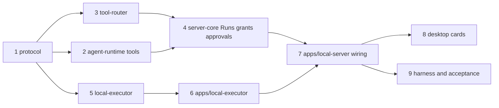

# OpenBot Technical Plan

Active delivery scope (2026-10-20): B9c OAuth and B12b optional model review are excluded. Phase 3 is deferred. B9b (#39) and I2 (#40) are merged. [B11a local routines](tasks/b11a-local-routines.md) is implemented and verified on its task branch, awaiting review. The remaining delivery order is the P1 workflow gate, B14d backup/restore, B14c history scaling, B13e templates and B14f signed updates. Historical planning sections below do not authorize excluded or deferred work.

Last updated: 2026-10-20.

This plan turns [the architecture](architecture.md) into an ordered sequence of work. The architecture defines contracts and boundaries; this document records what exists, what each milestone builds, how each step is verified, and which decisions are still open. When the two disagree, fix the architecture first, then update this plan.

Each section marks state explicitly: **Implemented** means code in the repository that was exercised as described; **Planned** means work that has not started.

Delivery sequencing after merged B26 is maintained in the [development roadmap](development-roadmap.md), designed in [D4](tasks/d4-delivery-plan.md). B14a, B15a, B14b, B12a and B13d are merged through the I1 integration in PR #34 before the B10 skills increment: 358 unit/Host tests, 99 hidden e2e tests, bundled startup and an isolated real-model workflow passed. Native release evidence remains separate from feature merges.

B10 is merged in PR #35, based on I1: 370 unit/Host tests, 103 hidden e2e tests, bundled startup and isolated real-model skill reuse passed. The library remains local and no skill changes tool authority.

B15b is merged in PR #36: durable command completion receipts, separate unattended continuation, group-budget reservation and bilingual inline status. It passed 390 unit/Host tests, 108 hidden e2e tests, bundled startup and isolated real-model completion/restart verification.

B9a is merged in PR #37: supervised local stdio MCP tools, explicit connector lifecycle and private credentials, routed Pi deferred discovery, exact revision/schema approvals and bilingual Connect apps. It passed 409 unit/Host tests, 112 hidden e2e tests, bundled startup and isolated real-model discovery/approved-write/restart verification.

B14e is merged in PR #38: async native Keychain ownership in main, bounded private Host requests, durable explicit migration and bilingual storage controls. Native release limitations and acceptance evidence are recorded in [B14e](tasks/b14e-main-credentials.md). B9b is merged in PR #39 against the merged credential owner with 461 unit/Host tests, 120 hidden e2e tests and isolated real-model one-write/restart acceptance. B11a local routines is implemented on `task/b11a-local-routines`; verification is recorded in its [spec](tasks/b11a-local-routines.md).

[I2](tasks/i2-mvp-acceptance.md) verifies the integrated MVP candidate including B9b and introduces the application through an English README, a complete Chinese translation and an authentic real-model screenshot. Its [acceptance record](acceptance/mvp-2026-10-19.md) separates current automated checks, practical tasks, packaging and outstanding native release gates.

## 1. Current State

### 1.1 Components

| Component | State | Verified by |
| --- | --- | --- |
| Local scheduled routines (B11a) | Confirmed bilingual panel, interval/daily/weekly calendar schedules, exact skills, isolated unattended contexts, durable catch-up/absence/overlap, one report per occurrence and twenty-record history | 477 unit/Host and 127 hidden e2e tests; real-clock trigger, Host-crash approval recovery, bundled startup and isolated real-model report/relaunch; [evidence](tasks/b11a-local-routines.md) |
| MVP acceptance and bilingual introduction (I2, PR #40) | Candidate includes B9b; explicit publication filename guidance, observed-UI search assertions, executable sales example, English/Chinese README and actual app screenshot | Full check/e2e, useful CSV execution/export/denial/restart, real-model memory/report/recovery, ad-hoc DMG; see [current evidence](acceptance/mvp-2026-10-19.md) |
| Workspace, boundary check, Pi vendor (`third_party/pi`, baseline `b45e0ebcc`) | Implemented (M0) | `pnpm run check`; provenance in `.openbot-vendor.json`, `BASELINE.json`, `OPENBOT_CHANGES.md` |
| `packages/protocol` | Implemented: Host methods and events, envelopes, `ExecutionTarget`, transcript items (messages, tool calls with `interrupted`/`cancelled`, dividers, stopped notes, thinking, timestamps), Runs, approvals with Always allow scopes, policy and grants, executor envelopes (`tool.status`, `result.ack`, `tasks.stop`), tool catalog, and one TypeBox schema per Host method (`@openbot/protocol/schemas`) | `protocol/test/*.test.ts` |
| `packages/agent-runtime` | Implemented: Bots, settings, memory, approvals, Runs, policy, and grants as Pi documents; prompt sections (identity, working style, tools, memory); thinking level; New topic (`reset`); submit with start/steer modes; snapshot projection with history before the context head; BYOK from `~/.openbot/models.json`; one-shot model test | `agent-runtime/test/*.test.ts` |
| `packages/server-core` | Implemented: `HostService` for every Host method; durable `ApprovalBook`; `RunScheduler` (cap, FIFO across Bots, steer, Stop, crash sweep); policy (`decide`, conservative zsh lexer, read-only default, rules, folder grants, re-evaluation); `web_search` (Tavily) and `web_fetch` (Readability + Markdown, retrieval outcomes); `memory_update`; subscribed and coalesced conversation feed; reveal-path check | `server-core/test/*.test.ts` |
| `packages/tool-router` | Implemented: policy and approval gate, per-conversation sequential gate, stable invocation and approval IDs from the Pi call ID, argument digest, read and read-write grant lists, dispatch to executor or Host tool | Host smoke (below) |
| `packages/local-executor`, `apps/local-executor` | Implemented: receipt ledger (`<data>/executor/receipts.sqlite`, accepted before effect, unknown after crash, digest check, ack and pruning); orphan process-group guard; read vs read-write grants; one output limiter with spill files under `<data>/artifacts`; `local_edit` expected SHA-256; background commands (`task_output`, `task_stop`, Stop ends them) | `local-executor/test/*.test.ts` |
| `apps/local-server` | Implemented: data directory, `host.lock`, provider-key scrubbing, private Desktop credential adapter, executor supervision, Tool Router composition, schema-checked IPC dispatch, recovery gate (executor ledger, approvals, Runs) before `resume()` | Host smoke scripts driving the real Host over IPC with a scripted model (memory, prompt, Runs and cap, approvals, web search, New topic, background tasks, Stop, read-only commands, Always allow, onboarding methods, subscriptions, duplicate and delete, schema rejection) |
| `apps/desktop` | Implemented: onboarding, sidebar with Queued and Needs attention, transcript with collapsed steps, Copy, Reveal in Finder, thinking, dividers, Retry, Always allow card, Stop and pending messages, Settings (models, web search, commands, folders), Memory tab, Duplicate and Delete, notifications, dock badge, power assertion, `app://` renderer, TypeBox validation in main | Type check, unit tests, and the e2e suites (22 tests across 8 suites, green in CI on macOS for PR #3); packaged smoke of an ad-hoc DMG (Host on bundled Node, UI over `app://`) |
| Desktop-owned credentials (B14e, PR #38) | Main-process Security.framework binding; versioned service and serialized atomic ID indexes; explicit migration; private Host broker; redacted bilingual storage status | 433 unit/Host and 115 hidden e2e tests; bundled startup; ad-hoc probe identity isolation; isolated real-model broker request; see B14e evidence |
| HTTPS connectors (B9b, PR #39) | Strict endpoint/auth union; executor TLS JSON/SSE sessions, credential/session echo redaction, persistent Retry-After cooldown and no tool retry; bilingual setup/reconnect | 461 unit/Host and 120 hidden e2e tests; nine final connector scenarios; isolated real-model write/restart; supported subset in [B9b](tasks/b9b-https-connectors.md) |
| Local stdio connectors (B9a, PR #37) | Host revisioned configuration and cleanup tombstones; executor bounded MCP sessions/process journal; credential isolation and echo redaction; Pi deferred discovery through Tool Router; bilingual Connect apps | 409 unit/Host tests, 112 full hidden e2e tests, final four-flow connector rerun, bundled startup and isolated real-model one-write/restart |
| Background completion (B15b, PR #36) | Host-owned durable subscriptions; bounded executor final receipts; separate unattended Runs; group root reservation; suppression tombstones; bilingual inline controls | 390 unit/Host tests, 108 hidden e2e tests, final five-flow rerun, bundled startup and real-model one-shot completion/restart |
| Reviewed skills (B10, PR #35) | Executor version store and verified SKILL.md; Host provenance/exact approval; Pi metadata and immutable skill input snapshots; bilingual library/review and composer selection | 370 unit/Host tests, 103 hidden e2e tests, inspected bilingual screenshots, bundled startup and real-model second-Bot reuse |
| Desktop test execution | Implemented on `task/b7a-background-e2e`: background by default; hidden non-focusable windows, no native attention effects; explicit `e2e:headed` debugging | `pnpm run check` (163 tests), `pnpm run e2e` (24 tests, 9 suites); hidden-renderer screenshots inspected |
| Desktop command path | Implemented on `task/b8a-login-path`: one bounded login-shell PATH probe before Host startup, reused on restart; inherited PATH fallback; other shell variables and output discarded | 15 resolver tests; ScriptedModel e2e from a system-only PATH; isolated agent-browser flow; ad-hoc package and bundled Host/executor smoke |
| Model sources (B16) | Implemented on `task/b16-model-sources`: shared built-in/custom setup, protocol selection, origin-only metadata, JSONC-safe additions, safe test errors and content-free local operation diagnostics | 183 unit tests; 27 background e2e; isolated agent-browser inspection |
| Default Core (B17) | Permanent durable Core identity, lifecycle protections, no preset Specialists, skippable model onboarding and default navigation | 186 unit tests; 29 background e2e; isolated agent-browser inspection |
| Core management (B18) | Core-only inspect/create/update/delete tools, user-Run provenance, exact approval cards, revision checks, atomic mutation receipts and local bilingual activity | 194 unit tests; 36 background e2e; isolated real-model create/update/delete and restart verification |
| Prompt and memory controls (B19) | Implemented, merged: profile revision binding and conflict protection; per-Bot memory revisions, source/time, 20-version restore history and replay receipts; fresh duplication and bilingual editor | 200 unit tests; 40 background e2e; isolated real-model learn, Prompt, correction, new-topic, restart and clear checks |
| Desktop experience (B20) | English / Simplified Chinese UI with local preference, refreshed roster/conversation/settings, native status translations; Pi mechanisms unchanged | 189 unit tests; 31 background e2e; screenshots at default/minimum sizes; isolated real-model desktop spot checks |
| Conversation experience (B21) | Shared private/group layout, contextual details, local conversation filtering/New, versioned local drafts and immutable send recovery, keyboard mentions, scroll anchors and compact task activity; English/Chinese | 229 unit tests; 54 background e2e; inspected light/dark and minimum-width screenshots; isolated real-model private, Core delegation/result and explicit @ flows |
| Conversation list (B22) | Local bounded private/group previews, monotonic snapshot-bound read cursors, native-aware automatic reading, explicit read, independent counts with draft/activity precedence, recency within Core/pinned sections; English/Chinese | 234 unit tests; 59 background e2e and inspected screenshots; isolated real-model replies, delegation, explicit @ and complete desktop/Host restart |
| Conversation search (B23) | Rebuildable local history corpus, literal English/Chinese matching, bounded snippets/cursors, unread composition, exact private/group message jumps and search-mode read suppression; transient debounced UI | 239 unit tests; 65 background e2e with screenshots; isolated real-model private/group history search and full desktop/Host restart |
| Authorized application API (B24) | Implemented, merged: five typed read capabilities, shared desktop/Core search and bounded context, durable caller/Run/channel/target checks, current-group scope, strict schemas and bilingual activity | 246 unit tests; 68 background e2e with screenshots; isolated real-model private/group search-read and complete desktop/Host restart |
| Local read-only Code Mode (B25) | Implemented, merged: Core-only Pi QuickJS, tools-only application reads, routed parent/child authorization, original Run/deadline replay, VM bridge/worker limits, durable bilingual activity and bundled assets | 259 unit tests; 69 background e2e; 227 Pi Code Mode and 47 Durable tests; packaged runtime startup and isolated real-model private/group/restart checks |
| Core management Code Mode (B26) | Implemented: eight direct-Core aliases, shared exact approvals/atomic receipts, transactional authority checks, denial latch before queue release, ten-minute direct deadline and bilingual nested activity | 278 unit/Host tests, 73 background e2e tests and isolated real-model six-approval/restart acceptance; merged into `main` in PR #27 |
| Usage evidence (B13d) | Implemented on `task/b13d-usage-evidence`: Pi model-ledger projections, atomic Run usage intervals, known-price estimates, local approval/result links and English/Chinese details | 285 unit/Host tests, 78 background e2e tests, bundled runtime and isolated real-model acceptance; merged through I1 (#34); no billing or telemetry |
| Reliable observation (B14a) | Merged through I1 (#34): bounded pull invalidation, topic revisions, single-flight snapshot reads, stale-generation rejection and independent main attention | 290 unit/Host tests; 75 background e2e tests and isolated real-model read/reply recovery; evidence in [B14a](tasks/b14a-reliable-observation.md) |
| File inputs and result artifacts (B15a) | Implemented on `task/b15a-bounded-artifacts`: immutable executor copies/receipts, bounded private multimodal input, native path authority, safe bilingual previews/export/removal, exact group result cards and capped output spills | 293 unit/Host tests, 79 full background e2e, six final artifact scenarios, inspected bilingual screenshots and isolated real-model text/image/result/export/restart; [B15a evidence](tasks/b15a-bounded-artifacts.md) |
| Lifecycle gates (B14b) | Implemented on `task/b14b-lifecycle-gates`: persistent global pause, native startup/lock/sleep/quit gates, target-bound executor quiescence, interrupted Runs and explicit continuation, preserved queues and stopped group chains; English/Chinese | 301 unit/Host tests; 80 full background e2e tests and seven final lifecycle scenarios; bundled runtime startup; isolated real-model pause/restart/continue kept exactly one synthetic write |
| Deterministic policy (B12a) | Implemented on `task/b12a-deterministic-policy`: target-bound revisions, bounded Ask first predicates, exact approvals, unattended expiry, executor revision synchronization and durable scoped revocation; English/Chinese | 319 unit/Host tests; 84 full background e2e tests; eight targeted policy/collaboration scenarios; bundled startup; isolated real-model Ask first/revocation/explicit-continuation with exactly one write |
| Bounded collaboration (B13c) | Core-default group routing, explicit @ recipients, task-scoped delegation/transfer, durable results and budgets, scoped tree stop, bilingual activity | 223 unit tests; 49 background e2e; isolated real-model delegation, transfer, Chinese synthesis, English @ and restart |
| Group lifecycle (B13b) | Local revisioned groups, Core-only exact approvals, user-selected recipients, durable delivery/publication, removal/dissolution recovery, English/Chinese UI | 211 unit tests; 45 background e2e; isolated real-model lifecycle, member tasks and restart |
| Channel contexts (B13a) | Additional Bot/channel conversations, shared profile/memory, same-channel steering, per-Bot admission, aging priority and channel-scoped cancellation/receipts | 204 unit tests; 40 background e2e |
| Packaging | Implemented: electron-builder arm64 DMG, esbuild-bundled Host and executor, pinned Node 24.22.0, fuses, ad-hoc or Developer ID signing, notarization when secrets exist, `v*` tag release workflow, `<data>/logs/host.log` | Local ad-hoc package; Developer ID signing and notarization unexercised (no certificate) |
| `browser`, `computer-use` | Planned (Phase 3: architecture M3 browser part, M6) | — |

Phase 1 (MVP, backlog B1–B8) and the authorized product increments through B26 are merged into `main`; each batch's design and as-built notes are in [`docs/tasks/`](tasks/README.md). Merging feature work does not establish every native packaged release claim. G0 in the roadmap separates background automated acceptance from outstanding native evidence. Remaining Phase 2 enhancements and Phase 3 computer control follow their own ready specs.

### Application capability foundation

[D3](tasks/d3-app-capabilities.md) designs a shared authorized Host capability gateway and local Pi Code Mode. B24 implements typed read services and Core read tools through Tool Router and the Host gateway. Pi optional arguments normalize null at the adapter, while canonical API inputs stay strict. B25 implements bounded local workers/bridge/output, original Run ancestry, replay and packaged assets; B26 implements existing exact-approval Bot/group mutations through shared aliases and transactional authority checks. No unrestricted desktop method mapping or provider-hosted execution is planned. Core installs the vendored Pi extension with models disabled and the five read capabilities callable from group scripts, plus eight management aliases in direct Core scripts. The generic OB-CODEMODE-1 vendor patch bounds the VM bridge; ordinary tools remain model-only. Application executions retain content-free child metadata and committed object references for the bilingual activity UI; exact proposals and receipts remain authoritative.

### 1.2 Known Gaps in Existing Code

[D1: Core Bot, Specialist Bots, and Model Sources](tasks/d1-bot-product-design.md) is a design proposal for the next product increment. Current code has per-Bot instructions and memory, and a protected Core identity, with Core-only model-facing Specialist management. B13b adds Core-only group management and user-directed group tasks. All duplicated Bots start with empty memory and conversation history. B19 provides revisioned memory and Prompt controls; Pi continues to own agent execution and compaction. B13a isolates group contexts from direct chat; B13c implements bounded group delegation and ownership transfer. Cross-group dispatch and direct-chat peer collaboration remain out of scope. Memory history is bounded in the active document, but complete erasure from the journal, backups and prior provider requests is not implemented.

B21 keeps unsent drafts and send recovery in the desktop renderer partition. Host receipts remain authoritative; uncertain sends require explicit retry with the original request ID. B22 adds local durable latest-message/read projections for private chats and groups; automatic reading requires a visible focused native window and a rendered timeline at its end. B23 adds literal history search and conversation-level unread filtering through a rebuildable in-memory runtime corpus. Queries never load transcripts, call a model or enter diagnostics; historical result navigation suppresses automatic read acknowledgements. Corpus memory and startup cost grow with retained text; a persistent index/worker requires a separate large-history spec. Group pin/hide, manual mark-unread, transcript virtualization remain separate UI work. B15a supplies bounded artifact previews.

These are deliberate shortcuts or missing pieces in implemented code. Each one is assigned to a milestone below.

| Gap | Where | Milestone |
| --- | --- | --- |
| Scoped revocation stops supervised operations; arbitrary shell commands still run as the user and cannot be confined to a directory | `server-core`, `local-executor` | Existing trust model; isolated targets remain separate work |
| Desktop forwards a minimal environment: `$NAME` key references in `models.json` cannot resolve. Login-shell PATH discovery is implemented separately by B8a and does not import credentials | `apps/desktop/src/main/index.ts` | Before the first release: settle explicit credential references versus the documented Keychain / `!command` setup |
| B15a supports bounded text/images and plaintext HTML results; Office/PDF extraction, group input propagation, complete journal erasure and artifact maintenance are not implemented | `local-executor`, `agent-runtime`, Desktop | Separate artifact follow-ups |
| macOS notifications, dock badge, and power assertion are unit-tested as logic only | `apps/desktop/src/main` | Owner's packaged run |
| Observation delivery is bounded, but full transcript snapshot size and retained renderer caches still grow with history | `apps/desktop/src/renderer/src/store.ts` | Backlog B14c |
| Packaged native lifecycle event delivery remains unverified; B14b forwards and gates simulated events | `apps/desktop/src/main/index.ts` | Native release acceptance |
| HTTPS connectors require explicit Connect after failure/restart; idle GET notifications, stream resumption, OAuth and endpoint edits are not implemented | `local-executor`, Connect apps | Separate connector follow-ups |
| Developer ID credential identity and continuity across updates remain unverified; native evidence uses a separately sealed ad-hoc probe, not a release-signed OpenBot | `apps/desktop/native`, `scripts/verify-keychain.mjs` | Native release acceptance |
| Developer ID signing and notarization are wired but have never run | `.github/workflows/release.yml`, `apps/desktop/scripts/package.mjs` | First release |
| A crash between Pi conversation creation and the Bot-index commit leaves an orphan conversation | `agent-runtime` `createBot` | Backlog B14 |
| A fixed 30-second request timeout applies to every Host method | `apps/desktop/src/main/host.ts` | Revisit when a long-running method appears |
| BYOK supports three APIs (`openai-completions`, `openai-responses`, `anthropic-messages`); there is no model discovery from a gateway's `/v1/models` | `agent-runtime/src/model-config.ts` | When a user needs another API or discovery |

## 2. Rules for Every Milestone

- **Done means acceptance passes.** A milestone is complete when its acceptance list in this plan and in architecture Section 10 passes on the workspace, not when code compiles.
- **Verify the real surface.** Runtime changes are exercised through the Host process; UI changes through the running Electron app. Unit tests protect invariants; they do not replace the smoke run.
- **Tests protect consumer-visible behavior:** authorization, deduplication, recovery, cancellation, ordering, and precedence. Do not add tests that only restate wiring.
- **New package checklist:** add `package.json` with `workspace:*` dependencies, add its rule to `scripts/check-boundaries.mjs` (rules for planned packages already exist), add tests under `test/`, and confirm `pnpm run check`.
- **Protocol changes** bump nothing until a released build exists; until then `PROTOCOL_VERSION` stays `1` and every consumer is updated in the same change. Update architecture Section 6 when a method or event is added, renamed, or removed.
- **Pi changes** follow architecture Section 2.3: a traceable patch ID in `OPENBOT_CHANGES.md`, the affected upstream tests, and no baseline advance.
- **Secrets in tests:** use `MemorySecretStore` in package tests and a dedicated `OPENBOT_KEYCHAIN_SERVICE` plus `OPENBOT_DATA_DIR` for process smoke runs. Delete the test Keychain item afterwards.

## 3. Milestone Plans

The milestones below follow the architecture's capability areas. Delivery is phased; [the backlog](backlog.md) owns the batch order:

| Phase | Milestone content it delivers |
| --- | --- |
| **1. MVP** (B1–B8) | M1 completion (B1, B2); coding tools beyond M1 (B3); `web_search` and `web_fetch` from M3 (B4); Always allow and folder grants from M5 (B5); memory from M4 and prompt quality (B6); the user-facing part of M2 (B7); a signed installable build from M9 (B8) |
| 2. Enhancements (B9–B15) | M7 connectors; skills, routines, and deterministic policy from M5; group chats, handoff, and templates from M4; the rest of M2 and M9 |
| 3. Computer control (deferred) | M3 managed browser, takeover, and secrets; M6 desktop computer use; M8 voice and teach-a-task |

The milestone sections stay as the reference for what each area needs; where a phase-1 batch takes part of a milestone, the batch's spec is authoritative.

### M1: Host and Local Execution (next)

Goal: a Bot uses file and command tools on the local target through Tool Router and a separate executor process, with grants, approvals, receipts, and replay-safe recovery. Architecture Sections 5.1 to 5.3, 6.2, 7, and 8.2.

**1. Protocol.**

- Executor envelopes from Section 6.2: `executor.hello` handshake (protocol version, instance ID, capabilities, bound `targetId`), `tool.invoke`, `tool.ack`, `tool.progress`, `tool.result`, `tool.status`, `tool.cancel`, `result.ack`.
- `InvocationStatus`: `accepted`, `running`, `succeeded`, `failed`, `cancelled`, `unknown`. Transport failure is distinct from tool failure.
- Tool catalog: name, capability (`files.read`, `files.write`, `commands`), and JSON Schema for arguments. The catalog lives in `protocol` so Tool Router can validate arguments without importing Pi.
- Run, grant, approval, and policy types: `Run` with the Section 7.2 states; `Grant` as `(targetId, capability, scope, version)`; `PendingApproval` binding `invocationId`, tool, target, argument digest, and grant version.
- Host methods: `messages.submit` returns `runId`; `runs.cancel` takes `runId`; `approvals.decide`; `grants.list`, `grants.create`, `grants.revoke`; `policy.settings.update` for capability defaults. Events: `run.updated`, `approval.requested`, `approval.resolved`.
- Transcript items: `tool_call` (tool, argument summary, status), `tool_result` (bounded text, artifact reference), `approval`.
- Error codes: `permission_denied`, `approval_expired`, `outcome_unknown`.
- Canonical argument digest helper (stable JSON, SHA-256), shared by router and executor.

**2. agent-runtime: routed tools.**

- `ToolInvoker` port: `invoke({ invocationId, botId, conversationId, tool, args, signal }) → ToolOutcome`.
- One OpenBot extension registered with `defineExtension()`; each catalog tool registered with `defineTool()`, `replay: "safe"`, and an `execute` that calls `ToolInvoker`. Argument schemas come from the protocol catalog.
- `invocationId` derived from the Pi conversation ID and tool task ID, so a rerun after a crash reuses it (Section 5.1 replay policy).
- Cancellation: the Pi `AbortSignal` becomes a `tool.cancel` through the invoker.
- Per-Bot tool selection through `configure({ tools })`; no `env`, no `CodingTools`.
- Project tool calls and results into the new transcript items.
- Tests with the scripted model: a scripted tool call reaches a fake invoker with a stable `invocationId` across reopen; an `unknown` outcome becomes an error result and the Run is flagged.

**3. tool-router (new package).**

- Ports: `PolicyPort`, `DispatchLedger`, `ExecutorTransport`, `HostToolHandler` (Section 4.1).
- Pipeline: catalog lookup → argument validation → `assertLocalTarget` → policy decision (allow, ask, deny) → wait for approval when asked → re-check policy → persist dispatch intent → dispatch → correlate result → persist receipt → acknowledge.
- A per-Run sequential gate as the second enforcement of `toolExecution: "sequential"`.
- Rerun semantics from Section 5.1: waiting approval resumes; existing dispatch intent re-sends the same `tool.invoke`; accepted without receipt becomes `unknown`.
- Tests with in-memory ports: non-local and mismatched targets rejected; deny never dispatches; ask waits and resumes after a simulated restart; rerun re-sends instead of creating a new invocation; argument change under the same ID is rejected.

**4. server-core: Runs, grants, policy, approvals.**

- OpenBot Run queue per conversation, stored as a versioned document: `queued` → `running` → terminal, a global active-Run cap (default 3), and `runId` returned from `messages.submit` after the durable receipt. Pi submission ID is associated with the Run; the stable request ID reconciles a crash in between.
- Grants document: the shared workspace (`~/OpenBot`, created with consent) and user-selected directories, versioned; revocation invalidates pending approvals.
- Policy evaluation for M1: hard rules, then capability defaults (`commands: ask` by default; file reads and writes inside a grant allowed). Ask first and Allow automatically rules arrive in M5 behind the same `PolicyPort`.
- Approvals document: persisted before the Run waits, survive restart, decided by `approvals.decide`. B12a implements ten-minute expiry for unattended approvals, reused by B11a routines.
- Invocation records implementing `DispatchLedger`.
- `needs_attention` activity when a Run waits for approval or holds an `unknown` outcome.

**5. local-executor (new package).**

- Receipt ledger in its own SQLite file (`<data>/executor/receipts.sqlite`, `node:sqlite`, WAL). Records acceptance before the side effect and the terminal receipt after; retained until `result.ack`.
- Deduplication by `invocationId` plus argument digest: replay returns recorded state; a different digest is rejected.
- Grant enforcement independent of the Host: capability, `targetId`, grant version.
- File adapter: `realpath` canonicalization and containment against granted roots, symbolic-link and time-of-check handling (open, then verify the opened path), bounded reads, atomic writes (temporary file plus rename), and `local_edit` with an expected-content check. Writes to the same path are serialized.
- Command adapter: `spawn` in a new process group with a scrubbed environment (no credentials), working directory inside a grant, deadline, bounded and drained stdout and stderr with truncation markers, exit code and signal recorded separately from transport status, cancellation by signalling the process group, and `unknown` when termination cannot be confirmed.
- Tests: path escape via `..` and symbolic links refused; replay after an accepted-but-unfinished record yields `unknown`; repeated `tool.invoke` after a receipt returns it without re-running; cancelling a command kills its child processes.

**6. apps/local-executor (new app).**

- Entry that binds the parent IPC channel, sends `executor.hello`, routes executor messages to `local-executor`, and exits on parent disconnect after attempting to stop supervised commands (Section 8.1).

**7. apps/local-server wiring.**

- Spawn and supervise the executor; validate the handshake against the bound `targetId`.
- Wire `PolicyPort`, `DispatchLedger`, and `HostToolHandler` to `server-core`, and `ExecutorTransport` to the executor connection.
- Recovery gate: open the store, connect the executor, reconcile unfinished invocations with `tool.status`, then call `runtime.resume()` and start the scheduler.
- Long-running methods do not hold a desktop request open: `messages.submit` returns after the durable receipt, and progress arrives as events.

**8. Desktop surfaces needed to drive M1.**

- Tool activity rows in the transcript, an approval card with **Allow once** and **Deny**, Stop for the active Run, and a workspace grant prompt during onboarding. **Always allow** arrives with policy rules in M5.

**9. Harness and acceptance.**

- A development harness script under `apps/local-server` that starts the Host with a temporary data directory, creates a Bot, submits a task, answers approvals, and prints the transcript and receipts. Add it as a package script only once it exists.
- Acceptance (architecture Section 10, M1):
  - A real-model task creates and reads a file in an authorized temporary directory.
  - An unauthorized path fails with `permission_denied` and no executor side effect.
  - A non-local `targetId` is rejected.
  - Command output, exit status, and receipts are stored.
  - Killing the Host while an approval is pending, then restarting, shows the same approval; approving it runs the command once.
  - Killing the executor during a command yields `unknown` and `needs_attention`, not a silent retry.

Risks: Pi tool-task identity across `resume()` must be confirmed against the vendored `harness/tool.ts` before relying on it for `invocationId`. Process-group cancellation cannot catch descendants that call `setsid`; record that as `unknown`.

### M2: Desktop Completion

Goal: the desktop completes M1 with production-grade IPC and lifecycle. Architecture Sections 6.1, 6.4, 6.5, and 8.1.

- **Schema validation** for every Host method in main and in the Host, generated from one definition per method (decision below).
- **Subscriptions:** replace broadcast snapshots with `conversations.subscribe` and `conversations.unsubscribe`, snapshot then `seq`-ordered deltas, gap detection that discards and refetches, and token-delta coalescing (about 50 ms) before IPC.
- **Backpressure:** an acknowledged event window between Host and main, and between main and the renderer.
- **Packaged-style loading:** a custom `app://` protocol with the existing Content Security Policy for both development builds and packaging.
- **Lifecycle:** forward `suspend`, `resume`, `lock-screen`, and `unlock-screen` to the Host; `powerSaveBlocker` while Runs are active; login item setting; notifications for approvals, completed and failed Runs; menu-bar count of running Bots and pending approvals with **Pause all**.
- **Transcript quality:** TanStack Virtual with end anchoring, Streamdown for streaming Markdown, a Normal and Verbose toggle for tool detail.
- **Sidebar and shortcuts:** search (`Cmd+K`), Bot state badges, `Cmd+N`, `Cmd+,`, and Bot menu actions Duplicate and Delete (deletion semantics from Section 8.3).
- **Keychain placement decision** (Section 5.9), implemented before M9 signing.
- Acceptance: architecture M2 criteria; a sequence gap injected in a development build triggers a fresh snapshot; the renderer has no path to executor messages or stored secrets (checked by reviewing the preload surface and attempting calls from DevTools).

### M3: Managed Browser and Web

Goal: Bots research in their own managed-browser windows, hand off logins, and fill secrets without seeing them. Architecture Sections 5.4 and 5.9.

- `packages/browser`: discover an installed Chrome-family browser, launch with a dedicated `--user-data-dir` and `--remote-debugging-pipe`, map Bots to windows, tab management, accessibility snapshots with element references, screenshots with frame metadata, DevTools input, gating for takeover, and relaunch with the same profile after a crash.
- Browser tools from Section 5.2 in the protocol catalog, dispatched through `local-executor`; references and coordinates validated against the producing `frameId`.
- Takeover flow: `browser_request_takeover`, a Take over card, `browser.takeover` and `browser.release` methods, a fresh snapshot after release.
- Secret requests: `secrets.provide` and `secrets.cancel`, values travelling main to Host only, Keychain or single use, `browser_fill_secret` by reference.
- Host tools `web_search` (configured endpoint and key) and `web_fetch` (public URLs only; private and loopback addresses blocked).
- Work panel Browser tab with the window's latest frame.
- Risks: background-window throttling (validate launch flags with two Bots), sites blocking automation (no bypass; use takeover).

### M4: Multiple Bots

Goal: Bots work in parallel and cooperate. Architecture Section 5.7.

- Memory document per Bot, `memory` prompt section, `memory_update`, and an editable memory panel (`bots.memory.get`, `bots.memory.update`).
- Active-Run cap enforced across Bots with fair admission.
- Group lifecycle and user-directed tasks are implemented in B13b: local append-only posts, explicit recipients/default Core, separate contexts and replay-safe publication.
- B13c implements `bot_delegate` and `bot_handoff`, two forward hops, twelve automatic deliveries, visible ownership and result continuations, durable receipts and tree cancellation. Private chats remain direct; peer work stays in its assigned group.
- Templates: `bots.export` and `bots.import` without memory, history, credentials, or grants.
- Usage per Bot from `pi.usage`.

### M5: Skills, Routines, and Deterministic Policy

Goal: reusable skills, scheduled work, and complete policy. Architecture Sections 5.3 and 5.8.

- Skill library under `<data>/skills/<name>/SKILL.md`, `skills` prompt section, `skill_load`, `skill_save` with confirmation, `/` attachment.
- Routine scheduler in `server-core` with request ID `routine:<routineId>:<scheduledAt>`, fresh ownerless conversation per occurrence, report entry, limits, test run, coalesced catch-up, pause after a long absence.
- Policy rules: Ask first and Allow automatically with tool, target, optional Bot, and argument predicates; **Always allow** creating a confirmed rule; 10-minute expiry for unattended approvals.

### M6: Desktop Computer Use

Goal: Bots operate desktop applications under a visible, pausable lease. Architecture Section 5.5.

- Swift helper application with its own bundle identifier, launched with responsibility disclaimed, length-prefixed JSON over stdio.
- ScreenCaptureKit capture excluding OpenBot windows, Accessibility-first input with CGEvent fallback, display selection and coordinate mapping, permission status confirmed by real capture.
- Control lease with epochs, border and HUD, global pause shortcut, invalidation on lock, session switch, display change, pause, or handoff.
- Packaged validation required: TCC attribution and grants depend on the signed helper.

### M7: Connectors

Goal: MCP servers as executor-supervised connectors. Architecture Section 5.6.

- Connector definitions, Keychain credentials injected only into their own server, stdio supervision and HTTP sessions, OAuth through the default browser, deferred tools with tool search, `@` attachment.

### M8: Voice and Teach-a-Task

- Composer dictation through on-device speech recognition or a configured endpoint.
- Recording DevTools navigation and input from a Bot's window into a draft skill, excluding password fields.

### M9: Recovery and Packaging

Goal: architecture Section 11 passes on a real Mac with the packaged app.

- Termination tests for each process, lock, sleep, wake, duplicate delivery, and orphan-conversation sweep.
- Consistent backup and restore, version records, migrations verified against a backup.
- electron-builder configuration: fuses from Section 6.4, bundled signed Node 24 with `allow-jit`, Host and executor JavaScript outside `app.asar`, Pi assets (model data, Photon and QuickJS WebAssembly), helper signing, notarization, and updates with electron-updater.

## 4. Cross-Cutting Tracks

| Track | Plan |
| --- | --- |
| Grok Bot interface parity | Each Section 6.5 surface is built in the batch that supplies its data: sidebar and conversation (done), tool activity and approval card (demo), Always allow and folders (B5), memory tab (B6), onboarding, collapsed steps, notifications (B7), skills, routines, Connect apps, groups, search, menu bar (Phase 2), work panel Browser and Screen, takeover card, dictation (Phase 3) |
| Persistence | Every OpenBot document is versioned from M1. Format changes ship with a migration and a reopen test against data written by the previous version |
| Logging | Correlate by `botId`, `runId`, and `invocationId`; never log credentials, secret values, full file or page contents, or screenshots. A bounded log file under the data directory arrives with B8 so packaged builds can be diagnosed |
| Pi baseline | Synchronize only as a dedicated task (architecture Section 2.4). Before M1, re-read the vendored tool-task and recovery code that M1 relies on |
| Dependency versions | Pin exact versions. Review electron-vite 6 after it settles; keep Electron within supported majors |

## 5. Open Decisions

| Decision | Options | Decide by |
| --- | --- | --- |
| Executor receipt storage | **Decided:** `node:sqlite` file per executor (B1). Electron 44's Node 24.21 and the development Node 22.22 both provide it | — |
| Tool argument schemas in `protocol` | **Decided:** plain JSON Schema objects (implemented in `TOOL_CATALOG`) | — |
| IPC schema validation library | **Decided:** TypeBox (B7), already a Pi dependency; tool schemas stay plain JSON Schema | — |
| Keychain placement | **Decided and implemented (B14e):** Electron main using Security.framework, a versioned service, explicit migration and private Host IPC | Developer ID/update evidence remains gated |
| Development Node version | Keep 22.22.2 for development; the packaged build bundles Node 24.22.0 (B8). CI should also run the Host tests on the bundled Node | B14 |
| Web search provider | **Decided:** Tavily behind a `SearchProvider` interface (B4) | — |
| Transcription | On-device only, or an optional configured endpoint | Phase 3 |
| Update channel | electron-updater with GitHub Releases | B14 |

## 6. Risks

| Risk | Impact | Mitigation |
| --- | --- | --- |
| Pi Durable's API is experimental | Upstream changes can break the runtime adapter | All Pi use stays in `agent-runtime`; deliberate synchronizations only; adapter tests cover the used surface |
| `node:sqlite` is experimental in Node 22 | Warnings today; behavior changes across Node majors | Validate on the bundled Node 24 in M9; storage reopen tests in every milestone |
| Replay safety depends on stable tool-task identity | Duplicate side effects after a crash | Confirmed in the vendored `harness/tool.ts` (B1 spec): a `replay: "safe"` call reruns with the same call ID; the executor ledger deduplicates by invocation ID as the second guard |
| Commands run as the user without a sandbox | A granted command can touch anything the user can | Commands ask by default; policy and visible receipts; isolated targets are later work (architecture Section 1.1) |
| TCC attribution through responsibility disclaim | Agent commands could inherit desktop grants | Dedicated helper with disclaim; launchd fallback; packaged validation in M6 and M9 |
| Background browser throttling | Parallel Bots stall in occluded windows | Validate launch configuration with two Bots in M3 |
