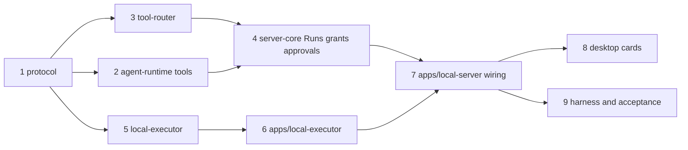

# OpenBot Technical Plan

Last updated: 2026-10-15.

This plan turns [the architecture](architecture.md) into an ordered sequence of work. The architecture defines contracts and boundaries; this document records what exists, what each milestone builds, how each step is verified, and which decisions are still open. When the two disagree, fix the architecture first, then update this plan.

Each section marks state explicitly: **Implemented** means code in the repository that was exercised as described; **Planned** means work that has not started.

## 1. Current State

### 1.1 Components

| Component | State | Verified by |
| --- | --- | --- |
| Workspace, boundary check, Pi vendor (`third_party/pi`, baseline `b45e0ebcc`) | Implemented (M0) | `pnpm run check`; provenance in `.openbot-vendor.json`, `BASELINE.json`, `OPENBOT_CHANGES.md` |
| `packages/protocol` | Implemented: Host methods (including `approvals.decide`), events, envelopes, `ExecutionTarget`, transcript `tool` items, `PendingApproval`, executor request/message envelopes, and the tool catalog (`TOOL_CATALOG`, plain JSON Schema) | `protocol/test/target.test.ts` |
| `packages/agent-runtime` | Implemented: Bot index and settings as Pi documents, one ownerless Pi conversation per Bot, async and awaited submit with stable request IDs, abort, snapshot and observe projections, model and provider listing, `CredentialStore` re-export, scripted-model test seam, BYOK from `~/.openbot/models.json` with Pi semantics (new providers, built-in overlays, `modelOverrides`) in `model-config.ts` | `agent-runtime/test/bot-runtime.test.ts`, `model-config.test.ts` (value grammar, validation, catalog inheritance, overlays, Keychain-over-config precedence, requests to a local endpoint) |
| `packages/server-core` | Implemented: `HostService` with handlers for every Host method, sidebar activity (`needs_attention`, `working`, `unread`, `idle`), `SecretStore` port, in-memory `ApprovalBook`, first-release policy (`decide`), `web_fetch` Host tool with private-address blocking | `server-core/test/host-service.test.ts` |
| `packages/tool-router` | Implemented: policy and approval gate, per-conversation sequential gate, stable invocation and approval IDs from the Pi call ID, argument digest, dispatch to executor or Host tool | Real-model smoke through the Host (below) |
| `packages/local-executor`, `apps/local-executor` | Implemented: separate process with handshake; grant re-check with symlink-safe canonical paths; `local_read` (line numbers, offset, device and binary refusal), `local_list`, atomic `local_write`, unique-match `local_edit`, `local_exec` (own process group, SIGTERM then SIGKILL, timeout, scrubbed environment, head-and-tail output); in-memory receipts dedupe repeated invocation IDs | `local-executor/test/executor.test.ts` (grant escape via `..` and symlink, foreign target, edit uniqueness, exactly-once repeat, exit status, group cancel, env scrub) |
| `apps/local-server` | Implemented: data directory, exclusive `host.lock`, provider-key environment scrubbing, Keychain secret store, `models.json` loading, shared workspace (`~/OpenBot` or `OPENBOT_WORKSPACE`), executor process supervision, Tool Router composition, IPC dispatch, ordered events, recovery gate, clean shutdown | Real-model smoke on 2026-10-15 through the Mafia gateway (`claude-sonnet-5-5`): a Bot wrote `hello.md` in the workspace without asking, `wc -c hello.md` waited for approval, ran after **Allow once**, and the Bot reported the size |
| `apps/desktop` | Implemented: Electron shell, sandboxed preload, Grok Bot-style sidebar and conversation, sanitized Markdown (`marked` + DOMPurify), one row per tool call with status and output, inline approval card (**Allow once** / **Deny**), Stop, settings | Electron run over CDP (chat flows); tool UI built and type-checked, not yet exercised in the window |
| `browser`, `computer-use` | Planned (Phase 3: architecture M3 browser part, M6) | — |

The demo runs the M1 path end to end with in-memory approvals and receipts. [The backlog](backlog.md) splits the remaining work into three phases: **Phase 1 MVP** (B1–B8, a standard agent Bot: files, terminal, web research, approvals with Always allow, memory, installable build), Phase 2 enhancements (B9–B15), and Phase 3 computer control.

### 1.2 Known Gaps in Existing Code

These are deliberate shortcuts or missing pieces in implemented code. Each one is assigned to a milestone below.

| Gap | Where | Milestone |
| --- | --- | --- |
| Request parameters are checked only for shape; there is no per-method schema validation in main or the Host | `apps/desktop/src/main/ipc.ts`, `apps/local-server/src/main.ts` | Backlog B7 |
| `messages.submit` forwards straight to Pi `submit` and returns `{ accepted: true }`; there is no OpenBot Run, queue, `runId`, or active-Run cap. `runs.cancel` aborts by `botId` | `server-core`, `agent-runtime` | Backlog B2 |
| Pending approvals and executor receipts live in memory; a Host restart drops a pending approval (Pi reruns the call, which asks again) | `server-core/src/approvals.ts`, `local-executor` | Backlog B1 |
| The transcript does not project images or thinking blocks | `agent-runtime` `toTranscript` | Backlog B6 (thinking), B15 (images) |
| Every conversation update is broadcast as a full snapshot; there is no per-conversation subscription, token-delta coalescing, or event backpressure | `server-core`, `apps/local-server`, renderer store | Backlog B7 (one subscribed Bot, coalescing), B14 (backpressure) |
| The renderer ignores `seq` and resynchronizes only when the Host restarts | `apps/desktop/src/renderer/src/store.ts` | Backlog B14 |
| Power and lock events are logged, not forwarded to the Host; no `powerSaveBlocker` | `apps/desktop/src/main/index.ts` | Backlog B7 (`powerSaveBlocker`), B14 (forwarding) |
| The renderer loads from `file://`; no `app://` protocol, fuses, packaging, or signing | `apps/desktop` | Backlog B8 |
| Keychain access runs in the Host through `/usr/bin/security` on a general-purpose Node binary (development path in architecture Section 5.9) | `apps/local-server/src/keychain.ts` | Kept for the MVP (B8 records the risk); moved in B14 |
| The Host runs on Node from `PATH` (`.node-version` is 22.22.2); the architecture targets a bundled Node 24 | `apps/desktop/src/main/index.ts`, `.node-version` | Backlog B8 |
| A crash between Pi conversation creation and the Bot-index commit leaves an orphan conversation | `agent-runtime` `createBot` | Backlog B14 |
| A fixed 30-second request timeout applies to every Host method | `apps/desktop/src/main/host.ts` | Revisit when a long-running method appears (none in Phase 1) |
| BYOK supports three APIs (`openai-completions`, `openai-responses`, `anthropic-messages`); there is no model discovery from a gateway's `/v1/models` | `agent-runtime/src/model-config.ts` | When a user needs another API or discovery |

## 2. Rules for Every Milestone

- **Done means acceptance passes.** A milestone is complete when its acceptance list in this plan and in architecture Section 10 passes on the workspace, not when code compiles.
- **Verify the real surface.** Runtime changes are exercised through the Host process; UI changes through the running Electron app. Unit tests protect invariants; they do not replace the smoke run.
- **Tests protect consumer-visible behavior:** authorization, deduplication, recovery, cancellation, ordering, and precedence. Do not add tests that only restate wiring.
- **New package checklist:** add `package.json` with `workspace:*` dependencies, add its rule to `scripts/check-boundaries.mjs` (rules for planned packages already exist), add tests under `test/`, and confirm `pnpm run check`.
- **Protocol changes** bump nothing until a released build exists; until then `PROTOCOL_VERSION` stays `1` and every consumer is updated in the same change. Update architecture Section 6 when a method or event is added, renamed, or removed.
- **Pi changes** follow architecture Section 2.3: a traceable patch ID in `OPENBOT_CHANGES.md`, the affected upstream tests, and no baseline advance.
- **Secrets in tests:** use `MemorySecretStore` in package tests and a dedicated `OPENBOT_KEYCHAIN_SERVICE` plus `OPENBOT_DATA_DIR` for process smoke runs. Delete the test Keychain item afterwards.

## 3. Milestone Plans

The milestones below follow the architecture's capability areas. Delivery is phased; [the backlog](backlog.md) owns the batch order:

| Phase | Milestone content it delivers |
| --- | --- |
| **1. MVP** (B1–B8) | M1 completion (B1, B2); coding tools beyond M1 (B3); `web_search` and `web_fetch` from M3 (B4); Always allow and folder grants from M5 (B5); memory from M4 and prompt quality (B6); the user-facing part of M2 (B7); a signed installable build from M9 (B8) |
| 2. Enhancements (B9–B15) | M7 connectors; skills, routines, and the rest of Auto Review from M5; group chats, handoff, and templates from M4; the rest of M2 and M9 |
| 3. Computer control | M3 managed browser, takeover, and secrets; M6 desktop computer use; M8 voice and teach-a-task |

The milestone sections stay as the reference for what each area needs; where a phase-1 batch takes part of a milestone, the batch's spec is authoritative.

### M1: Host and Local Execution (next)

Goal: a Bot uses file and command tools on the local target through Tool Router and a separate executor process, with grants, approvals, receipts, and replay-safe recovery. Architecture Sections 5.1 to 5.3, 6.2, 7, and 8.2.

**1. Protocol.**

- Executor envelopes from Section 6.2: `executor.hello` handshake (protocol version, instance ID, capabilities, bound `targetId`), `tool.invoke`, `tool.ack`, `tool.progress`, `tool.result`, `tool.status`, `tool.cancel`, `result.ack`.
- `InvocationStatus`: `accepted`, `running`, `succeeded`, `failed`, `cancelled`, `unknown`. Transport failure is distinct from tool failure.
- Tool catalog: name, capability (`files.read`, `files.write`, `commands`), and JSON Schema for arguments. The catalog lives in `protocol` so Tool Router can validate arguments without importing Pi.
- Run, grant, approval, and policy types: `Run` with the Section 7.2 states; `Grant` as `(targetId, capability, scope, version)`; `PendingApproval` binding `invocationId`, tool, target, argument digest, and grant version.
- Host methods: `messages.submit` returns `runId`; `runs.cancel` takes `runId`; `approvals.decide`; `grants.list`, `grants.create`, `grants.revoke`; `policy.settings.update` for capability defaults. Events: `run.updated`, `approval.requested`, `approval.resolved`.
- Transcript items: `tool_call` (tool, argument summary, status), `tool_result` (bounded text, artifact reference), `approval`.
- Error codes: `permission_denied`, `approval_expired`, `outcome_unknown`.
- Canonical argument digest helper (stable JSON, SHA-256), shared by router and executor.

**2. agent-runtime: routed tools.**

- `ToolInvoker` port: `invoke({ invocationId, botId, conversationId, tool, args, signal }) → ToolOutcome`.
- One OpenBot extension registered with `defineExtension()`; each catalog tool registered with `defineTool()`, `replay: "safe"`, and an `execute` that calls `ToolInvoker`. Argument schemas come from the protocol catalog.
- `invocationId` derived from the Pi conversation ID and tool task ID, so a rerun after a crash reuses it (Section 5.1 replay policy).
- Cancellation: the Pi `AbortSignal` becomes a `tool.cancel` through the invoker.
- Per-Bot tool selection through `configure({ tools })`; no `env`, no `CodingTools`.
- Project tool calls and results into the new transcript items.
- Tests with the scripted model: a scripted tool call reaches a fake invoker with a stable `invocationId` across reopen; an `unknown` outcome becomes an error result and the Run is flagged.

**3. tool-router (new package).**

- Ports: `PolicyPort`, `DispatchLedger`, `ExecutorTransport`, `HostToolHandler` (Section 4.1).
- Pipeline: catalog lookup → argument validation → `assertLocalTarget` → policy decision (allow, ask, deny) → wait for approval when asked → re-check policy → persist dispatch intent → dispatch → correlate result → persist receipt → acknowledge.
- A per-Run sequential gate as the second enforcement of `toolExecution: "sequential"`.
- Rerun semantics from Section 5.1: waiting approval resumes; existing dispatch intent re-sends the same `tool.invoke`; accepted without receipt becomes `unknown`.
- Tests with in-memory ports: non-local and mismatched targets rejected; deny never dispatches; ask waits and resumes after a simulated restart; rerun re-sends instead of creating a new invocation; argument change under the same ID is rejected.

**4. server-core: Runs, grants, policy, approvals.**

- OpenBot Run queue per conversation, stored as a versioned document: `queued` → `running` → terminal, a global active-Run cap (default 3), and `runId` returned from `messages.submit` after the durable receipt. Pi submission ID is associated with the Run; the stable request ID reconciles a crash in between.
- Grants document: the shared workspace (`~/OpenBot`, created with consent) and user-selected directories, versioned; revocation invalidates pending approvals.
- Policy evaluation for M1: hard rules, then capability defaults (`commands: ask` by default; file reads and writes inside a grant allowed). Ask first and Allow automatically rules arrive in M5 behind the same `PolicyPort`.
- Approvals document: persisted before the Run waits, survive restart, decided by `approvals.decide`. Unattended expiry arrives with routines in M5.
- Invocation records implementing `DispatchLedger`.
- `needs_attention` activity when a Run waits for approval or holds an `unknown` outcome.

**5. local-executor (new package).**

- Receipt ledger in its own SQLite file (`<data>/executor/receipts.sqlite`, `node:sqlite`, WAL). Records acceptance before the side effect and the terminal receipt after; retained until `result.ack`.
- Deduplication by `invocationId` plus argument digest: replay returns recorded state; a different digest is rejected.
- Grant enforcement independent of the Host: capability, `targetId`, grant version.
- File adapter: `realpath` canonicalization and containment against granted roots, symbolic-link and time-of-check handling (open, then verify the opened path), bounded reads, atomic writes (temporary file plus rename), and `local_edit` with an expected-content check. Writes to the same path are serialized.
- Command adapter: `spawn` in a new process group with a scrubbed environment (no credentials), working directory inside a grant, deadline, bounded and drained stdout and stderr with truncation markers, exit code and signal recorded separately from transport status, cancellation by signalling the process group, and `unknown` when termination cannot be confirmed.
- Tests: path escape via `..` and symbolic links refused; replay after an accepted-but-unfinished record yields `unknown`; repeated `tool.invoke` after a receipt returns it without re-running; cancelling a command kills its child processes.

**6. apps/local-executor (new app).**

- Entry that binds the parent IPC channel, sends `executor.hello`, routes executor messages to `local-executor`, and exits on parent disconnect after attempting to stop supervised commands (Section 8.1).

**7. apps/local-server wiring.**

- Spawn and supervise the executor; validate the handshake against the bound `targetId`.
- Wire `PolicyPort`, `DispatchLedger`, and `HostToolHandler` to `server-core`, and `ExecutorTransport` to the executor connection.
- Recovery gate: open the store, connect the executor, reconcile unfinished invocations with `tool.status`, then call `runtime.resume()` and start the scheduler.
- Long-running methods do not hold a desktop request open: `messages.submit` returns after the durable receipt, and progress arrives as events.

**8. Desktop surfaces needed to drive M1.**

- Tool activity rows in the transcript, an approval card with **Allow once** and **Deny**, Stop for the active Run, and a workspace grant prompt during onboarding. **Always allow** arrives with policy rules in M5.

**9. Harness and acceptance.**

- A development harness script under `apps/local-server` that starts the Host with a temporary data directory, creates a Bot, submits a task, answers approvals, and prints the transcript and receipts. Add it as a package script only once it exists.
- Acceptance (architecture Section 10, M1):
  - A real-model task creates and reads a file in an authorized temporary directory.
  - An unauthorized path fails with `permission_denied` and no executor side effect.
  - A non-local `targetId` is rejected.
  - Command output, exit status, and receipts are stored.
  - Killing the Host while an approval is pending, then restarting, shows the same approval; approving it runs the command once.
  - Killing the executor during a command yields `unknown` and `needs_attention`, not a silent retry.

Risks: Pi tool-task identity across `resume()` must be confirmed against the vendored `harness/tool.ts` before relying on it for `invocationId`. Process-group cancellation cannot catch descendants that call `setsid`; record that as `unknown`.

### M2: Desktop Completion

Goal: the desktop completes M1 with production-grade IPC and lifecycle. Architecture Sections 6.1, 6.4, 6.5, and 8.1.

- **Schema validation** for every Host method in main and in the Host, generated from one definition per method (decision below).
- **Subscriptions:** replace broadcast snapshots with `conversations.subscribe` and `conversations.unsubscribe`, snapshot then `seq`-ordered deltas, gap detection that discards and refetches, and token-delta coalescing (about 50 ms) before IPC.
- **Backpressure:** an acknowledged event window between Host and main, and between main and the renderer.
- **Packaged-style loading:** a custom `app://` protocol with the existing Content Security Policy for both development builds and packaging.
- **Lifecycle:** forward `suspend`, `resume`, `lock-screen`, and `unlock-screen` to the Host; `powerSaveBlocker` while Runs are active; login item setting; notifications for approvals, completed and failed Runs; menu-bar count of running Bots and pending approvals with **Pause all**.
- **Transcript quality:** TanStack Virtual with end anchoring, Streamdown for streaming Markdown, a Normal and Verbose toggle for tool detail.
- **Sidebar and shortcuts:** search (`Cmd+K`), Bot state badges, `Cmd+N`, `Cmd+,`, and Bot menu actions Duplicate and Delete (deletion semantics from Section 8.3).
- **Keychain placement decision** (Section 5.9), implemented before M9 signing.
- Acceptance: architecture M2 criteria; a sequence gap injected in a development build triggers a fresh snapshot; the renderer has no path to executor messages or stored secrets (checked by reviewing the preload surface and attempting calls from DevTools).

### M3: Managed Browser and Web

Goal: Bots research in their own managed-browser windows, hand off logins, and fill secrets without seeing them. Architecture Sections 5.4 and 5.9.

- `packages/browser`: discover an installed Chrome-family browser, launch with a dedicated `--user-data-dir` and `--remote-debugging-pipe`, map Bots to windows, tab management, accessibility snapshots with element references, screenshots with frame metadata, DevTools input, gating for takeover, and relaunch with the same profile after a crash.
- Browser tools from Section 5.2 in the protocol catalog, dispatched through `local-executor`; references and coordinates validated against the producing `frameId`.
- Takeover flow: `browser_request_takeover`, a Take over card, `browser.takeover` and `browser.release` methods, a fresh snapshot after release.
- Secret requests: `secrets.provide` and `secrets.cancel`, values travelling main to Host only, Keychain or single use, `browser_fill_secret` by reference.
- Host tools `web_search` (configured endpoint and key) and `web_fetch` (public URLs only; private and loopback addresses blocked).
- Work panel Browser tab with the window's latest frame.
- Risks: background-window throttling (validate launch flags with two Bots), sites blocking automation (no bypass; use takeover).

### M4: Multiple Bots

Goal: Bots work in parallel and cooperate. Architecture Section 5.7.

- Memory document per Bot, `memory` prompt section, `memory_update`, and an editable memory panel (`bots.memory.get`, `bots.memory.update`).
- Active-Run cap enforced across Bots with fair admission.
- Group chats: group documents, write-only group transcript, mention routing, lead Bot, replies written back.
- `bot_message` and `bot_handoff` with request ID `handoff:<invocationId>`.
- Templates: `bots.export` and `bots.import` without memory, history, credentials, or grants.
- Usage per Bot from `pi.usage`.

### M5: Skills, Routines, and Auto Review

Goal: reusable skills, scheduled work, and complete policy. Architecture Sections 5.3 and 5.8.

- Skill library under `<data>/skills/<name>/SKILL.md`, `skills` prompt section, `skill_load`, `skill_save` with confirmation, `/` attachment.
- Routine scheduler in `server-core` with request ID `routine:<routineId>:<scheduledAt>`, fresh ownerless conversation per occurrence, report entry, limits, test run, coalesced catch-up, pause after a long absence.
- Policy rules: Ask first and Allow automatically with tool, target, optional Bot, and argument predicates; **Always allow** creating a confirmed rule; optional model reviewer that can only escalate; 10-minute expiry for unattended approvals.

### M6: Desktop Computer Use

Goal: Bots operate desktop applications under a visible, pausable lease. Architecture Section 5.5.

- Swift helper application with its own bundle identifier, launched with responsibility disclaimed, length-prefixed JSON over stdio.
- ScreenCaptureKit capture excluding OpenBot windows, Accessibility-first input with CGEvent fallback, display selection and coordinate mapping, permission status confirmed by real capture.
- Control lease with epochs, border and HUD, global pause shortcut, invalidation on lock, session switch, display change, pause, or handoff.
- Packaged validation required: TCC attribution and grants depend on the signed helper.

### M7: Connectors

Goal: MCP servers as executor-supervised connectors. Architecture Section 5.6.

- Connector definitions, Keychain credentials injected only into their own server, stdio supervision and HTTP sessions, OAuth through the default browser, deferred tools with tool search, `@` attachment.

### M8: Voice and Teach-a-Task

- Composer dictation through on-device speech recognition or a configured endpoint.
- Recording DevTools navigation and input from a Bot's window into a draft skill, excluding password fields.

### M9: Recovery and Packaging

Goal: architecture Section 11 passes on a real Mac with the packaged app.

- Termination tests for each process, lock, sleep, wake, duplicate delivery, and orphan-conversation sweep.
- Consistent backup and restore, version records, migrations verified against a backup.
- electron-builder configuration: fuses from Section 6.4, bundled signed Node 24 with `allow-jit`, Host and executor JavaScript outside `app.asar`, Pi assets (model data, Photon and QuickJS WebAssembly), helper signing, notarization, and updates with electron-updater.

## 4. Cross-Cutting Tracks

| Track | Plan |
| --- | --- |
| Grok Bot interface parity | Each Section 6.5 surface is built in the batch that supplies its data: sidebar and conversation (done), tool activity and approval card (demo), Always allow and folders (B5), memory tab (B6), onboarding, collapsed steps, notifications (B7), skills, routines, Connect apps, groups, search, menu bar (Phase 2), work panel Browser and Screen, takeover card, dictation (Phase 3) |
| Persistence | Every OpenBot document is versioned from M1. Format changes ship with a migration and a reopen test against data written by the previous version |
| Logging | Correlate by `botId`, `runId`, and `invocationId`; never log credentials, secret values, full file or page contents, or screenshots. A bounded log file under the data directory arrives with B8 so packaged builds can be diagnosed |
| Pi baseline | Synchronize only as a dedicated task (architecture Section 2.4). Before M1, re-read the vendored tool-task and recovery code that M1 relies on |
| Dependency versions | Pin exact versions. Review electron-vite 6 after it settles; keep Electron within supported majors |

## 5. Open Decisions

| Decision | Options | Decide by |
| --- | --- | --- |
| Executor receipt storage | **Decided:** `node:sqlite` file per executor (B1). Electron 44's Node 24.21 and the development Node 22.22 both provide it | — |
| Tool argument schemas in `protocol` | **Decided:** plain JSON Schema objects (implemented in `TOOL_CATALOG`) | — |
| IPC schema validation library | **Decided:** TypeBox (B7), already a Pi dependency; tool schemas stay plain JSON Schema | — |
| Keychain placement | MVP keeps `/usr/bin/security` in the Host (B8 records the risk); Electron main with `safeStorage` or a signed helper later | B14 |
| Development Node version | Keep 22.22.2 for development; the packaged build bundles Node 24 (B8), and CI should run e2e on the bundled version once it exists | B8 |
| Web search provider | Tavily first behind a `SearchProvider` interface; confirm in the B4 spec | B4 spec |
| Transcription | On-device only, or an optional configured endpoint | Phase 3 |
| Update channel | electron-updater with GitHub Releases | B14 |

## 6. Risks

| Risk | Impact | Mitigation |
| --- | --- | --- |
| Pi Durable's API is experimental | Upstream changes can break the runtime adapter | All Pi use stays in `agent-runtime`; deliberate synchronizations only; adapter tests cover the used surface |
| `node:sqlite` is experimental in Node 22 | Warnings today; behavior changes across Node majors | Validate on the bundled Node 24 in M9; storage reopen tests in every milestone |
| Replay safety depends on stable tool-task identity | Duplicate side effects after a crash | Confirm identity across `resume()` in M1 step 2 before building on it; executor deduplication as the second guard |
| Commands run as the user without a sandbox | A granted command can touch anything the user can | Commands ask by default; policy and visible receipts; isolated targets are later work (architecture Section 1.1) |
| TCC attribution through responsibility disclaim | Agent commands could inherit desktop grants | Dedicated helper with disclaim; launchd fallback; packaged validation in M6 and M9 |
| Background browser throttling | Parallel Bots stall in occluded windows | Validate launch configuration with two Bots in M3 |
